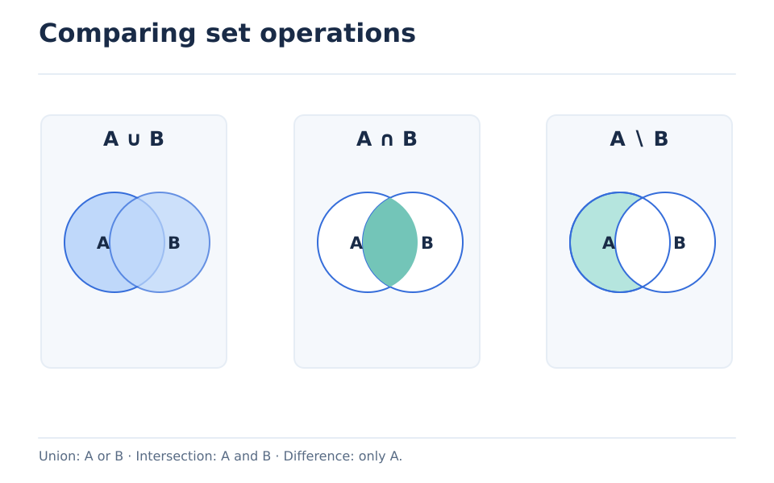

# M1-L1 – University: Sets, propositional logic and reasoning with proofs {#L1}

**Course area:** M1 – Bachelor’s: mathematical foundations

**Level:** Bachelor

**Prior knowledge:** No fixed prerequisites specified.

**Context:** Core university subject · mathematical foundations

## What is this about? {#S1}

At university, mathematics becomes a language of precise statements. It is not enough for a formula to work in a few examples: we want to know **which objects** it applies to and **why** it must hold. For this, we need sets as collections of objects, logic to connect statements and proofs as chains of justified deductions. The initial aim of this lesson is to read such texts, not to construct difficult proofs independently.

## Basic idea and intuition {#S2}

In programming, you are familiar with collections of data, conditions and type specifications. Mathematical logic adds a crucial requirement: every statement must make clear which objects are permitted, what claim is being made and which assumptions apply. A **counterexample** can disprove a universal claim. A **proof**, by contrast, explains why it holds in every permitted case.

## New symbols – be sure to read these before the formulas {#S3}

| Symbol | Name / pronunciation | Meaning here | Other use or potential pitfall |
| --- | --- | --- | --- |
| `{…}` | Curly braces | Enclose the elements of a set | Also used for blocks and objects in programs |
| $\in$ | ‘is an element of’ | An object belongs to a set | Not the same as a subset |
| $\notin$ | ‘is not an element of’ | An object does not belong to the set | Negation of membership |
| $\subseteq$ | ‘is a subset of’ | All elements on the left also occur on the right; equality allowed | Conventions for $\subset$ sometimes differ |
| $\subset$ | ‘is a proper subset of’ in this course | A subset, but not identical | In some textbooks $\subset$ also denotes a non-strict subset |
| $\cup$ | ‘union’ | Elements in the first or second set or both | Logical ‘or’ for sets |
| $\cap$ | ‘intersection’ | Elements in both sets | For events, joint occurrence |
| $\varnothing$ | ‘empty set’ | A set with no elements | Not the same as the number zero |
| $\mathbb{N}$, $\mathbb{Z}$, $\mathbb{R}$ | Natural numbers, integers, real numbers | Number systems from School Mathematics M1-L1 | Whether $0\in\mathbb{N}$ depends on convention |
| $\Rightarrow$ | ‘implies’ | Direction of inference from assumption to conclusion | Not automatically reversible |
| $\Leftrightarrow$ | ‘if and only if’ / ‘equivalent’ | Both directions hold | Not merely ordinary equality |
| $\land$ | ‘and’ | Both statements are true | `&&` in many programming languages |
| $\lor$ | ‘or’ | At least one of the statements is true | Usually inclusive or |
| $\neg$ | ‘not’ | Negation of a statement | `!` in many programming languages |
| $\forall$ | ‘for all’ | The statement holds for every object in the specified domain | Universal quantifier |
| $\exists$ | ‘there exists’ | At least one object satisfies the statement | Existential quantifier |
| $\exists!$ | ‘there exists exactly one’ | Unique existence | Do not confuse with the factorial symbol |
| `:` after a set variable | ‘with the property’ / ‘such that’ | Separates the domain of selection from the condition | In other contexts, division or ratio |
| $n$, $k$, $m$ | ‘en’, ‘kay’, ‘em’ | Integer indices or counting numbers in the proof | Other variables are also possible |
| $P$, $Q$, $R$; $P(x)$ | ‘pee’, ‘cue’, ‘ar’; ‘pee of ex’ | Statements; $P(x)$ is a statement about x | In probability theory, $P$ also stands for probability |

## Sets: what belongs to them? {#S4}

A **set** is a collection of clearly distinguishable objects, its **elements**. Order and repetition do not change the set.

$$
\begin{aligned}
A&=\{2,4,6\}\\
2&\in A\\
5&\notin A
\end{aligned}
$$

**Read in full:** ‘The set A contains the numbers two, four and six. Two is an element of A. Five is not an element of A.’ Objects can be numbers, strings, functions or even other sets.

Example of set operations:

$$
\begin{aligned}
A&=\{1,2,3\},\quad B=\{3,4\}\\
A\cap B&=\{3\}\\
A\cup B&=\{1,2,3,4\}
\end{aligned}
$$

**Read aloud:** ‘The intersection of A and B contains three; the union contains all numbers that occur in at least one of the two sets.’ Sets can also be defined by properties rather than by listing all their elements.

$$
M=\{x\in\mathbb{Z}:x>0\}
$$

**Read in full:** ‘M is the set of all integers x such that x is greater than zero.’ The curly braces describe the set; the colon here means ‘with the property’. Thus $M$ contains all **positive** integers, not zero or negative numbers.

**Important:** $2\in A$ refers to **a single element**; $\{2\}\subseteq A$ refers to **a set** that as a whole is a subset of A. These two statements are not interchangeable.

## Logical statements and connectives {#S5}

A mathematical statement is a sentence that – within the chosen model and with defined terms – is either true or false. ‘This number is large’ is too vague without a definition. ‘This number is greater than ten’, by contrast, can be checked for a given numerical value.

$$
\begin{aligned}
&(P\land Q)\implies R
\end{aligned}
$$

**Read aloud:** ‘If P and Q are both true, then R follows.’ $P$, $Q$ and $R$ denote statements, not necessarily numbers. An implication does not mean that $R\Rightarrow(P\land Q)$ also holds. In **classical propositional logic**, an implication ‘if P, then Q’ is false precisely when P is true and Q is false. It asserts neither a temporal sequence nor causation.

**Mini-example:** If a download is complete **and** the checksum matches, a program should mark the file as technically consistent. The real application requires additional security assumptions; mathematically, however, the condition describes an unambiguous logical test.

The logical expression $P\lor Q$ uses **inclusive or**: it is also true when both statements are true. $\neg P$ means ‘not P’. **Counterexample to the converse:** ‘If an integer is divisible by four, then it is even’ does **not** imply that every even number is divisible by four. The number six is even but not divisible by four.

## Quantifiers: does this always hold or at least once? {#S6}

The words ‘all’, ‘at least one’ and ‘exactly one’ are crucial in mathematics. Their position and order alter the meaning of a statement.

$$
\forall x\in\mathbb{R}:x^2\geq0
$$

**Read in full:** ‘For every real number x, x squared is greater than or equal to zero.’ This statement holds regardless of which real number we choose.

$$
\exists x\in\mathbb{R}:x^2=4
$$

**Read in full:** ‘There exists at least one real number x whose square is four.’ In fact, there are two possible values here, namely two and minus two. The existential quantifier $\exists$ does **not** say that the solution is unique. There is a separate symbol for that, $\exists!$.

**Order matters:** ‘For every user there is a password’ is not the same statement as ‘There is a password for all users’. Mathematics makes this difference visible through the order of the quantifiers. **Concrete countercheck:** For every number x in $\{1,2\}$ there is a number y in $\{1,2\}$ with $y=x$ (for $x=1$ choose $y=1$, for $x=2$ choose $y=2$). But there is **no single** number y in $\{1,2\}$ that equals both one and two. ‘For all x there is a y’ and ‘There is a y for all x’ must therefore not be interchanged.

An important negation rule expressed in words is: ‘Not everyone has the property’ means ‘There is at least one counterexample’. By contrast, ‘No one has the property’ means something stronger.

$$
\begin{aligned}
&\neg(\forall x\in M:\ P(x))\iff\exists x\in M:\ \neg P(x)
\end{aligned}
$$

**Read in full:** ‘It is not true that every element x of the set M has property P if and only if there is at least one element x that does not have property P.’ $P(x)$ here means that statement P holds for object x. The rule is valid in ordinary classical propositional logic. Within the same framework, the other negation also holds: ‘There is **no** x with $P(x)$’ is equivalent to ‘**All** x fail to satisfy $P(x)$’. On the **empty set**, a universal statement (for all elements) is true, whereas an existential statement (there is at least one) is false; there is no counterexample to the universal statement there.

## Relations and functions: connections between objects {#S7}

A **relation** describes which objects have a specified relationship, for example ‘is less than’. A **function** assigns **exactly one** output element to every permitted input element. Different inputs may have the same output value; the concept of a function does not automatically require invertibility.

$$
\begin{aligned}
&f\colon A\to B
\end{aligned}
$$

**Read aloud:** ‘f is a mapping from A to B.’ $A$ is the domain and $B$ the codomain. The arrow $\to$ here denotes a **mapping between sets**, not the limiting process from School Mathematics M2-L2. The actual image may be smaller than B.

**Mini-example:** $f(x)=x^2$ with real numbers as inputs and real numbers as the codomain is a valid function. The inputs two and minus two both produce four. On this domain there is therefore no unique inverse function, although every input has exactly one function value.

## What is a proof? {#S8}

A **definition** establishes what a word means. A **theorem** asserts a conclusion under specified assumptions. A **proof** shows, using traceable rules of inference, that the conclusion follows from the assumptions.

**Direct proof, as a principle:** The sum of two even integers is even. Every even integer can be written as twice an integer. For any two integers $m$ and $k$, the even starting numbers are $2m$ and $2k$; their sum is $2m+2k=2(m+k)$. Since $m+k$ is also an integer, we again obtain twice an integer. Thus the sum is even – not just in individual examples we have tested, but in general.

A **counterexample** is sufficient to disprove the claim ‘All prime numbers are odd’: the number two is an even prime. Many confirming examples, by contrast, do not constitute a complete proof of a universal statement.

Further proof principles that we will encounter again later:

- **Contradiction:** Temporarily assume the opposite and show that it is logically impossible.
- **Contraposition:** Instead of ‘If P, then Q’, prove the equivalent direction ‘If not Q, then not P’.
- **Mathematical induction:** Prove a base case and show that validity for one index implies validity for the next.

## Mathematical induction in an accessible example {#S9}

We consider the sum of the first $n$ positive integers. $n$ is a positive natural number; $k$ is a counting variable. The symbol $\sum$ (‘capital sigma’) from School Mathematics M2-L16 denotes the addition of individual contributions.

$$
1+2+\cdots+n=\frac{n(n+1)}{2}
$$

**Read in full:** ‘One plus two and so on up to and including n equals **n times the bracket n plus one, with that entire product divided by two**.’ The right-hand side is a compact formula for the sum on the left.

In the **base case** $n=1$, the left-hand side is one and the right-hand side is $\frac{1\cdot 2}{2}=1$. For the **induction step**, assume that the statement holds for an arbitrary positive number $n$. If we add $n+1$ to both sides, we obtain on the right:

$$
\frac{n(n+1)}{2}+(n+1)=\frac{(n+1)(n+2)}{2}
$$

**Read aloud:** ‘The product of n and the bracket n plus one, divided by two, and then plus the bracket n plus one, equals the product of the brackets n plus one and n plus two, all divided by two.’ Algebraically, we first factor out $n+1$: $(n+1)\cdot\left(\frac{n}{2}+1\right)=\frac{(n+1)(n+2)}{2}$. The right-hand side is precisely the claimed formula for the next number $n+1$. **Logical conclusion:** Since the base case at one holds and for every positive integer validity for n implies validity for $n+1$, the formula holds for **all positive natural numbers**. This is more than checking many numbers on a computer.

## What is it useful for? {#S10}

Logic and sets are the foundation of type systems, formal specifications, database queries and algorithm verification. Quantifiers distinguish precise statements such as ‘Every input has an output’ from stronger claims such as ‘One output is suitable for every input’. This language also helps distinguish permitted states, preconditions and verifiable guarantees in AI agents.

**Limitations:** Mathematical certainty applies only within the established definitions and assumptions. A correctly proved theorem about a simplified model does not automatically prove that the real world satisfies all the assumptions of that model.

## Assumptions and limitations {#S11}

The statements about set membership and quantifiers presuppose a **specified universe of discourse** and unambiguous definitions. The truth value of a quantified statement can change if its domain changes; an apparently general statement without a specified domain can therefore be ambiguous. The negation rules here are formulated in **classical logic**; other logical systems may require additional distinctions. A formula that holds in individual examples does not prove a statement about every element of its domain.

The mathematical induction shown here proves a formula for **positive natural numbers**. It cannot be transferred to any arbitrary set without additional structure. When applying this to software, we also distinguish the correctness of a formally proved specification from whether that specification fully reflects real requirements.

## Connection to M1-L2 {#S12}

In M1-L2 we apply this language to **sequences and series**. There we see how the familiar phrase ‘The values get closer and closer to a limit’ is translated into a precise statement using quantifiers.

## Sources {#S13}

No individual sources are listed separately in this lesson.
