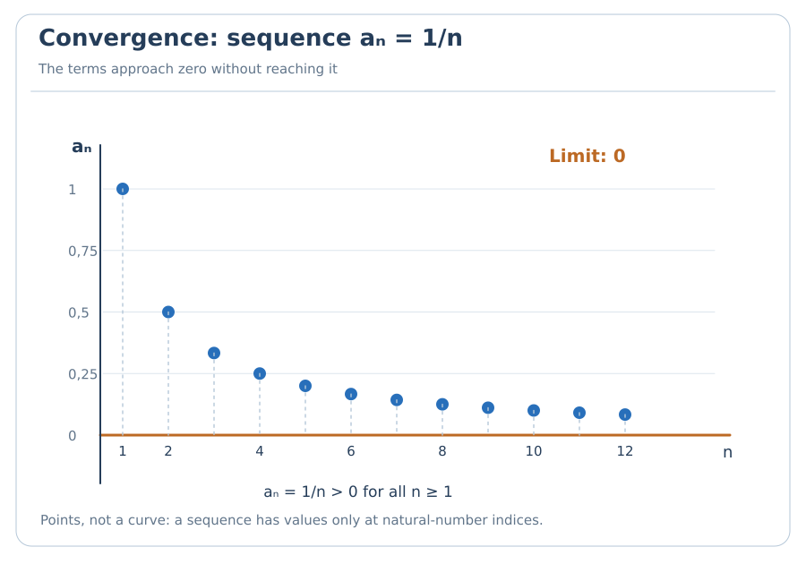

# M1-L2 – University: Analysis I – Sequences, series and convergence {#L2}

**Course area:** M1 – Bachelor’s: mathematical foundations

**Level:** Bachelor

**Prior knowledge:** No fixed prerequisites specified.

**Context:** Core university subject · foundations of analysis

## What is this about? {#S1}

An algorithm can keep calculating new approximations without ever reaching an exact ‘final’ step. In analysis, we ask whether such values nevertheless approach a fixed value and what ‘arbitrarily accurate’ really means. A **sequence** is an ordered list of numbers that can theoretically continue indefinitely. A **series** arises when we add the terms of a sequence one after another. The concept of a limit connects these ideas and allows us to distinguish finite calculations from idealised infinite processes.

## Basic idea and intuition {#S2}

Imagine a routine that halves the distance to a target after each iteration. The remaining distance becomes smaller: one half, one quarter, one eighth and so on. Although every individual value remains positive, there is no fixed positive threshold below which the sequence would eventually be unable to decrease further. This precise form of approach is called **convergence**.

## New symbols – read these first {#S3}

| Symbol | Name / pronunciation | Meaning here | Other use |
| --- | --- | --- | --- |
| $a_n$ | ‘a sub n’ | nth term of a sequence | More generally, the index can denote a measured value |
| $(a_n)$ | ‘the sequence a sub n’ | The entire ordered sequence | Brackets can also group expressions |
| $n\in\mathbb{N}$ | ‘n is an element of the natural numbers’ | Running positive index; starting point is specified | In some definitions $\mathbb N$ starts at zero |
| $n\to\infty$ | ‘n tends to infinity’ | The index grows without a fixed upper bound | $\infty$ is not a real number to substitute here |
| $\lim$ | ‘limit’ | Limit | Also used for limits of functions |
| $L$ | ‘el’ | Possible limit | Any other parameter |
| $\varepsilon$ | ‘epsilon’ | An arbitrary, strictly positive degree of accuracy | Error tolerance in applications |
| $N$ | ‘capital N’ | Threshold for the sequence index | Often also the set of natural numbers in a different typeface |
| $\forall$ / $\exists$ | ‘for all’ / ‘there exists’ | Quantifiers from M1-L1 | Formal logic in general |
| $\lvert a_n-L\rvert$ | ‘absolute value of a sub n minus L’ | Distance between the sequence term and the target value | Absolute value has a different geometric interpretation for complex numbers |
| $<$ | ‘less than’ | Strict bound | $\leq$ allows equality |
| $\sum$ | ‘capital sigma’ | Sum of terms of a series | Summation symbol in statistics |
| $k=1$ below $\sum$ | ‘k starts at one’ | Starting index of the addition | Other index bounds are possible |
| $s_n$ | ‘s sub n’ | nth partial sum | Other sequence notation is possible |
| $q$ | ‘cue’ | Constant factor of a geometric sequence | Any model parameter |
| $\lvert q\rvert$ | ‘absolute value of q’ | Positive distance from zero | Absolute value in general |
| $\sum$ | ‘sum’ | Typographical form of capital sigma | Identical in meaning to $\sum$ |
| `↛` | ‘does not converge to’ | Negates the stated limit | Not necessarily the only notation for divergence |

## Sequences: numbers with a running index {#S4}

A sequence assigns exactly one numerical value to every permitted integer index. It can be regarded as a function whose domain consists of natural numbers.

$$
a_n=\frac1n\qquad\text{for }n=1,2,3,\ldots
$$

**Read in full:** ‘a sub n is equal to one divided by n, for n equal to one, two, three and so on.’ The first terms are $1$, $\frac12$, $\frac13$ and $\frac14$. As the indices become larger, the value approaches zero.

$$
\lim_{n\to\infty}a_n=0
$$

**Read aloud:** ‘The limit of a sub n as n tends to infinity is zero.’ A limit does **not have to be a term of the sequence**. In this example, zero is never attained as a term, but the sequence approaches it arbitrarily closely.

A sequence can be **bounded** without converging. The alternating sequence $1,-1,1,-1,\ldots$, for example, always remains between minus one and one but has no limit. A sequence can also grow without bound: $a_n=n$ exceeds every specified real bound; it does not converge to a finite real number.

## What exactly does ‘arbitrarily close’ mean? {#S5}

The mathematical word **convergence** does not simply mean ‘usually gets smaller’. It requires the terms **to remain within every positive distance from the target value, however small, from a sufficiently late index onwards**.

First, the terminology: $\varepsilon$ (‘epsilon’) is an arbitrary permitted degree of accuracy, for example one hundredth. $N$ (‘capital N’) is a corresponding starting index. $n\geq N$ (‘n is greater than or equal to capital N’) means that we consider all subsequent terms from this point onwards.

$$
\forall\varepsilon>0\quad\exists N\in\mathbb{N}\quad\forall n\geq N:\ \lvert a_n-L\rvert<\varepsilon
$$

**Read in full:** ‘For every positive number epsilon, there exists a natural-number index N such that, for all **natural-number** indices n from N onwards, the distance between a sub n and the limit L is less than epsilon.’ Here the terms of the sequence are real numbers and $L$ is a fixed real number; the set of indices starts at one, as in the first sequence. The quantifier $\forall$ means ‘for all’, and $\exists$ means ‘there exists’; both were explained in M1-L1.

**N may depend on epsilon**, but it must not be chosen anew for each subsequent n. The order of the quantifiers is crucial. The tighter the required accuracy, the further along the sequence the corresponding index threshold may be.

**Mini-example:** For $a_n=\frac1n$ and target value $L=0$, we want to achieve $\lvert a_n-0\rvert<0.01$. This means $\frac1n<0.01$ or $n>100$. We can choose $N=101$: from the 101st term onwards, **all** subsequent values are below the tolerance of 0.01. At the 100th term, however, $\frac1{100}=0.01$, which does not yet satisfy the required **strict** inequality. In general, for every $\varepsilon>0$, it suffices to choose a positive integer $N$ **greater than $\frac1\varepsilon$**. Then for every $n\geq N$, we also have $\frac1n<\varepsilon$; convergence to zero has thus been shown for **every** positive tolerance.

## Monotonicity, boundedness and limits {#S6}

A sequence is called **monotonically increasing** if its terms never decrease, and **monotonically decreasing** if they never increase. ‘Strictly’ means that the change at each step is actually positive or negative, respectively.

The sequence $a_n=\frac1n$ has positive terms but converges to 0.

The sequence $a_n=\frac1n$ is strictly decreasing and bounded below by zero. A fundamental theorem of real analysis states: **Every monotone, bounded sequence of real numbers converges.** This is an important result concerning the completeness of the real numbers.

**Why can we trust this – idea of the proof?** For a monotonically increasing sequence that is bounded above, there is a least upper bound. The terms cannot remain a positive distance away from this bound indefinitely; otherwise, a smaller upper bound would be possible. For decreasing sequences, the corresponding argument uses a greatest lower bound. The precise justification relies on a fundamental property of $\mathbb{R}$, completeness.

**Limitation:** Monotonicity alone is not sufficient. The sequence $1,2,3,\ldots$ is strictly increasing but unbounded above; it has no finite real limit.

## Series: adding infinitely many terms {#S7}

A **series** is defined using the **partial sums** of a sequence. The nth partial sum contains only the first n terms – it is therefore an ordinary finite calculation.

$$
s_n=a_1+a_2+\cdots+a_n=\sum_{k=1}^{n}a_k
$$

**Read in full:** ‘The nth partial sum s sub n is a sub one plus a sub two and so on up to a sub n. This is the sum of the terms a sub k for k from one to n.’ $\sum$ (‘capital sigma’) denotes summation; $k$ is the running index and $n$ the upper bound.

An infinite series **converges** if the sequence of its partial sums has a finite limit.

$$
\sum_{k=1}^{\infty}a_k=\lim_{n\to\infty}s_n
$$

**Read aloud:** ‘The infinite sum of a sub k starting at k equal to one is the limit of the partial sums s sub n as n tends to infinity.’ The symbol $\infty$ means ‘infinity’ and here indicates the unbounded continuation of summation; we do not simply substitute an infinitely large number for it.

### Example: geometric series {#abschnitt-8}

When each term is multiplied by a fixed factor $q$ to obtain the next, a geometric sequence arises. For $\lvert q\rvert<1$, the series converges starting at index zero:

$$
1+q+q^2+q^3+\cdots=\frac1{1-q}\qquad\text{if }\lvert q\rvert<1
$$

**Read in full:** ‘One plus q plus q squared plus q cubed and so on equals one divided by one minus q, provided the absolute value of q is less than one.’

**Mini-example:** With $q=\frac12$, we obtain $1+\frac12+\frac14+\frac18+\cdots=2$. The partial sums $1$, $1.5$, $1.75$, $1.875$ approach two from below. This does not mean that any individual summand ever equals two.

**Idea of the proof:** For $q\ne 1$, the first $n+1$ terms (that is, $1+q+\cdots+q^n$) can be combined into $\frac{1-q^{n+1}}{1-q}$. We can verify this by multiplying the partial sum by $1-q$: the middle terms cancel each other out. For $\lvert q\rvert<1$, $q^{n+1}$ tends to zero. Therefore, $\frac1{1-q}$ remains in the limit. For $q=1$, by contrast, the sum of the first $n+1$ terms is $n+1$ and grows without bound. For $q=-1$, the partial sums alternate between one and zero. Overall, for $\lvert q\rvert\geq 1$ the infinite geometric series shown does not converge to a finite real value; for other values with $\lvert q\rvert>1$, there is likewise no finite real limit of the sums.

**Sign countercheck:** For $q=-\frac12$, the first partial sums are $1$, $\frac12$, $\frac34$, $\frac58$. They fluctuate around the limit $\frac1{1+\frac12}=\frac23$ and nevertheless approach it. **Monotonicity is not necessary for convergence.**

## Important: terms tending to zero are not enough {#S8}

A necessary condition for the convergence of a series is that its summands tend to zero. It is **not sufficient**: if the partial sums $s_n$ converge to a finite value, then the difference between two consecutive partial sums, namely the added summand $a_n$, must tend to zero. The converse does not follow.

The so-called **harmonic series** is:

$$
\begin{aligned}
&1+\frac12+\frac13+\frac14+\frac15+\ldots
\end{aligned}
$$

Its summands tend to zero, but its partial sums grow without a finite upper bound. **Justification by grouping:** After the first term, we can form groups $\left(\frac12\right)$, $\left(\frac13+\frac14\right)$, $\left(\frac15+\frac16+\frac17+\frac18\right)$ and so on. Each group has a value of at least $\frac12$, because the number of summands doubles each time, while every summand is at least as large as the last (smallest) one in its group. An unlimited number of such groups is added; the partial sums therefore cannot be bounded above by a fixed real number.

**Limitation of everyday intuition:** ‘Each new summand becomes tiny’ does not automatically mean ‘the total sum remains finite’. The rate of decay is crucial.

## Calculating with limits – subject to conditions {#S9}

When two real sequences converge to finite limits, we can also form their sums and products in the limit under the usual rules. For a quotient, the limit of the denominator must be **non-zero**, and the quotient must be defined for sufficiently late indices.

The situation is different for expressions in which, for example, ‘zero divided by zero’ appears merely as a limiting form. This is not an admissible division, but a signal that we must examine the limiting process more closely. Such cases are treated more systematically in advanced analysis lessons.

## What is it useful for? {#S10}

Sequences model iterative methods, for example the repeated improvement of an approximation to an equation. Series occur in filter calculations, number representations and the analysis of processes that can be continued indefinitely. In AI optimisation, convergence concerns whether a method stabilises and under what assumptions a sequence of model parameters or error values reaches a limit.

**Practical limitations:** A finite computer does not perform infinitely many steps and calculates with limited precision. Numerically observing ‘hardly any further change’ is not a proof of mathematical convergence; rounding, stagnation or a poorly chosen stopping criterion can also create this impression.

## Assumptions and limitations {#S11}

The statement ‘monotone and bounded implies convergent’ relies on the **completeness of the real numbers**; in other number systems, the theorem need not hold in the same form. Only for $\lvert q\rvert<1$ may a geometric series be replaced by $\frac1{1-q}$, if the sum of infinitely many terms is meant. For a **finite** sum, the appropriate partial-sum formula applies instead.

The epsilon–N definition describes **convergence of a real-valued numerical sequence**, not automatically the concept of convergence of a sequence of functions or a numerical program. Even if all terms are positive, we cannot claim without further justification that the sequence decreases monotonically; the counterexample with a negative geometric factor even exhibits a convergent but non-monotone sequence of partial sums. A computer checks only finitely many indices with finite precision; a single small numerical difference is not a proof of a limit. Likewise, sums, products and quotients may only be replaced by limits under the respective conditions.

## Connection to M1-L3 {#S12}

With the more precise idea of a limit, we can next give **continuity, derivatives and integrals more rigorous foundations**. M1-L3 develops the familiar ideas of analysis further without implicitly assuming more knowledge of symbols.

## Sources {#S13}

No individual sources are listed separately in this lesson.
