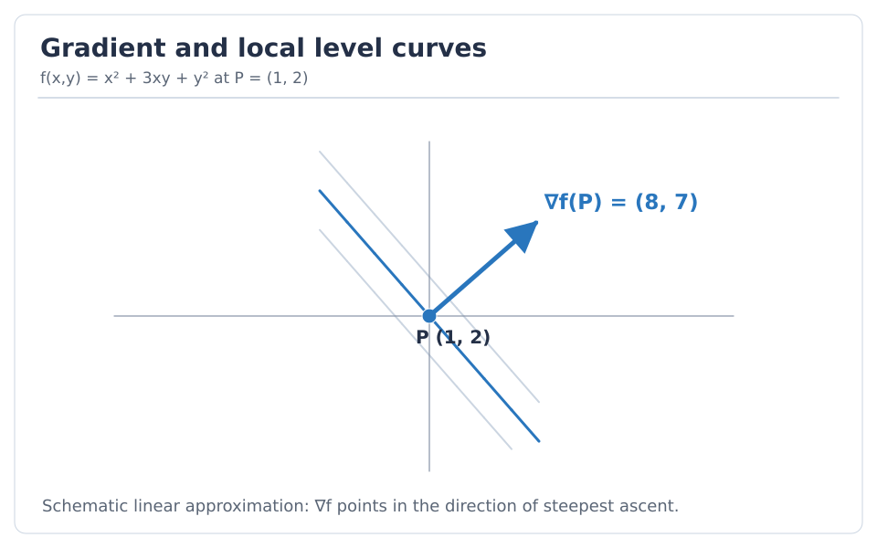

# M1-L4 – University: Analysis III – Functions of several variables {#L4}

**Course area:** M1 – Bachelor’s: mathematical foundations

**Level:** Bachelor

**Prior knowledge:** No fixed prerequisites specified.

**Context:** Core university subject · multivariable calculus

## What is this about? {#S1}

Many quantities in practice depend on more than one influencing variable. The temperature in a room, for example, varies with position; the running time of a service can depend on load and memory size. A single slope is not sufficient to describe such relationships. Instead, we ask how a result changes when we vary just one input, and in which direction it increases most rapidly overall. We can also sum values over surfaces and three-dimensional regions.

## Basic idea and intuition {#S2}

Imagine a landscape. Its elevation depends on how far you have travelled east and north. A separate rate of change can be calculated for each of the two coordinates: How steep is the slope towards the east when the north coordinate is held fixed? How steep is it towards the north when the east coordinate is held fixed? Together, these two values form a vector – the **gradient**. In ordinary plane geometry, it points locally in the direction of steepest ascent.

## New symbols – read these first {#S3}

| Symbol | Name / pronunciation | Meaning here | Other uses |
| --- | --- | --- | --- |
| $\mathbb{R}^2$ | “R two” or “real two-dimensional space” | Pairs of real inputs $(x,y)$ | A vector space in general |
| $f:\mathbb{R}^2\to\mathbb{R}$ | “f maps R two to R” | Function with two real inputs and one real output | The domain may be smaller |
| $(x,y)$ | “ordered pair x, y” | Position or pair of inputs | Also a pair of numbers in statistics |
| `∂` | “partial” or “partial d” | Derivative with respect to one input while the other is held fixed | Also in partial differential equations |
| $\frac{\partial f}{\partial x}$ | “partial derivative of f with respect to x” | Rate of change in the x-direction only | Distinguished from the ordinary derivative for functions of several variables |
| $\frac{\partial f}{\partial y}$ | “partial derivative of f with respect to y” | Rate of change in the y-direction only | Similarly for other inputs |
| `∇` | “nabla” | Operator that forms the gradient from the partial derivatives | Divergence and curl in vector calculus |
| $\nabla f$ | “gradient of f” | Vector of all first partial derivatives | More components for higher-dimensional inputs |
| $\vec{u}$ | “vector u” | Direction, ideally normalised to length one | u can otherwise be a scalar variable |
| $D_u f$ | “directional derivative of f in direction u” | Rate of change along u | Other notations are common |
| $\lVert\vec u\rVert$ | “norm of vector u” | Vector length | Norms other than the Euclidean norm are possible |
| `∫∫` / $\mathrm{d}x\,\mathrm{d}y$ | “double integral” / “d x d y” | Summation over an area, with a specified region of integration | Differential notation in iterated integrals |
| $Hf$ | “Hessian matrix of f” | Table of second partial derivatives | H can otherwise denote another operator |

Already familiar: $\cdot$ between vectors denotes the dot product (school mathematics M2-L11, in German); $t$ is used as a parameter for a path (school mathematics M2-L12, in German). In what follows, $f(x,y)$ is read as “f of x and y”. When a pair appears as the argument of a function, the comma separates the two inputs; it does not denote a decimal number.

## Partial derivative: only one variable changes {#S4}

Consider a model with two inputs:

$$
f(x,y)=x^2+3xy+y^2
$$

**Read aloud:** “f of x and y equals x squared plus three times x times y plus y squared.” If only $x$ changes, we treat $y$ as a constant. Similarly, when $y$ changes, the variable $x$ is held fixed.

$$
\begin{aligned}
\frac{\partial f}{\partial x}&=2x+3y\\
\frac{\partial f}{\partial y}&=3x+2y
\end{aligned}
$$

**Read aloud:** “The partial derivative of f with respect to x is two x plus three y; the partial derivative with respect to y is three x plus two y.” This follows from the differentiation rules already encountered, but for only one input at a time.

**Mini-example.** At the point $(1,2)$, the function value is $f(1,2)=1+6+4=11$. The partial derivatives there are $8$ in the x-direction and $7$ in the y-direction. These are **local rates of change**, not two new function values.

It is important to recognise that partial derivatives can exist even though a function as a whole is not continuous or not **totally differentiable** at a point. Total differentiability means that there is a linear approximation whose remainder, relative to the length of the change in input, tends to zero.

**Counterexample to a common misconception.** Define $g(x,y)=\frac{xy}{x^2+y^2}$ for $(x,y)\neq(0,0)$ and $g(0,0)=0$. Along both coordinate axes, $g$ is always zero; consequently, both partial derivatives at $(0,0)$ exist and are zero. However, if we approach along the line $x=y=t$ with $t\neq0$, then $g(t,t)=\frac12$ and does not tend to $g(0,0)=0$. The function is therefore not continuous at the origin and consequently is not totally differentiable there. **Two partial derivatives alone are not sufficient**. Our polynomial $f$, by contrast, is smooth everywhere and satisfies the stronger conditions.

## Gradient: local change as a vector {#S5}

In the Euclidean coordinate system, we write the partial derivatives as a vector:

{alt="Local linearised level curves around the point one, two, with the gradient vector eight, seven drawn perpendicular to them."}

At the point (1, 2), $\nabla f=(8,7)$ is perpendicular to the linearised level curve.

$$
\nabla f(x,y)=\left(\frac{\partial f}{\partial x},\frac{\partial f}{\partial y}\right)
$$

**Read aloud:** “The gradient of f is the vector whose first component is the partial derivative with respect to x and whose second component is the partial derivative with respect to y.” In our example, this gives $\nabla f(1,2)=(8,7)$ at the point $(1,2)$.

If $f$ is totally differentiable, a **non-zero gradient** is perpendicular to a smooth **level curve** – a curve along which the function has the same value. With ordinary Euclidean measurement of length, the gradient points in the direction of steepest local ascent. If the gradient is zero, all unit directions initially have the same directional derivative, zero; no particular direction of ascent can then be inferred from the gradient. The direction opposite to a non-zero gradient gives the steepest local descent.

For a **unit vector** $\vec{u}$ whose norm is $1$, the directional derivative of a differentiable function is:

$$
D_u f=\nabla f\cdot\vec{u}
$$

**Read aloud in full:** “The directional derivative in direction u is the dot product of the gradient and the unit vector u.” For $\vec{u}=(\frac35,\frac45)$, the length is indeed one. Thus the **local directional derivative** in the example is $(8,7)\cdot(\frac35,\frac45)=\frac{24}{5}+\frac{28}{5}=\frac{52}{5}=10.4$ units of function value per unit of length in this direction. This is not the finite change resulting from a large movement. For comparison, the greatest possible increase per Euclidean unit of length is $\lVert\nabla f(1,2)\rVert=\sqrt{8^2+7^2}=\sqrt{113}\approx10.630$; $10.4$ is below this value. `√` denotes the square root. Equality holds for a unit vector pointing in the direction of the gradient.

## Multivariable chain rule: change along a path {#S6}

Sometimes both inputs change simultaneously, for example when a robot follows a trajectory. In that case, we cannot use just the x-derivative or just the y-derivative. If we denote the path by $(x(t),y(t))$, then, assuming differentiability, we obtain:

$$
\frac{\mathrm{d}}{\mathrm{d}t}f(x(t),y(t))=\frac{\partial f}{\partial x}\cdot x^{\prime}(t)+\frac{\partial f}{\partial y}\cdot y^{\prime}(t)
$$

**Read aloud:** “The time derivative of the composite function is the partial derivative with respect to x times the velocity in the x-direction, plus the partial derivative with respect to y times the velocity in the y-direction.” $\frac{\mathrm{d}}{\mathrm{d}t}$ means the ordinary derivative with respect to the time variable $t$, and the prime marks `′` denote the corresponding derivatives. Both partial derivatives are evaluated at the current position along the path.

**Mini-example.** For the function $f$ above, choose $x(t)=t$ and $y(t)=t^2$. At $t=1$, the path is at the point $(1,1)$; the gradient there is $(5,5)$. Since $x^{\prime}(1)=1$ and $y^{\prime}(1)=2$, the **instantaneous rate of change with respect to time** is $5\cdot1+5\cdot2=15$. The number 15 is not a function value or the total change over a time interval. Direct substitution gives $f(t,t^2)=t^2+3t^3+t^4$; its ordinary derivative is $2t+9t^2+4t^3$, which also equals $15$ at $t=1$.

## Double integral: summing over more than a line {#S7}

An integral over an area can be used, for example, to sum a density, a temperature or an elevation function over a region. For a rectangle, the integral can be calculated in one coordinate at a time, provided the appropriate conditions are satisfied.

$$
\int_0^1\int_0^1(x+y)\,\mathrm{d}y\,\mathrm{d}x=1
$$

**Read aloud:** “First integrate x plus y with respect to y from zero to one, then integrate the result with respect to x from zero to one; the total value is one.” First, $x$ is constant and the inner integral gives $x+\frac12$. The outer integral gives $\frac12+\frac12=1$.

For continuous functions on closed rectangles, the order of integration may be reversed accordingly (an appropriate special case of Fubini's theorem). In our example, the reverse order also gives $\int_0^1\int_0^1(x+y)\,\mathrm{d}x\,\mathrm{d}y=1$: first we obtain $\frac12+y$, and then again $1$. For non-rectangular regions, the limits often depend on the other variable; when reversing the order, these limits must be rewritten correctly.

## Second derivatives and local curvature – outlook {#S8}

The **Hessian matrix** collects the second partial derivatives of a sufficiently smooth function. It helps to assess curvature in different directions and thus, for example, to classify stationary points in optimisation problems.

For our example function:

$$
\begin{aligned}
Hf&=\begin{bmatrix}2&3\\3&2\end{bmatrix}
\end{aligned}
$$

The entries $2$ and $2$ result from differentiating twice with respect to the same coordinate; the two entries $3$ are the mixed derivatives. If the second partial derivatives are continuous in a neighbourhood, the two mixed derivatives agree (Schwarz's theorem); the Hessian matrix is then symmetric. This condition is satisfied for the polynomial. At the point $(0,0)$, the gradient is zero, yet there is **no minimum**: along the direction $x=y=t$, the function value $5t^2$ is positive, whereas along $x=t,\ y=-t$, the value $-t^2$ is negative. Such a point is called a **saddle point**. Here the determinant of the Hessian matrix also indicates mixed curvature: $2\cdot2-3\cdot3=-5<0$. The matrix therefore has eigenvalues of opposite signs; the stationary point is a strict saddle point. This second-derivative test requires a sufficiently smooth function and applies to an **interior stationary point**. Once again, we see that a vanishing first derivative alone does not establish whether there is an extremum.

## What is it useful for? {#S9}

In neural networks, every model error depends on many parameters; the gradient assigns a local rate of change to each parameter, making gradient-based methods possible. In robotics and computer graphics, partial derivatives describe changes in surfaces, trajectories and coordinate transformations. Double integrals give, for example, the total mass of a surface from its surface density, or the probability of a two-dimensional region given a joint density.

## Assumptions and limitations {#S10}

- A partial derivative initially considers only one coordinate direction; its existence alone guarantees neither continuity nor total differentiability.
- Interpreting the gradient as the direction of steepest ascent requires a specified geometry or norm; the Euclidean one is customary.
- Expressing a directional derivative as a dot product requires differentiability. Without a normalised direction vector, the rate of change is scaled differently.
- Integration over a region requires limits and – depending on the theorem – suitable conditions such as continuity or integrability.
- In numerical optimisation, the gradient can be zero even though no minimum has been found.

## Connection to the next lesson {#S11}

The rates of change of several variables are vectors; their composition is described using matrices. **M1-L5** therefore first clarifies what vector spaces, bases and linear maps actually are.

## Sources {#S12}

No individual sources are listed separately in this lesson.
