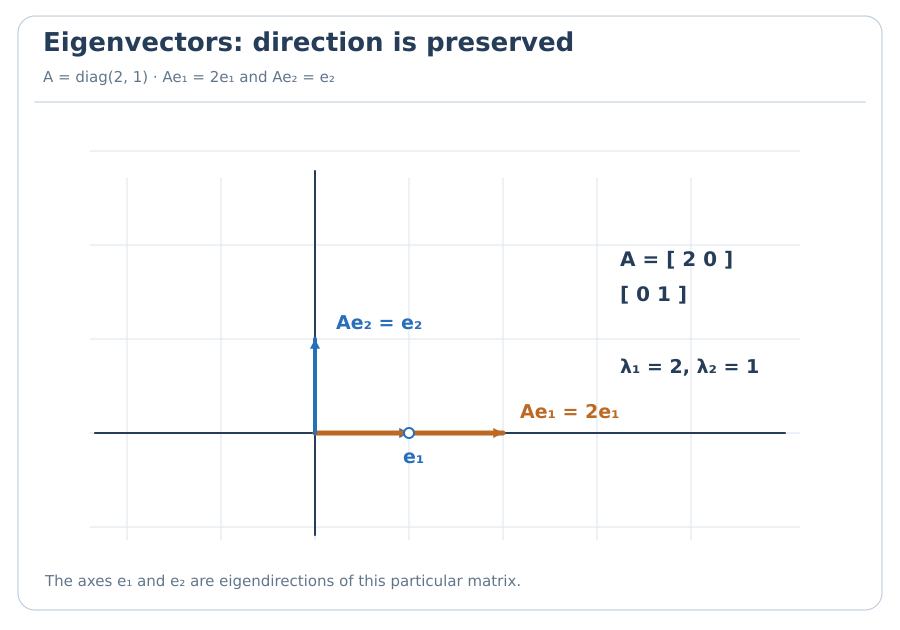

# M1-L6 – University: Linear algebra II – Rank, determinants and eigenvalues {#L6}

**Course area:** M1 – Bachelor’s: mathematical foundations

**Level:** Bachelor

**Prior knowledge:** No fixed prerequisites specified.

**Context:** Core university subject · linear algebra II

## What is this about? {#S1}

In M1-L5 we learnt that a matrix describes a linear transformation in chosen bases. We now investigate this transformation in more detail. **Rank** tells us how many independent output directions are preserved. The **determinant** of a square matrix helps us identify whether a transformation collapses an area or volume to zero. **Eigenvectors** are special directions that remain on the same line under the transformation; the corresponding **eigenvalue** tells us how they are scaled or reversed. These properties help us understand large models without having to try every individual input separately.

## Basic idea and intuition {#S2}

Imagine a sheet of squared paper being stretched, reflected or compressed. After ordinary stretching, a square becomes a parallelogram: the sheet still has two independent directions. If the entire sheet collapses onto a single line, a dimension is lost. There are often directions that remain on the same straight line during deformation: these are eigendirections. In higher-dimensional datasets, this corresponds to loss of information or particular amplification of certain combinations of features.

## New symbols – before the formulas {#S3}

| Symbol | Name / pronunciation | Meaning in this lesson | Other possible uses |
| --- | --- | --- | --- |
| $A$ | “matrix A” | Table of numbers representing the linear transformation | Area, event or set in other chapters |
| $\operatorname{rang}(A)$ or $\operatorname{rank}(A)$ | “rank of A” | Number of linearly independent columns or rows | `rank` in code may refer to a ranking |
| $\det(A)$ | “determinant of A” | Single number associated with a **square** matrix | Also $\lvert A\rvert$ in some books; beware of absolute value/cardinality |
| $\lambda$ | “lambda” | Eigenvalue; a number, possibly complex | Parameter or scaling factor |
| $\vec{v}$ | “vector v” | Non-zero eigenvector | General vector from M1-L5 |
| $A\cdot\vec v$ | “A times vector v” | Matrix-vector product | Not the multiplication of two ordinary numbers |
| $I$ | “identity matrix I” | Matrix that leaves vectors unchanged | The letter I may also be an index |
| $\vec{0}$ | “zero vector” | Vector whose components are all zero | Not the same kind of object as the number 0 |
| `≠` | “not equal” | Inequality, e.g. $\vec v\ne\vec0$ | General comparison symbol |
| $A^{-1}$ | “A to the power of minus one”, inverse matrix | Inverse transformation for an invertible matrix | For numbers, the power minus one means reciprocal |
| $\operatorname{diag}(\ldots)$ | “diagonal matrix with &#46;&#46;&#46;” | Numbers only on the main diagonal | Also a utility function in programs |
| `⊥` | “perpendicular to”, orthogonal | Dot product zero in ordinary Euclidean space | Geometric perpendicularity |
| $\ker(A)$ | “kernel of A” | Input vectors that A maps to the zero vector | Kernel of general linear transformations as well |
| $\dim$ | “dimension” | Number of basis vectors of a space | In computer science may refer to the shape of an array |
| $P$, $D$ | “matrix P”, “diagonal matrix D” | Eigenvector columns and corresponding eigenvalues | P denotes probability in M1-L7 |

The letters $m$ and $n$ denote the numbers of rows and columns of a matrix, respectively. An $m\times n$ matrix has $m$ rows and $n$ columns. The identity matrix $I$ has the same square dimensions as $A$ when both are combined in a formula. Eigenvalues may be complex even for real matrices; we begin with examples that have real eigenvalues.

## Rank: how many independent directions remain? {#S4}

The columns of a matrix describe the images of the standard basis vectors. The **rank** is the dimension of the space spanned by these columns. It is also the maximum number of linearly independent rows. For a matrix with $m$ rows and $n$ columns, the rank cannot exceed the smaller of these numbers.

**Mini-example: a projection onto a line.**

$$
\begin{aligned}
B&=\begin{bmatrix}1&2\\2&4\end{bmatrix}
\end{aligned}
$$

The second column $(2,4)$ is twice the first $(1,2)$. There is therefore only **one** independent column direction: $\operatorname{rank}(B)=1$. The transformation can reach only points on a straight line in the target space. Some input information is lost in the process. For example, $B\cdot(-2,1)=(0,0)$: two inputs that differ by $(-2,1)$ have the same image. The kernel therefore contains more than just the zero vector. For a linear transformation from an $n$-dimensional space, the **rank-nullity theorem** states: $\dim\ker(A)+\operatorname{rank}(A)=n$. Here we obtain $1+1=2$.

By comparison, the identity matrix of the plane has two independent columns; its rank is two. Rank also provides the basis for determining whether systems of linear equations are solvable: if the coefficient matrix and the matrix augmented by the right-hand side have the same rank, the system is solvable. For a unique solution, this rank must additionally equal the number of unknowns. These conditions apply to linear systems over a field, here the real numbers. **Countercheck:** for $B\cdot(x,y)=(1,0)$ the augmented matrix has rank two, but the coefficient matrix has rank only one: the system has no solution. For $B\cdot(x,y)=(1,2)$ both ranks equal one; there are infinitely many solutions because there are two unknowns and only one independent equation.

## Determinant: is area or volume collapsed? {#S5}

In the usual sense, the determinant is defined only for **square matrices**. For a $2\times2$ matrix with entries $a,b$ in the first row and $c,d$ in the second row, the calculation is:

$$
\begin{aligned}
A&=\begin{bmatrix}a&b\\c&d\end{bmatrix}\\
\det(A)&=a\cdot d-b\cdot c
\end{aligned}
$$

**Read aloud:** “The determinant of A is a times d minus b times c.” Each letter here names the entry at a fixed position in the matrix. The absolute value $\lvert\det(A)\rvert$ gives the **area scaling factor** of a linear transformation in the plane, or the corresponding volume scaling factor in three dimensions. A negative sign indicates reversal of orientation.

For the matrix $B$ shown above, $\det(B)=1\cdot4-2\cdot2=0$. A square can therefore shrink to a line segment with zero area. It follows that $B$ is not invertible. **For square matrices:** a non-zero determinant, full rank and the existence of an inverse matrix are equivalent properties.

A large or small determinant alone, however, does **not** tell us whether a numerical calculation is stable: very different scaling factors can cancel each other out in the determinant. We examine numerical *conditioning* in M1-L8. Example: $\operatorname{diag}(1000000,\;0.000001)$ has determinant $1$, but a condition number of $10^{12}$ in the Euclidean norm. An area scaling factor of one therefore does not rule out an extremely sensitive direction.

## Eigenvectors: directions that remain directions {#S6}

An eigenvector is a non-zero vector whose image under a square matrix lies on the same straight line. The eigenvalue is the corresponding scaling factor.

{alt="Matrix A with diagonal entries two and one: e1 is scaled to 2e1, e2 remains e2."}

Eigenvectors retain their direction; in this example the eigenvalues are 2 and 1.

$$
A\vec{v}=\lambda\vec{v}\qquad\text{with }\vec{v}\neq\vec{0}
$$

**Read aloud:** “Matrix A times vector v equals lambda times vector v, where v is not the zero vector.” The factor $\lambda$ may be positive, negative or zero. If $\lambda=0$, the eigenvector is mapped to the zero vector; this is possible for a singular matrix. Its original line is an eigenspace, even though the zero vector itself has no direction. The term **eigendirection**, when the image is non-zero, means the line determined by a real eigenvector.

**Worked mini-example – two particularly simple directions.**

$$
\begin{aligned}
A&=\begin{bmatrix}2&1\\1&2\end{bmatrix}\\
A\cdot(1,1)&=(3,3)=3\cdot(1,1)\\
A\cdot(1,-1)&=(1,-1)=1\cdot(1,-1)
\end{aligned}
$$

The direction $(1,1)$ is scaled by a factor of three; its eigenvalue is $3$. The direction $(1,-1)$ remains unchanged; its eigenvalue is $1$. We have thus found the two real eigenvalues and corresponding eigenvectors. The rank of $A$ is two and the determinant is $2\cdot2-1\cdot1=3$. This agrees with the product of the two eigenvalues $3\cdot1=3$.

## How do we find eigenvalues systematically? {#S7}

The eigenvalue equation can be rearranged: $A\cdot\vec v-\lambda\cdot\vec v=\vec0$. Since $I\cdot\vec v=\vec v$, we write $(A-\lambda I)\cdot\vec v=\vec0$. For a square matrix, a non-zero solution is possible if and only if the corresponding determinant is zero.

$$
\det(A-\lambda I)=0
$$

**Read aloud:** “The determinant of A minus lambda times the identity matrix equals zero.” This is called the **characteristic equation**. In our example it becomes ${(2-\lambda)}^2-1=0$, hence $\lambda^2-4\lambda+3=(\lambda-1)(\lambda-3)=0$ and therefore $\lambda=1$ or $\lambda=3$. For $\lambda=3$, solving $(A-3I)\cdot\vec v=\vec0$ gives the condition $v_1=v_2$; for $\lambda=1$ it gives $v_1=-v_2$. In general, the system of linear equations $(A-\lambda I)\cdot\vec v=\vec0$ must be solved for each eigenvalue. Each eigenvector can be scaled by any **non-zero** number.

## Diagonalisation and limitations of the method {#S8}

If an $n\times n$ matrix has $n$ linearly independent eigenvectors, these can be assembled into a matrix $P$. With the diagonal matrix $D$ of corresponding eigenvalues we have:

$$
A=P\cdot D\cdot P^{-1}
$$

**Read aloud:** “A equals P times D times the inverse of matrix P.” This representation simplifies repeated matrix multiplication, because powers of a diagonal matrix are calculated component by component. **Not every matrix is diagonalisable.** Counterexample: $J=\begin{pmatrix}1&1\\0&1\end{pmatrix}$ has only the eigenvalue $1$ (counted twice), but $(J-I)\cdot(x,y)=(y,0)$ requires $y=0$. There is therefore only **one** independent eigenvector direction; an invertible eigenvector matrix P with two columns is impossible. A real symmetric matrix such as our example, by contrast, has an orthonormal basis of real eigenvectors, that is, pairwise perpendicular unit vectors, and is particularly easy to work with. Non-symmetric matrices may have complex eigenvalues or incomplete systems of eigenvectors.

## What is it useful for? {#S9}

- **PCA and data analysis:** Eigenvectors of a suitably calculated covariance matrix describe directions of variation; the eigenvalues quantify the corresponding variance. This requires appropriate data preprocessing.
- **Dynamical systems and robotics:** Eigenvalues of system matrices provide information about stability and the behaviour of repeated state transitions; for discrete linear systems, their absolute values are particularly relevant.
- **Image processing and AI:** Matrix rank, compression and low-dimensional approximations help identify redundant data directions. In practice, singular value decomposition (SVD) is often used instead of direct eigendecomposition.

## Assumptions and common misinterpretations {#S10}

- An **eigenvector must not be the zero vector**; otherwise the equation would be trivially satisfied for any lambda.
- An **eigenvalue of zero**, by contrast, is explicitly possible and indicates a loss of information for square matrices.
- Only square matrices have eigenvalues in the sense used here; for rectangular matrices, **singular values** are often the more appropriate tool.
- The determinant is not a general measure of computational accuracy. In particular, an invertible matrix can be numerically very poorly conditioned.
- Mathematical linear independence is defined exactly. With rounded data, a numerical algorithm often determines an *effective* rank only on the basis of a tolerance.

## Connection to the next lesson {#S11}

M1-L7 moves from deterministic transformations to uncertain quantities: probability distributions, expected value, conditional information and statistical inference. Later we combine the two, for example in the covariance matrix and in AI models.

## Sources (external) {#S12}

No external sources listed.
