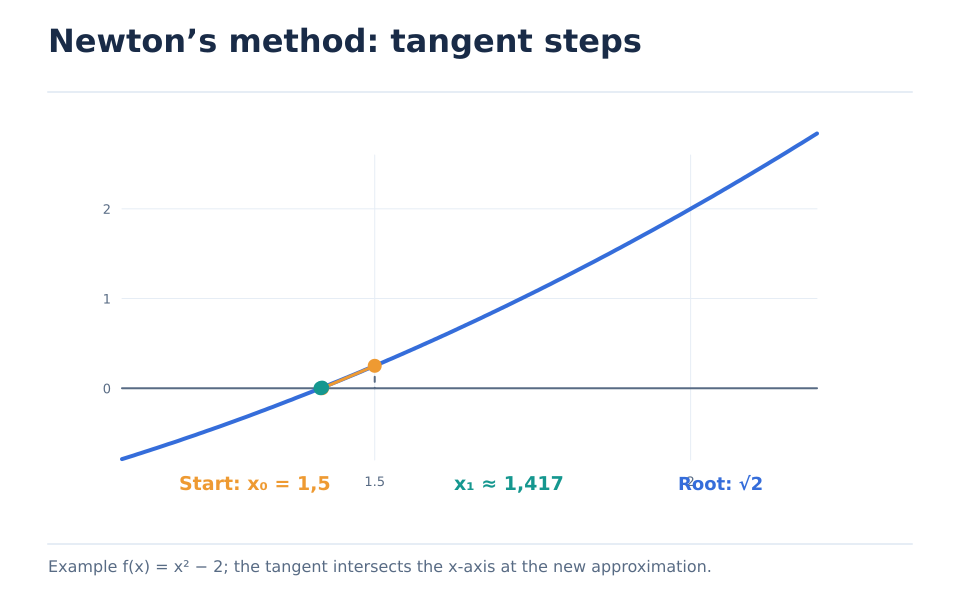

# M1-L8 – University: Numerical and computational mathematics {#L8}

**Course area:** M1 – Bachelor’s: mathematical foundations

**Level:** Bachelor’s

**Prior knowledge:** No fixed prerequisites specified.

**Context:** Core university subject · Numerical mathematics

## What is this about? {#S1}

Mathematical formulas work conceptually with exact numbers. A computer, by contrast, has a finite number of bits, limited memory and finite computing time. Many results must therefore be obtained **approximately**. Numerical mathematics develops methods for doing this and investigates when the calculated approximation can be trusted. It distinguishes between two problems: a mathematical problem may be sensitive even to small changes in its inputs; in addition, the chosen algorithm itself may amplify errors. This distinction is central to robust software, simulation and AI.

## Basic idea and intuition {#S2}

Imagine that you are looking for the square root of two. The exact number has infinitely many non-repeating decimal places; a computer can store only a finite representation. It must approach the solution step by step or use a built-in algorithm. What matters is not simply that many decimal places appear, but **how large the actual error may still be**. A good numerical method can explain and measure its approximation and provide safeguards against rounding problems.

## New symbols – before they are used {#S3}

| Symbol | Name / pronunciation | Meaning here | Other uses |
| --- | --- | --- | --- |
| $x^{\ast}$ | ‘x star’ | Exact solution sought | Often an optimal solution in optimisation |
| $x_k$ | ‘x sub k’ | Approximation after the k-th step | General sequence index |
| $k$ | ‘k’ | Iteration number | Also a constant in geometry |
| $f(x)$ | ‘f of x’ | Function whose root is sought | General function |
| $f^{\prime}(x)$ | ‘f prime of x’ | Derivative for Newton’s method | Local rate of change |
| $\epsilon$ | ‘epsilon’ | A chosen error tolerance | An arbitrarily small positive number in formal limits |
| $\approx$ | ‘approximately equal to’ | Approximate rather than exact value | General approximation symbol |
| $\lvert e\rvert$ | ‘absolute value of e’ | Non-negative magnitude of an error | Elsewhere, $e$ denotes Euler’s number |
| $\lVert\vec r\rVert$ | ‘norm of r’ | Magnitude of an error or residual vector | Different norms are possible |
| $\kappa(A)$ | ‘kappa of A’ | Condition number of a matrix in a chosen norm | Kappa may denote an arbitrary parameter |
| $\Delta x$ | ‘delta x’ | Change in or perturbation of an input | Finite difference in differentiation |
| $O(h^p)$ | ‘big O of h to the power p’ | Order of error for a small step size h | Computer science: similar notation for running-time growth |
| $A\cdot\vec x=\vec b$ | ‘matrix A times vector x equals vector b’ | System of linear equations | Vectors and matrices from M1-L5–M1-L6 |
| $\vec r=\vec b-A\cdot\vec x$ | ‘r equals b minus A times x’ | Residual of an approximation | Not identical to the solution error |
| `MC` | ‘Monte Carlo’ | Estimation by random sampling | Not a mathematical symbol in the strict sense |
| $h$ | ‘h’ | Positive step size in a discretisation | Also a variable for height |
| $p$ | ‘p’ | Positive order of error in $O(h^p)$ | Probability in M1-L7 |
| $n$ | ‘n’ | Number of independent simulations | Also the number of columns in matrices |
| $\lVert A^{-1}\rVert$ | ‘norm of the inverse of matrix A’ | Amplification factor for a linear residual when the matrix is invertible | The norm must be specified |

The star in $x^{\ast}$ is merely a **distinguishing label**: it does not mean multiplication. A subscript such as $k$ identifies the step in an iterative sequence. The norm used – for instance, Euclidean length – must be specified when comparing errors.

## Why a computer calculates differently from calculations on paper {#S4}

A binary floating-point number stores a sign, a finite sequence of significant bits and an exponent. Many simple decimal fractions, including $0{,}1$, have no finite representation in binary. In a common binary floating-point format, for example, `0.1 + 0.2` in a program may produce a value that is not bit-for-bit identical to the stored approximation of `0.3`. This does not disprove mathematics; it is a consequence of differently rounded machine values.

The order of operations can matter because of rounding. For floating-point numbers, the associative law of ordinary real addition does not hold in every machine calculation. When values differ greatly in magnitude, small summands can be lost entirely. An equally important risk is **cancellation** (*catastrophic cancellation*), when nearly equal numbers are subtracted, leaving few meaningful digits.

**Mini-example of a more stable rearrangement:** The mathematical expression $\sqrt{x^2+1}-x$ can be difficult to evaluate accurately for large positive $x$ because the two terms are nearly equal. Multiplying by the appropriate conjugate factor produces the exactly equivalent expression $\frac{1}{\sqrt{x^2+1}+x}$. It avoids this particular subtraction of nearly equal numbers. In real software, overflow when calculating $x^2$ must also be avoided, for example by using an appropriately robust square-root/hypotenuse routine. **Limitation:** For very large **negative** $x$, cancellation can now occur in the denominator $\sqrt{x^2+1}+x$. The rearranged version is therefore particularly favourable for **large positive** $x$, rather than universally superior.

## Error, residual and conditioning {#S5}

The difference between an approximation $x_k$ and the exact solution $x^{\ast}$ is called the **solution error**; for a scalar quantity, we consider its absolute magnitude:

$$
\text{absolute error}=\lvert x_k-x^*\rvert
$$

**Read aloud:** ‘The absolute error is the absolute value of x sub k minus x star.’ In many real problems, the exact solution is unknown; we therefore **cannot calculate the actual error directly**.

For an equation $f(x)=0$, the **residual** is the value $f(x_k)$, which has not yet reached zero. A small residual does not necessarily imply a small solution error. Example: For $f(x)=0{,}000001\cdot(x-100)$, the point $x=0$ has a residual of only $-0{,}0001$, although the exact root is 100 and the solution error is therefore 100. A tiny slope makes root finding sensitive. For an **invertible** linear system $A\cdot\vec x=\vec b$, the approximation $\vec x_k$ and the residual $\vec r=\vec b-A\cdot\vec x_k$ satisfy the exact relation $\vec x-\vec x_k=A^{-1}\cdot\vec r$. Hence the bound $\lVert\vec x-\vec x_k\rVert\leq\lVert A^{-1}\rVert\cdot\lVert\vec r\rVert$ follows for compatible vector and induced matrix norms. Without knowing or estimating the amplification factor, a small residual provides no general error guarantee.

**Conditioning** describes this sensitivity of the mathematical problem to its inputs. **Stability** describes how well an algorithm handles unavoidable perturbations and rounding errors. For matrix equations, very large condition numbers are a warning sign: even small data errors or rounding errors can lead to markedly different solutions. Merely checking the determinant provides no general guarantee here. **Numerical counterexample:** $A=\operatorname{diag}(1000000,\ 0{,}000001)$ has determinant $1$. In the Euclidean norm, however, the condition number is $\kappa(A)=\frac{1000000}{0{,}000001}=10^{12}$. A perturbation in the second, small-scale coordinate can therefore be substantially amplified in relative terms, even though the determinant appears unremarkable.

## Nested intervals: safely bracketing a root {#S6}

We seek the positive solution of $x^2=2$. To do this, we consider the function $f(x)=x^2-2$. It is continuous. Since $f(1)=-1$ and $f(2)=2$ have opposite signs, the intermediate value theorem ensures that a root lies between 1 and 2.

The **bisection method** halves this interval and retains the half whose endpoints have opposite signs:

$$
\begin{aligned}
&\begin{array}{lll}
\text{Start: }[1;2]&f(1)=-1,\quad f(2)=2&\\
\text{Midpoint: }1{,}5&f(1{,}5)=0{,}25&\to[1;1{,}5]\\
\text{Midpoint: }1{,}25&f(1{,}25)=-0{,}4375&\to[1{,}25;1{,}5]\\
\text{Midpoint: }1{,}375&f(1{,}375)=-0{,}109375&\to[1{,}375;1{,}5]
\end{array}
\end{aligned}
$$

**Read aloud:** ‘We halve the interval, evaluate the function at its midpoint and retain the half in which the sign changes.’ After three halvings, the remaining interval has width $0{,}125$ instead of its original width of $1$. In the exact mathematical model, the root sought still lies within it. The midpoint of the remaining bracket then has an absolute error of at most half the interval width. **This guaranteed enclosure initially assumes exact sign decisions.** In an ordinary floating-point implementation, rounding errors may even distort the calculated sign; anyone seeking to guarantee a *rigorous* enclosure needs suitable error bounds or outward-rounded interval arithmetic. A sensible stopping criterion is also needed. Given an initial interval width $b-a$ and $k$ halvings, the width is $\frac{b-a}{2^k}$, so the error bound for the midpoint is at most $\frac{b-a}{2^{k+1}}$, **provided** that the enclosure remains valid after every step. For $[1,2]$, an error of at most $\frac1{16}=0{,}0625$ is therefore guaranteed after three steps. The method thus finds a root in the interval; uniqueness does not follow from the change of sign alone.

## Newton’s method: obtaining the next approximation from a tangent {#S7}

Newton’s method replaces the function locally with its tangent and uses the tangent’s intersection with the x-axis as the new estimate:

{alt="Tangent iteration for the root of x² minus 2"}

$$
x_{k+1}=x_k-\frac{f(x_k)}{f\prime(x_k)}
$$

**Read aloud:** ‘The next approximation, x sub k plus one, is the current approximation, x sub k, minus the function value divided by the derivative at the current approximation.’ $f^{\prime}$ is the first derivative, explained in School Mathematics M2-L3–School Mathematics M2-L4. Division by zero is not allowed; the derivative must be defined and non-zero at the current point.

For $f(x)=x^2-2$, we have $f^{\prime}(x)=2x$. Starting at $x_0=1{,}5$, we obtain:

$$
\begin{aligned}
x_1&=1{,}5-\frac{{(1{,}5)}^2-2}{2\cdot1{,}5}=1{,}416666\ldots\\
x_2&=1{,}416666\ldots-\frac{{(1{,}416666\ldots)}^2-2}{2\cdot(1{,}416666\ldots)}
\approx1{,}414215686
\end{aligned}
$$

The actual positive root is approximately $1{,}414213562$. With a good starting value, Newton’s method is considerably faster than bisection here. However, Newton’s method does **not** guarantee convergence from every starting value. It can jump far away, become cyclic or fail because of an unsuitable derivative. In robust applications, numerical libraries therefore often combine fast steps with safeguarded intervals. **Boundary case:** For $f(x)=x^3$, the derivative at the starting value $x_0=0$ is zero, but the root has already been reached. A program must first check whether the residual is sufficiently small before blindly dividing by the derivative. Quadratic local convergence of Newton’s method can only be expected under suitable conditions on smoothness, the starting value and the root being simple.

## Orders of error, linear systems and simulations {#S8}

In approximation formulas, the notation $O(h^p)$ indicates that the magnitude of the error under consideration is, for sufficiently small positive step sizes $h$, bounded by a constant times $h^p$. **Read aloud:** ‘The error is of order h to the power p.’ If $p=2$, halving the step size can approximately quarter the leading error in the asymptotic regime. This does not hold indefinitely: rounding errors may dominate for very small steps.

In practice, large linear systems $A\cdot\vec x=\vec b$ are generally **not** solved by explicitly calculating the inverse matrix. Instead, methods include Gaussian elimination with pivoting, LU or QR decompositions and, for suitable large sparse matrices, iterative methods. The choice depends on the matrix structure, conditioning, memory and accuracy requirements.

Additional sources of error matter in simulations: an approximate model equation, a discrete time-stepping scheme, random fluctuations and limited computational precision. A **Monte Carlo simulation** averages many random trials. Typically, for independent, identically distributed trials with finite variance, the standard error of a sample mean decreases in proportion to $\frac1{\sqrt n}$, where $n$ is the number of trials. Under these assumptions, four times as many trials approximately halve the standard error – not the overall model error. This simple standard-error rule does not hold in general for dependent samples or infinite variance. Likewise, $O(h^2)$ is only an **asymptotic** bound, not an error value for every arbitrary step size.

## What is it useful for? {#S9}

- **AI training:** Weights are changed iteratively; rounding, poorly scaled gradients and ill-conditioned problems affect the computation.
- **Robotics:** Motion and control equations must be approximated using real measurements, limited computing time and numerical integrators.
- **Data processing:** Matrix decompositions, stable norm calculations and error estimates guard against seemingly plausible but unreliable results.
- **Simulation and agent planning:** Approximation methods allow numerous state variants to be evaluated, provided that their assumptions and errors are controlled.

## Assumptions and common misconceptions {#S10}

- Many decimal places are **not proof** of accuracy. A suitable error model or a reliable bound is needed.
- A small residual does not necessarily imply a small solution error, especially for ill-conditioned problems.
- A symbolically exact formula is not automatically the most numerically favourable formula on a computer.
- A fast iteration can fail. A slower method with guaranteed nested intervals is often a useful safeguard.
- Simulation results inherit the weaknesses of the input data and model assumptions. More computing power does not eliminate a systematic modelling error.

## Connection to the next lesson {#S11}

M1-L9 deals with ordinary differential equations: how can changes over time in stocks, motion and feedback be formulated and investigated? Calculus, linear algebra and numerical computation come together directly in that lesson.

## Sources (external) {#S12}

No external sources listed.
