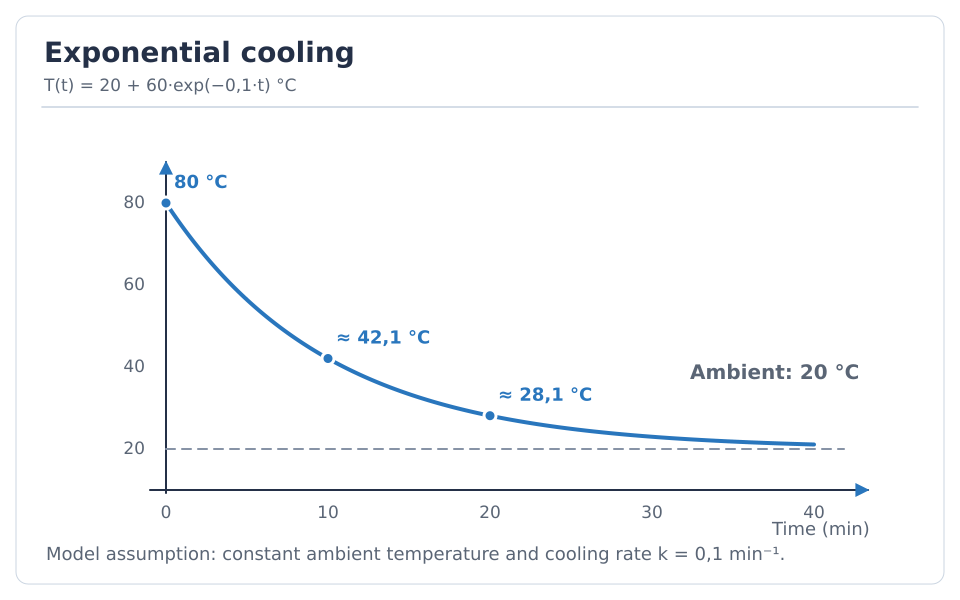

# M1-L9 – Ordinary differential equations: Dynamics, stability and feedback control {#L9}

**Course area:** M1 – Bachelor’s: mathematical foundations

**Level:** Bachelor’s

**Prior knowledge:** No fixed prerequisites specified.

**Context:** University – typical area of mathematical study

## What is this about? {#S1}

Many systems are described not only by their current state, but also by how quickly that state is changing at the moment. How quickly does an object cool down? How does a stock change over time? How does a robot respond when its controller constantly makes small corrections? A **differential equation** specifies a relationship between an unknown function and one or more of its derivatives. We explore the underlying idea, some typical models and their limitations, without replacing a full university course on solution methods.

## Basic idea and intuition {#S2}

In an ordinary equation, we look for a number; in an **ordinary differential equation** (abbreviated ODE), we usually look for an entire trajectory over time. Rather than specifying the temperature of an object separately at each instant, we formulate a law of change. Together with a known initial value, this law allows us to determine a time-dependent function under suitable conditions.

Here, ‘ordinary’ means that the unknown function depends on **one independent variable**, often time. If it depends on several spatial and temporal variables and involves partial derivatives, we speak of a **partial differential equation** (preview in M2-L8).

A first-order ODE uses the first derivative. A second-order equation may also contain a second derivative; in mechanics, for example, this describes acceleration. An **initial value problem** combines the law of change with the initial state.

## New symbols – before the first formula {#S3}

| Symbol | Name / pronunciation | Meaning here | Other possible uses |
| --- | --- | --- | --- |
| $t$ | ‘tee’ | Time as the independent variable | General parameter |
| $y(t)$ | ‘y of t’ | Unknown state function at time t | Any function |
| $\frac{\mathrm dy}{\mathrm dt}$ or $y^{\prime}(t)$ | ‘d y by d t’ / ‘y prime of t’ | Instantaneous rate of change with respect to time | Derivative with respect to another variable |
| $\frac{\mathrm d^2y}{\mathrm dt^2}$ | ‘second derivative of y with respect to t’ | Change in the rate of change, e.g. acceleration | Not an ordinary square of y |
| $k$ | ‘kay’ | Here, a **positive** rate per unit time | General constant or iteration index |
| $y_0$ | ‘y nought’ | Specified initial value | First term of a sequence |
| $e$ | ‘Euler’s number’ | Base of the natural exponential function, approximately 2.71828 | Often an error or event variable in code |
| $e^{-kt}$ | ‘e to the power of minus k times t’ | Exponential decay factor over time | Exponential terms can also describe growth |
| $f(t,y)$ | ‘f of t and y’ | General law of change | Multivariate function |
| $h$ | ‘aitch’ | Step size in numerical computation | Height in geometry |
| $y_n$ / $t_n$ | ‘y / t subscript n’ | Numerical approximation at the nth time step | General terms of a sequence |
| $\approx$ | ‘approximately equal to’ | Rounded number, not an exact identity | Approximation in general |
| $x^{\ast}$ | ‘x star’ | Equilibrium state | Also the unknown exact solution in M1-L8 |
| $\ln$ | ‘natural logarithm’ | Inverse of the exponential function to base $e$ | Already introduced in School Mathematics M1-L19 (German-language course) |

## A simple law of change {#S4}

If a quantity decreases more quickly the larger it currently is, a very common model arises:

$$
\frac{\mathrm{d}y}{\mathrm{d}t}=-k\cdot y(t)\qquad\text{with }k>0
$$

**Read aloud:** ‘The derivative of y with respect to time t equals minus k times the current value of y; k is positive.’ The minus sign means that the quantity falls when it is positive. $k$ controls the rate. If $t$ is expressed in hours, $k$ has the unit ‘per hour’; the right-hand side therefore has the same unit as the rate of change on the left.

The function satisfying this law and taking the value $y_0$ at time zero is:

$$
y(t)=y_0e^{-kt}\qquad\text{with }y(0)=y_0
$$

**Read aloud:** ‘The state at time t is the initial value y nought times e to the power of minus k times t. Initially, the state equals y nought.’ This is **one possible solution** to this particular law of change; under the stated assumptions, it is the unique solution for the specified initial value. Without an initial condition, there would be many solutions with different starting values. Here the right-hand side $-k\cdot y$ is continuous everywhere and Lipschitz continuous with respect to $y$; the solution is therefore unique for every real initial value. For more general equations, specifying an initial value alone is **not** a guarantee of uniqueness.

Why does the function satisfy the equation? Its derivative is the same exponential function again, this time multiplied by $-k$. It therefore satisfies the law of change. We know the concepts from derivatives (School Mathematics M2-L3) and the exponential function (School Mathematics M1-L17 / M1-L19, German-language course).

## Fully explained mini-example: Cooling {#S5}

An object initially at 80 °C is in an environment with a constant temperature of 20 °C. We consider the **temperature difference relative to the surroundings**. Initially it is 60 °C. We choose a cooling rate of $k=0{,}1\,\mathrm{min}^{-1}$ (read aloud as ‘zero point one per minute’) for our model; time $t$ is measured in minutes. Thus the product $k\cdot t$ in the exponent is **dimensionless**. The simplified notation $-0{,}1\cdot t$ in the following numerical formula applies only when the numerical value in minutes is substituted for $t$.

{alt="Temperature curve T(t) equals 20 plus 60 times e to the power of minus 0.1t. It starts at 80 degrees Celsius and approaches the ambient temperature of 20 degrees Celsius."}

Exponential cooling model with a constant ambient temperature of 20 °C.

The absolute temperature $T(t)$ is therefore given by:

$$
T(t)=20\,^{\circ}\mathrm{C}+60\,^{\circ}\mathrm{C}\cdot e^{-0{,}1t}
$$

**Read aloud:** ‘The temperature after t minutes is twenty degrees Celsius plus sixty degrees Celsius times e to the power of minus zero point one times t.’ The exponential function operates on the **difference relative to the surroundings**, not on the absolute temperature in degrees Celsius.

- Initially ($t=0$), $e^0=1$, so the temperature is $20+60=80\,^{\circ}\mathrm C$.
- After ten minutes, $e^{-1}\approx0{,}3679$. Hence $T(10)\approx20+60\cdot0{,}3679\approx42{,}07\,^{\circ}\mathrm C$.
- As time increases indefinitely, the temperature approaches 20 °C without falling below it in the idealised model.

The model is a simplified form of Newton’s law of cooling. Among other things, it assumes a constant ambient temperature and an approximately constant heat transfer coefficient. The example is not a universal natural law for every temperature change.

## Growth, capacity limits and equilibria {#S6}

Using a **positive** sign instead of the minus sign gives the growth law $\frac{\mathrm dy}{\mathrm dt}=k\cdot y$. The quantity then increases more quickly the larger it is. This models certain unrestricted processes, but is often unrealistic in the long run.

If a population or stock is to approach a capacity limit, a logistic model can be used. Before the formula, we need two additional symbols: $r$ is the positive intrinsic growth rate and $K$ is the positive capacity or saturation limit.

$$
\frac{\mathrm{d}y}{\mathrm{d}t}=r\cdot y\cdot\left(1-\frac{y}{K}\right)
$$

**Read aloud:** ‘The rate of change of y with respect to time equals the growth rate r times the population y times one minus the population divided by capacity K.’ As long as the population is between zero and $K$, the growth rate is positive. At $y=K$ it becomes zero; a population above $K$ decreases in the model. Since $y$ and $K$ have the same unit, the factor in brackets $1-\frac yK$ is dimensionless; $r$ has units of inverse time.

An **equilibrium** is a state in which the rate of change is zero. In the logistic model, $y=0$ and $y=K$ are equilibria. For positive initial populations near $K$, $K$ has a stabilising effect; for small positive populations, however, $0$ is unstable. For $r>0$, $K>0$ and a **positive initial population** $y_0$, we can even solve the equation explicitly. The exponential function is applied only to a dimensionless expression:

$$
y(t)=\frac{K}{1+\frac{K-y_0}{y_0}\cdot e^{-rt}}\qquad\text{for }t\geq0\text{ and }y_0>0
$$

**Read aloud:** ‘Capacity K divided by one plus the initial difference from capacity relative to the initial population, multiplied by the exponential decay factor.’ For $y_0=20$, $K=100$, $r=0{,}2\,\mathrm{day}^{-1}$, we have $y(0)=\frac{100}{1+4}=20$. After $t=\frac{\ln(4)}{0{,}2}\approx6{,}93$ days, $e^{-0{,}2t}=\frac14$ and therefore $y(t)=\frac{100}{1+4\cdot\frac14}=50$. For $y_0=0$, however, the constant zero function is a solution; the displayed fractional formula must not be used in this case because it divides by $y_0$. Equilibrium analysis describes the direction of possible changes; it does not establish a biological prediction without suitable data and assumptions.

## Feedback and stability {#S7}

Imagine a controller that continually reduces the error between the desired and actual states. We denote this error by $x(t)$ and again choose a positive control gain $k$:

$$
\frac{\mathrm{d}x}{\mathrm{d}t}=-k\cdot x(t)
$$

**Read aloud:** ‘The rate of change of the error with respect to time is minus k times the current error.’ A positive error decreases; a negative error also approaches zero, provided the model applies. The equilibrium state is $x^{\ast}=0$ and is **asymptotically stable** in the continuous model for $k>0$: small deviations decay over time.

Realistic feedback control loops may involve inertia, time delays, noise, actuator limits and further state variables. Excessive corrective action can then lead to oscillations or instability. The simple model is an introduction, not a complete robot controller.

With several state variables, we can model a linear system with matrix $A$ and state vector $\vec x$: $\frac{\mathrm d\vec x}{\mathrm dt}=A\cdot\vec x$. The eigenvalues of $A$ (M1-L6) help us understand stability: if all the real parts of the eigenvalues of a **time-invariant linear system** are negative, the zero state is asymptotically stable. This establishes a connection with linear algebra; it is not a substitute for analysing nonlinear systems.

## When no convenient solution exists: Euler’s method {#S8}

Many ODEs have no simple closed-form solution. We then calculate the trajectory step by step. For a law of change $\frac{\mathrm dy}{\mathrm dt}=f(t,y)$ and step size $h$, the **explicit Euler method** is:

$$
\begin{aligned}
t_{n+1}&=t_n+h\\
y_{n+1}&=y_n+h f(t_n,y_n)
\end{aligned}
$$

**Read aloud:** ‘The next time is the current time plus the step size. The next state value is the current state value plus the step size times the currently estimated rate of change.’ This method assumes that the rate remains approximately constant during the short step.

For the cooling temperature difference $y(0)=60\,^{\circ}\mathrm C$ and $\frac{\mathrm dy}{\mathrm dt}=-0{,}1\cdot y$, a time step of **one minute** gives: $y_1=60+1\cdot(-0{,}1\cdot60)=54\,^{\circ}\mathrm C$. The absolute temperature after one minute is therefore approximately 74 °C. The exact model value is $20+60\cdot e^{-0{,}1}\approx74{,}29\,^{\circ}\mathrm C$. The discrepancy arises from time discretisation.

After ten steps of one minute each, Euler’s method gives $20+60\cdot\left(0{,}9\right)^{10}\approx40{,}92\,^{\circ}\mathrm C$; the analytical model solution gave approximately 42.07 °C after ten minutes. For this problem, smaller steps typically improve the approximation but increase computational cost. **Not every step size is stable:** for the model $\frac{\mathrm dx}{\mathrm dt}=-k\cdot x$, the Euler formula gives exactly $x_{n+1}=(1-h\cdot k)\cdot x_n$. The repeated approximation tends asymptotically to zero only when $\lvert1-h\cdot k\rvert<1$, that is, **$0<h\cdot k<2$**. For $0<h\cdot k\leq1$, a positive initial error does not change sign; for $1<h\cdot k<2$, damped oscillations with alternating signs arise. At the boundary $h\cdot k=2$, the error alternates between two signs without decaying; for $h\cdot k>2$, its magnitude increases.

**Check example:** starting with $x_0=10$, $k=0{,}1\,\mathrm{min}^{-1}$ and choosing $h=15\,\mathrm{min}$ gives $1-h\cdot k=-0{,}5$: Euler’s method yields $x_1=-5$ and $x_2=2{,}5$ – the approximation oscillates about zero although the exact solution $10\cdot e^{-0{,}1t}$ remains positive. With $h=25\,\mathrm{min}$, the factor is $-1{,}5$ and Euler’s method yields $-15$, then $22{,}5$: an artificially unstable trajectory. This is a **numerical** instability, not an instability of the underlying continuous model.

## What is it useful for? {#S9}

- **Robotics and control:** Joint movements, velocity, inertia and correction signals are described as state trajectories.
- **Server and agent systems:** Changes in stocks, backlogs or resource consumption can be studied using suitable continuous approximation models.
- **Simulation:** Numerical ODE solvers enable predictions about dynamical systems even when no simple closed-form solution exists.
- **AI and optimisation:** Continuous learning and adaptation models build on gradients and differential equations.

## Assumptions, limitations and common misconceptions {#S10}

- A law of change alone usually does not determine a unique trajectory over time; initial values or other conditions are necessary.
- A differential equation is **a model**. Measured data may contain noise, abrupt events and parameter changes that the model does not include.
- The mathematical existence and uniqueness of a solution depend on assumptions such as sufficient regularity of the right-hand side; they are not automatically guaranteed.
- A numerical approximation is not an exact solution; discretisation errors occur in addition to rounding errors.
- The stability of a continuous system does not guarantee stability for an arbitrarily coarse numerical discretisation. Even a stable step size for the linear test model is not a universal error or stability guarantee for other ODEs; for general right-hand sides, local smoothness or Lipschitz conditions and, where appropriate, adaptive steps must be examined.

## Connection to the next unit {#S11}

M1-L9 completes the planned university foundations block. M2-L1 moves on to **discrete mathematics**: instead of continuous trajectories over time, it considers nodes, edges, finite structures and state spaces that can be searched algorithmically.

## Sources {#S12}

No individual sources are listed separately in this lesson.
