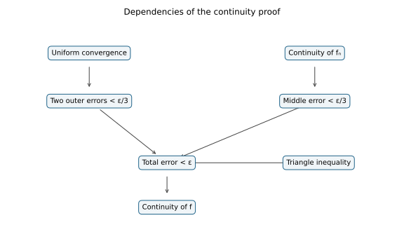

# M10-L1 – Mathematical literature, proof reading and seminars {#L1}

**Course area:** M10 – Seminar and research

**Level:** Bachelor’s studies · Seminar

**Prerequisites:** [M1-L1](M1-L1.md); [M1-L2](M1-L2.md); [M1-L3](M1-L3.md)

**Classification:** Bachelor seminar pathway

## Learning objectives {#S1}

Reconstruct the dependencies of a mathematical proof, distinguish assumptions from conclusions, find counterexamples to stronger claims, and prepare an original seminar write-up with documented sources.

## Formulating a literature question {#S2}

A seminar paper starts not with a collection of formulas but with a verifiable question: why is continuity preserved by uniform limits but not by pointwise limits? Choose an interval $I\subseteq\mathbb R$ and real-valued functions $f_n:I\to\mathbb R$. The basic concepts appear in [M1-L2](M1-L2.md) and [M1-L3](M1-L3.md). For each source record the author or institution, title, edition, precise location and access date. Describe the role of each assertion in your own words: definition, established lemma, main theorem or mere example. Matching formulations in two texts do not constitute an independent proof. When assumptions differ, first check whether the statements are actually equivalent.

## Reconstructing the proof {#S3}

**Theorem.** If all $f_n$ are continuous on $I$ and $f_n$ converges uniformly to $f:I\to\mathbb R$, then $f$ is continuous on $I$.

**Proof.** Choose any $x_0\in I$ and $\varepsilon>0$. By uniform convergence choose one index $n$ such that $|f_n(x)-f(x)|<\varepsilon/3$ for all $x\in I$. Since this fixed $f_n$ is continuous at $x_0$, there exists $\delta>0$ such that $|f_n(x)-f_n(x_0)|<\varepsilon/3$ for $x\in I$ with $|x-x_0|<\delta$. The triangle inequality gives

$$|f(x)-f(x_0)|\le |f(x)-f_n(x)|+|f_n(x)-f_n(x_0)|+|f_n(x_0)-f(x_0)|<\varepsilon.$$

Thus $f$ is continuous at $x_0$. Because $x_0$ was arbitrary, it is continuous throughout $I$. The proof does not require compactness of $I$; at endpoints use relative continuity. The order of choosing $n$ and $\delta$ matters. A proof dependency graph records the definition of uniform convergence, continuity of the fixed term, and the triangle inequality as separate inputs.

{alt="Proof graph from convergence and continuity to error bound"}

## Testing hypotheses with counterexamples {#S4}

Replacing uniform convergence with pointwise convergence makes the theorem false. Choose $f_n(x)=x^n$ for $x\in[0,1]$, $n\ge1$. Every term is continuous; the limit is zero for $x<1$ and one at $x=1$. It is therefore discontinuous at one. For every fixed $n$, $\sup_{x\in[0,1]}|f_n(x)-f(x)|=1$, although this error is not attained: approaching one from the left, $x^n$ tends to one, while at one the error is zero. On $[0,a]$ with $0<a<1$, by contrast, the maximum error is $a^n\to0$. This tests the role of the domain using the same example. The supremum argument establishes the claim; an additional self-produced plot can illustrate the boundary region.

## Seminar workflow and evidence {#S5}

Prepare a two- to three-page seminar write-up containing the question, definitions, theorem, proof, counterexample and limitations. Mark every external assertion you do not prove with a precise reference. Distinguish notes taken from sources from your own argument. For the example above, reconstruct the proof without a template and then check the order of choices against the definitions. Oxford's guidance on counterexamples and Stanford's proofwriting checklist provide methodological references; the proof and examples above are independently developed here.

Allow about ten minutes for the presentation: two for concepts, four for the proof, three for the counterexample and one for limitations. Ask a second reader to trace the dependencies backwards, especially where $n$ is chosen independently of $x$. During self-study, revisiting the proof later may help but does not replace independent review. Label unresolved questions as such.

## Self-assessment {#S6}

### Exercises

1. State the quantifier order of uniform convergence.
2. Why is pointwise convergence insufficient for the proof?
3. Find an integer $n$ for which the error of $x^n$ on $[0,1/2]$ is less than $1/100$.
4. Give a counterexample showing that uniform convergence alone does not guarantee continuity if the terms are not continuous.
5. Outline a proof dependency graph and source record for the theorem.

::: {.lc-solutions data-lc-section="S6"}
1. For every $\varepsilon>0$ there exists $N$ such that for every $n\ge N$ and every $x\in I$ the error is smaller than $\varepsilon$.
2. The required index could depend on $x$; continuity of a single fixed term would no longer control the errors together.
3. $n=7$ suffices since $2^{-7}=1/128<1/100$.
4. Let each $f_n$ be the same step function $1_{[0,\infty)}$ on $\mathbb R$. The error is identically zero, but the limit is discontinuous at zero.
5. Uniform convergence gives two error bounds, continuity the middle one, and the triangle inequality combines them. Source record: institution, title, URL, section, date, assertion used and own verification; methodological references in S7.
:::

## Sources {#S7}

- [University of Oxford, Introduction to University Mathematics (2025–26): Logic and Proof](https://courses.maths.ox.ac.uk/mod/page/view.php?id=65664) · Counterexamples · Last accessed: 2026-11-24 · Content verified: 2026-11-24
- [Stanford University, CS103 Proofwriting Checklist](https://web.stanford.edu/class/cs103/proofwriting_checklist) · Clearly articulate assumptions; scope variables · Last accessed: 2026-11-24 · Content verified: 2026-11-24
