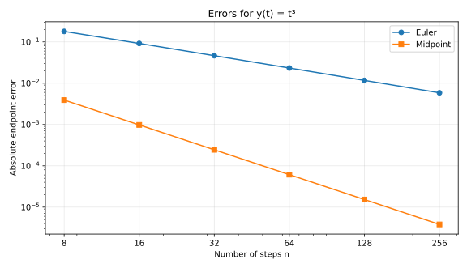

# M10-L2 – Mathematical research project and reproducibility {#L2}

**Course area:** M10 – Seminar and research

**Level:** Master’s studies · Research project

**Prerequisites:** [M10-L1](M10-L1.md); [M7-L3](M7-L3.md)

**Classification:** Master’s research pathway

## Learning objectives {#S1}

Formulate a bounded research question and testable hypothesis, distinguish analytical proof from numerical experiment, document code, inputs and results, and explain why negative or unevaluable findings must be retained.

## Research question and predefined test plan {#S2}

Build on [M10-L1](M10-L1.md) and [M7-L3](M7-L3.md). Ask how the endpoint error of Euler and explicit midpoint methods changes when the step size is halved for $y\prime=3t^2$, $y(0)=0$ on $[0,1]$. The exact solution $y(t)=t^3$ provides an independent reference. For $n$ uniform steps, $h=1/n$. Before computing, define absolute endpoint error $E_n=|1-y_n|$ and observed order $p_n=\log_2(E_n/E_{2n})$ when both errors are positive. Hypothesis: $p_n$ approaches one for Euler and two for midpoint. Choose $n=8,16,32,64,128$ and their doubles for the finite test plan. All five pairs should satisfy $|p_n-1|<0.05$ for Euler and $|p_n-2|<0.05$ for midpoint. These tolerances are a predefined choice for this teaching project, not a general statistical test. Also test $y\prime=2t$ with the same initial condition as a control. Record any changes to the plan rather than adapting it retrospectively to the data.

## Analytical proof for the test problem {#S3}

The right-hand side depends only on $t$. Euler therefore corresponds to the left rectangle sum, and explicit midpoint to midpoint quadrature. With $t_j=j/n$,

$$y_n^{E}=\frac{3}{n^3}\sum_{j=0}^{n-1}j^2=1-\frac{3}{2n}+\frac{1}{2n^2},$$

$$y_n^{M}=\frac{3}{n^3}\sum_{j=0}^{n-1}(j+1/2)^2=1-\frac{1}{4n^2}.$$

The first equation follows from $\sum j^2=n(n-1)(2n-1)/6$. For the second expand $(j+1/2)^2=j^2+j+1/4$ and use $\sum j=n(n-1)/2$. Thus $E_n^{E}=3/(2n)-1/(2n^2)$ and $E_n^{M}=1/(4n^2)$. The limiting error ratios are 2 and 4 respectively; the midpoint ratio is exactly 4. This proves the orders for this test problem, not for every differential equation. General method analysis needs further regularity and stability assumptions.

## Reproducible experiment {#S4}

The following original script requires only Python and its standard library. Save it as `experiment.py`, record the output of `python --version`, and run `python experiment.py`. Rational arithmetic keeps endpoint errors exact; only the logarithmic display uses floating-point arithmetic. `None` means the order cannot be evaluated, not that it is zero.

```python
from fractions import Fraction as F
from math import log2

def error(n, degree, midpoint=False):
    if type(n) is not int or n < 1 or degree not in (2, 3):
        raise ValueError("positive integer n; degree 2 or 3")
    h = F(1, n)
    offset = F(1, 2) if midpoint else F(0)
    y = h * sum(degree * ((j + offset)*h)**(degree-1)
                for j in range(n))
    return abs(1-y)

def observed_order(e, refined):
    if e <= 0 or refined <= 0:
        return None
    return log2(float(e / refined))

for n in (8, 16, 32, 64, 128):
    for midpoint in (False, True):
        e = error(n, 3, midpoint)
        print(n, midpoint, e,
              observed_order(e, error(2*n, 3, midpoint)))
print("control", error(8, 2, True))
```

For $n=8$, $E_8^E=23/128$ and $E_8^M=1/256$; for $n=16$, they are $47/512$ and $1/1024$. Hence $p_8^E=\log_2(92/47)\approx0.969$ and $p_8^M=2$. The graph shows error curves from the proven formulas. Check the script output against them. For the same number of steps, the general midpoint method uses two function evaluations per step, versus one for Euler; in this special time-dependent case both need only one. A runtime study would need to measure cost and accuracy separately.

{alt="Logarithmic error comparison of Euler and midpoint methods"}

## Negative findings and research artifacts {#S5}

For $y\prime=2t$, $y(0)=0$, the midpoint rule integrates the linear function exactly. Both errors in the ratio are zero, so the observed order is undefined. Report this result rather than replacing it with an artificial small number. It refutes the unrestricted assertion that order can be measured in every test case, not theoretical order two. A sequence of small errors also does not prove stability on stiff problems.

Create a project directory with `README.md` (question, assumptions, versions, launch command), `experiment.py`, unaltered `results.txt`, a description of the output columns, a proof note and a results report. Record SHA-256 for the versioned files; a hash confirms identity, not correctness. Record each change with its reason and version. ACM SIGIR artifact review provides methodological guidance: a rerun by the same person is not independent reproduction. Ask another person to obtain the results using the supplied files; a separate reimplementation additionally tests dependence on the code. Report discrepancies with environment and inputs. This small project is a self-study example and claims neither scientific novelty nor certification.

## Self-assessment {#S6}

### Exercises

1. Determine both errors for $n=4$ exactly.
2. Calculate the midpoint error ratio when $n$ doubles and its observed order.
3. Explain why no logarithmic error ratio exists for the control problem.
4. What claim about stiff differential equations cannot be established by the experiment?
5. Outline a minimal reproduction protocol for a second person.

::: {.lc-solutions data-lc-section="S6"}
1. Euler: $11/32$; midpoint: $1/64$.
2. Ratio $4$, order $\log_2 4=2$.
3. Both errors are zero; $0/0$ and its logarithm are undefined.
4. The experiment establishes neither absolute stability for large negative eigenvalues nor convergence for arbitrary stiff problems.
5. Check version and hashes, record Python version, run the command, compare exact fractions and zero-error control, record discrepancies with inputs and environment, and assess the result independently.
:::

## Sources {#S7}

- [ACM SIGIR, Artifact Badging](https://sigir.org/general-information/acm-sigir-artifact-badging/) · Artifact Packaging; Results Reproduced and Replicated · Last accessed: 2026-11-24 · Content verified: 2026-11-24
- [Gustav Delius, Numerical Analysis, Chapter 6](https://gustavdelius.github.io/NumericalAnalysis2024/nmODE.html) · Definition 6.2; Exercise 6.23 · Last accessed: 2026-11-24 · Content verified: 2026-11-24
