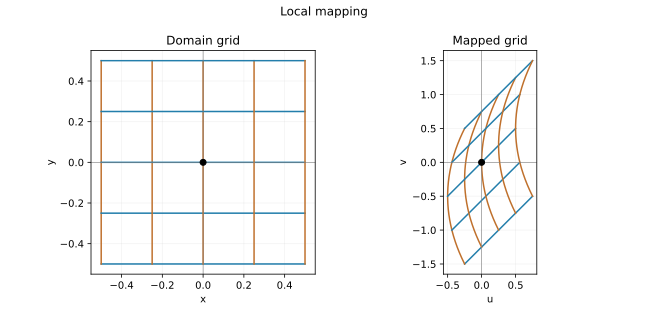

# M11-L1 – Total derivative, Jacobian and inverse function theorem {#L1}

**Course area:** M11 – Advanced calculus, linear algebra and probability

**Level:** Bachelor · Foundations and advanced study

**Prerequisites:** [M1-L4](M1-L4.md); [M1-L6](M1-L6.md)

**Classification:** Bachelor calculus core/extension

## Learning objectives {#S1}

Distinguish partial and total differentiability, compute Jacobian matrices and derivatives of compositions, apply the local inverse function theorem and test its assumptions with counterexamples.

## Linear approximation and remainder {#S2}

The partial derivatives introduced in [M1-L4](M1-L4.md) describe changes along individual coordinates. Total differentiation captures arbitrary small changes simultaneously. Let $U\subset\mathbb R^n$ be open and $f:U\to\mathbb R^m$. At $a\in U$, $f$ is differentiable if a linear map $A$ exists such that

$$f(a+h)=f(a)+Ah+r(h),\qquad \lim_{h\to0,h\ne0}\frac{\|r(h)\|}{\|h\|}=0.$$

Use the Euclidean norm. The map is unique: if $A,B$ qualify, set $h=tv$, divide by $|t|$ and take the limit to obtain $(A-B)v=0$ for every vector $v$. Setting $h=te_j$ shows that column $j$ of $A$ contains the partial derivatives in coordinate direction $j$. Hence $A=Df(a)=J_f(a)=(\partial_j f_i(a))_{i,j}$, an $m\times n$ matrix. Continuous partial derivatives in an open neighbourhood suffice: along the segment from $a$ to $a+h$, the fundamental theorem applied componentwise gives remainder $\int_0^1 (J_f(a+th)-J_f(a))h\,dt$. Its norm divided by $\|h\|$ tends to zero by continuity. For small $h$, the segment lies entirely in $U$.

## Example, chain rule and counterexample {#S3}

For $f(x,y)=(x+y^2,2y+x)$, $J_f(x,y)=\begin{pmatrix}1&2y\\1&2\end{pmatrix}$. At $a=(0,0)$ with $h=(s,t)$ the exact remainder is $(t^2,0)$; its norm divided by $\|h\|$ is at most $\|h\|$. For a differentiable subsequent map $g$, $D(g\circ f)(a)=Dg(f(a))Df(a)$. Indeed, the increment of $f$ is $Ah+o(\|h\|)=O(\|h\|)$; substitution into the linear approximation of $g$ yields the stated linear term with remainder $o(\|h\|)$. Matrix order matters. With $g(u,v)=u+v^2$ we obtain $D(g\circ f)=(1,0)$ at the origin.

In contrast, define $q(x,y)=xy/\sqrt{x^2+y^2}$ away from the origin and $q(0,0)=0$. On both axes $q=0$, so both partial derivatives at the origin exist and vanish. The function is continuous because $|xy|\le (x^2+y^2)/2$. But for $h=(t,t)$ with $t\ne0$, $|q(h)|/\|h\|=1/2$. The required linear map would be zero, and its remainder fails the definition. Continuity together with existence of partial derivatives is therefore insufficient.

## Local inverse function theorem {#S4}

Let $f:U\subset\mathbb R^n\to\mathbb R^n$ be of class $C^1$ and $\det Df(a)\ne0$. The inverse function theorem guarantees open neighbourhoods $V$ of $a$ and $W$ of $f(a)$ on which $f:V\to W$ is bijective and has a $C^1$ inverse. From $f^{-1}\circ f=\operatorname{id}$ and the chain rule,

$$D(f^{-1})(f(a))=[Df(a)]^{-1}.$$

For the preceding example, $\det Df(0,0)=2$, so a local inverse exists with derivative $\begin{pmatrix}1&0\\-1/2&1/2\end{pmatrix}$. The figure shows the local coordinate grid and its deformation. The claim is local, not global: $f(0,0)=(0,0)=f(-4,2)$, although the theorem applies at the origin. For $f(x,y)=(x^3,y)$ the determinant vanishes at the origin, yet the function is bijective; the inverse $(\sqrt[3]{u},v)$ is not differentiable there. A singular derivative thus rules out a differentiable local inverse, not all invertibility.

The existence part of the inverse function theorem is used as a theorem here; its complete analytical proof is a further study task. The derivative formula was derived above using the chain rule.

{alt="Local grid and its image under f"}

## Application and verification {#S5}

For a small target increment $(\Delta u,\Delta v)=(0.02,0.06)$ near $f(0,0)$, the linear inverse predicts $(\Delta x,\Delta y)\approx(0.02,0.02)$. Substitution gives $(0.0204,0.06)$; the first coordinate error is quadratic. The exact local solution follows from $x=v-2y$ and $y^2-2y+v-u=0$: near zero, $y=1-\sqrt{1+u-v}$ and $x=v-2y$. The other branch lies near $y=2$ and does not belong to this local inverse. A small determinant alone does not reliably measure numerical conditioning; singular values are relevant, among other quantities. In [M11-L2](M11-L2.md) the determinant is used to scale area.

## Self-assessment {#S6}

### Exercises

1. Compute the Jacobian of $(xy,x^2+y)$ at $(1,2)$.
2. Find the determinant for example $f$ from S3 at $y=1$ and assess applicability of the inverse theorem.
3. Compute the normalised remainder for $q$ along $(t,t)$.
4. Find the derivative of the local inverse of $(2x+y,x+y)$.
5. Explain why local invertibility does not guarantee global injectivity.

::: {.lc-solutions data-lc-section="S6"}
1. $\begin{pmatrix}2&1\\2&1\end{pmatrix}$.
2. $2-2y=0$; the theorem supplies no local $C^1$ inverse there.
3. $1/2$ for every $t\ne0$; the limit is not zero.
4. $\begin{pmatrix}1&-1\\-1&2\end{pmatrix}$, constant everywhere.
5. The theorem restricts the mapping to suitable neighbourhoods. The example in S4 has two distinct preimages of $(0,0)$.
:::

## Sources {#S7}

- [University of Toronto, MAT237, §2.2](https://www.math.toronto.edu/courses/mat237y1/20189/notes/Chapter2/S2.2.html) · Theorem 1, differentiability and Jacobian · Last accessed: 2026-11-24 · Content verified: 2026-11-24
- [University of Toronto, MAT237, §3.3](https://www.math.toronto.edu/courses/mat237y1/20189/notes/Chapter3/S3.3.html) · Theorem 1, inverse function theorem · Last accessed: 2026-11-24 · Content verified: 2026-11-24
