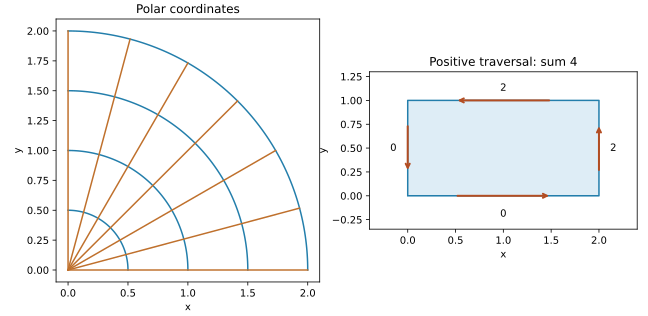

# M11-L2 – Change of variables and integral theorems {#L2}

**Course area:** M11 – Advanced calculus, linear algebra and probability

**Level:** Bachelor · Foundations and advanced study

**Prerequisites:** [M11-L1](M11-L1.md); [M1-L4](M1-L4.md)

**Classification:** Bachelor calculus core/extension

## Learning objectives {#S1}

Compute area elements under coordinate changes, recognise multiple coverings and distinguish nonnegative area scaling from oriented boundary integrals. Prove Green’s theorem for rectangles and calculate circulation and flux.

## Change of variables {#S2}

Building on [M11-L1](M11-L1.md) and [M1-L4](M1-L4.md), let $T:U\to V$ be a $C^1$ diffeomorphism of open subsets of $\mathbb R^2$, meaning a bijection with a continuously differentiable inverse. For integrable $f$ on $V$,

$$\int_V f(x,y)\,dx\,dy=\int_U f(T(u,v))\,|\det DT(u,v)|\,du\,dv.$$

To first order, the local rectangle of sides $du,dv$ is spanned by the two columns of $DT$. The parallelogram area is the absolute determinant times $du\,dv$. This motivates the formula; the general integration theorem requires a separate limiting proof. For instance, $T(u,v)=(2u+v,u-v)$ has determinant $-3$. The unit square maps to a parallelogram of area 3, not $-3$. Orientation reverses but area remains nonnegative. Boundary pieces of zero area measure may be omitted in these integrals.

## Polar coordinates and multiple covering {#S3}

For $T(r,\theta)=(r\cos\theta,r\sin\theta)$, $DT=\begin{pmatrix}\cos\theta&-r\sin\theta\\\sin\theta&r\cos\theta\end{pmatrix}$ and $\det DT=r$. On $0<r<R$, $0<\theta<2\pi$, $T$ is a diffeomorphism onto the open disk minus the origin and positive radial cut. The omitted sets have zero area measure. For $f(x,y)=x^2+y^2$,

$$\int_{x^2+y^2<R^2}(x^2+y^2)\,dA=\int_0^{2\pi}\int_0^R r^3\,dr\,d\theta=\frac{\pi R^4}{2}.$$

For $R=2$ this is $8\pi$. Extending the angular interval to $(0,4\pi)$ makes the mapping noninjective, and the naive integral gives twice the value. The singularity at $r=0$ cannot be treated as a local diffeomorphism; here removing a null set is valid. The transformed integrand and limits must also correspond to the same mapping.

## Green’s theorem: circulation and proof for rectangles {#S4}

Let $D$ be a bounded planar region with a piecewise smooth simple closed boundary, positively (counterclockwise) oriented, and let $P,Q$ be $C^1$ on an open neighbourhood of $\overline D$. Then

$$\oint_{\partial D} P\,dx+Q\,dy=\iint_D(\partial_xQ-\partial_yP)\,dA.$$

For rectangle $D=[a,b]\times[c,d]$, the bottom edge contributes $\int_a^b P(x,c)dx$, the right $\int_c^d Q(b,y)dy$, the top $-\int_a^b P(x,d)dx$ and the left $-\int_c^d Q(a,y)dy$. Their sum is

$$\int_c^d[Q(b,y)-Q(a,y)]dy-\int_a^b[P(x,d)-P(x,c)]dx.$$

The one-dimensional fundamental theorem replaces the differences by integrals of the respective partial derivatives. Continuity permits Fubini’s theorem to align the integration orders, yielding exactly the area integral. This proves the rectangular case. General regions require an additional argument not proved here. For regions with holes the positive orientation of inner boundaries is clockwise, so the region always remains to the left of the direction of travel. The theorem must then include every boundary component, provided the regularity assumptions hold.

## Circulation, flux and orientation {#S5}

For $P=-y^2$, $Q=2xy$ on $D=[0,2]\times[0,1]$, $Q_x-P_y=4y$; circulation equals $\int_0^2\int_0^1 4y\,dy\,dx=4$. Direct boundary check: bottom 0, right $\int_0^1 4y\,dy=2$, top $\int_2^0 -1\,dx=2$, left 0. The figure shows all four contributions. Reversing boundary orientation gives circulation $-4$.

For a vector field $F=(P,Q)$ and outward unit normal $n$, positive boundary orientation gives $F\cdot n\,ds=P\,dy-Q\,dx$. Applying the circulation theorem to $(-Q,P)$ yields the flux form $\oint F\cdot n\,ds=\iint_D(P_x+Q_y)dA$. For the same field the divergence is $2x$ and outward flux is 4. It is a geometrically defined quantity; reversing traversal requires adjusting the outward normal formula. These are planar cases of the relation between differentiation and boundary integration; Stokes’ and the divergence theorem extend them to suitable three-dimensional surfaces and regions. A singular field such as $(-y,x)/(x^2+y^2)$ cannot be used on a full disk without checking its domain.

{alt="Polar grid and positively oriented rectangular boundary"}

## Self-assessment {#S6}

### Exercises

1. Find the area of the image of $[0,2]\times[0,3]$ under $T(u,v)=(2u+v,u-v)$.
2. Integrate $1$ over the disk of radius 3 using polar coordinates.
3. Why is $\theta\in(0,4\pi)$ unsuitable for a simple polar coordinate change?
4. Compute circulation of $(-y,x)$ around the positively oriented rectangle $[0,3]\times[0,2]$.
5. Find the outward flux of $(x,y)$ through the same boundary.

::: {.lc-solutions data-lc-section="S6"}
1. $3\cdot2\cdot3=18$.
2. $\int_0^{2\pi}\int_0^3 r\,dr\,d\theta=9\pi$.
3. Almost every point of the disk is covered twice; injectivity fails.
4. $Q_x-P_y=2$; circulation $12$, clockwise $-12$.
5. $P_x+Q_y=2$; outward flux $12$.
:::

## Sources {#S7}

- [MIT 18.013A, §24.2](https://ocw.mit.edu/ans7870/18/18.013a/textbook/chapter24/section02.html) · Area integrals and absolute Jacobian · Last accessed: 2026-11-24 · Content verified: 2026-11-24
- [De Anza College, Calculus IV, §3.4](https://math.libretexts.org/Courses/De_Anza_College/Calculus_IV:_Multivariable_Calculus/03:_Vector_Calculus/3.04:_Greens_Theorem) · Circulation, rectangle proof, flux and regions with holes · Last accessed: 2026-11-24 · Content verified: 2026-11-24
