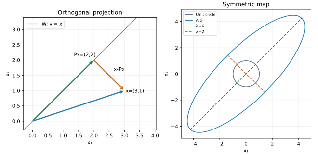

# M11-L3 – Inner products, orthogonal projection and spectral theorem {#L3}

**Course area:** M11 – Advanced calculus, linear algebra and probability

**Level:** Bachelor · Foundations and advanced study

**Prerequisites:** [M1-L5](M1-L5.md); [M1-L6](M1-L6.md)

**Classification:** Bachelor core/extension

## Learning objectives {#S1}

Compute orthogonal projections and Gram–Schmidt bases, prove best approximation in finite-dimensional subspaces, and orthogonally diagonalize real symmetric matrices.

## Inner product and best approximation {#S2}

On a real vector space an inner product is a symmetric bilinear form with $\langle x,x\rangle>0$ for $x\ne0$. It induces the norm $\|x\|=\sqrt{\langle x,x\rangle}$. Nonnegativity of $\|x-ty\|^2$ for every real $t$, minimized at $t=\langle x,y\rangle/\|y\|^2$ when $y\ne0$, gives the Cauchy–Schwarz inequality $|\langle x,y\rangle|\le\|x\|\|y\|$. Orthogonality means $\langle x,y\rangle=0$.

Let $W$ have a finite orthonormal basis $q_1,\ldots,q_m$. Define $Px=\sum_i\langle x,q_i\rangle q_i$. Then $x-Px$ is orthogonal to each basis vector and hence to $W$. By Pythagoras, for every $w\in W$,

$$\|x-w\|^2=\|x-Px\|^2+\|Px-w\|^2.$$

The right side is minimized uniquely at $w=Px$. In Euclidean coordinates with $Q=(q_1\ \cdots\ q_m)$, $P=QQ^T$ and $P^2=P=P^T$. For a nonorthogonal basis with full-column-rank matrix $B$, the projection matrix is $B(B^TB)^{-1}B^T$: the normal equation $B^T(x-Bc)=0$ determines the coefficients. Without full column rank this inverse formula does not apply.

## Gram–Schmidt and QR factorization {#S3}

From independent vectors $a_1,\ldots,a_m$ construct $v_j=a_j-\sum_{i<j}\langle a_j,q_i\rangle q_i$ and $q_j=v_j/\|v_j\|$ recursively. The inner product of $v_j$ with each earlier $q_i$ is zero. As the previous $q_i$ span the same space as the previous $a_i$, independence implies $v_j\ne0$. Induction preserves the successive spans. In Euclidean coordinates this gives $B=QR$, with $R_{ij}=q_i^Ta_j$ for $i\le j$ and zero otherwise. Its diagonal is positive. Nearly dependent vectors can suffer loss of orthogonality from rounding; numerical implementations often use Householder transformations or modified Gram–Schmidt.

Example: $a_1=(1,1,0)^T$, $a_2=(1,0,1)^T$. Then $q_1=(1,1,0)^T/\sqrt2$ and $q_2=(1,-1,2)^T/\sqrt6$. Projecting $(2,0,0)^T$ onto their span yields $(4/3,2/3,2/3)^T$. The residual $(2/3,-2/3,-2/3)^T$ is orthogonal to both original vectors. The figure shows the two-dimensional case $x=(3,1)$, $W=\operatorname{span}(1,1)$, with $Px=(2,2)$.

{alt="Orthogonal projection and eigendirections"}

## Spectral theorem and proof {#S4}

Every real symmetric matrix $A=A^T$ has an orthonormal eigenbasis, so $A=Q\Lambda Q^T$ with orthogonal $Q$ and real diagonal $\Lambda$. A proof maximizes $x^TAx$ on the compact unit sphere. Let $u$ be a maximizer. For any unit vector $v\perp u$, the derivative of $(u\cos t+v\sin t)^TA(u\cos t+v\sin t)$ at zero must vanish. It equals $2v^TAu$. Hence $Au=\lambda u$. Symmetry makes $u^\perp$ invariant: $u^TAw=(Au)^Tw=0$ for $w\perp u$. The restriction is symmetric again. Induction on dimension, starting at dimension one, gives the eigenbasis.

For $A=\begin{pmatrix}4&2\\2&4\end{pmatrix}$ the eigenvectors $q_+=(1,1)^T/\sqrt2$ and $q_-=(1,-1)^T/\sqrt2$ have eigenvalues 6 and 2. Thus $A=6q_+q_+^T+2q_-q_-^T$ and $A^k=6^k q_+q_+^T+2^k q_-q_-^T$ for $k\ge0$. It is positive definite because $x^TAx=6(q_+^Tx)^2+2(q_-^Tx)^2>0$ for $x\ne0$.

## Limitations and applications {#S5}

In linear least squares a QR factorization minimizes $\|Bc-y\|$: since $Q^TQ=I$, the unique full-rank solution satisfies $Rc=Q^Ty$. This avoids explicitly forming $B^TB$, whose 2-norm condition number is the square of that of $B$ at full rank. An idempotent matrix need not be an orthogonal projection: $\begin{pmatrix}1&1\\0&0\end{pmatrix}$ projects obliquely onto the first axis. It is not symmetric. A real matrix may fail to be diagonalizable even with real eigenvalues, for example $\begin{pmatrix}1&1\\0&1\end{pmatrix}$. This spectral theorem is finite-dimensional; infinite-dimensional operators require further assumptions.

## Self-assessment {#S6}

### Exercises

1. Project $(4,2)$ onto the line with direction $(1,2)$.
2. Orthogonalize $(1,0,1)$ and $(1,1,0)$ without normalization.
3. Find the eigenvalues and an orthonormal eigenbasis of $\begin{pmatrix}3&1\\1&3\end{pmatrix}$.
4. Why is $P=QQ^T$ idempotent if $Q^TQ=I$?
5. Test the oblique projection in S5 for symmetry and give its kernel.

::: {.lc-solutions data-lc-section="S6"}
1. $(8/5,16/5)$.
2. $(1,0,1)$ and $(1/2,1,-1/2)$.
3. $4,2$ with $(1,1)/\sqrt2$ and $(1,-1)/\sqrt2$.
4. $P^2=Q(Q^TQ)Q^T=P$.
5. Not symmetric; kernel $\operatorname{span}(1,-1)$.
:::

## Sources {#S7}

- [TU Delft, R. Koekoek, The Gram-Schmidt process](https://tudelft.roelofkoekoek.nl/teaching/linalg/orthogonality/gram-schmidt.html) · Projection formula, Gram–Schmidt, QR · Last accessed: 2026-11-24 · Content verified: 2026-11-24
- [TU Delft, R. Koekoek, The spectral theorem](https://tudelft.roelofkoekoek.nl/teaching/linalg/symmetric/spectral_theorem.html) · Orthogonal diagonalization and spectral decomposition · Last accessed: 2026-11-24 · Content verified: 2026-11-24
