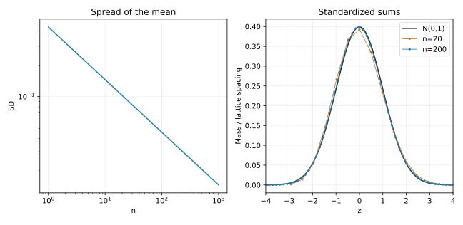

# M11-L4 – Law of large numbers and central limit theorem {#L4}

**Course area:** M11 – Advanced calculus, linear algebra and probability

**Level:** Bachelor · Foundations and advanced study

**Prerequisites:** [M1-L7](M1-L7.md); [M1-L2](M1-L2.md)

**Classification:** Bachelor core/extension

## Learning objectives {#S1}

Distinguish probabilistic convergence modes, prove the weak law of large numbers using Chebyshev’s inequality, and apply the central limit theorem to standardized sums.

## Sample mean and weak law {#S2}

Let $X_i$ be independent and identically distributed (i.i.d.) with mean $\mu$ and finite variance $\sigma^2$. The sample mean $\bar X_n=n^{-1}\sum_{i=1}^nX_i$ satisfies $E\bar X_n=\mu$ and $\operatorname{Var}(\bar X_n)=\sigma^2/n$ because covariances vanish. Chebyshev’s inequality follows from $E(Y-EY)^2\ge\varepsilon^2P(|Y-EY|\ge\varepsilon)$. Consequently,

$$P(|\bar X_n-\mu|\ge\varepsilon)\le\frac{\sigma^2}{n\varepsilon^2}\to0$$

for every $\varepsilon>0$. This is convergence in probability and proves the weak law under these assumptions. Mean squared error also tends to zero. The bound is often conservative. For Bernoulli observations with $p=0.3$ and $n=1000$, the upper bound for $\varepsilon=0.05$ is $0.084$.

## Convergence modes and dependence {#S3}

Almost sure convergence means $P(\{\omega:X_n(\omega)\to X(\omega)\})=1$. The strong law gives almost sure convergence of the mean for i.i.d. variables with $E|X_1|<\infty$. It is stated here without its full proof. Almost sure convergence implies convergence in probability, which implies convergence in distribution. In distributional convergence, the CDFs converge at continuity points of the limiting CDF. The converses fail in general. For instance, independent indicators with success probabilities $1/n$ converge to zero in probability, but the second Borel–Cantelli lemma implies infinitely many successes almost surely.

Independence cannot simply be dropped: let $X_i=Y$ for all $i$ with $Y\sim\mathrm{Bernoulli}(1/2)$. Then $\bar X_n=Y$ and its variance does not decrease. A growing sample of fully redundant observations adds no information.

## Central limit theorem {#S4}

For i.i.d. $X_i$ with $0<\sigma^2<\infty$, define the standardized sum

$$Z_n=\frac{\sum_iX_i-n\mu}{\sigma\sqrt n}=\frac{\sqrt n(\bar X_n-\mu)}{\sigma}.$$

The central limit theorem states $Z_n\Rightarrow N(0,1)$. Unlike the law of large numbers, it describes the shape of scaled fluctuations. Proof sketch: for $Y=(X_1-\mu)/\sigma$, the characteristic function satisfies $\varphi_Y(t)=1-t^2/2+o(t^2)$ at zero (Taylor expansion and dominated convergence given a finite second moment). Independence gives $\varphi_{Z_n}(t)=\varphi_Y(t/\sqrt n)^n\to e^{-t^2/2}$. Lévy’s continuity theorem gives the claimed convergence in distribution; it is taken as an advanced result here.

For $S\sim\mathrm{Bin}(100,0.3)$ the mean is 30 and variance 21. A continuity correction gives $P(25\le S\le35)\approx\Phi(5.5/\sqrt{21})-\Phi(-5.5/\sqrt{21})\approx0.770$. The correction accounts for the lattice. When expected success or failure counts are small, the approximation can be poor; the theorem does not provide a universal minimum sample size.

## Reproducible experiment {#S5}

The code simulates 20,000 independent Bernoulli sums for each sample size using the exact binomial distribution. It compares the empirical mean squared error of the mean with $p(1-p)/n$ and calculates the proportion of standardized sums in $[-1,1]$.

```python
import numpy as np
rng = np.random.default_rng(165)
p = 0.3
for n in (20, 100, 1000):
    s = rng.binomial(n, p, size=20000)
    z = (s-n*p)/np.sqrt(n*p*(1-p))
    print(n, np.mean((s/n-p)**2), p*(1-p)/n,
          np.mean(np.abs(z) <= 1))
```

The limiting probability for the final interval is about 0.6827. This experiment checks plausibility, not proof. The standard error of the empirical proportion is at most $1/(2\sqrt{20000})$. The figure shows the shrinking standard deviation of the mean and the exact binomial mass in standardized coordinates, divided by the lattice spacing (density comparison).

{alt="Standard deviation of mean and standardized binomial distributions"}

## Self-assessment {#S6}

### Exercises

1. Compute the variance of the mean of 400 i.i.d. observations with variance 9.
2. What minimum $n$ gives a Chebyshev bound of at most $0.05$ for Bernoulli-$p=1/2$ and $\varepsilon=0.1$?
3. Standardize a binomial sum with $n=200,p=0.25$ and observed value 60.
4. Why does the standard CLT proof fail when $\sigma^2=0$?
5. Explain the difference between the weak law and the central limit theorem.

::: {.lc-solutions data-lc-section="S6"}
1. $9/400=0.0225$.
2. $n\ge500$.
3. $(60-50)/\sqrt{37.5}\approx1.633$.
4. Standardization divides by zero; the observations are almost surely constant.
5. The first shows concentration of the mean near $\mu$; the second describes the limiting distribution of its deviations magnified by $\sqrt n$.
:::

## Sources {#S7}

- [H. Pishro-Nik, Introduction to Probability, §7.1.1](https://www.probabilitycourse.com/chapter7/7_1_1_law_of_large_numbers.php) · Weak law, Chebyshev · Last accessed: 2026-11-24 · Content verified: 2026-11-24
- [H. Pishro-Nik, Introduction to Probability, §7.1.2](https://www.probabilitycourse.com/chapter7/7_1_2_central_limit_theorem.php) · i.i.d. CLT, standardization, normal approximation · Last accessed: 2026-11-24 · Content verified: 2026-11-24
