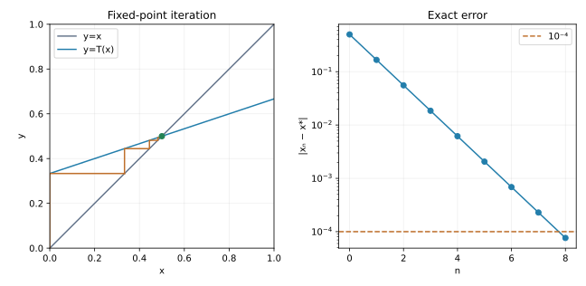

# M11-L5 – Banach spaces and the contraction mapping theorem {#L5}

**Course area:** M11 – Advanced calculus, linear algebra and probability

**Level:** Bachelor · Advanced study and bridge to Master level

**Prerequisites:** [M2-L4](M2-L4.md); [M2-L7](M2-L7.md); [M1-L9](M1-L9.md)

**Classification:** Bachelor extension / Master bridge

## Learning objectives {#S1}

Distinguish normed and complete spaces, prove Banach’s contraction mapping theorem, compute error bounds, and apply the iteration to an integral equation.

## Completeness and Banach spaces {#S2}

A norm on a real or complex vector space $X$ satisfies definiteness, absolute homogeneity and the triangle inequality. It induces the metric $d(x,y)=\|x-y\|$. A sequence $(x_n)$ is Cauchy if for every $\varepsilon>0$ there exists $N$ such that $\|x_n-x_m\|<\varepsilon$ for all $n,m\ge N$. A normed space is a Banach space if every Cauchy sequence converges in it. Completeness concerns not only distances but also the existence of the limit within the space.

The space $C([0,1])$ of continuous real functions with $\|f\|_\infty=\max_{t\in[0,1]}|f(t)|$ is complete. A Cauchy sequence in this norm is pointwise Cauchy and has a pointwise limit $f$ by completeness of $\mathbb R$. Passing to the limit in one index in the uniform Cauchy estimate gives $\|f_n-f\|_\infty\to0$. A uniform limit of continuous functions is continuous (use the triangle inequality with a fixed sufficiently late term). The polynomial subspace with the same norm is incomplete: Taylor polynomials for $e^t$ converge uniformly on $[0,1]$ to $e^t$, which is not a polynomial. A closed subset of a complete metric space is complete even if it is not a vector space.

## Contraction theorem and error bounds {#S3}

Let $(X,d)$ be nonempty and complete and $T:X\to X$ a contraction: some $q\in[0,1)$ satisfies $d(Tx,Ty)\le qd(x,y)$ for all $x,y\in X$. Then there exists exactly one fixed point $x^*=Tx^*$. For every start $x_0\in X$, the iteration $x_{n+1}=Tx_n$ converges to it.

Proof: Repeated application of the contraction estimate gives $d(x_{n+1},x_n)\le q^n d(x_1,x_0)$. For $m>n$, the triangle inequality gives

$$d(x_m,x_n)\le\sum_{k=n}^{m-1}q^k d(x_1,x_0)\le\frac{q^n}{1-q}d(x_1,x_0).$$

The sequence is therefore Cauchy and has a limit in $X$. Lipschitz continuity of $T$ permits passing to the limit in the iteration, so $Tx^*=x^*$. Two fixed points would satisfy $d(x^*,y^*)\le qd(x^*,y^*)$, hence must coincide. Taking $m\to\infty$ gives the a priori bound above. The same argument starting at $x_n$ gives the a posteriori bound $d(x_n,x^*)\le d(x_{n+1},x_n)/(1-q)$, which in terms of the previous step is at most $q d(x_n,x_{n-1})/(1-q)$ for $n\ge1$.

## Worked example and counterexamples {#S4}

On $[0,1]$ let $T(x)=(x+1)/3$. It preserves the interval and has $q=1/3$. The fixed point is $1/2$. Starting at $x_0=0$, exactly $x_n=(1-3^{-n})/2$. The a priori bound is $3^{-n}/2$ and equals the actual error in this example. Eight steps guarantee error at most $10^{-4}$. The figure shows alternating vertical and horizontal steps between $y=T(x)$ and $y=x$, together with error decay.

The assumptions matter. On $(0,1)$, $T(x)=x/2$ is a contraction without a fixed point in the space (which is incomplete). On $\mathbb R$, $T(x)=x+1$ has no fixed point despite Lipschitz constant 1. Even strict pairwise distance reduction is insufficient: on $[1,\infty)$, $T(x)=x+1/x$ strictly reduces distances between distinct $x,y$ since $|Tx-Ty|=|x-y||1-1/(xy)|<|x-y|$. However, there is no uniform factor $q<1$ and no fixed point.

{alt="Fixed-point iteration and geometric error decay"}

## Application to differential equations {#S5}

On $C([0,1/2])$ with supremum norm define $(Tf)(t)=1+\int_0^t f(s)\,ds$. This is a self-map and $\|Tf-Tg\|_\infty\le\tfrac12\|f-g\|_\infty$. The theorem gives a unique continuous solution of the integral equation. By the fundamental theorem of calculus it is differentiable and satisfies $y'=y$, $y(0)=1$, hence $y=e^t$. Starting at $f_0=1$, the iterates are $f_n(t)=\sum_{k=0}^n t^k/k!$. This follows by induction and termwise integration of the finite sum. Since $\|f_1-f_0\|_\infty=1/2$, $\|f_n-e^t\|_\infty\le2^{-n}$. The actual Taylor remainder bound is substantially sharper. General Picard operators require, among other conditions, a suitable invariant set of functions and a Lipschitz condition in the state variable; arbitrary time horizons do not automatically yield a contraction.

## Self-assessment {#S6}

### Exercises

1. Determine the fixed point and contraction factor of $T(x)=0.4x+3$ on $\mathbb R$.
2. With $q=1/2$, $d(x_1,x_0)=2$, how many steps does the a priori estimate guarantee for error at most $0.01$?
3. Why does the theorem not apply to $(0,1)$ with $T(x)=x/2$?
4. Compute $f_2(t)$ for the integral operator in S5.
5. Derive a guaranteed distance to $x^*$ from $d(x,Tx)\le\delta$.

::: {.lc-solutions data-lc-section="S6"}
1. $x^*=5$, $q=0.4$.
2. $4\cdot2^{-n}\le0.01$; $n=9$ suffices, $n=8$ does not.
3. The space is incomplete; the limit 0 lies outside it.
4. $1+t+t^2/2$.
5. $d(x,x^*)\le d(x,Tx)+q d(x,x^*)$, hence at most $\delta/(1-q)$.
:::

## Sources {#S7}

- [University of Toronto, MAT267, Tutorial 6](https://www.math.utoronto.ca/almut/MAT267/Tutorial-6A.pdf) · p. 1: assumptions, uniqueness, existence, geometric error estimate; PDF text only · Last accessed: 2026-11-24 · Content verified: 2026-11-24
