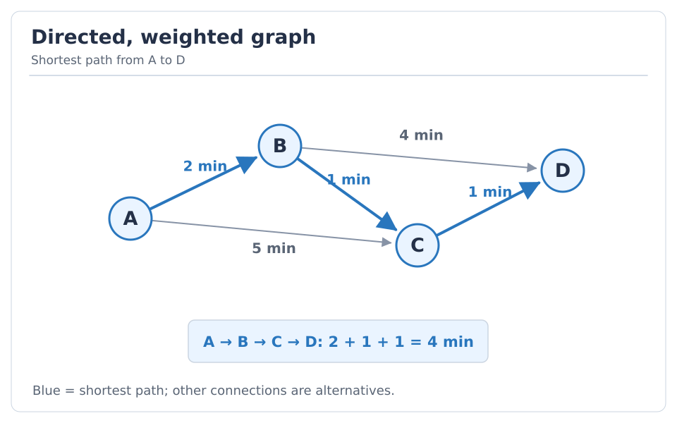

# M2-L1 – Discrete mathematics, graph theory and combinatorics {#L1}

**Course area:** M2 – Advanced Bachelor’s studies / transition to Master’s studies

**Level:** Bachelor’s / bridge to Master’s studies

**Prior knowledge:** No fixed prerequisites specified.

**Context:** University – further advanced studies

## What is this about? {#S1}

Calculus often studies changes as continuous processes. **Discrete mathematics**, by contrast, deals with distinguishable elements and structures: individual tasks, nodes in a network, possible paths or a finite set of decisions. Graph theory makes relationships between such elements mathematically accessible. Combinatorics examines how many configurations are possible. This forms a direct bridge between mathematics, data structures and algorithms.

## Basic idea and intuition {#S2}

A graph here is not a plotted function curve. In this context, it is a set of **vertices** (nodes) and **edges**: vertices represent objects or states; edges represent connections, dependencies or possible transitions. A directed graph distinguishes ‘from A to B’ from ‘from B to A’. A weighted graph assigns values such as travel times, costs or distances to its edges. Weights need a clearly defined unit or meaning.

Using such a model, we can ask: Which connection is shortest? Are two vertices connected at all? Does the system contain a cycle of dependencies? Which tasks can be carried out in parallel? How many alternatives does a planning algorithm have?

## New symbols before the first formula {#S3}

| Symbol | Pronunciation | Meaning here | Other possible use |
| --- | --- | --- | --- |
| $G$ | ‘capital G’ | Graph as the entire network | G can also denote a function or group |
| $V$ | ‘capital V’ | Set of vertices | Vector space (M1-L5) or volume (School Mathematics M1-L5) |
| $E$ | ‘capital E’ | Set of edges | Expected value notation E\[X\] (M1-L7) |
| $G=(V,E)$ | ‘G is the ordered pair V, E’ | The graph is defined by its vertex and edge sets | Parentheses are also used for coordinates |
| $\{A,B\}$ | ‘set containing A and B’ | Unordered pair, for example an undirected edge | General set notation |
| $(A,B)$ | ‘ordered pair A, B’ | Directed edge from A to B | Coordinates or function argument |
| $w(A,B)$ | ‘weight from A to B’ | Edge cost for this transition | w as an arbitrary function |
| $d(s,z)$ | ‘d of s and z’ | Shortest path length from starting point s to destination z | d can denote a differential |
| $A_{ij}$ | ‘A sub i j’ | Matrix entry in row i, column j | A as an arbitrary matrix (M1-L5) |
| $\lvert V\rvert$ / $\lvert E\rvert$ | ‘number of elements in V / E’ | Cardinality of the vertex/edge set | Vertical bars also denote absolute value |
| $n!$ | ‘n factorial’ | Product of the natural numbers from 1 to n | Exclamation mark as negation in programming languages |
| $C(n,k)$ | ‘n choose k’ / ‘combinations of n and k’ | Selection of k objects from n without regard to order | C can also be a constant |
| $O(\lvert V\rvert+\lvert E\rvert)$ | ‘capital O of the number of vertices plus the number of edges’ | Order of growth of an algorithm’s running time | O notation is also used for numerical errors (M1-L8) |
| $F(n)$ | ‘F of n’ | Number of permitted step sequences for n stairs | F can also be a general function |

## A graph as a mathematical data structure {#S4}

$$
G=(V,E)
$$

**Read aloud:** ‘The graph G consists of the vertex set V and the edge set E.’ For an **undirected simple graph**, edges can be unordered pairs, and for a directed graph, ordered pairs. If there are multiple edges or additional attributes, the formal definition requires further information.

Software can store this graph in several ways:

- **Adjacency list:** For each vertex, its neighbours and, if needed, their edge weights are listed. This often saves space for large, sparsely connected networks.
- **Adjacency matrix:** A square table with an entry $A_{ij}$ for the connection from vertex i to vertex j. In a simple unweighted graph, for example, $A_{ij}=1$ means that the edge exists; $0$ means that it is absent.
- **Edge list:** A list of connections, potentially including their starting points, destinations and weights.

In a graph with $\lvert V\rvert$ vertices, the adjacency matrix has $\lvert V\rvert\cdot\lvert V\rvert$ entries. An adjacency list can require considerably less memory for sparse graphs. The particular data structure affects the computational cost of search procedures.

## Fully explained mini-example: shortest path {#S5}

A small directed graph models four stations A, B, C and D. The number on each connection is its **non-negative** processing time in minutes:

The edges highlighted in blue form the shortest path A → B → C → D.

Formula, sketch or calculation scheme · Original notation

    A --2--> B --1--> C --1--> D
     \       \
      5       4
       \       \
        v       v
        C       D

The edges are explicitly: A→B with weight 2, A→C with 5, B→C with 1, B→D with 4 and C→D with 1. The sketch helps with reading; the edge list defines the model unambiguously.

From starting point A to destination D, there are, for example, the following paths:

| Path | Sum of the weights | Time |
| --- | --- | --- |
| A → C → D | $5+1$ | 6 minutes |
| A → B → D | $2+4$ | 6 minutes |
| A → B → C → D | $2+1+1$ | **4 minutes** |

The best path in this model is A → B → C → D, taking 4 minutes. It has **three edges**. A path with **only two edges**, such as A → C → D, takes **six minutes** instead: with different weights, the path with the fewest edges is not necessarily the shortest in time. $d(A,D)=4$ is the mathematical shorthand for the length of this shortest path. **Read aloud:** ‘The shortest distance from A to D is four.’ Here, distance is defined as a sum of **times**, not metres.

**Dijkstra’s algorithm** can calculate such shortest paths in directed or undirected weighted graphs **if all edge weights under consideration are non-negative**. Negative edge weights may require a different procedure. For example, $A\to B$ with cost 2, $A\to C$ with cost 5 and $C\to B$ with cost −4 form a graph **without a negative cycle**. The least costly path A→C→B costs $5-4=1$, although the direct path A→B costs 2. The usual Dijkstra algorithm, which permanently settles vertices already examined, is not reliable for such negative weights; under appropriate conditions, Bellman–Ford can be used instead. If a negative cycle is reachable from the starting point and the destination is reachable from that cycle, the total cost can decrease without bound through repetition; there is then no finite shortest **walk** with repetitions. The algorithm does not count the mere number of connections as the cost in this example; the weights are what matters.

## Depth-first search, breadth-first search and dependency graphs {#S6}

**Breadth-first search** (*BFS*) first examines the vertices one step away, then those two steps away, and so on. In an unweighted graph, it finds a path with as **few edges** as possible, not automatically the path with the lowest arbitrary costs. With adjacency lists, a complete BFS in the usual model takes time of order $O(\lvert V\rvert+\lvert E\rvert)$; with a fully searched **adjacency matrix**, however, examining all possible neighbours may require $O({\lvert V\rvert}^{2})$ time.

**Read aloud:** ‘The order of growth of the running time is linear in the number of vertices plus the number of edges.’ The capital $O$ denotes an asymptotic upper bound up to constant factors; it is not an exact running time in seconds.

**Depth-first search** (*DFS*) follows a path as far as possible before backtracking. It is useful, for example, for checking connectivity, detecting cycles and as a building block of many graph algorithms.

A **directed acyclic graph**, or **DAG**, is often used for project workflows. ‘Acyclic’ means that it is impossible to follow the directed dependencies and return to the starting point. A **topological sort** orders all steps so that each prerequisite precedes the step that depends on it. If a directed cycle exists, there is no such complete ordering for its dependencies. **Example:** If A→B, A→C, B→D and C→D are mandatory dependencies, then `A, B, C, D` and `A, C, B, D` are both valid topological orders. `B, A, C, D` is not, because B comes before its prerequisite A. A DAG is not yet a complete schedule, however: the actual duration depends on resources, running times and parallelism.

## Combinatorics: how many possibilities are there? {#S7}

The product rule of combinatorics states that if we have three independent choices in a first step and four choices after each of them, there are $3\cdot4=12$ different sequences of decisions in total. ‘Independent’ here means that each of the four second-step options is available after each of the three first-step choices; it does not refer to the statistical independence of events.

If we select two from five **distinct** objects and order does not matter, there are:

$$
C(5,2)=\frac{5!}{2!\cdot3!}=10
$$

**Read aloud:** ‘Five choose two is five factorial divided by the product of two factorial and three factorial; this equals ten.’ $5!$ means $5\cdot4\cdot3\cdot2\cdot1=120$, $2!=2$ and $3!=6$; hence $\frac{120}{2\cdot6}=10$. By convention, **$0!=1$** as well, so that the formula holds for $k=0$ and $k=n$.

In general, for integers $0\leq k\leq n$:

$$
C(n,k)=\frac{n!}{k!\cdot(n-k)!}
$$

**Read aloud:** ‘The number of ways of choosing k from n is n factorial divided by the product of k factorial and n minus k factorial.’ The formula counts combinations **without repetition and without regard to order**. Different formulas apply to arrangements or repetitions: if we select two from five distinct objects **in order without replacement**, there are $5\cdot4=20$ possibilities instead of ten. For two consecutive draws **with replacement**, with five possible choices on each draw, there are $5\cdot5=25$ ordered outcomes. The important connection with probability theory is that combinatorics helps count the number of outcomes, but this number alone does not yet determine **a probability** (see the German-language School Mathematics course, M2-L15).

## State spaces and dynamic programming {#S8}

An AI agent can represent a problem as a state graph: each vertex is a valid configuration; an edge represents a permitted action. A search can then plan how to move from the initial state to the goal state. Even a few decisions per step can lead to a large number of possible state sequences – this growth is often called a **combinatorial explosion**.

**Dynamic programming** saves computations when subproblems recur and their optimal solutions can be combined in a meaningful way. Rather than computing the same substate repeatedly, the corresponding results are stored or processed in a table. **Mini-example:** A staircase with four stairs can be climbed one or two stairs at a time. The number $F(n)$ of different **sequences of one- and two-stair steps** satisfies $F(n)=F(n-1)+F(n-2)$, because the last step is either one or two stairs long. With $F(0)=1$ (empty sequence) and $F(1)=1$, we obtain $F(2)=2$, $F(3)=3$, $F(4)=5$. Storing earlier values avoids repeated intermediate calculations. Not every graph can be optimised efficiently by simple caching; the structure of the problem is decisive.

## What is it useful for? {#S9}

- **Software and agents:** Dependencies between tasks, package management, build systems, workflows and state transitions.
- **Networks:** Routing, reachability and load paths in computer networks or supply chains.
- **AI:** Search trees, knowledge graphs, graph neural networks and path planning.
- **Robotics:** Map graphs and discrete motion planning; real geometry and the absence of obstacles must also be considered.

## Assumptions, limitations and common misconceptions {#S10}

- A graph is only as complete as the vertices, edges, directions and costs represented in it. A mathematically shortest route need not be the best in reality.
- Standard BFS minimises the **number of edges**, not weighted costs in general. Dijkstra requires non-negative edge weights.
- Topological sorting requires a **directed acyclic** graph; it does not automatically solve resource planning and scheduling.
- Combinatorial formulas depend on whether order, repetition and distinguishability matter.
- A fast asymptotic running time does not guarantee fast execution in practice for very large inputs, unfavourable constants or memory problems.

## Connection to the next unit {#S11}

M2-L2 moves from possible paths and configurations to **constrained optimisation**. We ask not only which solutions exist, but which of them is best according to a previously defined objective.

## Sources {#S12}

No individual sources are listed separately for this lesson.
