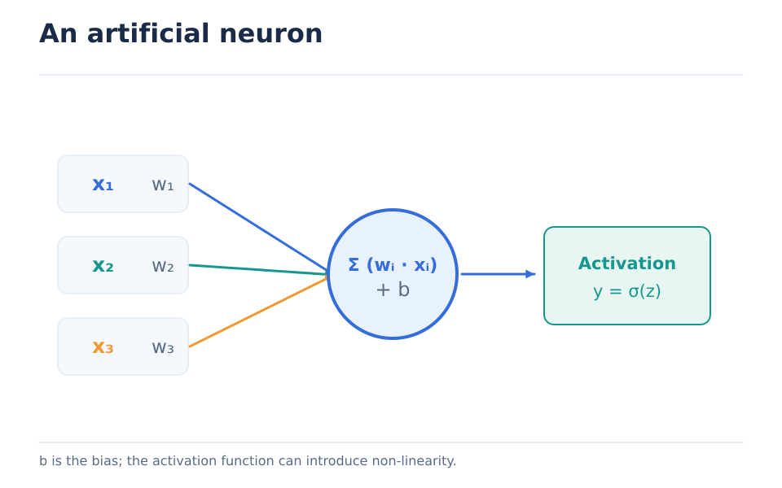

# M2-L11 – Mathematical foundations of AI and neural networks {#L11}

**Course area:** M2 – Advanced Bachelor’s studies / transition to Master’s studies

**Level:** Bachelor’s / bridge to Master’s studies

**Prior knowledge:** No fixed prerequisites specified.

**Context:** University – advanced application-oriented studies

## What is this about? {#S1}

A neural network is not a magical mathematical special case. It combines many simple computational operations into a large function with adjustable parameters. During training, an optimisation method changes these parameters so that the predictions for the training data better match a specified objective. This requires linear algebra, derivatives, probability and numerical mathematics. This lesson explains the mathematical notation of such models using a small, fully transparent example, without reducing the entire range of modern AI architectures to a single formula.

Connections: School Mathematics M2-L4 (chain rule), M1-L4 (gradient), M1-L5/M1-L6 (matrices), M1-L7 (probability), M1-L8 (numerical mathematics), M2-L2 (optimisation) and M2-L10 (cross-entropy).

## Basic idea and intuition {#S2}

Imagine a software function that produces a prediction from several input numbers. Some numbers inside this function act as adjustable settings. As long as these settings remain unchanged, the function gives the same result for the same input. During training, we compare the prediction with the desired result and determine in which direction the settings should be adjusted slightly. A complex neural network consists of many such steps in succession; **backpropagation** is the systematic application of the chain rule to propagate the required gradients backwards through these computational steps.

## New symbols before the first formula {#S3}

| Symbol | Pronunciation | Meaning here | Other possible uses |
| --- | --- | --- | --- |
| $x$ | ‘x’ | Input as a number or vector | Coordinate or random variable |
| $W$ | ‘capital W’ | Weight matrix containing learnable values | W as an event or work in other fields |
| $b$ | ‘b’ | Bias vector, additive shift | Intercept of a straight line |
| $z$ | ‘zed’ | Result of a linear combination | Complex number in M2-L5 |
| $\sigma$ | ‘lower-case sigma’ | Activation function; here a placeholder for a nonlinearity | Standard deviation in M1-L7 |
| $y$ | ‘y’ | Observed or desired target value | General output variable |
| $\hat{y}$ | ‘y hat’ | Value predicted by the model | Estimate in general |
| $L$ | ‘capital L’ | Loss function, measures training error | Length in geometry |
| $\theta$ | ‘theta’ | Collective notation for the learnable parameters | Angle in trigonometry |
| $\nabla_\theta L$ | ‘gradient of L with respect to theta’ | Derivatives of the loss with respect to all parameters | Nabla in other spatial derivatives |
| $\eta$ | ‘eta’ | Positive learning rate, step size of an update | Otherwise a general parameter |
| `Σ` | ‘capital sigma’ | Add many summands | – |
| $s_{j}$, $s_{k}$ | ‘score sub j’, ‘score sub k’ | Real-valued class scores; j denotes the class under consideration, k ranges over all classes | s as distance in physics |
| $p_{j}$ | ‘p sub j’ | Softmax probability of the j-th class | p as a general probability |
| $\exp$, $m$ | ‘exponential function’, ‘m’ | Exponential function and maximum of all scores | m as mass in physics |
| $n$ | ‘n’ | Number of training examples considered | Time index and sample size |
| $w$ | ‘lower-case w’ | A single adjustable weight | Velocity or another quantity |
| $u\cdot v$ | ‘u dot v’ | Similarity between two vectors | Dot as ordinary multiplication |
| $\Vert u\Vert$ | ‘norm of u’ | Vector length | Norm of a function in M2-L7 |
| $\in$, $\mathbb{R}$ | ‘is an element of’, ‘real numbers’ | Specifies the set to which vector components belong | General set theory |

## A neural computation step {#S4}

A single computation step in what is known as a layer may be written as follows:

{alt="Weighted sum and activation of an artificial neuron"}

$$
\begin{aligned}
z&=W\cdot x+b\\
\text{Output}&=\sigma(z)
\end{aligned}
$$

**First formula read aloud:** ‘Zed equals the weight matrix W times the input vector x plus the shift vector b.’ The multiplication here is **matrix–vector multiplication**, not element-wise multiplication of two lists. The second formula reads: ‘The output is the activation function, lower-case sigma, applied to zed.’

Example of dimensions: the input vector contains three features. We want to calculate two output values. The matrix $W$ then has two rows and three columns, $x$ has three entries and $b$ has two entries. The result $z$ contains exactly two numbers. Without compatible dimensions, the matrix computation is undefined.

If $\sigma$ is a nonlinear function such as **ReLU** – it returns zero for negative inputs and leaves positive inputs unchanged – combining several layers can represent more complex relationships than a single purely linear mapping. A sequence of exclusively linear layers without further nonlinearities would again be a linear or affine mapping overall.

## Loss function: what does ‘better’ mean? {#S5}

The quality of a model prediction requires a specified measurement rule. For a simple numerical prediction, the **mean squared error** is sometimes suitable:

$$
L=\frac1n\sum_{i=1}^n{(\hat y_i-y_i)}^2
$$

**Read aloud:** ‘The loss L is one divided by the number of examples, multiplied by the sum of the squared differences between the predicted and actual values.’ $\hat{y}_{i}$ is the i-th prediction, $y_{i}$ the i-th target value. Squaring prevents positive and negative errors from cancelling each other out, but gives particularly large weight to large errors.

For classification, **negative log-likelihood** or cross-entropy are often more suitable; their statistical interpretation was introduced in M2-L10. Which loss function is appropriate depends on the problem and its assumptions. A low training loss initially means only good agreement with the chosen training objective.

## Gradient and learning step {#S6}

For each parameter, the gradient of a loss function contains information about how the loss initially changes when that parameter is changed slightly. A simple gradient descent update is:

$$
\theta_{\mathrm{new}}=\theta_{\mathrm{old}}-\eta\,\nabla_{\theta}L(\theta_{\mathrm{old}})
$$

**Read aloud:** ‘The new parameter vector theta is the old parameter vector minus the learning rate eta multiplied by the gradient of the loss function, evaluated at the old parameters.’ The minus sign means moving locally in the direction opposite to the steepest ascent. For small steps, this can reduce the loss; excessively large learning rates can increase it or make the computation unstable.

$\nabla_\theta L$ contains many **partial derivatives** in a model with multiple parameters. Backpropagation calculates them by systematically chaining the differentiation rules from School Mathematics M2-L4 and M1-L4. It is a method for efficient gradient computation, not the optimisation algorithm itself and not a guarantee of a global minimum.

## Fully explained mini-example: a single weight {#S7}

A model uses only one input $x=2$ and one adjustable weight $w$:

$$
\begin{aligned}
\hat y&=w\cdot x\\
\text{Target value: }\quad y&=6\\
L(w)&={(2w-6)}^2
\end{aligned}
$$

**Read aloud:** ‘The prediction is the weight w times the input x; the target value is six. The loss as a function of the weight is the square of two times w minus six.’ There is exactly one data point in this example; the mean squared error is therefore identical to the individual squared error.

We start with $w=2$. The prediction is $\hat{y}=2\cdot 2=4$, the error is $4-6=-2$ and the loss is $L(2)=4$.

Now we need the **derivative of the loss with respect to the weight**. Using the chain rule, we obtain:

$$
\frac{\mathrm{d}L}{\mathrm{d}w}=2(2w-6)\cdot2=4(2w-6)
$$

**Read aloud:** ‘The derivative of L with respect to w is two times the quantity two w minus six, times two; simplified, four times the quantity two w minus six.’ At $w=2$, it is $-8$. The negative sign tells us that if we increase $w$ slightly, the loss initially decreases.

With learning rate $\eta =0{,}1$, gradient descent gives:

$$
\begin{aligned}
w_{\mathrm{new}}&=2-0{,}1\cdot(-8)=2{,}8\\
\hat y_{\mathrm{new}}&=2{,}8\cdot2=5{,}6\\
L_{\mathrm{new}}&={(5{,}6-6)}^2=0{,}16
\end{aligned}
$$

**Read in full:** ‘The new weight is two minus zero point one times minus eight, giving two point eight. The new prediction is five point six. The new squared error is zero point one six.’ A single learning step has reduced the loss from $4$ to $0{,}16$. **Why the learning rate matters:** For this particular quadratic function, the derivative is $\frac{dL}{dw}=8(w-3)$. A single learning step therefore changes the distance from the optimum according to the exact rule:

$$
w_{\mathrm{new}}-3=(1-8\eta)(w_{\mathrm{old}}-3)
$$

**Read aloud:** ‘New distance from the optimum equals one minus eight times the learning rate, multiplied by the old distance.’ For a starting value other than $3$, the distance decreases at every step if $|1-8\eta | < 1$, that is, **$0<\eta<\frac{1}{4}$**. For example, $\eta =0{,}3$ from the starting value $w=2$ leads initially to $w_{\mathrm{new}}=4{,}4$ and $L_{\mathrm{new}}=7{,}84$, rather than an improvement – the error increases. This strict bound applies **to this single quadratic example**, not to neural networks in general.

The exact optimal solution here would be $w=3$, because the prediction $6$ then matches the target value. In large neural networks, the situation is more complicated: many parameters, numerous data points and often a non-convex loss landscape.

## Embeddings and vector similarity {#S8}

An **embedding** is a numerical vector representation of an object, such as a passage of text or an image. The values are often learnt so that objects that are similar with respect to a particular training objective are appropriately close to one another. A widely used measure is **cosine similarity**:

$$
\operatorname{cos\_sim}(u,v)=\frac{u\cdot v}{\lVert u\rVert\,\lVert v\rVert}
$$

**Read aloud:** ‘The cosine similarity of vectors u and v is their dot product divided by the product of their lengths.’ The dot product was explained in School Mathematics M2-L11. For real vectors, a value close to $1$ indicates similar directions; $0$ means perpendicular directions; $-1$ means opposite directions. The formula is only defined when both vectors have a **non-zero length**. Cosine similarity is not a reliable indicator of the truth, moral evaluation or logical consistency of texts.

In a local search or an AI agent system, embeddings can be used to compare documents. However, their informative value depends on the quality of the model, the preprocessing of the data and the actual search task.

## Probabilities, softmax and numerical stability {#S9}

Many classifiers output probability values for several classes. Arbitrary real-valued **scores** are often generated first and then transformed by a softmax function into positive values whose sum is one. This does not automatically mean that these probabilities are well calibrated in the real world.

**Readable softmax formula:** We call the number for the class with index $j$ a score $s_{j}$. $\exp$ is the exponential function, and `Σ` sums over all class indices $k$. The probability of this class is:

$$
p_j=\frac{\exp(s_j)}{\sum_k\exp(s_k)}
$$

With two equally high scores, each class receives $\frac{1}{2}$; for scores of $1000$ and $1000$, however, directly calculating the exponential values in floating-point arithmetic would be risky. Numerical care is needed: directly evaluating an exponential function at a very large score can cause overflow. For a stable softmax calculation, the largest score is commonly subtracted from all scores **before** exponentiation. Because the same constant enters the numerator and denominator, the mathematical probabilities are unchanged. With $m$ as the largest score, the computationally more stable but mathematically identical form is:

$$
p_j=\frac{\exp(s_j-m)}{\sum_k\exp(s_k-m)}
$$

For the two scores $1000$ and $1000$, we have $m=1000$; both exponential values become $\exp (0)=1$, giving $p_1=p_2=\frac{1}{2}$. This prevents overflow due to large positive scores but does not solve every conceivable numerical problem. This connection between algebra and floating-point numerical computation follows from M1-L8.

## What is it useful for? {#S10}

The formulas help us interpret training curves and error messages for local AI models. When developing our own inference or agent tools, they explain how embeddings, similarity search and simple learning methods work. Understanding matrix dimensions and gradients makes it easier to analyse neural network architectures. Finally, numerical mathematics explains why identical mathematical models can produce different results depending on the data type and implementation.

## Assumptions and limitations {#S11}

A learning algorithm optimises a **defined mathematical objective**, not automatically correctness or reliability in real-world use. Training data may contain biases; the model may fail when inputs change. Overfitting means that a model handles training data well but generalises poorly to new data. Evaluating a model therefore requires suitable test examples kept separate from training; even a good test result is informative only for the assumed data distribution. Gradient descent does not guarantee a global solution in non-convex problems. Furthermore, this lesson presents the basic idea of ordinary differentiable networks; modern architectures may contain additional components and training objectives.

## Connection to the next unit {#S12}

M2-L12 applies matrices, derivatives, optimisation and uncertainty to robotics: motion models, rotations, state estimation and control.

## Further specialist resource (optional, online; not required for offline reading) {#S13}

Stanford University, *CS231n – Optimization: Stochastic Gradient Descent* and related chapters on backpropagation: [https://cs231n.github.io/optimization-1/](https://cs231n.github.io/optimization-1/) (accessed 04.11.2026).

## Sources {#S14}

External specialist sources and further reading links mentioned in the lesson text:

- [https://cs231n.github.io/optimization-1/](https://cs231n.github.io/optimization-1/)
