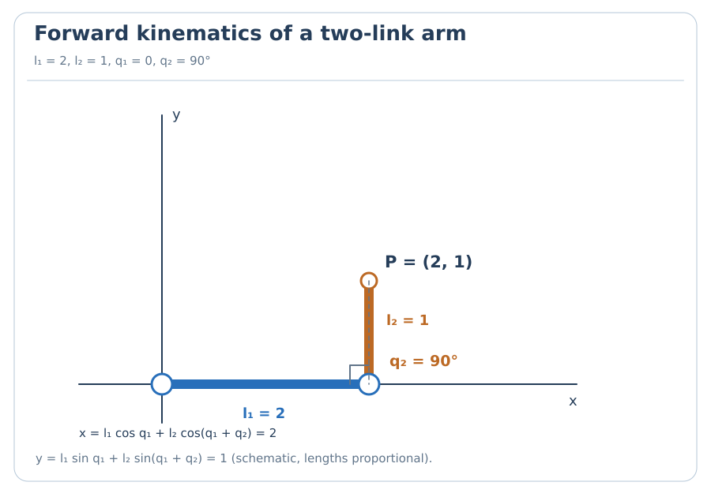

# M2-L12 – Mathematics of robotics: Kinematics, quaternions and control {#L12}

**Course area:** M2 – Advanced Bachelor’s studies / transition to Master’s studies

**Level:** Bachelor’s / bridge to Master’s studies

**Prior knowledge:** No fixed prerequisites specified.

**Context:** University – advanced application-oriented studies

## What is this about? {#S1}

A robot needs more than just a target. It must first describe its own configuration mathematically, relate its joint movements to the position of a tool, evaluate uncertain sensor measurements and continually correct its motion. Geometry, linear algebra, differential equations, probability and algorithms interact in this process. This lesson progresses from a small planar robot arm to spatial orientation using quaternions. The examples are deliberately designed to be calculable and do **not** constitute a complete safety-critical robot control system.

Connections: School M2-L11–School M2-L14 (vectors and rotations), M1-L4 (partial derivatives), M1-L5/M1-L6 (matrices), M1-L7 (probabilities), M1-L9 (dynamics), M2-L1 (graphs), M2-L2 (optimisation) and M2-L11 (AI models).

## Basic idea and intuition {#S2}

**Kinematics** describes the location of a component resulting from its joint configurations, without initially asking about the forces causing the motion. **Dynamics** additionally investigates masses, inertia and forces. **Feedback control** compares a desired state with measured values and adjusts control inputs. **State estimation** attempts to infer the actual state from imperfect measurements. **Motion planning** selects an admissible sequence of states before and while a robot executes them.

The same hand position can correspond to different joint configurations. Similarly, a camera can describe the same object from different coordinate systems. Sound robotics mathematics therefore begins by specifying the meaning of each quantity and its reference frame.

## New symbols and how to read them before the formulae {#S3}

| Symbol | Read aloud | Meaning in this lesson | Other possible use |
| --- | --- | --- | --- |
| $q_{1}$, $q_{2}$ | “q one, q two” | Angles of two revolute joints, in radians | $q$ later also denotes a quaternion |
| $l_{1}$, $l_{2}$ | “ell one, ell two” | Lengths of two rigid arm links, for example in metres | $l$ may otherwise denote the length of a path |
| $p=(x,y)$ | “p as the coordinate pair x, y” | Tool position in the plane | $p$ also denotes a probability in M2-L10 |
| $\sin$, $\cos$ | “sine”, “cosine” | Trigonometric functions, with angles in radians here | Not other functions despite similar abbreviations |
| $\pi$ | “pi” | Circle constant; half a revolution is $\pi\,\mathrm{rad}$ | – |
| $R(\theta )$ | “rotation matrix R of theta” | Rotation in the planar coordinate system | $R$ may also denote measurement error variance |
| $R^{\mathrm{T}}$ | “R transpose” | Rows and columns of R interchanged | Transposition in general in M1-L5 |
| $I$ | “identity matrix I” | Matrix that leaves vectors unchanged | Information content in M2-L10 |
| $T$ | “transformation matrix T” | Change of pose between spatial coordinate systems | Time or temperature in other lessons |
| $J(q)$ | “Jacobian matrix J of q” | Local change of tool position due to joint angles | $J$ may be an objective function |
| $\dot{q}$, $\dot{p}$ | “q dot”, “p dot” | Time derivative of joint configuration or position, respectively | The dot is not a scalar product here |
| $\det$ | “determinant” | Tests local invertibility of the Jacobian matrix here | Volume scaling in School M2-L14/M1-L6 |
| $\operatorname{atan2}(y,x)$ | “arctangent two of y, x” | Angle accounting for the quadrant, provided both inputs are not zero | Not identical to ordinary $\arctan\!\left(\frac{y}{x}\right)$ |
| $Q=(w,a,b,c)$ | “quaternion capital Q with four components” | Spatial rotation as a unit quaternion | $q_{1}$ was previously a joint angle |
| $\Vert Q\Vert$ | “norm of q” | Length of the four-dimensional quaternion vector | Vector norms in M1-L5/M2-L7 |
| $e$, $u$, $K_{p}$ | “e”, “u”, “K sub p” | Control error, control input, proportional gain | $e$ also denotes Euler's number, $u$ a function |
| $\hat{x}^{-}$, $\hat{x}^{+}$ | “x hat minus / plus” | State estimate before / after a new measurement | Minus and plus are state labels here |
| $P^{-}$, $P^{+}$, $R_{m}$ | “P minus / plus, R sub m” | Estimation error variance before / after measurement and measurement error variance | P as probability; R as rotation matrix |
| $K$ | “Kalman gain K” | Proportion of the measurement correction | Stiffness or another constant |
| $z$ | “zed” | Current measured value | Input of a neural network unit in M2-L11 |
| `*` | “quaternion product” | Composition of two rotations, not elementwise multiplication | Ordinary multiplication in software texts |

All the following calculations explicitly specify units or the dimensionless meaning of quantities. Trigonometric functions use radians as the computational measure of angles.

## Two joints move a point: forward kinematics {#S4}

Imagine a robot arm in the plane. Its first rigid link is $l_{1}=2 \,\mathrm{m}$ long and its second is $l_{2}=1 \,\mathrm{m}$ long. The first joint angle $q_{1}$ is measured from the positive x-direction. The second angle $q_{2}$ describes the **relative rotation** of the second link with respect to the first. The absolute angle of the second link is therefore $q_{1}+q_{2}$.

{alt="Robot arm in a coordinate system with the first link of length two horizontal and the second link of length one vertical, tool point (2,1)."}

Forward kinematics with $q_1=0$ and $q_2=90^{\text{°}}$ gives the tool point (2,1).

The position of the tool point is:

$$
\begin{aligned}
x&=l_1\cos(q_1)+l_2\cos(q_1+q_2)\\
y&=l_1\sin(q_1)+l_2\sin(q_1+q_2)
\end{aligned}
$$

**First formula read in full:** “The horizontal position is the length of the first link multiplied by the cosine of its angle, plus the length of the second link multiplied by the cosine of the sum of the two joint angles.” **Second formula read in full:** “The vertical position is the length of the first link multiplied by the sine of its angle, plus the length of the second link multiplied by the sine of the sum of the two angles.” Both results have the unit metre. We add the x and y components of two directed line segments.

**Fully worked mini-example:** The first link points to the right ($q_{1}=0$), and the second points upwards at right angles to it ($q_2=\frac{\pi}{2}$). Then:

$$
\begin{aligned}
x&=2\cdot\cos(0)+1\cdot\cos(\pi/2)=2\cdot1+1\cdot0=2\,\mathrm{m}\\
y&=2\cdot\sin(0)+1\cdot\sin(\pi/2)=2\cdot0+1\cdot1=1\,\mathrm{m}\\
p&=(2\,\mathrm{m},1\,\mathrm{m})
\end{aligned}
$$

**Read aloud:** “The tool point is two metres to the right and one metre above the origin.” The position follows from geometry alone; friction, motor load and inertia are not yet included in this description.

## The reverse direction: inverse kinematics and ambiguity {#S5}

**Inverse kinematics** asks the opposite question: which joint angles reach a desired position? For this planar two-joint arm, the cosine of the second joint angle can first be determined:

$$
\cos(q_2)=\frac{x^2+y^2-l_1^2-l_2^2}{2l_1l_2}
$$

**Read aloud:** “The cosine of the second angle equals the sum of the squares of the two target coordinates minus the squares of both arm lengths, divided by twice the product of the two arm lengths.” This follows from the cosine rule. The expression on the right must lie between minus one and plus one; otherwise the target is unreachable with these two rigid links. The same **reachability condition** can be read directly from the distance of the target point from the origin:

$$
\lvert l_1-l_2\rvert\leq\sqrt{x^2+y^2}\leq l_1+l_2
$$

**Read aloud:** “The absolute difference between the two arm lengths is at most the distance to the target; this distance is at most their sum.” Here `|...|` denotes the non-negative absolute value and $\sqrt{x^2+y^2}$ the distance of the target from the first joint. With $l_{1}=2 \,\mathrm{m}$, $l_{2}=1 \,\mathrm{m}$, precisely the radial target distances between **1 m and 3 m** are thus reachable if there are no obstacles and the joints rotate freely. Joint limits and collisions may restrict the actually reachable region.

Substituting the target point $(2 \,\mathrm{m},1 \,\mathrm{m})$ that we already know:

$$
\begin{aligned}
\cos(q_2)&=\frac{2^2+1^2-2^2-1^2}{2\cdot2\cdot1}\\
&=\frac{4+1-4-1}{4}\\
&=0
\end{aligned}
$$

Hence the two angles $q_2=+\frac{\pi}{2}$ and $q_2=-\frac{\pi}{2}$ are possible in principle. The second choice requires a different first joint configuration: $q_{1}\approx 0{,}9273\,\mathrm{rad}$, or approximately $53{,}13^{\text{°}}$. Indeed, with $q_2=-\frac{\pi}{2}$, substitution into the two equations also gives $x=2 \,\mathrm{m}$ and $y=1 \,\mathrm{m}$. Two different arm configurations can reach the same tool point, often called “elbow up” and “elbow down”.

Which configuration is actually admissible depends on additional conditions such as joint stops, collisions, maximum torques and the current initial position. A mathematical solution is therefore not yet a safe robot movement.

## Local motion: the Jacobian matrix {#S6}

So far, we have calculated positions. For velocities, we ask how the tool point changes under a **small change** in the angles. We differentiate the x and y equations with respect to the joint angles. The resulting Jacobian matrix is:

$$
\begin{aligned}
J(q)&=\begin{bmatrix}
-l_1\sin(q_1)-l_2\sin(q_1+q_2)&-l_2\sin(q_1+q_2)\\
 l_1\cos(q_1)+l_2\cos(q_1+q_2)& l_2\cos(q_1+q_2)
\end{bmatrix}\\
\dot p&=J(q)\cdot\dot q
\end{aligned}
$$

**Read aloud:** “The tool velocity equals the Jacobian matrix at the current joint configuration multiplied by the vector of joint angular velocities.” Each column describes how the tool point moves as a result of the corresponding joint. For revolute joints, a Jacobian column here has the unit metres per radian; multiplying by radians per second gives metres per second.

For the position $q_{1}=0$, $q_2=\frac{\pi}{2}$, $l_{1}=2$, $l_{2}=1$, the matrix simplifies to:

$$
\begin{aligned}
J&=\begin{bmatrix}-1&-1\\2&0\end{bmatrix}
\end{aligned}
$$

If only the second joint rotates at $0{,}1\,\mathrm{rad/s}$, i.e. $\dot{q}=(0;0{,}1)\,\mathrm{rad/s}$, then:

$$
\begin{aligned}
\dot p&=\begin{bmatrix}-1&-1\\2&0\end{bmatrix}
 \cdot\begin{bmatrix}0\\0{,}1\end{bmatrix}
 =\begin{bmatrix}-0{,}1\\0\end{bmatrix}\mathrm{m}/\mathrm{s}
\end{aligned}
$$

**Read aloud:** “At this instant, the tool point moves to the left at zero point one metres per second and initially has no vertical velocity.” This describes the **instantaneous** velocity, not a velocity that remains unchanged over a longer period.

In general, the determinant of this two-dimensional Jacobian matrix is $\det  J = l_{1}\cdot l_{2}\cdot \sin (q_{2})$. **Read aloud:** “The determinant of J equals the product of the two link lengths multiplied by the sine of the second joint angle.” If $q_{2}=0$ or $q_{2}=\pi$, the arm is extended or folded back and the determinant becomes zero. Certain instantaneous tool movements are then not independently achievable from the current configuration: a **kinematic singularity**. Local inversion of the matrix is impossible there, although the arm still exists mechanically.

### Singularity: a configuration is not always locally invertible {#abschnitt-7}

The Jacobian matrix maps joint velocities to the instantaneous tool velocity. Conversely, joint velocities can be calculated **uniquely** from a specified tool velocity only if the square matrix is invertible at that configuration. For the two-joint arm described here, expanding the determinant gives:

$$
\det J(q)=l_1l_2\sin(q_2)
$$

**Read aloud:** “The determinant of the Jacobian matrix is the product of both link lengths and the sine of the second joint angle.” The unit is square metres if angles in radians are treated as dimensionless computational quantities. For positive link lengths, $\det  J=0$ holds precisely when $q_{2}$ is an integer multiple of $\pi$. The links are then extended or folded together; this is called a **kinematic singularity**.

**Worked limiting case:** With $q_{1}=0$, $q_{2}=0$, $l_{1}=2 \,\mathrm{m}$, $l_{2}=1 \,\mathrm{m}$, the arm points fully to the right. The formula from Section 3 then gives:

$$
\begin{aligned}
J&=\begin{bmatrix}0&0\\3&1\end{bmatrix}\\
\det J&=0\cdot1-0\cdot3=0
\end{aligned}
$$

Both joint velocities initially produce only a **vertical** tool velocity at this point; a non-zero horizontal velocity cannot be generated there to first order. This does not mean that the arm can never change its horizontal position, only that the local linear inversion fails. For $q_2=\frac{\pi}{2}$ from Section 3, by contrast, $\det  J=2 \,\mathrm{m}^{2}$ and the matrix is locally invertible. In general, joint limits and additional degrees of freedom may further alter practical feasibility.

## Coordinate systems and rotation matrices {#S7}

A sensor may measure in its own coordinate system while the controller uses a world map. We therefore consistently distinguish the **coordinates of a geometric quantity** from the quantity itself. For a planar rotation by an angle $\theta$, we use:

$$
\begin{aligned}
R(\theta)&=\begin{bmatrix}\cos(\theta)&-\sin(\theta)\\\sin(\theta)&\cos(\theta)\end{bmatrix}\\
p_{\mathrm{welt}}&=R(\theta)\cdot p_{\mathrm{lokal}}+t
\end{aligned}
$$

**First formula read aloud:** “The two-dimensional rotation matrix consists of the cosine and sine of the angle arranged with specific signs.” The second formula reads: “The world coordinates of the point equal its rotated local coordinates plus the translation vector t.” $t$ has the unit metre; rotation and translation serve different purposes.

For $\theta=\frac{\pi}{2}$, $p_{\mathrm{lokal}}=(1;0)\,\mathrm{m}$ and $t=(2;3)\,\mathrm{m}$:

$$
\begin{aligned}
R(\pi/2)&=\begin{bmatrix}0&-1\\1&0\end{bmatrix}\\
R(\pi/2)\cdot(1;0)\,\mathrm{m}&=(0;1)\,\mathrm{m}\\
p_{\mathrm{welt}}&=(0;1)\,\mathrm{m}+(2;3)\,\mathrm{m}=(2;4)\,\mathrm{m}
\end{aligned}
$$

**Read aloud:** “A local point one metre to the right is rotated by ninety degrees and then translated two metres to the right and three metres upwards; it ends up at two and four metres.” Pure rotation matrices satisfy $R^{\mathrm{T}}R=I$ and, in three dimensions, $\det (R)=+1$. The first condition preserves lengths and angles; the second distinguishes a proper rotation from a reflection.

In 3D, rotation and translation are often combined in a **homogeneous $4\times4$ transformation matrix**:

$$
\begin{aligned}
T&=\begin{bmatrix}R_{3\times3}&t_{3\times1}\\0\quad0\quad0&1\end{bmatrix}
\end{aligned}
$$

**Read aloud:** “The transformation matrix T contains a three-by-three rotation matrix in the upper left and a three-dimensional translation vector on the right. The last row contains three zeros and a one.” A point receives a fourth homogeneous coordinate $1$, and a direction receives $0$. This allows several coordinate transformations to be chained by matrix multiplication. The **order of multiplication** is crucial; a rotation before a translation is generally not the same as the reverse order.

## Quaternions: spatial orientation without three chains of angles {#S8}

In three dimensions, rotations can also be represented by **unit quaternions**. A quaternion consists of four real numbers, is normalised to unit norm for pure rotations and describes an axis together with an angle of rotation. Here we choose the convention $Q=(w,a,b,c)$: first the scalar component $w$, followed by the three vector components $a,b,c$.

Let $\theta$ be the angle of rotation and $(u_{x},u_{y},u_z)$ a **unit vector** along the rotation axis. Then:

$$
\begin{aligned}
Q&=\begin{pmatrix}\cos(\theta/2)\\u_x\cdot\sin(\theta/2)\\u_y\cdot\sin(\theta/2)\\u_z\cdot\sin(\theta/2)\end{pmatrix}\\
\lVert Q\rVert^2&=w^2+a^2+b^2+c^2=1
\end{aligned}
$$

**First formula read aloud:** “The first component of the rotation quaternion is the cosine of half the rotation angle. The other three components are the axis components, each multiplied by the sine of half the rotation angle.” The second statement reads: “The sum of the squares of its four components is one.” A half-angle appears because the quaternion representation is a particular algebraic mapping to three-dimensional rotations; it does not mean that the physical rotation angle is halved.

**Second verifiable rotation:** A rotation of $90^\circ=\frac{\pi}{2}$ about the positive z-axis has the quaternion $Q=\left(\frac{\sqrt{2}}{2},0,0,\frac{\sqrt{2}}{2}\right)$ under the scalar-first convention adopted here. The associated rotation matrix sends the vector $(1,0,0)$ to $(0,1,0)$; its norm remains one. Without specifying the direction of rotation, the quaternion convention and whether the mapping is local to global or the reverse, the sign of the resulting coordinate would not be unambiguously specified.

**Mini-example:** We rotate by $180^\circ=\pi\,\mathrm{rad}$ about the positive z-axis $(0,0,1)$. Then $\cos\!\left(\frac{\pi}{2}\right)=0$, $\sin\!\left(\frac{\pi}{2}\right)=1$, hence $Q=(0,0,0,1)$. The rotation sends $(1,0,0)$ to $(-1,0,0)$. $-Q=(0,0,0,-1)$ also describes **the same spatial rotation**: quaternions $Q$ and $-Q$ are equivalent representations of rotations. The quaternion product `*` composes rotations in a specified order and is generally **non-commutative**: $Q_{1}\ast Q_{2}$ and $Q_{2}\ast Q_{1}$ need not yield the same orientation.

Compared with representation by three Euler angles, quaternions can avoid certain singularities of the **parameterisation** and are popular for orientation interpolation. However, they do not eliminate actual kinematic singularities of a robot; the choice of axis and reference frame conventions remains important.

## Control: target, measurement and control input {#S9}

An open-loop controller issues a preplanned action. **Feedback control** regularly incorporates feedback. For a simple proportional controller (P controller), we set:

$$
\begin{aligned}
e&=\text{setpoint}-\text{actual value}\\
u&=K_p\cdot e
\end{aligned}
$$

**Read aloud:** “The control error is the setpoint minus the actual value. The control input u is the proportional gain K sub p multiplied by this error.” The unit of $K_{p}$ must be appropriate for the desired control input: for example, if an angle in radians is corrected and a torque in newton metres is output, the gain has the unit newton metres per radian.

**Worked example:** A joint should reach $1{,}5\,\mathrm{rad}$, and its measured actual angle is $1{,}2\,\mathrm{rad}$. Thus $e=0{,}3\,\mathrm{rad}$. With $K_{p}=2\,\mathrm{N\cdot m/rad}$, we obtain $u=0{,}6\,\mathrm{N\cdot m}$. Initially, this is only the **requested** control input. Whether the joint responds as desired depends on its dynamics; a motor may be limited and a load may act as a disturbance.

A PID controller often adds a time integral of the error and its time derivative. This can reduce steady-state deviations and damp motion, but requires tuning and possibly protection against integrator windup during saturation. Measurement noise, dead time, missing safety limits and a sign modelled incorrectly can make real feedback control dangerous. The simple equation is therefore explicitly **not** a complete guide for operating physical robots.

## Kalman filter: estimating with uncertain measurements {#S10}

A camera may provide slightly different coordinates with every measurement. A Kalman filter combines a **model prediction** with a **new measurement**, taking their assumed uncertainties into account. A complete multidimensional filter works with matrices and covariances. The basic idea is already apparent from a single scalar state.

Suppose the predicted position is $\hat{x}^{-}=10 \,\mathrm{m}$ and the variance of this prediction error is $P^{-}=4 \,\mathrm{m}^{2}$. A sensor reports $z=12 \,\mathrm{m}$ with measurement error variance $R_{m}=1 \,\mathrm{m}^{2}$. In the simple case of independent, unbiased errors and a direct measurement of the state, the correction is:

$$
\begin{aligned}
K&=\frac{P^-}{P^-+R_m}\\
\hat x^+&=\hat x^-+K\cdot(z-\hat x^-)\\
P^+&=(1-K)\cdot P^-
\end{aligned}
$$

**First formula read aloud:** “The Kalman gain K is the predicted error variance divided by the sum of the prediction and measurement error variances.” **Second formula:** “The improved estimate equals the previous estimate plus the Kalman gain multiplied by the difference between the measurement and the previous estimate.” **Third formula:** “The corrected error variance equals one minus the Kalman gain, multiplied by the previous error variance.” The quantity $K$ is dimensionless in this special case.

Substituting gives:

$$
\begin{aligned}
K&=\frac{4}{4+1}=0{,}8\\
\hat x^+&=10\,\mathrm{m}+0{,}8\cdot(12-10)\,\mathrm{m}=11{,}6\,\mathrm{m}\\
P^+&=(1-0{,}8)\cdot4\,\mathrm{m}^2=0{,}8\,\mathrm{m}^2
\end{aligned}
$$

**Read aloud:** “Because the measurement has the smaller uncertainty in the model, it pulls the estimate considerably towards twelve metres; the result is eleven point six metres.” The estimated uncertainty decreases. **Important:** $P$ is a **variance** (square metres), not a direct error margin in metres. The model assumes correctly specified uncertainties and appropriate error assumptions. An exact posterior Gaussian distribution requires, among other things, a linear Gaussian model; without the corresponding conditions, the numerical value must not be presented as an absolute guarantee. A real filter additionally requires **prediction over time**, usually using a dynamical model.

## Motion planning is more than a geometric line {#S11}

For planning, free configurations of a robot can be represented as vertices and admissible transitions as edges of a graph. M2-L1 explains shortest paths and search algorithms. The **A\*** algorithm accounts for both the path cost incurred so far and a heuristic for the remaining cost. If this heuristic is suitably chosen in a conventional finite search graph, for example **admissible** (never greater than the actual remaining cost), the search can find a cost-optimal path. The precise guarantee of optimality additionally depends on the search variant and its treatment of repeated states.

For a robot, the shortest straight line in the workspace is not always achievable. An arm may have to move around an obstacle, a vehicle cannot move sideways and a joint cannot assume angles without limit. Motion planning therefore considers the **configuration space** and, where appropriate, velocities, accelerations, minimum clearances and obstacles that move over time. A path calculated to be collision-free may nevertheless be unsafe with uncertain sensor data or impaired control.

## What is deliberately not treated as equivalent here {#S12}

- **Coordinate system versus actual pose:** The same pose has different numerical descriptions in different reference frames. A matrix without a specified frame is ambiguous.
- **Kinematics versus dynamics:** A reachable final position does not yet tell us what motor power or time is required.
- **Quaternion versus joint angle:** Unit quaternions describe orientations; they are not automatically the control inputs of individual joints.
- **Estimation versus measurement:** A filter combines assumptions and data. Biased sensors or incorrect covariances can systematically distort even a plausible-looking estimate.
- **Optimality versus safety:** The mathematically shortest path is not necessarily the most robust or safest.
- **Simulation versus deployment:** An offline model calculation that can be reproduced is not sufficient to validate physical machines.

## What is it useful for? {#S13}

The same tools are used for industrial robots, mobile navigation, autonomous sensor platforms, image processing and virtual 3D scenes. Transformations relate camera coordinates to world coordinates, Jacobian matrices describe directions of motion, controllers translate targets into corrected control inputs, and state estimators combine uncertain observations. In AI-assisted robotics, learning models can support individual components; the physical limits and safety requirements do not thereby disappear.

## Assumptions and limitations {#S14}

Most worked examples use rigid links, ideal joints, sufficiently accurate angle measurements and a fixed planar or Cartesian reference frame. Mechanical elasticity, collisions, nonlinear friction, sensor timestamps and control latency are not modelled. For quaternions, normalisation, axis orientation and multiplication convention must be consistent. The Kalman example is a **scalar measurement correction**, not a complete navigation filter. Real systems require additional subject-specific and safety engineering assessments.

## Connection to the next lesson {#S15}

A robot controller is based on algorithms. But can **all** precisely formulated problems be solved by an algorithm? M2-L13 examines mathematical logic, formal proofs, computability and the fundamental limitations of automated procedures. The map of topics thus ends not with a new formula, but with the question of what mathematics and computers can achieve at all.

## Sources {#S16}

No individual sources are listed separately in this lesson.
