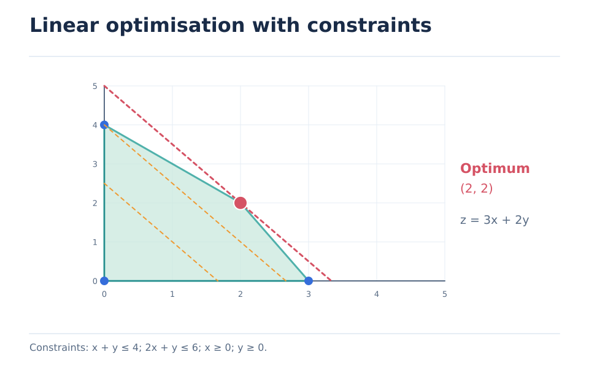

# M2-L2 – Optimisation and operations research {#L2}

**Course area:** M2 – Advanced Bachelor’s studies / transition to Master’s studies

**Level:** Bachelor’s / bridge to Master’s studies

**Prior knowledge:** No fixed prerequisites specified.

**Context:** University – further advanced studies

## What is this about? {#S1}

Many technical problems have not just one correct solution but a wide range of feasible solutions. Which tasks should run first when computing time is limited? How do we allocate resources to several AI agents? How do we plan delivery routes, shifts or memory allocation? **Optimisation** seeks the best feasible decision under clearly stated assumptions. **Operations research** combines such mathematical models with algorithms for planning, allocation and operations.

## Basic idea and intuition {#S2}

Every optimisation model needs at least three components: **decision variables** (what can we change?), an **objective function** (what does ‘good’ mean?) and **constraints** (what is permitted in the first place?). Further questions often arise about whether values must be integers and how to deal with uncertainty about future developments.

A mathematically best solution is optimal only relative to the chosen model. If the objective function considers energy costs but ignores reliability, the calculated optimal solution may be technically unsuitable. Good optimisation therefore begins with the model, not the algorithm.

## New symbols before the first formula {#S3}

| Symbol | Pronunciation | Meaning here | Other possible uses |
| --- | --- | --- | --- |
| $x$, $y$ | ‘ex’, ‘why’ | non-negative decision quantities | coordinates or function values |
| $z$ | ‘zed’ | numerical value of the objective function | third coordinate |
| $\max$ / $\min$ | ‘maximise’ / ‘minimise’ | seek the largest / smallest feasible objective value | maximum/minimum of a list of numbers |
| $\leq$ / $\geq$ | ‘less than or equal to’ / ‘greater than or equal to’ | upper / lower bound of a constraint | ordering relation in general |
| $x^{\ast}$ | ‘ex star’ | optimal decision | exact root or reference value (M1-L8) |
| $\operatorname{argmax}$ | ‘argument of the maximum’ | the input at which the maximum is attained | similarly, $\operatorname{argmin}$ for a minimum |
| $\mathbb{Z}$ | ‘set of integers’ | integrality constraint | number system from School mathematics M1-L1 |
| $\Sigma$ | ‘sigma sum’ | combination of many cost or benefit contributions | other summation ranges |
| $a_{ij}$ | ‘a sub i j’ | coefficient for resource i and decision j | matrix entry |
| $b_i$ | ‘b sub i’ | available quantity of resource i | any parameter |
| $\alpha$ | ‘alpha’ | positive step size of an optimisation method | angle, significance level |
| $f^{\prime}(x)$ | ‘f prime of x’ | derivative of an objective function | rate of change from School mathematics M2-L3 |
| $\nabla f$ | ‘nabla f’ | gradient of a multidimensional objective function | other nabla operators |

## Objective function and constraints {#S4}

Imagine a service that performs two types of computing jobs. Job type X provides three benefit points, while type Y provides two. The numbers $x$ and $y$ indicate how many units of each job type we want to perform. In the first model they may also take non-integer values – for instance, if a unit represents a divisible block of work.

{alt="Feasible polygonal region and optimisation of a linear objective function"}

Our objective function is:

$$
\text{maximise }z=3x+2y
$$

**Read aloud:** ‘Maximise the benefit zed, which is three times x plus two times y.’ The benefit points here are freely chosen model values that are **comparable with one another**.

Resources are limited:

$$
\begin{aligned}
x+y&\leq4\\
2x+y&\leq6\\
x&\geq0,\quad y\geq0
\end{aligned}
$$

**Read aloud:** ‘x plus y must be at most four. Twice x plus y must be at most six. Neither quantity may be negative.’ The first inequality describes a shared capacity; the second describes another resource that type X uses at twice the rate.

All points satisfying **every** constraint form the *feasible region*. Points outside this region may have high benefit values, but they are not valid solutions.

## Fully explained mini-example: optimal resource allocation {#S5}

The equations of the two capacity boundaries intersect at $x=2$ and $y=2$, since $2+2=4$ and $2\cdot2+2=6$. The benefit is then $z=3\cdot2+2\cdot2=10$ points.

For comparison, consider the vertices of the feasible region:

| Feasible vertex $(x,y)$ | Benefit $3x+2y$ |
| --- | --- |
| (0,0) | 0 |
| (0,4) | 8 |
| (2,2) | **10** |
| (3,0) | 9 |

For this **linear** objective function on this non-empty, bounded polygonal feasible region, a maximum can be found at a vertex. Comparing the four vertices gives the optimal decision $(x^{\ast},y^{\ast})=(2,2)$ with ten benefit points.

**Independent proof of optimality:** We add the two resource constraints. From $x+y\leq4$ and $2x+y\leq6$ it follows that

$$
z=3x+2y=(x+y)+(2x+y)\leq4+6=10
$$

**Read aloud:** ‘The benefit is the sum of the two bounded resource expressions, so it is at most ten.’ Because $(2,2)$ **uses both capacities in full**, this point attains the upper bound. This proves the global maximum $z^{\ast}=10$ rather than merely inferring it from the sketch. In this example the solution is even unique: for $z=10$, both inequalities that were added must be equalities; their only common solution pair is $(2,2)$.

**Read aloud:** ‘x star equals two, y star equals two: this feasible combination achieves the greatest model benefit, ten.’ There is no better intermediate solution here; the reason lies in the linearity of the model. The method cannot simply be transferred to every non-linear or unbounded problem.

## Linear and integer optimisation {#S6}

A **linear programme** (*LP*) uses a linear objective function and linear equations or inequalities as constraints. Many larger linear programmes are solved using specialised algorithms such as the simplex method or interior-point methods. Problems can be very large; the small example calculated by hand is not a general-purpose solver.

If decisions must be made in whole units, the result is an **integer optimisation** problem (*integer programming*). A partly integer problem is often called *mixed-integer linear programming* (MILP) if the rest of the model is linear.

**Mini-comparison:** A resource provides at most five time units, and a complete job needs two units. If the job is divisible, $x\leq2{,}5$ is allowed; with **whole, indivisible jobs**, at most $x=2$ is feasible. Simply rounding a continuous solution can violate constraints or yield a worse solution. Integrality changes the mathematics substantially.

For difficult combinatorial problems, exact methods such as *branch-and-bound* can structure the search. Heuristics often find good solutions quickly, but not necessarily optimal ones. A verifiable guarantee of quality must be distinguished from a merely plausible solution.

## Non-linear optimisation and gradient methods {#S7}

If the objective or constraints are non-linear, several local optima may arise. A **local minimum** is better than neighbouring solutions in its immediate vicinity; a **global minimum** is the best throughout the feasible region.

As a simple one-dimensional example, consider the function $f(x)=\left(x-3\right)^{2}$. Its derivative is $f^{\prime}(x)=2(x-3)$. It becomes zero at $x=3$, and since a square is never negative, the global minimum with value zero occurs there too.

A step-by-step search can use the derivative. To do this, we choose the positive step size $\alpha$ (alpha) and the current approximation $x_n$:

$$
x_{n+1}=x_n-\alpha\cdot f\prime(x_n)
$$

**Read aloud:** ‘The next decision, x sub n plus one, is the previous decision minus alpha times the derivative at that point.’ Subtraction moves in the direction of decreasing function values if the step size is suitable. Starting at $x_0=0$ with $\alpha=0{,}25$, we have $f^{\prime}(0)=-6$; the next value is $x_1=0-0{,}25\cdot(-6)=1{,}5$. The distance to the minimum at three has decreased. The second step gives $x_2=1{,}5-0{,}25\cdot(-3)=2{,}25$.

Here we can check convergence **exactly**: because $f^{\prime}(x)=2(x-3)$, it follows that

$$
x_{n+1}-3=(1-2\alpha)(x_n-3)
$$

**Read aloud:** ‘The new distance from the optimum is the old distance multiplied by one minus twice alpha.’ For any initial value, this particular algorithm converges to the minimum if and only if $\lvert1-2\alpha\rvert<1$, that is, **$0<\alpha<1$**, or if it starts at the minimum. At $\alpha=1$, a non-zero error is repeated indefinitely with alternating sign; at $\alpha>1$, its magnitude grows. The bound applies **only** to the quadratic function considered here with the given scaling, not as a general learning-rate rule for arbitrary optimisation problems.

For functions of several variables, the derivative is replaced by the **gradient**. This is the basic principle behind much of the optimisation involved in training neural networks. However, the appropriate step size, the shape of the objective function and the constraints are crucial. Gradient descent does **not** in general provide the global solution to a non-convex problem. With constraints, even an ordinary gradient step can leave the feasible region; suitable **constrained or projected optimisation methods** are then needed. Even for convex problems, convergence depends on further assumptions.

## Scheduling, discrete decisions and multiple objectives {#S8}

In **scheduling**, we plan when particular tasks will be performed on particular machines or agents. Dependencies can be modelled as a directed graph (M2-L1); resources must not be overbooked at any time. Possible objectives are short completion times, low energy consumption or high adherence to deadlines.

These objectives may conflict. To combine several objectives, we must specify priorities or weights – or consider a set of **Pareto-optimal** alternatives instead of a single optimal solution. Precisely, **Pareto-optimal** means that no other **feasible** alternative is at least as good in **all** objectives under consideration and strictly better in **at least one** objective (ordered according to whether the objective is to be maximised or minimised). Improving one objective at the expense of another does not contradict Pareto optimality. This definition assumes that the objectives under consideration and the directions in which they are compared are specified.

The term ‘optimal’ therefore never automatically means ‘well balanced in practice’. A numerically good plan may, for example, disregard robustness, fairness or ease of use.

## What is it useful for? {#S9}

- **AI agents and job queues:** Allocating tasks with limited GPU, CPU, memory and time budgets.
- **Software infrastructure:** Capacity planning, allocation of storage, load and data across systems.
- **Robotics and logistics:** Routes, job sequences, machine allocation and motion optimisation.
- **AI training:** Gradient methods for adjusting model parameters using a defined loss function.

## Assumptions, limitations and common misconceptions {#S10}

- An objective function represents only **the criteria we explicitly include in it**. Requirements not modelled may be violated.
- Linear models assume a suitable approximation; real costs often contain fixed costs, thresholds and interactions.
- LP and integer optimisation are not the same. A rounded LP solution is not automatically feasible or optimal.
- Optimisation with unknown data requires scenarios, robust or stochastic models; otherwise, exact figures suggest false certainty.
- A fast heuristic plan is not equivalent to a proven optimum. A stationarity condition such as $f^{\prime}(x)=0$ is also insufficient on its own as proof of a global extremum. Statistical or numerical statements from solvers must likewise be interpreted correctly.

## Connection to the next unit {#S11}

M2-L3 deals with **abstract algebra**. There we move from seeking optimal decisions to structures with permitted operations and symmetries: groups, rings and fields.

## Sources (external) {#S12}

No external sources listed.
