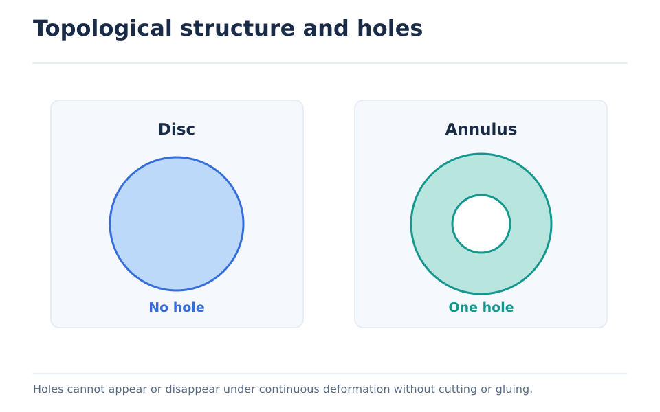

# M2-L4 – Topology and abstract spaces {#L4}

**Course area:** M2 – Advanced Bachelor’s studies / transition to Master’s studies

**Level:** Bachelor’s / bridge to Master’s studies

**Prior knowledge:** No fixed prerequisites specified.

**Context:** University – further advanced studies

## What is this about? {#S1}

In geometry, we measure lengths, angles and distances. **Topology** asks a different question: which points are close to one another in the sense of a particular spatial structure? How can we understand continuity without necessarily calculating numerical distances? When is a space connected, and which properties are preserved under continuous deformation? The answers are based on a surprisingly economical concept: a collection of what are known as **open sets**.

Topology does not simply mean ‘geometry with distorted shapes’. It provides a general language for proximity, continuity, limiting behaviour and connectedness – including for spaces whose ‘points’ are functions or other mathematical objects.

## Basic idea and intuition {#S2}

Imagine a drawn line that is deformed without lifting the pen. Its length may change, and straight sections may become curved. Nevertheless, it remains recognisable as one connected piece. Similarly, a circular rubber ring can be deformed without losing its fundamental character as a closed loop.

Topology does not primarily compare exact measurements, but rather **structural properties** of this kind. A mathematical space need not look like a room: it may consist of data points, functions, states or abstract elements.

## New symbols before the first formula {#S3}

| Symbol | Pronunciation | Meaning here | Other possible uses |
|---|---|---|---|
| $X$ | ‘capital X’ | Entire set of points of a space | Unknown or random variable |
| $\mathcal{T}$ | ‘calligraphic T’ | Collection of subsets of X designated as open | General family of sets |
| $\varnothing$ | ‘empty set’ | Set with no elements | General set theory |
| $\subseteq$ | ‘is a subset of or equal to’ | A set’s inclusion in the spatial structure | General set relation |
| $\in$ | ‘is an element of’ | Membership of a collection | General set theory |
| $\cup$ | ‘union’ | Elements from at least one subset | Union of events in probability theory |
| $\cap$ | ‘intersection’ | Elements belonging to all the specified sets | Intersection of events in probability theory |
| $U$, $V$ | ‘u’, ‘v’ | Selected open sets | Voltage or volume in other contexts |
| $(a,b)$ | ‘open interval from a to b’ | All real numbers strictly between a and b | Ordered pair in another notation |
| $f^{-1}(U)$ | ‘preimage of U under f’ | All inputs whose function value lies in U | $f^{-1}$ can also denote an inverse function |
| $\to$ | ‘maps to’ | Mapping between spaces | Passage to a limit or indication of direction |
| $\mathbb{R}$ | ‘real numbers’ | Ordinary number line | Number system from School Mathematics M1-L1 |

**Important:** The notation $f^{-1}(U)$ does **not** require an invertible function. It denotes the *preimage of a set*: we collect all inputs that land in the output region under consideration.

## Open sets: proximity without a fixed measurement in millimetres {#S4}

On the real number line, for example, the interval $(0,1)$ is open. Every point within it has a little room to its left and right that is still inside the interval. The endpoints zero and one are not included.

The empty set and the entire number line are also considered open. The fact that the entire number line is open does not mean that it is ‘unbounded’ in the everyday sense. It is a property of the mathematically defined relationship of proximity.

In a general space, a distance is **not** defined first. Instead, we specify which subsets are to be called open. These open sets must satisfy certain rules. This gives us a **topology**.

The mathematical shorthand for a topological space is:

$$
\begin{aligned}
&(X,\mathcal T)
\end{aligned}
$$

**Read aloud:** ‘The pair consisting of the set X and the topology calligraphic T.’ $X$ denotes all the points, and $\mathcal{T}$ the collection of open subsets.

The three axioms of a topology are:

1.  The empty set $\varnothing$ and the entire set $X$ belong to $\mathcal{T}$.
2.  The union of **arbitrarily many** sets from $\mathcal{T}$ also belongs to $\mathcal{T}$.
3.  The intersection of **finitely many** sets from $\mathcal{T}$ also belongs to $\mathcal{T}$.

The distinction between *arbitrary unions* and *finite intersections* is particularly important. An infinite intersection of open sets need not be open. Consider an example on the real number line: the open intervals from $-\frac{1}{n}$ to $\frac{1}{n}$ for $n=1,2,3,\ldots$ become narrower and narrower. Their common intersection consists only of $\{0\}$ – this singleton is not open in the usual topology of $\mathbb{R}$.

‘Arbitrarily many’ also includes the empty family of sets; intersections over the empty family are permitted as well. By convention, the empty union gives $\varnothing$ and the empty intersection gives the entire space $X$.

## Fully explained mini-example: a space with two points {#S5}

Consider a space with two points $a$ and $b$:

$$
\begin{aligned}
X&=\{a,b\}\\
\mathcal T&=\{\varnothing,\{a\},\{a,b\}\}
\end{aligned}
$$

**Read aloud:** ‘The space X consists of a and b. The topology contains the empty set, the singleton containing a, and the entire set containing a and b.’ The outer braces group together **sets as elements** of a collection.

Let us check the three conditions for a topology: the empty set and the entire space are present. Every union of these three sets is again one of the three specified sets. The same applies to every finite intersection. Thus, $\mathcal{T}$ is a valid topology.

Notice that $\{a\}$ is open, but $\{b\}$ is not. This is mathematically permissible. Topologies need not be as symmetric as ordinary metric spaces. Our example shows that the axioms describe a **more general structure** than mere distance on the number line. It is also known as the *Sierpiński space*. In particular, this topology **does not arise from an ordinary metric** on the two points: in every metric space with only finitely many points, each individual point can be isolated by a sufficiently small open ball, whereas here $\{b\}$ is not open.

By comparison, if we declare *every* subset of $X$ to be open, we obtain the **discrete topology**. If only the empty set and $X$ itself are open, we speak of the **indiscrete** or trivial topology. Both satisfy the axioms.

## Continuity as preservation of open neighbourhoods {#S6}

In school calculus, continuity means, in simple terms, that small changes in the input can produce small changes in the result. Topology formulates the same principle without requiring a distance to be measured in metres or numbers.

A mapping between topological spaces is called **continuous** if, for every open set in the *target space*, the corresponding **preimage** in the *source space* is open.

$$
\begin{aligned}
&f\colon X\to Y\\
&\text{for every open }U\text{ in }Y\text{ we have:}\\
&\qquad f^{-1}(U)\text{ is open in }X
\end{aligned}
$$

**Read aloud:** ‘The function f maps points of the space X into the space Y. For every open set u in the target space, the set of all inputs whose image lies in u is open in the source space.’

This statement is a **definition**, not a numerical calculation procedure. It connects the continuity already familiar from M1-L3 with a more comprehensive perspective.

### An accessible example with an ordinary function {#abschnitt-7}

Consider the function that squares every real number, namely $f(x)=x^{2}$. In the output space, we take the open interval $(1,4)$ – all numbers strictly between one and four.

Which inputs are mapped to a value between one and four when squared? Precisely the numbers between minus two and minus one, and between one and two:

$$
f^{-1}((1,4))=(-2,-1)\cup(1,2)
$$

**Read aloud:** ‘The preimage of the open interval from one to four is the union of the open interval from minus two to minus one with the open interval from one to two.’ This union is open on the number line. The example illustrates why preimages and openness fit together in the definition of continuity. To establish continuity fully, the condition must hold **for all** open sets in the target space, not just this one interval.

### A small countercheck with the two-point space {#abschnitt-8}

Consider the **identity mapping**: it sends $a$ to $a$ and $b$ to $b$. From the two-point space described above to the same set of points equipped with the **discrete topology**, it is **not continuous**: in the discrete target space, $\{b\}$ is open, but its preimage $\{b\}$ is not open in the source space. In the reverse direction, however, *from the discrete space to the topology defined above*, the identity mapping is continuous. The assignment of points is the same – the **topologies** determine continuity.

## Connectedness: does the space consist of one piece? {#S7}

A space is **connected** if it cannot be decomposed into two disjoint, non-empty open subsets that together form the entire space. In simple terms, it cannot be separated topologically into two distinct open pieces.

The ordinary closed interval from zero to one is connected. The union of two separate intervals, for example from zero to one and from three to four, is not connected.

A closed circular loop is connected as well – even though its interior need not belong to the circle if we consider only its circumference. **Connectedness** and the question of whether a shape has a **hole** are different properties.

In advanced topology, such loops are studied more closely, for example with the help of the *fundamental group*. The precise machinery of proofs is not required for this overview.

## Compactness: why ‘finite control’ is useful {#S8}

Another important topological concept is **compactness**. Intuitively, it means that any potentially infinite cover of a space by open subsets can always be reduced to **finitely many** subsets that still cover the space completely.

For subsets of ordinary Euclidean space, the well-known **Heine–Borel theorem** holds: a set is compact if and only if it is **closed and bounded**.

On the real number line, the interval $[0,1]$ is compact; $(0,1)$ is not. **Read aloud:** ‘The interval from zero to one, including both endpoints, is compact; the corresponding open interval is not compact.’ The square brackets indicate that the endpoints are included.

Why are we interested in this? On **non-empty compact sets**, continuous real-valued functions attain their maximum and minimum. Topology is therefore directly connected to optimisation (School Mathematics M2-L6, M2-L2). The theorem requires the stated conditions; on arbitrary open or unbounded domains, an optimum may not exist. For example, the function $f(x)=x$ on $(0,1)$ has neither a maximum nor a minimum: its values approach one and zero respectively, but the endpoints do not belong to the domain.

**Limitation of the Heine–Borel theorem:** In general topological spaces, ‘compact’ is not the same as ‘closed and bounded’. Our finite two-point space, for example, is compact. Its subset $\{a\}$ is also compact (every open cover has a finite subcover), but is **not closed**: its complement $\{b\}$ is not open. In general topological spaces, therefore, compactness does not always imply closedness.

## Homeomorphism: the same topological structure {#S9}

Two spaces are called **homeomorphic** if there is a bijective (that is, one-to-one and onto) continuous mapping between them whose inverse is also continuous.

{alt="Topological comparison of a disc and an annulus"}

Under such a ‘topological equivalence’, lengths may increase and shapes may become curved. Properties such as connectedness and compactness are preserved. The familiar image of a coffee cup and a doughnut illustrates surfaces with a hole; the precise statement requires a careful choice of the surfaces being considered, not merely the appearance of arbitrary three-dimensional objects.

**Not every continuous mapping is a homeomorphism.** A mapping can collapse entire regions to a single point; in that case it loses information and is not invertible.

## What can I do with this? {#S10}

- **Optimisation:** Compactness and continuity provide conditions under which an optimal solution actually exists.
- **Software and data spaces:** Spaces of functions, data and states gain a formal language for stability and limiting behaviour; an ordinary Euclidean distance is not always necessary.
- **Robotics:** Connectedness and the existence of separate regions are central considerations in configuration spaces and when dealing with obstacles.
- **Geometric data analysis:** Topological methods can examine connected components and stable loop structures in data, although they require additional modelling decisions and often a notion of distance.

## Assumptions and common misconceptions {#S11}

- *Open* does not mean ‘without a boundary’ in the everyday sense, but follows from a specified topology.
- A topological space requires **no** predefined distance. Additional structure is necessary to calculate numerical distances.
- A single open preimage does not establish continuity; the criterion applies to **all** open sets in the target space.
- The theorem ‘compact equals closed and bounded’ holds for subsets of finite-dimensional Euclidean spaces with the usual topology, **not** as a universal definition for every topology.
- In arbitrary topological spaces, even **finite compact sets may fail to be closed**; additional separation properties such as the Hausdorff property are needed for this conclusion.
- Topological equivalence differs from geometric congruence: lengths, angles and areas may change.

## Connection to the next lesson {#S12}

In M2-L5, we return to numbers, extend the real number line to the complex plane and examine what functions look like there. Algebra, geometry and calculus come together in a particularly elegant way.

## Optional outlook for further study {#S13}

Metric spaces, Hausdorff properties, bases for a topology, convergence of sequences and nets, fundamental groups and algebraic topology develop these concepts systematically. This course first provides an overview of the field and a guide to reading the basic definitions.

## Sources {#S14}

No individual sources are listed separately for this lesson.
