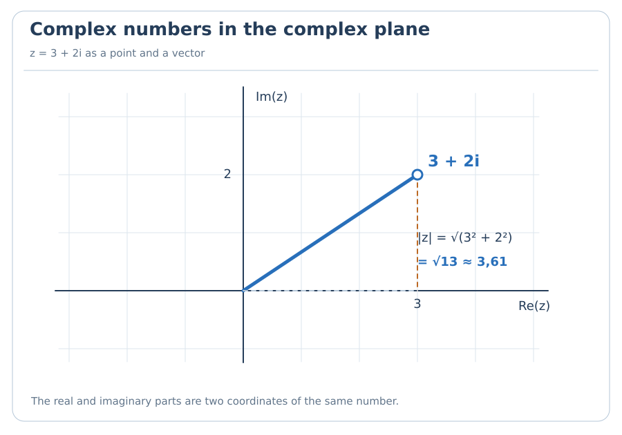

# M2-L5 – Complex numbers and complex analysis {#L5}

**Course area:** M2 – Advanced Bachelor’s studies / transition to Master’s studies

**Level:** Bachelor’s / bridge to Master’s studies

**Prior knowledge:** No fixed prerequisites specified.

**Context:** University – further advanced studies

## What is this about? {#S1}

On the real number line, the equation “a number squared equals minus one” cannot be solved. **Complex numbers** therefore extend our number system by adding another direction. Each complex number then has two components, which can be represented geometrically as a point in a plane. Multiplication can be understood as both **scaling and rotation**. **Complex analysis** studies functions on this plane, with surprisingly powerful rules for differentiation, integration and the behaviour of functions.

## Basic idea and intuition {#S2}

Imagine a point on a sheet of paper. An ordinary real number specifies its position only along a horizontal axis. A complex number, by contrast, has a horizontal and a vertical component. Addition combines the components, just as with two-dimensional vectors. Multiplication is the distinctive operation: in general, it changes **length and direction** at the same time.

{alt="Complex plane with z = 3+2i shown as an arrow from the origin to the point (3,2), modulus √13."}

In the complex (Argand) plane, $z=3+2i$ corresponds to the point (3,2), with modulus $\sqrt{13}$.

This representation is useful because oscillations, phase shifts and rotations can often be described much more easily with complex numbers than with separate sine and cosine calculations.

## New symbols – before the first formula {#S3}

| Symbol | Read aloud | Meaning here | Other uses |
| --- | --- | --- | --- |
| $\mathbb{C}$ | “set of complex numbers” | number system containing all complex numbers | the subset symbol $\subset$ is different |
| $z$ | “zed” | complex number | third spatial coordinate in geometry |
| $a$, $b$ | “ay”, “bee” | real and imaginary parts of z | general variables |
| $i$ | “imaginary unit” | number whose square is −1 | often an index of a sequence in sums |
| $i^{2}$ | “i squared” | product of i with itself; defined as −1 | power notation in general |
| $\operatorname{Re}(z)$ | “real part of z” | horizontal component | $\operatorname{Re}$ is a function name, not multiplication |
| $\operatorname{Im}(z)$ | “imaginary part of z” | real coefficient of i | not the same as the term $bi$ |
| $\bar{z}$ | “z bar” or “z conjugate” | complex conjugate | an overbar may denote a mean |
| $\lvert z\rvert$ | “modulus of z” | distance from the origin to point z | absolute value of a real number, cardinality of a set |
| $r$ | “ar” | non-negative length in polar form | radius in general |
| $\theta$ | “theta” | angle or argument of a complex number | angle notation in general |
| $\operatorname{arg}(z)$ | “argument of z” | direction of z, unique only up to full turns | “argument” of a function |
| $e$ | “Euler's number” | base of the natural exponential function | identity element of a group in M2-L3 |
| $\pi$ | “pi” | half a turn in radians equals $\pi$ | the circle constant in general |
| $\partial$ | “partial d” | partial derivative with respect to a real coordinate | differentiation in several variables |
| $u$, $v$ | “you”, “vee” | real components of a complex-valued function | arbitrary labels |
| $t$ | “tee” | real running parameter of a path in the complex plane | time variable in applications |
| $\oint$, $\mathrm{d}z$ | “integral along a closed path”, “d zed” | contour integral and complex path differential | integration symbols in other contexts |

The imaginary unit $i$ is **not an unknown that has to be guessed from real numbers**, but part of the definition of the extended number structure. In electrical engineering, $j$ is often used instead, because $i$ denotes electric current there.

## Complex numbers as pairs of numbers {#S4}

The basic notation is:

$$
z=a+bi\qquad\text{with }a,b\in\mathbb{R}\text{ and }i^2=-1
$$

**Read aloud:** “Zed equals a plus b times i. Here a and b are real numbers, and i squared is minus one.”

For example, the number $z=3+4i$ has real part three and imaginary part four. In a coordinate system, it lies at the point $(3,4)$: three steps horizontally and four steps vertically.

$$
\begin{aligned}
\operatorname{Re}(3+4i)&=3\\
\operatorname{Im}(3+4i)&=4
\end{aligned}
$$

**Read aloud:** “The real part of three plus four i is three. The imaginary part of three plus four i is four.” The second sentence is particularly important: the **imaginary part** is the real number four, not the term $4i$.

Two complex numbers are equal if and only if both their real parts and their imaginary parts are equal.

## Arithmetic: addition and multiplication {#S5}

Addition is performed component by component:

$$
(1+2i)+(3-i)=4+i
$$

**Read aloud:** “One plus two i, added to three minus i, equals four plus i.” The real parts add up to four, and the i-parts give two minus one, leaving a single i.

For multiplication, we use the distributive law familiar from school mathematics. The only special feature is the rule $i^{2}=-1$.

$$
\begin{aligned}
(1+2i)(3-i)&=3-i+6i-2i^2\\
&=3+5i+2\\
&=5+5i
\end{aligned}
$$

**Read aloud:** “The product of one plus two i and three minus i is expanded. Since i squared equals minus one, minus two i squared becomes plus two. The result is five plus five i.”

**Fully explained mini-example:** The four terms initially obtained are $3$, $-i$, $6i$ and $-2i^{2}$. The imaginary terms combine to give $5i$, and the last term, because $i^{2}=-1$, becomes the real number $+2$. Together, they produce a real part of five and an imaginary part of five. The result can be checked by expanding the product directly again.

## Conjugation and modulus {#S6}

**Complex conjugation** reflects a number across the real axis. It changes the sign of the term containing the imaginary unit:

$$
\begin{aligned}
z&=3+4i\\
\bar z&=3-4i
\end{aligned}
$$

**Read aloud:** “The complex conjugate of three plus four i is three minus four i.”

When a complex number is multiplied by its conjugate, the imaginary part disappears. For the example, we obtain:

$$
\begin{aligned}
z\cdot\bar z&=(3+4i)(3-4i)=9+16=25\\
|z|&=\sqrt{25}=5
\end{aligned}
$$

**Read aloud:** “Zed times zed bar is twenty-five. The modulus of zed is the square root of twenty-five, which is five.” Geometrically, this is Pythagoras' theorem: the distance from the point $(3,4)$ to the origin is five.

In general:

$$
\lvert a+bi\rvert=\sqrt{a^2+b^2}
$$

**Read aloud:** “The modulus of a plus b i is the square root of a squared plus b squared.”

Complex division can be rewritten with a real number in the denominator by using conjugation. For instance:

$$
\frac1{1+i}=\frac{1-i}{2}
$$

This is allowed because we multiply the numerator and denominator by $1-i$. Division by complex zero is just as undefined as division by real zero.

## Polar form: length and angle of rotation {#S7}

Instead of giving the real and imaginary parts, we can describe a complex number by its **modulus** and **direction**. The modulus $r$ is the non-negative length, and the angle $\theta$ (theta) is usually measured in radians.

$$
z=r\,(\cos\theta+i\sin\theta)
$$

**Read aloud:** “Zed equals r times open bracket cosine theta plus i times sine theta close bracket.” The functions $\cos$ and $\sin$ are familiar from school mathematics M1-L16/school mathematics M1-L20 (German-language course). When the modulus is zero, no unique direction is defined.

For $z=1+i$, the modulus is $\sqrt{2}$ and the direction is 45°, or $\frac{\pi}{4}$ radians. The same number can therefore also be described in polar form.

The major advantage is that, when complex numbers are multiplied, **their moduli are multiplied** and their angles **are added** (with the angles understood modulo a full turn). For two non-zero complex numbers, it follows from the polar forms with moduli $r_1$, $r_2$ and angles $\theta_1$, $\theta_2$ that the product has modulus $r_1\cdot r_2$ and angle $\theta_1+\theta_2$. If one factor is zero, the product has modulus zero and no uniquely defined angle. If one factor produces a quarter-turn, the direction rotates accordingly. This makes complex multiplication a natural language for rotations and oscillations.

## Euler's formula {#S8}

In complex analysis, we encounter a particularly useful relationship between the exponential function and trigonometry:

$$
e^{i\theta}=\cos\theta+i\sin\theta
$$

**Read aloud:** “E to the power of i times theta equals cosine theta plus i times sine theta.” Euler's number $e$ is the same constant as in real exponential functions. Here, the exponential function is extended to complex numbers.

For $\theta=\frac{\pi}{2}$, we obtain $e^{i\pi/2}=i$, a quarter-turn on the unit circle. For $\theta=\pi$, we obtain:

$$
e^{i\pi}=-1
$$

**Read aloud:** “E to the power of i times pi is minus one.” This identity shows how the imaginary unit, a half-turn and the exponential function are connected. On the unit circle, it corresponds to the point to the left of the origin.

In signal processing in particular, sine and cosine oscillations can thus be combined into a single complex description. This does not require us to claim that measured voltages themselves are “imaginary”: complex notation is a **mathematical model of amplitude and phase**.

## Complex analysis: differentiation in every direction {#S9}

For real functions, we examine the change as we move left or right along a number line. For complex functions, an input can change in **any direction in the complex plane**. A complex derivative therefore exists only if the same limit is obtained regardless of the direction of approach.

A function that is complex differentiable in an open neighbourhood of every point is called **holomorphic** there. This is a strong property: holomorphic functions have particularly regular local representations and satisfy far-reaching integral theorems.

For a function with real components $u(x,y)$ and $v(x,y)$, we write:

$$
f(x+iy)=u(x,y)+i\cdot v(x,y)
$$

**Read aloud:** “F of x plus i times y equals u of x and y plus i times v of x and y.” Here $x$ and $y$ specify the coordinates of the input, while $u$ and $v$ describe the real output components.

If the partial derivatives satisfy suitable regularity conditions, the **Cauchy–Riemann equations** provide a criterion for complex differentiability:

$$
\begin{aligned}
\frac{\partial u}{\partial x}&=\frac{\partial v}{\partial y}\\
\frac{\partial u}{\partial y}&=-\frac{\partial v}{\partial x}
\end{aligned}
$$

**Read aloud:** “The partial derivative of u with respect to x equals the partial derivative of v with respect to y. The partial derivative of u with respect to y is the negative of the partial derivative of v with respect to x.” A partial derivative means that one coordinate is varied while the other is temporarily held constant (M1-L4).

### Mini-example: why squaring works {#abschnitt-10}

For the complex function $f(z)=z^{2}$, we substitute $z=x+iy$. Expanding gives:

$$
\begin{aligned}
f(z)&=x^2-y^2+i(2xy)\\
u(x,y)&=x^2-y^2\\
v(x,y)&=2xy
\end{aligned}
$$

Here $\frac{\partial u}{\partial x}=2x$ and $\frac{\partial v}{\partial y}=2x$. Likewise, $\frac{\partial u}{\partial y}=-2y$ and $-\frac{\partial v}{\partial x}=-2y$. Both conditions are satisfied for all real $x$ and $y$; the derivatives are also continuous. Thus $z^{2}$ is holomorphic on the entire complex plane. Its complex derivative is $f^{\prime}(z)=2z$: the difference quotient gives $\frac{{(z+h)}^{2}-z^{2}}{h}=2z+h$, and every complex approach $h\to0$ gives the same limit $2z$.

As a counterexample, $f(z)=\bar{z}$, namely conjugation, is **nowhere complex differentiable**. Approaching with real or purely imaginary increments produces different difference quotients. At any starting point $z$, the quotient for a non-zero increment $h$ is $\frac{\bar{h}}{h}$: for real $h$, this gives $1$, whereas for purely imaginary $h$, it gives $-1$. A direction-independent complex limit therefore cannot exist. This is an important distinction between ordinary two-dimensional real differentiability and complex differentiability.

## Complex integrals: an outlook {#S10}

In a more advanced lecture, functions are integrated along paths through the complex plane. Under suitable assumptions, very powerful statements hold for holomorphic functions, including a form of **Cauchy's integral theorem**: the contour integral along a **simple, closed, piecewise smooth curve** vanishes if the function is holomorphic on an **open neighbourhood of the curve and its entire interior**. The choice of these conditions on the curve and the domain is essential. For general closed paths or domains containing holes, the precise statement requires further concepts such as homotopy or winding number. The condition “holomorphic only **on** the curve” is insufficient.

Special care is needed with singularities (points at which a function is not defined or holomorphic as required). For example, the function $\frac{1}{z}$ has a singularity at $z=0$. The contour integral along the unit circle traversed anticlockwise is **not zero**. With the path $z(t)=e^{it}$ for $0\leq t\leq2\pi$, we have $\mathrm{d}z=i\cdot e^{it}\,\mathrm{d}t$; hence:

$$
\begin{aligned}
\oint\frac1z\,\mathrm{d}z&=\int_0^{2\pi}\frac{i\cdot e^{it}}{e^{it}}\,\mathrm{d}t\\
&=\int_0^{2\pi}i\,\mathrm{d}t=2\pi i
\end{aligned}
$$

**Read aloud:** “After substituting the circular path, the closed contour integral of one over zed gives the integral of the constant imaginary unit over a full turn, namely two pi i.” The singularity at zero is **inside** the path. Anyone who overlooks the assumption “holomorphic throughout the interior” would apply Cauchy's integral theorem incorrectly. The precise integration calculus can follow as a separate advanced topic if needed; the focus here is on **reading the formula and understanding the conditions under which it is valid**, not on a complete proof.

## What is this useful for? {#S11}

- **Audio, radio and signal processing:** Complex amplitudes and phases simplify calculations with periodic signals and Fourier methods (M2-L9).
- **Electronics and control:** AC networks and oscillating systems are frequently described using complex quantities.
- **2D graphics and robotics:** Multiplication by complex numbers with modulus one enables rotations in the plane.
- **Mathematical research and physics:** Holomorphic functions and complex integrals have far-reaching properties that simplify many real-valued calculation problems.

## Assumptions, limitations and misconceptions {#S12}

- The imaginary part of a number is a **real coefficient**; $\operatorname{Im}(3+4i)=4$, not $4i$.
- Complex numbers cannot be compared as real numbers can, using an ordinary total ordering of “greater than/less than”. The modulus provides a magnitude, but not a general ordering of the number system.
- The angle of a complex number is not unique, but determined only up to whole turns; at $z=0$, no angle is defined.
- Complex differentiability is **stronger** than differentiability of real functions of two variables.
- The Cauchy–Riemann equations **at a single point** are not generally sufficient for complex differentiability. As a simple sufficient criterion: if the real components have continuous partial derivatives in an open neighbourhood and satisfy both equations there, the function is holomorphic in that neighbourhood.
- The complex representation of signals is usually a calculation tool; real measured quantities are obtained by taking suitable real parts or applying further inverse transformations.

## Connection to the next lesson {#S13}

M2-L6 examines curved spaces and surfaces. Geometric coordinates, tangents, derivatives and transformations come together there – the foundations of **differential geometry**.

## Optional outlook for further study {#S14}

Power series, the complex exponential and logarithmic functions, analytic continuation, the residue theorem and conformal maps are central further topics. Complex analysis at universities is taught with considerably more emphasis on proofs than this reading overview is intended to provide.

## Sources (external) {#S15}

No external sources listed.
