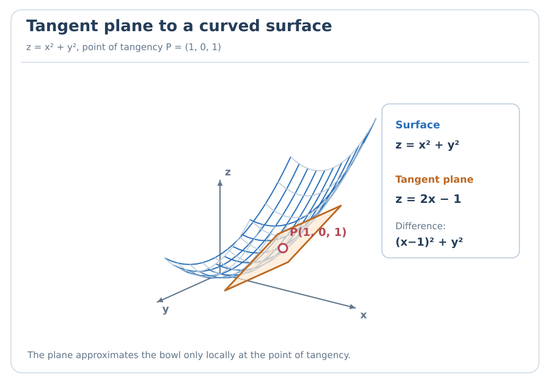

# M2-L6 – Differential geometry: curved surfaces and spaces {#L6}

**Course area:** M2 – Advanced Bachelor’s studies / transition to Master’s studies

**Level:** Bachelor’s / bridge to Master’s studies

**Prior knowledge:** No fixed prerequisites specified.

**Context:** University – further advanced studies

## What is this about? {#S1}

A straight line on a sheet of paper is easy to describe. Things become more difficult when we travel from one place to another on the Earth's surface or study the motion of a robot along a curved path. In such situations, the simple coordinates and angles of plane geometry do not apply unchanged everywhere. **Differential geometry** therefore combines geometry with analysis: it studies a curved figure by considering very small regions and the directions of motion possible within them. This makes it possible to describe lengths, tangents, curvatures and shortest paths even on curved surfaces.

This lesson is a **map of the subject**, not a substitute for a complete lecture course on differentiable manifolds. It builds particularly on school M1-L20 (angles and circles), school M2-L11 (vectors), M1-L4 (partial derivatives) and M2-L4 (topology).

## Basic idea and intuition {#S2}

Imagine an ant on a large sphere. In its immediate surroundings, the surface appears almost flat. It can walk forwards, backwards, left or right – but cannot simply move radially into the sphere. The possible **local directions of motion** form a plane tangent to the sphere: the *tangent plane*. As we move to another point, the orientation of this plane changes.

In simplified terms, a **manifold** is a space that looks like ordinary Euclidean space in sufficiently small regions. The surface of a sphere, for instance, is locally two-dimensional, although it lies in three-dimensional space. Its points can be specified by two local coordinates. However, no single global coordinate pair works for the entire sphere without special features such as singularities at the poles or overlapping charts.

## New symbols before the first formula {#S3}

| Symbol | Pronunciation | Meaning here | Other possible use |
|---|---|---|---|
| $t$ | ‘tee’ | Parameter, for instance time along a path | Arbitrary variable |
| $\vec{r}(t)$ | ‘r of t’ | Position vector of a parametrised curve | r also denotes radius |
| $\vec{r}^{\prime}(t)$ | ‘r prime of t’ | Derivative of the position vector with respect to t, the tangent/velocity vector | Derivative notation from school M2-L3 |
| $\lVert\vec{v}\rVert$ | ‘norm of v’ | Length of a vector | Other norms in higher-dimensional spaces |
| $\int$ and $\mathrm{d}t$ | ‘integral’ and ‘d t’ | Continuous summation along parameter t | From school M2-L7–school M2-L9 |
| $a$, $b$ | ‘a’, ‘b’ | Starting and ending values of the curve parameter | Arbitrary constants |
| `√` | ‘square root’ | Non-negative root | Already introduced in school M1-L7 |
| $f(x,y)$ | ‘f of x and y’ | Height above a plane | General function of two variables |
| $\frac{\partial f}{\partial x}$ | ‘partial derivative of f with respect to x’ | Change in the x-direction with y fixed | From M1-L4 |
| $\approx$ | ‘is approximately equal to’ | Linear approximation near a point | Numerical approximation |
| $R$ | ‘capital R’ | Radius of a sphere | Also the set of real numbers as $\mathbb{R}$ |
| $L$ | ‘ell’ | Arc length of a curve | Linear quantity or operator in another lesson |
| $K$ | ‘kay’ | Gaussian curvature of a surface | Variable in other contexts |
| $z$ | ‘zed’ | Height coordinate of a surface | Target value in M2-L2 |
| $x_0$, $y_0$ | ‘x sub zero’, ‘y sub zero’ | Fixed coordinates of a point of tangency | Index zero in general |
| $\pi$ | ‘pi’ | Circle constant | From circle geometry |
| $\theta$ | ‘theta’ | Angle, here in radians | Also a general parameter |
| $\varphi$ | ‘phi’ | Smaller central angle between two points on a sphere | Other angle or parameter |

## Curves: constructing a path from tiny tangent steps {#S4}

A smooth path can be described by its position vector $\vec{r}(t)$. For each parameter value $t$, the function gives a point on the path. The derivative $\vec{r}^{\prime}(t)$ describes the direction and speed at which the point moves as $t$ changes. Integrating the length of this velocity vector over all parameter values gives the **arc length**:

$$
L=\int_a^b\lVert\vec{r}'(t)\rVert\,\mathrm{d}t
$$

**Read aloud:** ‘The length ell is the integral from a to b of the norm of r prime of t, with respect to t.’ In everyday language, we add up the distances travelled along the curve in infinitely many small steps. $a$ and $b$ determine which section of the curve is measured. In particular, the path must be sufficiently smooth on the interval, for instance piecewise continuously differentiable.

### Mini-example: a quarter-circle {#abschnitt-5}

For motion along a circle of radius two metres, the arc length of a quarter-turn is:

$$
\begin{aligned}
L&=R\cdot\theta\\
R&=2\,\mathrm{m}\\
\theta&=\frac{\pi}{2}\quad(90^{\text{°}})\\
L&=2\,\mathrm{m}\cdot\frac{\pi}{2}=\pi\,\mathrm{m}\approx3{,}14\,\mathrm{m}
\end{aligned}
$$

**Read aloud:** ‘Arc length equals radius times the angle in radians. With a radius of two metres and an angle of pi over two, this is pi metres.’ A straight chord between the same endpoints would measure only $2\sqrt{2}\,\mathrm{m}\approx2{,}83\,\mathrm{m}$. The path along the circle is therefore longer than the direct connection through the plane. Which path is permitted depends on the space in which motion takes place.

**Verification using the curve formula:** Parametrise the same quarter-circle by $\vec{r}(t)=(2\cos t,2\sin t)$ for $0\leq t\leq\frac{\pi}{2}$, with coordinates given in metres. Then $\vec{r}^{\prime}(t)=(-2\sin t,2\cos t)$ and, because $\sin^{2}t+\cos^{2}t=1$, its norm is a constant $2\,\mathrm{m}$ per unit of the dimensionless angular parameter. The arc length integral therefore gives $L=\int_0^{\pi/2}2\,\mathrm{d}t=\pi\,\mathrm{m}$. Another admissible parametrisation of the same curve does not change its length.

## Tangent plane: the best local approximation {#S5}

A curved surface can often be approximated near a particular point by a plane. If the surface is represented by the height $z=f(x,y)$, the partial derivatives give the local slopes.

{alt="Perspective view of a bowl z equals x squared plus y squared with an orange tangent plane z equals 2x minus 1, point of tangency P=(1,0,1)."}

Tangent plane to $z=x^2+y^2$: at point $P(1,0,1)$, the local slope agrees with $z=2x-1$; the error is ${(x-1)}^2+y^2$.

Consider the bowl-shaped surface:

$$
f(x,y)=x^2+y^2
$$

**Read aloud:** ‘f of x and y equals x squared plus y squared.’ The point with coordinates $x=1$, $y=0$ has height $z=1$.

The partial derivative with respect to $x$ is $2$ there, and the partial derivative with respect to $y$ is $0$. The tangent plane at this point is therefore:

$$
\begin{aligned}
z&=1+2\cdot(x-1)+0\cdot(y-0)\\
&=2x-1
\end{aligned}
$$

**Read aloud:** ‘The approximate height z is one plus two times x minus one, plus zero times y minus zero; simplified, this is two x minus one.’ The geometrical statement is important: immediately around $(1,0,1)$, the plane follows the curved surface to first approximation. Further away, the difference increases. The tangent plane is **a local approximation**, not an exact description of the entire bowl.

**Exact error check:** For the bowl, $f(x,y)-(2x-1)={(x-1)}^{2}+y^{2}$. At the point of tangency the error is zero, and at a small step $x=1{,}1$, $y=0$ it is $0{,}01$. This demonstrates the *quadratic* error of the linear approximation in this example. The derivation assumes differentiability at the point under consideration; the mere existence of both partial derivatives alone does not guarantee a suitable linear approximation for every function.

The general notation at a point $(x_0,y_0)$ is:

$$
\begin{aligned}
z&\approx f(x_0,y_0)+\frac{\partial f}{\partial x}(x_0,y_0)\cdot(x-x_0)\\
&\qquad+\frac{\partial f}{\partial y}(x_0,y_0)\cdot(y-y_0)
\end{aligned}
$$

Here $x_0$ is read as ‘x sub zero’, the fixed x-coordinate of the reference point, and similarly $y_0$. In short: *height at the reference point plus local slope times the small change in each coordinate direction.* This is the same linear idea that occurs in numerical optimisation and the gradient method (M1-L4, M2-L2).

## Curvature and the distinction between intrinsic and extrinsic geometry {#S6}

A straight line does not bend; a circle bends continuously. Its **curvature** is constant for a circle and equals $\frac{1}{R}$, or ‘one over the radius’. A small circle has high curvature, a large circle lower curvature. For a general curve, curvature can vary from point to point.

For surfaces, we also distinguish curvature that depends on **embedding in an ambient space** from properties that inhabitants of the surface can establish using measurements on the surface alone. A sheet of paper rolled into a cylinder is curved in space; nevertheless, a small rectangle from it can be unrolled flat without stretching. By contrast, the surface of a sphere cannot be flattened onto a plane without distortion.

**Gaussian curvature** captures part of this intrinsic geometrical distinction. On an ordinary sphere of radius $R$, we have:

$$
K=\frac{1}{R^2}
$$

**Read aloud:** ‘The Gaussian curvature K is one over R squared.’ For a positive sphere radius $R=2\,\mathrm{m}$, we obtain $K=\frac{1}{{(2\,\mathrm{m})}^{2}}=0{,}25\,\mathrm{m}^{-2}$ (‘zero point two five per square metre’). The unit of Gaussian curvature is therefore **inverse area**. On a flat surface this curvature is zero. Here $K$ denotes Gaussian curvature, **not** the local temperature or the number of dimensions. On general surfaces, $K$ may be positive, zero or negative. This statement goes beyond visual appearance: curvature can be obtained from intrinsic length measurements.

## Geodesics: what is the shortest admissible route? {#S7}

Intuitively, a **geodesic** is a curve that runs as ‘straight’ as possible locally, even though the underlying space may be curved. On the plane, straight lines are geodesics. On a sphere, great circles – for example the equator – are examples of geodesics. A **shortest path** between two non-antipodal points on a sphere follows a shorter great-circle arc.

Importantly, a geodesic need **not be the globally shortest path** between points arbitrarily far apart. Between antipodal points of a sphere there are even infinitely many equally short great-circle arcs. The statement ‘geodesic = always the globally shortest path’ would be false.

**Mini-example: distance on a sphere.** If the smaller central angle between two points is $\varphi$ in the range $0\leq\varphi\leq\pi$, their shortest path length on the ideal spherical surface is $d=R\cdot\varphi$. For $R=2\,\mathrm{m}$ and $\varphi=\frac{\pi}{2}$ this gives $d=\pi\,\mathrm{m}$. A longer great-circle arc is also geodesic but is not globally shortest: for the same separation, the path in the opposite direction would be $3\pi\,\mathrm{m}$. Distance on the spherical surface ($\pi\,\mathrm{m}$) and the three-dimensional chord length ($2\sqrt{2}\,\mathrm{m}$) are different quantities.

In more advanced theory, a **metric** describes how lengths and angles are measured on the space. It is not necessarily the same as a metric in the topological sense of M2-L4, where the word denotes a distance between points. Here it usually refers to a *metric tensor field* that assigns lengths and angles to local tangent vectors. Detailed tensor and index notation remains an optional topic for further study.

## What is this useful for? {#S8}

- **Robotics and motion planning:** A robotic arm has admissible joint positions that together may form a curved *configuration space*. The shortest mathematical path is not automatically collision-free or energy-optimal.
- **Navigation and geodesy:** Over long distances, routes on the Earth's surface are calculated using spherical or more accurate Earth models; a flat map distorts distances or angles.
- **3D graphics and CAD:** Tangents and normals help with surface lighting, local coordinate systems and shape manipulation.
- **Optimisation and AI:** When parameters are restricted by additional geometrical conditions, we may speak of optimisation on manifolds; the direction of admissible changes then lies locally in the tangent space.

## Assumptions, limitations and common misconceptions {#S9}

- ‘Locally like a plane’ does not mean that a curved surface has **the same** coordinate chart everywhere.
- A tangent plane approximates a smooth surface **near a point**, not throughout the space. At corners, a unique tangent plane may not exist.
- A geodesic is a locally straight path; global minimality and physical optimality must be checked separately.
- The formula $K=\frac{1}{R^{2}}$ applies to the ordinary spherical surface with a fixed radius, **not to arbitrary curved spaces**. A cylinder intrinsically has $K=0$, even though it is visibly curved in three-dimensional space.
- Differential-geometrical models require sufficient smoothness for many statements. A polygon mesh from 3D graphics is not automatically a smooth manifold.

## Connection to the next lesson {#S10}

M2-L7 now generalises the idea of a space in another direction: its ‘points’ may be entire functions. We also learn how measures and integrals are defined over much more complicated sets.

## Optional outlook for further study {#S11}

Differentiable charts, atlases, tangent and cotangent spaces, Riemannian metrics, Christoffel symbols, geodesic equations, parallel transport and curvature tensors are typical subjects of an advanced differential geometry lecture course. They require more extensive analysis and linear algebra.

## Sources (external) {#S12}

No external sources listed.
