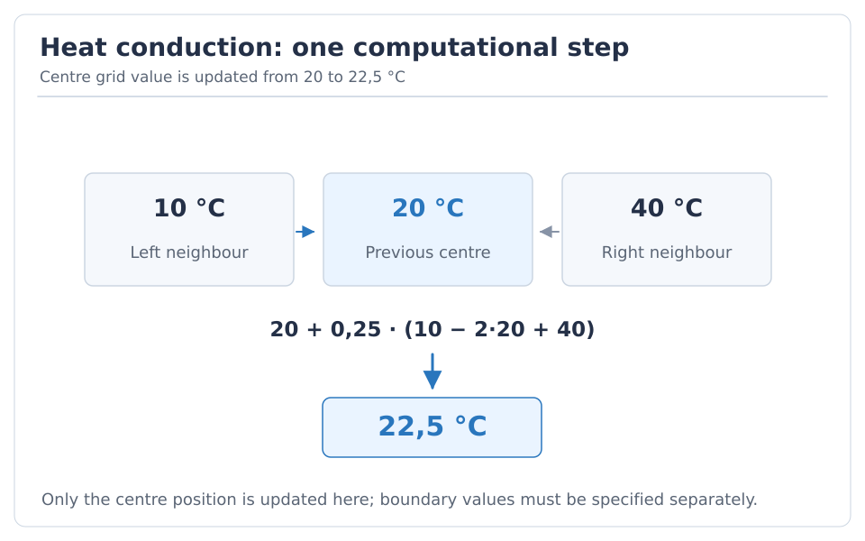

# M2-L8 – Partial differential equations: heat, waves and spatial processes {#L8}

**Course area:** M2 – Advanced Bachelor’s studies / transition to Master’s studies

**Level:** Bachelor’s / bridge to Master’s studies

**Prior knowledge:** No fixed prerequisites specified.

**Context:** University – further advanced studies

## What is this about? {#S1}

An ordinary differential equation describes, for example, how **a temperature changes over time**. However, a metal rod has many positions at the same time, and each position may have a different temperature. Heat therefore spreads **through space and time**. The same applies to a vibrating string, the propagation of sound or the flow of a liquid. **Partial differential equations** (PDEs for short) connect changes in different spatial directions with evolution over time.

This lesson builds on M1-L4 (partial derivatives), M1-L9 (ordinary differential equations), M2-L6 (spatial geometry) and M2-L7 (function spaces). We learn the basic notation and three typical classes of models, rather than the complete framework of proofs in PDE theory.

## Basic idea and intuition {#S2}

Imagine a long, thin metal rod. It is cool on the left and warm on the right. Inside, heat is transferred from warmer to colder neighbouring regions. The temperature at a fixed position can change even though nobody touches that position directly. What matters instead is how the temperature is **distributed in its surroundings**.

A PDE therefore asks not only “How quickly does the value change?”, as in M1-L9, but also “How do spatial differences influence the change?” A spatial temperature field, sound field or pressure field is described as a function of **several input quantities**.

## New symbols – read these before the first formula {#S3}

| Symbol | Read aloud | Meaning here | Other possible use |
| --- | --- | --- | --- |
| $u(x,t)$ | “u of x and t” | Temperature or another state variable at position x and time t | u as a general variable |
| $x$ | “x” | Position on a one-dimensional rod | Unknown number |
| $y$ | “y” | Second spatial coordinate in a planar field | Another variable |
| $r$ | “r” | Dimensionless time factor in the numerical grid step | Radius in M2-L6 |
| $t$ | “t” | Time | General parameter |
| $\partial$ | “partial” | Derivative with respect to one variable while holding the others fixed | From M1-L4 |
| $\frac{\partial u}{\partial t}$ | “partial derivative of u with respect to t” | Rate of change over time | Analogous for other state variables |
| $\frac{\partial^{2}u}{\partial x^{2}}$ | “second partial derivative of u with respect to x” | Spatial curvature of the temperature profile | Second derivatives in other contexts |
| $\alpha$ | “alpha” | Thermal diffusivity (temperature equalisation) | Step size in M2-L2 |
| $c$ | “c” | Wave propagation speed | Arbitrary constant |
| $\Delta x$, $\Delta t$ | “delta x”, “delta t” | Finite spatial and time steps of a computational grid | Change in general |
| $i$, $n$ | “index i”, “index n” | Spatial and time indices of a discrete grid | i as the imaginary unit in M2-L5 |
| $u_i^n$ | “u sub i superscript n” | Numerical value at position i at time step n | Superscript n is an **index** here, not a power |
| $\nabla^{2}u$ | “nabla squared u” or “Laplacian of u” | Sum of the second spatial derivatives | Not the square of a number |
| $k$, $\omega$ | “k”, “omega” | Wavenumber and angular frequency of a wave example | General model parameters |
| $\lambda$ | “lambda” | Wavelength in the wave example | Eigenvalue or another variable |

## Heat conduction: changes due to neighbouring regions {#S4}

With constant material properties, the **one-dimensional heat equation** can be written as:

$$
\frac{\partial u}{\partial t}=\alpha\frac{\partial^2u}{\partial x^2}
$$

**Read aloud:** “The partial derivative of u with respect to time t equals alpha times the second partial derivative of u with respect to position x.” In everyday language, the change in temperature depends on how strongly the spatial temperature profile **curves** at that position.

If the temperature at a position is lower than in its immediate surroundings, the temperature profile curves upwards there: the position warms up. At a local temperature peak, the curvature is downwards: the position cools down.

$\alpha$ is a **positive** material parameter with units of area per time, for example square metres per second. It is called *thermal diffusivity*. In this model, greater diffusivity means faster spatial equalisation of temperature. The model assumes a thin rod, suitable boundary conditions, constant material properties and no internal heat sources; otherwise, additional terms arise.

## Initial values and boundary values: one equation is not enough {#S5}

The heat equation describes a *rule*, but not yet a unique temperature evolution. We also need to know **how warm the rod was initially** and what happens at its **boundaries**.

An initial condition might specify that the temperature at every position is known at the start. At the ends, for example, a fixed temperature may be prescribed (a *Dirichlet boundary condition*) or a specified heat flux (a *Neumann boundary condition*). In a simple model, an insulated end corresponds to zero heat flux.

**Mini-example illustrating the meaning:** Two rods made of the same material obey the same heat equation. If one rod is initially hot everywhere and the other is hot only at one end, they evolve differently. A rod actively cooled at its ends also behaves differently from an insulated one. Only **the equation, initial values and boundary conditions together** define the particular model.

## Waves: propagation rather than simple equalisation {#S6}

The heat equation smooths out temperature differences. A stretched string or a sound wave, by contrast, can **oscillate** and transmit its motion through space. A simple model is the one-dimensional wave equation:

$$
\frac{\partial^2u}{\partial t^2}=c^2\frac{\partial^2u}{\partial x^2}
$$

**Read aloud:** “The second partial derivative of u with respect to time t equals c squared times the second partial derivative of u with respect to position x.” For a displacement, the second time derivative corresponds to acceleration; $c$ is the propagation speed.

For an idealised vibrating string, $u(x,t)$ describes the displacement. A particular solution typically requires both the **initial displacement** and the **initial velocity** of the string, as well as suitable boundary conditions.

**Verifiable wave example:** A travelling sine wave $u(x,t)=\sin(kx-\omega t)$ satisfies the wave equation if $\omega^{2}=c^{2}k^{2}$. This is because $\frac{\partial^{2}u}{\partial t^{2}}=-\omega^{2}\sin(kx-\omega t)$ and $\frac{\partial^{2}u}{\partial x^{2}}=-k^{2}\sin(kx-\omega t)$. For a wave with wavelength $\lambda>0$, the wavenumber is $k=\frac{2\pi}{\lambda}$. For $k>0$, $\omega>0$, the speed is $c=\frac{\omega}{k}$. This calculation concerns an ideal wave without boundary reflections or damping.

The heat and wave equations have very different solution behaviours. An oscillation can carry information across a distance, whereas heat distribution in this idealised model tends towards equalisation. In real materials, damping, friction, non-uniform properties or non-linear effects may also occur.

## Steady state: the Laplace equation {#S7}

Sometimes we are interested not in the transition over time, but only in an equilibrium state. If the temperature has become **constant over time** and there are no heat sources in the domain, the time derivative in the heat equation vanishes.

In a plane with two spatial directions, we obtain the **Laplace equation**:

$$
\frac{\partial^2u}{\partial x^2}+\frac{\partial^2u}{\partial y^2}=0
$$

**Read aloud:** “The second partial derivative of u with respect to x plus the second partial derivative with respect to y equals zero.” Here $y$ (“y”) is the second spatial coordinate, not an output function. The sum of these two second derivatives is called the *Laplace operator*, often denoted by $\nabla^{2}u$.

In heat conduction, this models a steady spatial temperature distribution. The same basic mathematical form also occurs in potential fields, with other physical interpretations. Again, boundary conditions are necessary to obtain a particular solution.

## How a computer approximately solves a PDE {#S8}

For most interesting geometries and boundary conditions, there is no simple closed-form formula. Computers therefore replace continuous spaces with **grid points** and continuous time with **small time steps**.

We focus on an interior point of a uniformly subdivided rod. The second spatial derivative can be approximated using the neighbouring values:

$$
\frac{\partial^2u}{\partial x^2}\approx\frac{u_{\mathrm{left}}-2u_{\mathrm{centre}}+u_{\mathrm{right}}}{{(\Delta x)}^2}
$$

**Read aloud:** “The second spatial derivative is approximately the left value minus twice the centre value plus the right value, divided by the square of the spatial grid spacing.” For four times continuously differentiable functions, this central difference formula approximates the second derivative with a spatial error of order ${(\Delta x)}^{2}$, provided that we are in the interior of a uniform grid. At the boundaries, the prescribed boundary conditions must be taken into account separately.

With the **explicit Euler method** (M1-L9), the heat equation becomes a rule for the value at the next time step:

$$
\begin{aligned}
u_{\mathrm{new}}&=u_{\mathrm{centre}}+r\cdot(u_{\mathrm{left}}-2\cdot u_{\mathrm{centre}}+u_{\mathrm{right}})\\
r&=\frac{\alpha\cdot\Delta t}{{(\Delta x)}^2}
\end{aligned}
$$

**Read aloud:** “The new temperature value is the previous centre value at the point under consideration plus r times the discrete spatial curvature.” Here $r$ is simply the **dimensionless computational factor** derived from the material parameter, time step and spatial grid spacing; it is not the radius from M2-L6.

### Fully explained mini-example: one simulation step {#abschnitt-9}

Three neighbouring grid points currently have values of $10\,{}^{\text{°}}\mathrm{C}$, $20\,{}^{\text{°}}\mathrm{C}$ and $40\,{}^{\text{°}}\mathrm{C}$. We consider only the centre point. Assume a grid spacing of **one centimetre**, a time step of **one second** and a thermal diffusivity of **0.25 square centimetres per second**. This gives $r=0{,}25$.

{alt="Three neighbouring grid points at 10, 20 and 40 degrees Celsius. With r equal to 0.25, the centre value rises to 22.5 degrees Celsius after one explicit heat conduction step."}

A single explicit computational step of the one-dimensional heat conduction model.

$$
\begin{aligned}
u_{\mathrm{new}}&=20+0{,}25\cdot(10-2\cdot20+40)\\
&=20+0{,}25\cdot10\\
&=22{,}5\,{}^{\text{°}}\mathrm{C}
\end{aligned}
$$

**Read aloud:** “The new value equals twenty plus zero point two five times ten minus forty plus forty, giving twenty-two point five degrees Celsius.” In this calculation, the warm neighbour on the right raises the centre temperature slightly. The result applies **only to this grid point and exactly one computational step**; in the complete model, the two boundary values must also be determined by their equations or boundary conditions.

### Why the step size matters {#abschnitt-10}

For the simple **one-dimensional** heat equation with constant $\alpha$, a uniform grid and this explicit Euler scheme, a fundamental stability condition is:

$$
0<r\leq\frac12
$$

**Read aloud:** “r is greater than zero and at most one half.” The stability limit can be seen directly from the weights:

$$
u_{\mathrm{new}}=r\,u_{\mathrm{left}}+(1-2r)\,u_{\mathrm{centre}}+r\,u_{\mathrm{right}}
$$

For $0\leq r\leq\frac12$, all three weights are non-negative and their sum is one. The new value therefore lies between the minimum and maximum of the three previous values: a discrete form of heat equalisation. For $r=\frac34$, the centre coefficient $1-2r=-\frac12$ becomes negative. Thus $u_{\mathrm{left}}=0$, $u_{\mathrm{centre}}=1$, $u_{\mathrm{right}}=0$ gives the new value $-0{,}5$, outside the previous range from zero to one. For the alternating grid perturbation, the amplitude even changes by a factor of $1-4r=-2$ per time step; its magnitude doubles. This explains an instability for such modes in this particular scheme.

If the time step becomes too large, the numerical solution can oscillate or grow in an unphysical manner, even though actual heat conduction acts to equalise temperatures. The condition is **not a universal law for every PDE**: in several spatial dimensions and with other numerical methods, the stability requirements change. Stability alone does not guarantee sufficient accuracy either. For a **two-dimensional** uniformly gridded case with the same spatial spacing in both directions and the explicit Euler method, for example, the stricter bound $\frac{\alpha\Delta t}{{(\Delta x)}^{2}}\leq\frac14$ applies (constant $\alpha$, standard five-point stencil).

## What is it useful for? {#S9}

- **Engineering simulation:** Heat distribution in electronics, buildings or components, waves in elastic materials and fluid flows can be described using suitable PDE models.
- **Audio and image processing:** Wave equations model oscillations; diffusion-like methods can smooth images, possibly losing details in the process.
- **Robotics:** Physical fields, deformable materials and flows may play a role in planning and simulation.
- **Numerical software and AI:** Finite difference, finite element and spectral methods approximately solve spatial models; under particular conditions, neural networks can supplement such approximations but do not replace an assessment of the adequacy of the physical model.

## Assumptions, limitations and common misconceptions {#S10}

- A PDE is **a class of equations**, not a single algorithm. Heat, wave and flow equations have different solution rules.
- Without initial and boundary conditions, a specific initial-boundary value problem is normally not sufficiently defined.
- A numerical solution is an **approximation**. The quality of the result depends on the grid, time step, boundary treatment, rounding and model assumptions.
- The explicit stability condition $r\leq\frac12$ applies to the simple one-dimensional discretisation under the assumptions given above; it cannot be transferred to arbitrary equations or numerical methods. Large time steps can even produce values outside the previous temperature range.
- At corners, discontinuities and in complicated domains, derivatives and solutions may have to be interpreted in a **weaker sense**. This is where the functional analysis of M2-L7 comes in.
- A mathematically plausible equation does not prove that it represents real physics with the required accuracy. Material parameters and measurement data must be appropriate for the model.

## Connection to the next lesson {#S11}

M2-L9 investigates **Fourier analysis and signal processing**. This connection is no coincidence: many linear heat and wave models can be studied particularly clearly using sine, cosine or Fourier representations.

## Optional outlook for further study {#S12}

Weak solutions, Sobolev spaces, variational formulations, finite element methods, conservation equations and non-linear PDEs such as Navier–Stokes belong to the more advanced field. The present lesson conveys their basic problem setting and notation, not the full mathematical theory.

## Sources {#S13}

No individual sources are separately listed in this lesson.
