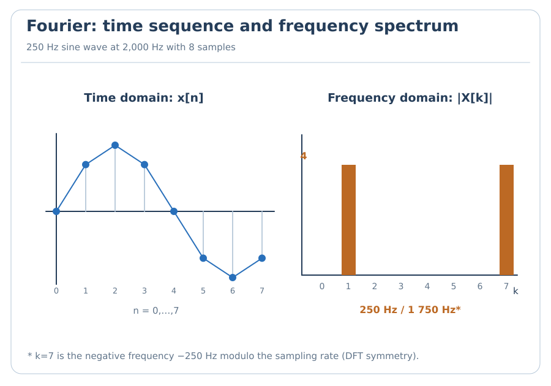

# M2-L9 – Fourier analysis and signal processing {#L9}

**Course area:** M2 – Advanced Bachelor’s studies / transition to Master’s studies

**Level:** Bachelor’s / bridge to Master’s studies

**Prior knowledge:** No fixed prerequisites specified.

**Context:** University – further advanced studies

## What is this about? {#S1}

A sound signal plotted against time often looks like a confusing wavy line. Yet it may contain several distinguishable tones. Fourier analysis considers the same signal from a different perspective: not just **which value occurs when**, but **which frequencies are involved, with what strengths and phases**. This is another description of the same information and the basis of many filtering, compression and analysis methods. We learn the most important symbols and the discrete calculation without anticipating the entire mathematical framework of proofs.

This lesson builds on school M1-L20 (sine and period), M2-L5 (complex numbers) and M1-L8 (numerical calculations).

## Basic idea and intuition {#S2}

Think of a piece of music with a low and a high note. Their oscillations overlap over time. A frequency spectrum instead displays the contributions of the individual oscillations side by side. In this way, a long, seemingly confusing sequence of measurement points becomes a kind of **table of contents of frequencies**.

A pure sine wave has exactly one frequency. A brief clicking sound, by contrast, distributes its energy over many frequencies. Fourier analysis makes it possible to identify the frequency ranges contained in a measured signal – not automatically to identify its cause.

## New symbols before the first formula {#S3}

| Symbol | Pronunciation | Meaning here | Other possible use |
|---|---|---|---|
| $x(t)$ | ‘x of t’ | Signal value at time $t$ | Position of a moving object in other models |
| $A$ | ‘ay’ | Amplitude, the maximum displacement of a pure sine wave | Event set in probability theory |
| $f$ | ‘eff’ | Frequency in hertz, oscillations per second | Function name in earlier lessons |
| $t$ | ‘tee’ | Time in seconds | General parameter |
| $\varphi$ | ‘phi’ | Phase angle, shift of the oscillation | Free parameter in other fields |
| $\sin$, $\cos$ | ‘sine’, ‘cosine’ | Periodic trigonometric functions; cosine for the aliasing check | – |
| $\pi$ | ‘pi’ | Circle constant, approximately 3.14159 | – |
| $T$ | ‘capital T’ | Period in seconds | Temperature in physical models |
| $f_{s}$ | ‘f sub s’ | Sampling rate, number of measurements per second | Index $s$ in other contexts |
| $x[n]$ | ‘x at index n’ | nth stored sample | Square brackets also denote lists or intervals |
| $N$ | ‘capital N’ | Number of values in a signal block under consideration | Number of trials in statistics |
| $n$, $k$ | ‘en’, ‘kay’ | Sample and frequency indices respectively; here they start at zero | Arbitrary counting variables |
| `Σ` | ‘capital sigma’, summation sign | Add many terms | – |
| $X[k]$ | ‘capital X at index k’ | Complex Fourier coefficient for frequency index $k$ | Set X in set theory |
| $e$ | ‘Euler’s number’ | Base of the exponential function | Identity element of a group in M2-L3 |
| $i$ | ‘eye’ | Imaginary unit with $i^{2} = -1$ | Loop index in programs |
| $\lvert X[k]\rvert$ | ‘magnitude of capital X at index k’ | Magnitude of the complex coefficient | Absolute value or cardinality of a set |
| `FFT` | ‘eff eff tee’ | Fast algorithm for calculating the discrete Fourier transform | Not a new mathematical transform |

## Frequency, period and phase {#S4}

For a simple sine wave:

$$
\begin{aligned}
x(t)&=A\cdot\sin(2\pi\cdot f\cdot t+\varphi)\\
T&=\frac1f\quad\text{(for }f>0\text{)}
\end{aligned}
$$

**First formula read aloud:** ‘The signal value x at time t equals amplitude A times the sine of two pi times frequency f times time t plus phi.’ The expression inside the sine describes the advancing angle of the oscillation. $\varphi$ shifts the starting point in time, $A$ changes the height of the wave and $f$ changes the number of waves per second.

**Second formula read aloud:** ‘The period, capital T, equals one divided by frequency f.’ At 250 hertz, one oscillation lasts $\frac{1}{250}$ seconds, or $0{,}004$ seconds, that is four milliseconds. This applies to the pure periodic oscillation with $f > 0$.

Under suitable conditions, a complicated signal can be represented as a superposition of such sinusoidal oscillations. This is called a **Fourier series**, particularly for periodic signals; the term **Fourier transform** is used for more general non-periodic signals. The precise conditions and the mathematical meaning of the ‘integral over all frequencies’ are topics in advanced analysis.

## From a continuous to a digital signal {#S5}

A computer generally receives not every conceivable instant in time, but a sequence of discrete measurements. At a sampling rate of $2\,000$ hertz, there are $2\,000$ values per second. In this lesson we number them with $n = 0, 1, 2, \ldots$.

The corresponding sampling times are:

$$
\begin{aligned}
t_n&=\frac{n}{f_s}\\
x[n]&=x(t_n)
\end{aligned}
$$

**Read aloud:** ‘The nth sampling time is n divided by the sampling rate. The stored value at index n is the signal value at that instant.’ $t_{n}$ means an instant of time indexed by n, not $t$ to the power of n.

During **sampling**, information may be irretrievably lost. For an ideally band-limited signal, the sampling rate must be **greater than twice its highest frequency component** for unique reconstruction. In practice, appropriate prefilters and actual measurement conditions are also crucial. The corresponding term is the *Nyquist–Shannon sampling theorem*. Band limitation and idealised reconstruction are essential: the short rule $f_{s} > 2\cdot f_{\max}$ is no guarantee for just any noisy or time-limited measured signal.

**Concrete aliasing check:** We measure a cosine wave at $250\,\mathrm{Hz}$ with $2\,000$ samples per second. A second cosine wave at $1\,750\,\mathrm{Hz}$ gives **the same values at every integer sampling index n**, although the continuous tones differ:

$$
\cos\left(\frac{2\pi\cdot250\cdot n}{2000}\right)=\cos\left(\frac{2\pi\cdot1750\cdot n}{2000}\right)\qquad\text{for }n\in\mathbb{Z}
$$

**Interpretation:** During sampling, the higher frequency $1\,750\,\mathrm{Hz}$ may appear to be $250\,\mathrm{Hz}$. This is because $\frac{1\,750}{2\,000}=1-\frac{250}{2\,000}$, and cosine is unchanged by a whole number of revolutions and reversal of the sign of the angle. The Nyquist frequency here is $1\,000\,\mathrm{Hz}$. The example derives neither a new physical cause nor a new signal from the measurements; instead, it explicitly illustrates the ambiguity.

## The discrete Fourier transform (DFT) {#S6}

For a stored sequence of $N$ values, the discrete Fourier transform (DFT) summarises the contribution of individual frequency classes. Its central formula is:

$$
X[k]=\sum_{n=0}^{N-1}x[n]\,e^{-2\pi i k n/N}
$$

**Read aloud in full:** ‘The Fourier coefficient capital X at index k is the sum over all sample indices n from zero to capital N minus one. Each sample x at index n is multiplied by a complex rotation. The angle of rotation depends on k, n and the block length capital N.’

`Σ` is the summation sign; the first index appears below and the last above. The expression `e^(...)` is the complex exponential function from M2-L5. The minus sign in the exponent is part of the **forward transform convention** used here. Other normalisation conventions are possible. $X[k]$ is generally **complex** and contains both a magnitude and a phase; its magnitude alone is not yet a physical signal amplitude with a general normalisation.

A DFT index corresponds to the frequency

$$
f_k=\frac{k\,f_s}{N}
$$

**Read aloud:** ‘The frequency at index k is k times the sampling rate divided by the number of samples.’ The frequency spacing is $\frac{f_s}{N}$. For a real signal, the upper DFT indices represent negative frequencies in cyclic notation; they must not be interpreted uncritically as additional independent positive tones.

## Fully explained mini-example: a digital tone {#S7}

A pure tone with $f = 250\,\mathrm{Hz}$ and $A = 1$ is sampled at $f_{s} = 2\,000\,\mathrm{Hz}$. For a block with $N = 8$, the samples are:

{alt="Eight sine wave samples at a frequency of 250 Hz and a sampling rate of 2,000 Hz, and the magnitudes of their Fourier transform. Only DFT bins 1 and 7 are non-zero, each with magnitude 4."}

DFT example: a 250 Hz oscillation appears at $k=1$ and is mirrored at $k=7$.

| Sample index $n$ | Time in milliseconds | Signal value $x[n]$ (rounded) |
|---|---|---|
| 0 | 0.0 | 0.000 |
| 1 | 0.5 | 0.707 |
| 2 | 1.0 | 1.000 |
| 3 | 1.5 | 0.707 |
| 4 | 2.0 | 0.000 |
| 5 | 2.5 | −0.707 |
| 6 | 3.0 | −1.000 |
| 7 | 3.5 | −0.707 |

The next sampling instant after these eight values is again at the beginning of a new period. The total observation time of the block is $\frac{8}{2\,000}=0{,}004$ seconds. This gives a DFT spacing of $\frac{2\,000}{8}=250\,\mathrm{Hz}$. The tone lies exactly at the first positive frequency grid point, that is $k = 1$.

With the DFT convention above, the **exact**, unrounded sine values give $X[1] = -4i$ and the symmetric coefficient $X[7] = +4i$; the remaining coefficients are zero apart from numerical rounding residuals. For this pure real sine wave, the amplitude can be recovered from the positive-frequency coefficient as $\frac{2\cdot|X[1]|}{N}=\frac{2\cdot4}{8}=1$. Among other conditions, **this simple amplitude formula** requires the frequency to coincide with a grid point as it does here, and must not be applied unchanged to arbitrary signals.

The example shows that a time sequence of eight points has a different representation from a pair of complex frequency components with symmetric indices. No new tone was created; the information was rewritten.

## FFT, filters, windows and the time–frequency trade-off {#S8}

The **fast Fourier transform (FFT)** is not a different mathematical quantity from the DFT, but a family of efficient algorithms that calculate the same DFT coefficients up to rounding errors. With suitable block lengths, a classical FFT requires on the order of $N\cdot \log_2(N)$ rather than $N^{2}$ operations. $\log_2$ denotes the base-two logarithm; the exact running time depends on the implementation and block length.

A filter can attenuate or amplify frequency components. In a linear time-invariant filter, the output spectrum is related to the input spectrum and the frequency response. This does **not** mean that a filter can cleanly separate every disturbance from the desired signal: when frequencies overlap, limitations remain.

A finite measurement cuts off the time sequence. If an oscillation does not fall exactly on the DFT grid points, its energy may ‘leak’ into adjacent frequency bins: **spectral leakage**. A window function can change this behaviour, but involves a trade-off between sidelobes and frequency resolution. **Zero-padding** adds further frequency grid points computationally, but does not improve the actual resolving power, which remains limited by the available measurement duration. Short windows detect rapid changes over time, while long windows better separate nearby frequencies. For time-varying signals, short overlapping Fourier windows are therefore frequently used (*short-time Fourier transform, STFT*).

## What is this useful for? {#S9}

In audio, pitches, unwanted noise and changing frequency patterns can be examined. For images, the two-dimensional Fourier transform gives spatial frequencies, which describe scales of patterns and edges. In robotics, frequency analysis helps detect vibrations and periodic sensor patterns; in software, FFT methods are used for efficient convolution and filtering of long signals. Many AI models also use spectral features instead of raw data alone.

## Assumptions and limitations {#S10}

Fourier decomposition is a mathematical representation, **not automatic recognition of meaning or causes**. The DFT mathematically treats the finite block of values under study as if it were repeated periodically; this may produce boundary and leakage effects. Digital FFT results depend on sampling rate, measurement duration, window, DFT convention and numerical accuracy. Above the Nyquist limit, frequencies may appear as other frequencies (*aliasing*). Analysing a short stationary block is not readily suitable for strongly varying signals; time–frequency methods are necessary for this purpose.

## Connection to the next unit {#S11}

M2-L10 considers information in digital symbol sequences: how many bits are needed at a minimum, how can data be compressed, and how can transmission errors be detected or corrected?

## Further subject-specific reading (optional, online; not required for offline reading) {#S12}

MIT OpenCourseWare, *Discrete-Time Signal Processing*, lectures on the DFT, FFT and spectral analysis: [https://www.ocw.mit.edu/courses/6-341-discrete-time-signal-processing-fall-2005/pages/lecture-notes/](https://www.ocw.mit.edu/courses/6-341-discrete-time-signal-processing-fall-2005/pages/lecture-notes/) (accessed 4 November 2026).

## Sources (external) {#S13}

- [MIT OpenCourseWare – Discrete-Time Signal Processing, Lecture Notes](https://www.ocw.mit.edu/courses/6-341-discrete-time-signal-processing-fall-2005/pages/lecture-notes/) · Thematic relevance to lesson: S8: FFT, filters, windows and the time–frequency trade-off (overview/metadata page) · Last accessed: 2026-11-22
