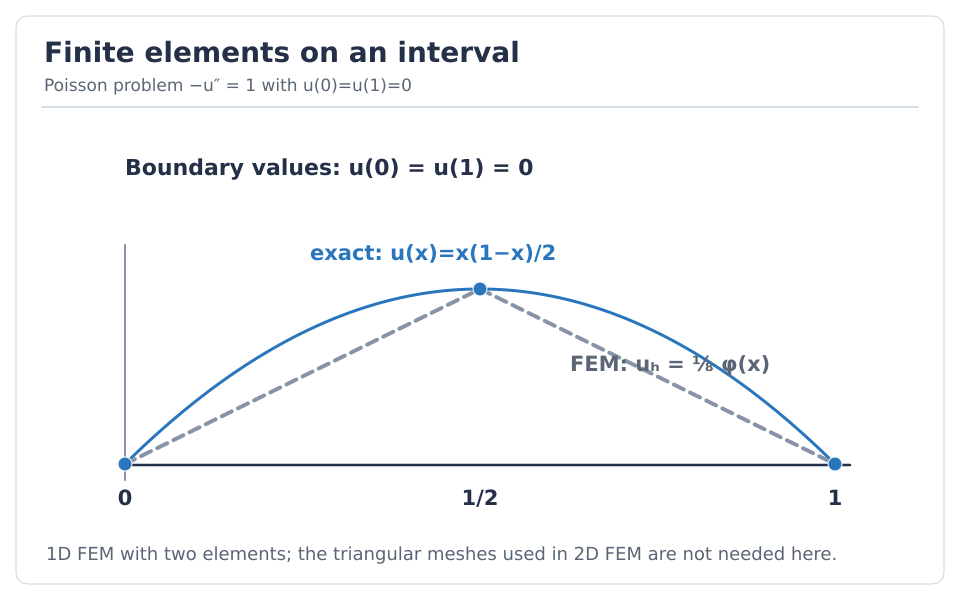

# M3-L3 – Master: Weak solutions, Sobolev spaces and finite elements {#L3}

**Course area:** M3 – Master’s-oriented advanced studies

**Level:** Master’s orientation

**Prior knowledge:** No fixed prerequisites specified.

**Context:** Master’s-oriented advanced study following M1-L3, M1-L4, M1-L8, M2-L7, M2-L8 and M3-L2

## What is this about? {#S1}

Heat conduction, elastic solids and many engineering models are described by partial differential equations. However, their solutions are not always sufficiently smooth for all the required derivatives to exist in the classical sense. A **weak formulation** transfers some of the derivatives to suitable test functions by integration. This makes solutions in larger function spaces possible and establishes the basis for the **finite element method**. It is one of the most important bridges between theoretical analysis and computational simulations.

## Basic idea and intuition {#S2}

Suppose a rod is subjected to a constant load and held fixed at both ends. A simple one-dimensional model leads to a second-order differential equation. The classical solution must be twice differentiable. If the material or the load has discontinuities, we still want to express the equation meaningfully. Instead of requiring two derivatives at every point, we require an **integral identity for all suitable test functions**.

## New symbols – read these first {#S3}

| Symbol | Read aloud | Meaning here | Do not confuse with |
| --- | --- | --- | --- |
| $u(x)$ | “u of x” | Solution sought, e.g. displacement | Input signal in M2-L12 |
| $u'$, $u''$ | “first, second derivative of u” | Spatial rate of change and its rate of change | Time derivative; specify the context |
| $v(x)$ | “v of x” | Test function against which we test the equation | A velocity symbol |
| $\int_0^1$ | “integral from zero to one” | Sum over the entire interval of the rod | A value at a single point |
| $H^{1}(0,1)$ | “H one on zero to one” | Functions whose values and first weak derivatives are square-integrable | H as the name of a Hilbert space |
| $H_{0}^{1}(0,1)$ | “H sub zero superscript one” | Functions in $H^1$ with zero boundary values in the trace sense | The null hypothesis $H_0$ |
| $u'_{\mathrm{weak}}$ | “weak derivative” | Derivative defined by an integral identity | A necessarily pointwise derivative |
| $a(u,v)$ | “a of u and v” | Bilinear form of the weak equation | Area A |
| $F(v)$ | “F of v” | Linear right-hand side expressed as a functional | An antiderivative |
| $J(u)$ | “J of u” | Energy whose minimum we seek | Jacobian matrix J |
| $\varphi$ | “phi” | Simple shape or hat function on the computational mesh | An angle |
| $c$ | “c” | Coefficient of the numerical approximation | Speed of light |

A **weak derivative** is defined by how the function interacts with smooth test functions under the integral. For $u\in L^{1}$, w is a first weak derivative if, for every smooth test function $\varphi$ with compact support in the interval, the following holds:

$$
\int u(x)\,\varphi'(x)\,\mathrm{d}x=-\int w(x)\,\varphi(x)\,\mathrm{d}x
$$

Read aloud: “The integral of u times the derivative of phi equals minus the integral of the weak derivative w times phi.” The boundary terms vanish because the test function is zero at both ends of the interval (and in their neighbourhoods). More precisely, we begin with smooth test functions with compact support; the extension to the space $H_{0}^{1}$ follows by density and continuity. If u is classically differentiable, w agrees with the ordinary derivative.

## From the classical boundary value problem to the weak form {#S4}

Our model is:

$$
\begin{aligned}
-u''(x)&=1\quad\text{for }0<x<1\\
u(0)&=0,\quad u(1)=0
\end{aligned}
$$

Read aloud: “The negative second derivative of the unknown function u is one in the open interval; u is zero at both ends.” This is an idealised one-dimensional Poisson problem. The load is constant and all lengths are dimensionless here; material parameters and units would have to be included for a physical rod.

We multiply the differential equation by a test function v that is zero at both ends and integrate:

$$
\int_0^1(-u''(x))\,v(x)\,\mathrm{d}x=\int_0^1v(x)\,\mathrm{d}x
$$

Using **integration by parts**, we transfer one derivative from u to v. In general, $\int  u''v = [u'v] - \int u'v'$. Since $v(0)=v(1)=0$, the boundary term vanishes. We therefore obtain:

$$
\int_0^1u'(x)\,v'(x)\,\mathrm{d}x=\int_0^1v(x)\,\mathrm{d}x
$$

Read aloud: “The integral of the first derivative of u times the first derivative of v equals the integral of v.” **This is the weak form.** We seek u in the space $H_{0}^{1}(0,1)$ and require equality for **every** test function v from the same space. This is not a single test equation, but an infinite family of identities.

## The exact solution and an independent check {#S5}

We first solve the classical example directly. From $u''(x)=-1$, integrating twice gives:

$$
\begin{aligned}
u'(x)&=-x+C_1\\
u(x)&=-\frac{x^2}{2}+C_1x+C_2
\end{aligned}
$$

The boundary condition at zero gives $C_{2}=0$. The boundary condition at one gives $-\frac12+C_1=0$, hence $C_1=\frac12$. Thus:

$$
\begin{aligned}
u(x)&=\frac{x(1-x)}{2}\\
u'(x)&=\frac12-x\\
u''(x)&=-1
\end{aligned}
$$

Read aloud: “The solution is x times one minus x, divided by two.” It is smooth and satisfies the classical equation, including the boundary conditions.

**Checking the weak equation:** choose $v(x)=x(1-x)$ as an example of a test function. Then $v'(x)=1-2x$. We calculate the left-hand side:

$$
\begin{aligned}
\int_0^1u'v'\,\mathrm{d}x
&=\int_0^1\left(\frac12-x\right)(1-2x)\,\mathrm{d}x\\
&=\int_0^1\left(\frac12-2x+2x^2\right)\mathrm{d}x\\
&=\frac12-1+\frac23\\
&=\frac16
\end{aligned}
$$

The right-hand side is:

$$
\int_0^1v(x)\,\mathrm{d}x=\int_0^1(x-x^2)\,\mathrm{d}x=\frac12-\frac13=\frac16
$$

Both sides agree. This checks the formula for **one** test function; its validity for all test functions follows from the derivation by integration by parts. A single numerical example alone would not constitute a proof.

## Why Sobolev spaces are needed {#S6}

An element of $H^{1}(0,1)$ is a square-integrable function with a square-integrable **weak** first derivative. The norm combines the two components:

$$
\lVert u\rVert_{H^1}^2=\int_0^1\lvert u(x)\rvert^2\,\mathrm{d}x+\int_0^1\lvert u'(x)\rvert^2\,\mathrm{d}x
$$

Read aloud: “The square of the H-one norm is the integral of the squared absolute value of u plus the integral of the squared absolute value of its weak derivative.” $H_{0}^{1}$ adds the zero boundary condition in the precise sense of the trace operator. The larger space also contains functions that are not classically differentiable everywhere.

The weak equation takes the form $a(u,v)=F(v)$ with:

$$
\begin{aligned}
a(u,v)&=\int_0^1u'(x)v'(x)\,\mathrm{d}x\\
F(v)&=\int_0^1v(x)\,\mathrm{d}x
\end{aligned}
$$

Read aloud: “a is the bilinear form, F is the linear load functional.” The **Lax–Milgram theorem** guarantees a unique solution in suitable Hilbert spaces if a is bounded and coercive and F is continuous and linear. For our space, the Poincaré inequality establishes coercivity of the derivative form with respect to the $H^1$ norm; the right-hand side is continuous. These assumptions must be checked for other boundary conditions or signs; we must not simply declare every differential equation uniquely solvable.

## The energy perspective: an equation as a minimisation problem {#S7}

The same solution minimises the energy in the appropriate function space:

$$
J(w)=\frac12\int_0^1\lvert w'(x)\rvert^2\,\mathrm{d}x-\int_0^1w(x)\,\mathrm{d}x
$$

Read aloud: “J of w is half the integral of the squared slope minus the integrated contribution of the load.” The first term penalises steep deformation gradients; the second favours displacement in the direction of the load. A small variation $w=u+\varepsilon v$ at a minimum leads to the condition $a(u,v)=F(v)$. This relationship explains the close connection between PDEs, optimisation and material mechanics.

## Complete mini-example: one finite element step {#S8}

The **finite element method (FEM)** replaces the infinite-dimensional search space with a finite-dimensional space of simple functions. We divide $[0,1]$ into the subintervals $\left[0,\frac12\right]$ and $\left[\frac12,1\right]$. There is an interior node at $x=\frac12$. The so-called **hat function $\varphi$** is one there, zero at both endpoints and linear on each of the two intervals:

1D FEM: two elements approximate the exact solution by a piecewise linear function.

$$
\begin{aligned}
\varphi(x)&=\begin{cases}2x&\text{for }0\le x\le\tfrac12\\2(1-x)&\text{for }\tfrac12\le x\le1\end{cases}
\end{aligned}
$$

Read aloud: “Phi rises linearly from zero to one at the midpoint and then falls back to zero.” Its derivative is 2 on the left half and −2 on the right. We seek an approximation $u_h(x)=c\varphi (x)$; $c$ is the unknown value at the interior node. In the weak equation, we also set the test function equal to $\varphi$:

$$
c\int_0^1{(\varphi'(x))}^2\,\mathrm{d}x=\int_0^1\varphi(x)\,\mathrm{d}x
$$

The stiffness coefficient on the left is $4\cdot\left(\frac12\right)+4\cdot\left(\frac12\right)=4$. The integral on the right is the area under a triangle with base one and height one, hence $\frac12$. Thus:

$$
\begin{aligned}
4c&=\frac12\\
c&=\frac18=0.125
\end{aligned}
$$

**Interpretation:** the numerical approximation at the midpoint node is 0.125. In fact, the exact solution gives $u\left(\frac12\right)=\frac{\frac12\cdot\frac12}{2}=\frac18$. In this small special example, linear FEM gives the exact nodal value, even though the exact solution is **quadratic between the nodes** and the piecewise linear FEM approximation does not agree with it there. A matching nodal value therefore does not imply an exact global solution.

### How large is the error despite the exact nodal value? {#abschnitt-9}

The exact solution is $u(x)=\frac{x(1-x)}2$. Our FEM approximation is $u_h=\left(\frac18\right)\varphi$. To the left of the midpoint this gives $u_h(x)=\frac{x}{4}$, and to the right, correspondingly, $\frac{1-x}{4}$. The derivatives differ on the left half:

$$
\begin{aligned}
u'(x)&=\frac12-x\\
u_h'(x)&=\frac14\\
{(u-u_h)}'(x)&=\frac14-x\quad\text{for }0<x<\frac12\text{.}
\end{aligned}
$$

On the right, the error is symmetric. It follows that the **square of the derivative error norm** is:

$$
\begin{aligned}
\int_0^1|u'-u_h'|^2\,\mathrm{d}x
&=2\cdot\int_0^{1/2}\left(\frac14-x\right)^2\mathrm{d}x\\
&=\frac1{48}\text{.}
\end{aligned}
$$

**Read aloud:** “The mean squared derivative error over both halves is one forty-eighth.” The norm itself is $\frac{1}{\sqrt{48}}$; it is **not zero**, even though the FEM nodal value agrees with the exact value. The ordinary derivative of the hat function jumps at the midpoint; nevertheless, the function has a weak derivative and belongs to $H_{0}^{1}$. The ability to choose such a trial space is precisely the advantage of the weak formulation.

The calculation measures only the error **on this idealised mesh**. It does not replace a general error estimate for other differential equations, meshes or dimensions.

## Errors, mesh selection and higher dimensions {#S9}

For real computations, we must not only solve the linear algebra problem, but also investigate discretisation errors, boundary conditions, mesh quality and conditioning. In two and three spatial dimensions, the elements often consist of triangles and tetrahedra, respectively. The local shape functions are assembled into a global **stiffness matrix**. A very fine mesh may improve accuracy, but may also increase memory requirements and aggravate numerical errors. Convergence of FEM approximations requires assumptions about solution regularity and the quality of the discrete space.

## What is it useful for? {#S10}

- **Engineering and robotics:** simulating elastic components, mechanical loads and thermal models.
- **Image processing:** formulating spatial smoothing and reconstruction models with differential operators.
- **Numerical AI systems:** understanding differentiable simulations and physically motivated model losses.

## Assumptions and limitations {#S11}

The model equation is linear, stationary and one-dimensional, with a constant load and homogeneous Dirichlet boundary conditions. Lax–Milgram was stated **as a theorem under its assumptions**, not proved in general. Non-linear PDEs, time evolution, mixed boundary conditions or incompressible flow require additional spaces and methods. The mini FEM example was chosen for teaching purposes and is not a fully developed industrial simulation.

## Connection to the next Master’s topic {#S12}

M3-L4 moves from deterministic dynamics to **stochastic processes**: what changes if not only the initial values, but also the time evolution itself involves randomness? M3-L7 explores numerical methods for large systems of equations in more depth. M3-L11 connects inverse problems with regularisation.

## References {#S13}

No individual sources are listed separately in this lesson.
