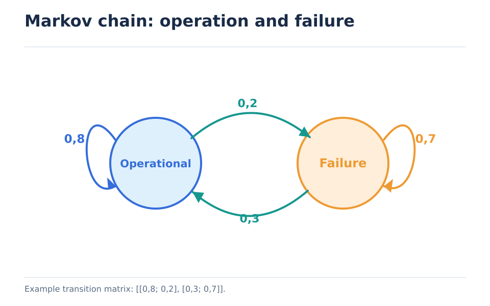

# M3-L4 – Master: Stochastic processes and Markov models {#L4}

**Course area:** M3 – Master’s-oriented advanced studies

**Level:** Master’s orientation

**Prior knowledge:** No fixed prerequisites specified.

**Context:** Master’s-oriented advanced study following M1-L7, M1-L9 and M3-L1

## What is this about? {#S1}

In M1-L7, the focus was often on **one** random variable: a measurement, a classification or a waiting time. Here we track a system over many points in time. Its state changes randomly, but not necessarily without any regularity. A **stochastic process** is a family of random variables linked by time or another index. The **Markov property** enables particularly clear modelling: the current state is sufficient to predict the next state, provided the model has actually been chosen correctly.

## Basic idea and intuition {#S2}

A technical device is either operational or faulty. An operational device may fail before the next observation; a faulty device may be repaired. We are interested not simply in the probability of an individual failure, but in how the state probabilities evolve over many steps. We then ask: is there a long-term distribution to which the system returns? How quickly does it approach it? And what changes when time passes continuously rather than in discrete steps?

## New symbols – read these first {#S3}

| Symbol | Read aloud | Meaning here | Do not confuse with |
| --- | --- | --- | --- |
| $X_{n}$ | “X sub n” | random state at time n | a fixed number x |
| $n\in \mathbb{N}_{0}$ | “n belongs to the natural numbers including zero” | discrete time steps 0, 1, 2, … | continuous time t |
| $P(A\mid B)$ | “probability of A given B” | conditional probability | a causal influence of B on A |
| $p_{ij}$ | “p sub i j” | transition from state i to state j | p as an unknown Bernoulli parameter in M3-L5 |
| $P$ as a matrix | “transition matrix P” | all transition probabilities | P as the probability of an event |
| $p_{n}$ | “p sub n” | row vector of state probabilities | an individual transition probability $p_{ij}$ |
| $P^n$ | “P to the power n” | n applications of the same transitions | componentwise exponentiation |
| $\pi$ | “lowercase pi” | stationary probability distribution | the mathematical constant $\pi$ |
| `∑` | “sum over” | addition over all possible intermediate states | an integral over a continuous space |
| $K(x,A)$ | “transition kernel K of x and A” | transition probability from state x into a set A | a matrix entry in a finite state space |
| $Q$ | “generator Q” | rates of change in a continuous-time Markov chain | a probability matrix |
| $\lambda$ | “lambda” | event rate of a Poisson process | eigenvalue in M1-L6/M3-L2 |
| $N(t)$ | “N of t” | number of events up to time t | fixed sample size n |
| $\exp (-z)$ | “exponential of minus z” | exponential decay | the negative number −z itself |

**Reading convention:** Probability vectors are written here **as row vectors**. Thus $p_{n}P$ denotes the state after one more step. Other books use column vectors for probabilities; the matrix must then be transposed accordingly.

## What a stochastic process is {#S4}

A process $X_{0}, X_{1}, X_{2}, \ldots$ describes a random variable at each integer time. The different random variables are jointly defined on **one** probability space and may be dependent. The fact that individual states have the same possible values does not mean that they have the same distribution.

For all state sequences with positive conditioning probability, the Markov property is written as follows:

$$
\begin{aligned}
P(X_{n+1}=j\mid X_n=i,X_{n-1}=i_{n-1},\ldots,X_0=i_0)
&=P(X_{n+1}=j\mid X_n=i)\text{.}
\end{aligned}
$$

Read aloud: “If we know the current state, the previously observed sequence of states provides **no additional information** about the next step.” This means neither that past and future are generally independent nor that the current state contains all information about the real world. **Whether the Markov property holds is a modelling assumption.** A device subject to wear might also require its age to be included; the two-state description would then be too coarse. Extending the state to include relevant quantities can produce a useful Markov model.

A **time-homogeneous** Markov chain uses the same transition probabilities $p_{ij}$ at every step. Homogeneity is a further, separate assumption.

## Complete worked example: operation and failure {#S5}

We denote the states by $B$ = operational and $S$ = faulty. The following probabilities per day are assumed in the model:

- An operational device remains operational with probability **0.8** and becomes faulty with probability **0.2**.
- A faulty device is repaired with probability **0.3** and remains faulty with probability **0.7**.

The **rows** of the transition matrix specify the initial state and the **columns** the next state. In the order $(B,S)$, the matrix is:

$$
\begin{aligned}
P&=\begin{bmatrix}0{,}8&0{,}2\\0{,}3&0{,}7\end{bmatrix}\\
&\text{Rows: from B, from S}\\
&\text{Columns: to B, to S}
\end{aligned}
$$

Each row sums to one, and all entries are non-negative. These are precisely the requirements for a stochastic transition matrix in this convention. If the device is initially known to be operational, its initial vector is $p_{0}=(1,0)$.

$$
\begin{aligned}
p_1&=p_0P=(1,0)P=(0{,}8;0{,}2)\\
p_2&=p_1P\\
&=(0{,}8\cdot0{,}8+0{,}2\cdot0{,}3\,;\,0{,}8\cdot0{,}2+0{,}2\cdot0{,}7)\\
&=(0{,}70;0{,}30)
\end{aligned}
$$

Read aloud: “After one day, the modelled probability of being operational is 80 per cent. After two days, it is 70 per cent, because the device may either have remained operational or have been repaired following a failure in the meantime.” This is a **model of the expected behaviour** of a random device state, not a guarantee of the course of events for a particular device.

### The Chapman–Kolmogorov idea {#abschnitt-6}

With an unchanged transition matrix, the probability of going from i to j in two steps is the sum over the possible intermediate paths:

$$
\begin{aligned}
(P^2)_{ij}&=\sum_k p_{ik}\cdot p_{kj}\\
p_n&=p_0 P^n
\end{aligned}
$$

Read aloud: “For each possible intermediate state k, we multiply the two successive transition probabilities and add the results.” In our matrix, the first row of $P^{2}$ is $(0{,}70;0{,}30)$, as calculated directly above.

## Stationary distribution and long-term behaviour {#S6}

A probability distribution $\pi$ is called **stationary** if its distribution does not change after one step:

$$
\pi P=\pi\qquad\text{and}\qquad\pi_B+\pi_S=1\text{.}
$$

We set $\pi =(a,1-a)$. The probability of being operational after one step is then $0{,}8a+0{,}3(1-a)$. Stationarity requires:

$$
\begin{aligned}
a&=0{,}8a+0{,}3(1-a)\\
a&=0{,}5a+0{,}3\\
0{,}5a&=0{,}3\\
a&=0{,}6\\
\pi&=(0{,}6;0{,}4)\text{.}
\end{aligned}
$$

**In everyday language:** “At the model’s equilibrium, 60 per cent of the probability is assigned to being operational and 40 per cent to being faulty in the long term.” For this particular chain, the stationary distribution is unique: both states can reach each other (**irreducible**), and self-transitions prevent a rigid pattern of alternation (**aperiodic**).

More precisely, for a device initially known to be operational, we obtain:

$$
P(X_n=B)=0{,}6+0{,}4\cdot{(0{,}5)}^n\text{.}
$$

Read aloud: “The probability consists of the limiting value 0.6 and an initial deviation of 0.4, which is halved at every step.” As a check: for $n=1$ we obtain $0{,}8$, and for $n=2$ we obtain $0{,}7$. For very large n, the second term vanishes. Here, this explains both **mixing** and the rate of convergence.

**Caution:** Not every finite Markov chain has a **unique** stationary distribution, and not every state distribution approaches a stationary distribution. For example, in a forced alternation $B\to S\to B\to \ldots$, the distribution $(0{,}5;0{,}5)$ is stationary, but a known initial state alternates for ever between $(1,0)$ and $(0,1)$. Stationarity and convergence are different properties.

A unique stationary distribution exists for finite irreducible chains; convergence of the time-step distributions to equilibrium additionally requires aperiodicity. The statement about long-term **proportions of time** must be distinguished from this.

### A stationary distribution is not the same as a time average or convergence in distribution {#abschnitt-8}

For our matrix, the probability of being operational after three days, starting with certainty in B, is

$$
P(X_3=B)=0{,}6+0{,}4\cdot{(0{,}5)}^3=0{,}65\text{.}
$$

By contrast, $\pi _B=0{,}6$ describes the **stationary** probability. Because of irreducibility and aperiodicity, the state distributions in *this* example approach the stationary distribution. In the periodically alternating two-state chain, however, the **distributions** alternate indefinitely. Nevertheless, along a long individual path, the proportion of time spent in each of the two states is approximately $\frac12$ (with strict alternation, even exactly so apart from a single remaining step).

For a **finite irreducible** Markov chain, the ergodic theorem gives almost sure convergence of the empirical proportions of visits to the stationary distribution; aperiodicity is **not** required for this. In the finite irreducible case, however, convergence of the **state distribution at a given time** requires aperiodicity. Three statements are thus clearly distinguished: *being stationary*, *reaching the limiting distribution* and *proportions of time along a trajectory*.

## Continuous state spaces and transition kernels {#S7}

For finitely many states, a table is sufficient. If $X_{n}$ is a continuous position or sensor estimate, we ask for the probability that the next value lies in a **set** A. A transition kernel expresses this as $K(x,A)$. For each fixed x, $A\mapsto K(x,A)$ is a probability distribution; for each measurable set A, $K(x,A)$ depends on x in an appropriately measurable way.

The matrix formula thus becomes an integrated transition formula:

$$
K^2(x,A)=\int K(y,A)\,K(x,\mathrm{d}y)\text{.}
$$

Read aloud: “We consider every possible intermediate state y, weight the probability of reaching y from x, and then the probability of reaching A from y.” This notation uses the integral with respect to a measure explained in M3-L1. The formula extends the finite sum over intermediate states; it is not a different computational idea.

## When time passes continuously {#S8}

A device can now fail or be repaired **at any time**. For a simple two-state model, we assume constant transition rates of $\alpha =0{,}2$ per hour (B to S) and $\beta =0{,}3$ per hour (S to B). A **rate** is not a probability for a whole hour; only for very short time intervals Δt is the transition probability approximately the rate multiplied by Δt.

The so-called generator has row sums of zero:

$$
\begin{aligned}
Q&=\begin{bmatrix}-\alpha&\alpha\\\beta&-\beta\end{bmatrix},
\quad\text{Column order: B, S}
\end{aligned}
$$

With $b(t)=P(X(t)=B)$ and $1-b(t)=P(X(t)=S)$, we have:

$$
\begin{aligned}
b'(t)&=-\alpha b(t)+\beta(1-b(t))\\
&=\beta-(\alpha+\beta)b(t)\text{.}
\end{aligned}
$$

Read aloud: “The probability of being operational loses mass through failures and gains mass through repairs.” This ordinary differential equation is a special case of a **forward equation** for continuous-time Markov chains. With initial condition $b(0)=1$, it follows that:

$$
\begin{aligned}
b(t)&=\frac{\beta}{\alpha+\beta}+
\left(1-\frac{\beta}{\alpha+\beta}\right)\exp(-(\alpha+\beta)t)\\
&=0{,}6+0{,}4\exp(-0{,}5t)\text{.}
\end{aligned}
$$

At $t=2$ hours, the result is approximately $0{,}6+0{,}4\cdot 0{,}3679=0{,}7472$. One hour in the continuous model is not the same transition step as one day in the preceding discrete example; the numerically identical rates and probabilities must therefore **not** be confused.

**Exact distinction between rate and transition probability:** Starting with certainty in B, the probability of being in S after exactly one hour is:

$$
\begin{aligned}
P(X(1)=S\mid X(0)=B)&=\frac{\alpha}{\alpha+\beta}\cdot
\bigl(1-\exp(-(\alpha+\beta)\cdot1)\bigr)\\
&=0{,}4\cdot(1-\exp(-0{,}5))\\
&\approx0{,}1574\text{.}
\end{aligned}
$$

Although the **failure rate** is $\alpha=0{,}2\ \text{per hour}$, the probability of being in state S after one hour is therefore approximately **15.74 per cent**, rather than a flat 20 per cent: the possibility of an intervening repair is taken into account. The approximation $\alpha \cdot \Delta t$ is useful only for short intervals $\Delta t$.

## Counting processes: Poisson as a second time model {#S9}

A **Poisson process** counts random events at a constant rate $\lambda >0$. It starts at zero, has independent increments over disjoint time intervals, and the number of events in an interval of length t follows a Poisson distribution:

$$
P(N(t)=k)=\exp(-\lambda t)\cdot\frac{{(\lambda t)}^k}{k!}
$$

Here $k$ is the integer number of events, $k!$ its factorial, $t\ge 0$ the time and $\lambda$ the average number of events per unit of time. Read aloud: “The probability of exactly k events consists of an exponential factor, the expected number of events raised to the kth power, and the factorial in the denominator.”

**Worked example:** For $\lambda =2$ events per hour and $t=1$ hour, the expected number is $\lambda t=2$:

$$
\begin{aligned}
P(N(1)=0)&=\exp(-2)\approx0{,}1353\\
P(N(1)\ge1)&=1-\exp(-2)\approx0{,}8647\text{.}
\end{aligned}
$$

**Calculation check:** For this Poisson model, we also have $E[N(t)]=\operatorname{Var}(N(t))=\lambda t$. With $\lambda=2/\mathrm{h}$ and $t=1\,\mathrm{h}$, both the expected value and the variance of the number of events are equal to 2; the standard deviation is $\sqrt{2}$ events. These are properties of the Poisson model, not general laws for real arrival processes.

The process has the Markov property with respect to its current count. The waiting time until the next event follows an exponential distribution and has the **memoryless property**. Both depend on the specific Poisson assumptions; real event streams with clusters or daily patterns often fail to satisfy them.

## Hidden states and decisions {#S10}

A robot rarely knows its true state exactly. In a **hidden Markov model** (HMM), the hidden state has the Markov property, but the sensor observation is additionally generated stochastically from that state. The observation alone is generally **not** a Markov chain. In a **Markov decision process** (MDP), a chosen action influences the transition probability; this is a different model class from a fixed Markov chain.

This distinction is crucial for AI agents: prediction without choosing an action, state estimation from sensors and optimal action planning answer three different questions.

## What is it useful for? {#S11}

- **Reliability and maintenance:** modelling changes of state and long-term availability.
- **Robotics and autonomous systems:** describing uncertain motion and sensor models in a structured way.
- **AI and sequence models:** understanding HMMs, Markov decision processes and state transitions.
- **Networks and queues:** modelling arrival events and peaks in load over time.

## Assumptions and limitations {#S12}

The Markov property, time homogeneity, independence of increments and constant rates are **assumptions that must be checked**, not universal facts. Stationarity implies neither an individual time average nor a causal explanation automatically. A transition matrix is only as good as its estimated probabilities and the chosen definition of the state. In continuous and infinite state spaces, measurability, existence, ergodicity and integrability are additionally relevant.

## Connection to the next lesson {#S13}

M3-L5 asks how we estimate unknown model parameters from data and quantify their uncertainty. Our failure parameter, for example, might not be “known”, but have to be **estimated** from observed transitions. Later, M3-L12 connects these models with nonlinear control and decisions.

## Key points {#S14}

A Markov chain is a model of **conditional transitions**. A stationary distribution is preserved by one application of the transitions. Uniqueness, convergence and actual proportions of time are separate statements with their own prerequisites. The choice of the state is just as important as the transition probabilities.

## Sources {#S15}

No individual sources are listed separately in this lesson.
