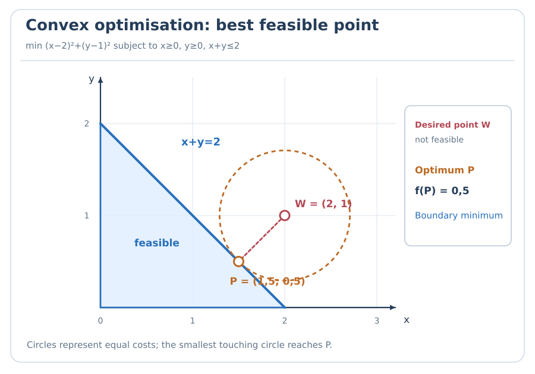

# M3-L6 – Master: Convex optimisation, duality and KKT conditions {#L6}

**Course area:** M3 – Master’s-oriented advanced studies

**Level:** Master’s orientation

**Prior knowledge:** No fixed prerequisites specified.

**Context:** Master’s-oriented advanced study following M2-L2, M1-L4 and M1-L5

## What is this about? {#S1}

In M2-L2, we formulated cost functions and constraints as decision problems. Some optimisation problems are easy to solve because their structure prevents us from getting stuck at an unfavourable local minimum. This special class is called **convex optimisation**. It combines geometric properties of sets and functions with derivatives, proofs and efficient numerical methods. **Duality** provides bounds on the best possible objective value. The **Karush–Kuhn–Tucker conditions**, or **KKT** for short, help us characterise solutions to constrained problems mathematically.

## Basic idea and intuition {#S2}

Imagine that we want to minimise a robot’s deviation from a target position but must respect spatial or technical limits. The best unconstrained point may be forbidden. The best permitted solution then often lies on the **boundary** of the feasible region. The gradient indicates the direction in which costs locally increase. An active constraint, however, prevents certain movements. At the optimum, the objective gradient and the boundary normals balance in a particular way.

The crucial question is: **Which assumptions actually turn a local optimality condition into a global certificate?**

## New symbols – read first {#S3}

| Symbol | Read aloud | Meaning here | Do not confuse with |
| --- | --- | --- | --- |
| $x\in \mathbb{R}^d$ | ‘x in d-dimensional real space’ | decision vector with d components | position vector in school mathematics M2-L11 |
| $C$ | ‘feasible set C’ | set of all permitted decisions | condition number in M1-L8 |
| $f(x)$ | ‘objective function f of x’ | cost or error to be minimised | density function in M3-L5 |
| $\min$ | ‘minimum’ | smallest attained function value | an infimum without a minimiser |
| $\inf$ | ‘infimum’ | greatest lower bound, not necessarily attained | minimum |
| $t\in [0{,}1]$ | ‘t between zero and one’ | weight of a convex combination | time variable in M1-L9 |
| $g_{i}(x)\le 0$ | ‘constraint g sub i at most zero’ | admissible inequality | equality constraint |
| $Ax=b$ | ‘A times x equals b’ | affine equality constraints | product of individual scalars |
| $\nabla f(x)$ | ‘gradient of f at x’ | vector of first partial derivatives | spatial position vector |
| $\nabla ^{2}f(x)$ | ‘Hessian of f’ | matrix of second partial derivatives | matrix square |
| $\lambda _{i}\ge 0$ | ‘lambda sub i non-negative’ | multiplier of an inequality constraint | event rate in M3-L4 |
| $\nu$ | ‘nu’ | multiplier of an equality constraint | frequency denoted by the letter n |
| $\mathcal{L}(x,\lambda ,\nu )$ | ‘Lagrangian’ | objective function plus weighted constraints | likelihood L in M3-L5 |
| $q(\lambda ,\nu )$ | ‘dual function’ | lower bound on the primal optimal value | transition generator Q in M3-L4 |
| `∑` | ‘sum’ | addition over constraints | product symbol `∏` |
| `⊤` | ‘transpose’ | here $A^{\top}\nu$ as an equality multiplier acting back on the variables | a new matrix operation |
| $\succeq 0$ | ‘positive semidefinite’ | quadratic form is never negative | strictly positive definite |
| ${\Vert x\Vert}_2^2$ | ‘squared Euclidean norm’ | sum of the squares of all components | square of a single coordinate |
| $B$ | ‘B’ | total available resource in the parametrised motor example | random variable or matrix |
| $v(B)$ | ‘v of B’ | smallest attainable objective value with budget B | objective function at an arbitrary point |

## Convex sets: connecting line segments remain feasible {#S4}

A set C is **convex** if the line segment joining any two points of C lies entirely in C. Formally, for all points x,y in C and every weight $t\in [0{,}1]$:

$$
\begin{aligned}
&(1-t)x+ty\in C\text{.}
\end{aligned}
$$

Read aloud: ‘Every point on the line segment between two permitted decisions is itself permitted.’ A circular disc, a cube and a region described by linear inequalities are convex. An annular region with a hole is generally not: a connecting line segment may pass through the forbidden hole.

A common engineering example is a **power budget**: $x\ge 0$, $y\ge 0$ and $x+y\le 2$. The region is a triangle including its boundary. Every weighted combination of two permitted settings remains feasible.

## Convex functions: no hidden deep valleys {#S5}

A function f on a convex set is called **convex** if its value on a connecting line segment is at most the linearly interpolated value at the endpoints:

$$
f((1-t)x+ty)\leq(1-t)f(x)+tf(y)\text{.}
$$

Read aloud: ‘Along every segment between two inputs, the function does not lie above the line joining the endpoint values.’ This is a **global** geometric condition. A quadratic error $f(x)={(x-3)}^2$ is convex; the function $f(x)=-x^{2}$, by contrast, is concave and therefore not convex.

For a differentiable convex function on an open convex domain, the **supporting hyperplane inequality** holds:

$$
f(y)\geq f(x)+\nabla f(x)\cdot(y-x)\text{.}
$$

Read aloud: ‘At point x, the tangent plane lies below the entire convex function.’ Consequently, an interior point with $\nabla f(x)=0$ can occur only where f attains a **global minimum**.

For a twice continuously differentiable function on an open convex domain, convexity is equivalent to its **Hessian** being positive semidefinite everywhere:

$$
z^{\mathrm{T}}\nabla^2 f(x)\,z\geq0\qquad\text{for all direction vectors }z\text{.}
$$

Read aloud: ‘The second-order curvature in every possible direction must be non-negative.’ Positive **definiteness** of the Hessian is a stronger, sufficient condition for strict convexity; it is not necessary. A strictly convex function has **at most one** global minimiser, if one exists. Convexity alone does not guarantee existence.

## The general convex optimisation problem {#S6}

We minimise f subject to inequalities $g_{i}(x)\le 0$ and an affine equality $Ax=b$. In a **convex optimisation problem**, f and all $g_i$ are convex, the equality constraints are affine and the domain is convex. The set C need not be specified separately from the outset: it follows from these conditions.

$$
\begin{aligned}
\text{minimise}\quad&f(x)\\
\text{subject to}\quad&g_i(x)\le0\quad\text{for }i=1,\ldots,m\\
&Ax=b\text{.}
\end{aligned}
$$

Read aloud: ‘Among all decisions that satisfy every constraint, we seek the smallest possible objective value.’ In convex problems, every **local** minimiser is also a **global** minimiser. This guarantee does not apply to general neural networks or arbitrary robotics problems: their objective functions are often non-convex.

## Fully worked boundary problem: why the multiplier appears {#S7}

We want to keep a non-negative real quantity x as small as possible, but must provide at least two units. We choose $f(x)=x^{2}$ as the cost function. We write the constraint $x\ge 2$ in KKT-compatible form as $g(x)=2-x\le 0$.

$$
\begin{aligned}
\text{minimise}\quad&x^2\\
\text{subject to}\quad&2-x\le0\text{.}
\end{aligned}
$$

Without the constraint, $x=0$ would be best, but it is forbidden. Among all permitted $x\ge 2$, **$x=2$** is the best value, with cost $f(2)=4$.

To characterise this result formally, we introduce a **non-negative Lagrange multiplier** $\lambda$ and construct:

$$
\mathcal{L}(x,\lambda)=x^2+\lambda(2-x)\qquad\text{with }\lambda\geq0\text{.}
$$

Read aloud: ‘The Lagrangian contains the original cost and an expression weighted by lambda for the constraint that can be violated.’ The stationarity condition with respect to x is:

$$
\frac{\partial\mathcal{L}}{\partial x}=2x-\lambda=0\text{.}
$$

At the candidate $x=2$, we obtain $\lambda =4$. We now check all four KKT conditions in this particular case:

1.  **Primal feasibility:** $2-2=0\le 0$ – $x=2$ satisfies the constraint.
2.  **Dual feasibility:** $\lambda =4\ge 0$ – the inequality multiplier is non-negative.
3.  **Stationarity:** $2x-\lambda =4-4=0$ – the gradient balance holds.
4.  **Complementary slackness:** $\lambda \cdot g(x)=4\cdot 0=0$ – a positive penalty weight here corresponds to an active constraint.

Since f and g are convex, the KKT pair we found is a **certificate of global optimality**. The inequality alone does not yet tell us how much the minimum requirement costs; $\lambda$ illustrates precisely this sensitivity.

## Lagrange duality without magic formulae {#S8}

For each fixed number $\lambda \ge 0$, we consider the smallest value of the Lagrangian when x is initially unrestricted:

$$
q(\lambda)=\inf_{x\in\mathbb{R}}\left[x^2+\lambda(2-x)\right]\text{.}
$$

Read aloud: ‘q of lambda is a lower bound on the best possible cost, calculated for this choice of lambda.’ **Only by maximising over all admissible multipliers** do we seek the best such bound. We complete the square or set the derivative with respect to x to zero:

$$
\begin{aligned}
2x-\lambda&=0\implies x=\frac\lambda2\text{.}\\
q(\lambda)&=\left(\frac\lambda2\right)^2+\lambda\left(2-\frac\lambda2\right)\\
&=2\lambda-\frac{\lambda^2}{4}\text{.}
\end{aligned}
$$

The **dual problem** maximises this lower bound over $\lambda \ge 0$:

$$
\begin{aligned}
\text{maximise}\quad q(\lambda)&=2\lambda-\frac{\lambda^2}{4}\quad\text{for }\lambda\ge0\text{.}\\
q'(\lambda)&=2-\frac\lambda2=0\implies\lambda^*=4\text{.}\\
q(4)&=8-4=4\text{.}
\end{aligned}
$$

Read aloud: ‘The best dual multiplier is four, and the best calculated lower bound is also four.’ The **primal** optimal value was four. Thus there is **no duality gap** in this example.

For a minimisation problem with correctly chosen signs, general **weak duality** states that every dual feasible value is at most the primal optimal value. This is a verifiable **lower bound**, even if we do not yet know an optimal decision.

**When does strong duality hold?** For convex problems, the so-called **Slater condition** is a common sufficient assumption: in simplified terms, the inequalities must be strictly satisfiable at at least one point while the affine equalities remain satisfied; precise versions account for relative interiors and domains. In our example, $x=3$ strictly satisfies the inequality ($2-3<0$). Strong duality can therefore be justified here, and when optima are suitably attained, KKT conditions are necessary and sufficient. **Without appropriate regularity assumptions, one must not claim the necessity of KKT conditions or strong duality in general.**

## A two-dimensional resource example {#S9}

Two motors are to operate close to their desired power settings $(2,1)$. Together, however, they may require at most two units of power. Both settings should be non-negative. We minimise:

Convex optimisation: desired point (2,1) outside the feasible set; boundary minimum at (1,5;0,5) with cost 0,5.

$$
\begin{aligned}
f(x,y)&={(x-2)}^2+{(y-1)}^2\\
\text{subject to}\quad&x\ge0,\quad y\ge0,\quad x+y\le2\text{.}
\end{aligned}
$$

The desired values $(2,1)$ are forbidden because their sum is three. The geometrically nearest permitted pair must lie on the budget boundary. We first set $x+y=2$, hence $y=2-x$:

$$
\begin{aligned}
f(x,2-x)&={(x-2)}^2+{(1-x)}^2\\
&=2x^2-6x+5\text{.}\\
f'(x)&=4x-6=0\implies x=1{,}5\text{.}\\
y&=2-1{,}5=0{,}5\text{.}\\
f(1{,}5;0{,}5)&={(-0{,}5)}^2+{(-0{,}5)}^2=0{,}5\text{.}
\end{aligned}
$$

Read aloud: ‘We divide the total resource into 1,5 and 0,5. Both motors fall short of their desired value by 0,5; the total squared deviation cost is 0,5.’ Both settings are positive and satisfy the constraint with equality.

With multiplier $\lambda$ for the budget constraint $x+y-2\le 0$, the stationarity equations are as follows, because the non-negativity constraints are inactive here:

$$
\begin{aligned}
2(x-2)+\lambda&=0\\
2(y-1)+\lambda&=0\text{.}
\end{aligned}
$$

At $(x,y)=(1{,}5;0{,}5)$, both equations are satisfied with $\lambda =1$. This illustrates the meaning of the **shadow price**: a small change in the total available power has a local effect on the optimal objective value, described by $\lambda$. The unit and sign used depend on the particular parametrisation of the budget constraint.

The complete KKT cross-check also includes the two inequalities $-x\le 0$ and $-y\le 0$: since x and y are strictly positive here, their multipliers may be zero. For the budget constraint, we use $\lambda =1$. We then have primal feasible variables, non-negative multipliers, the two stationarity equations and the complementary slackness condition $1\cdot (1{,}5+0{,}5-2)=0$. Furthermore, $(0{,}5;0{,}5)$ is a strictly feasible point for **all three** inequalities. The strictly convex quadratic objective function therefore has its **unique global minimum** at $(1{,}5;0{,}5)$.

**Calculating the shadow price:** If we replace the fixed budget of 2 with a variable budget $B$ close to 2, then for $1<B<3$ we still have an active budget constraint and positive motor power settings:

$$
\begin{aligned}
x^*(B)&=\frac{B+1}{2},\quad y^*(B)=\frac{B-1}{2}\\
v(B)&=\frac{{(3-B)}^2}{2},\quad v'(B)=B-3\text{.}\\
\text{At }B=2:\quad v(2)&=0{,}5\quad\text{and}\quad v'(2)=-1=-\lambda\text{.}
\end{aligned}
$$

Read aloud: ‘If the budget increases slightly, the minimum squared deviation cost initially falls by approximately one unit per additional unit of budget.’ The minus sign follows from the constraint $x+y-B\le 0$ used here; for differently formulated constraints, the sign and meaning of the multiplier change. The fact that the optimal point lies on the boundary is a consequence of the particular numbers – not a general requirement for convex problems.

## Numerical methods and relevance to AI {#S10}

For high-dimensional problems, the solution often cannot be determined by hand. **Projected gradient descent** combines a step towards decreasing objective values with projection back onto the feasible set C. In textual notation:

$$
x_{\mathrm{new}}=\operatorname{Proj}_C\left(x_{\mathrm{old}}-\eta\cdot\nabla f(x_{\mathrm{old}})\right)\text{.}
$$

$\operatorname{Proj}_C$ denotes the Euclidean nearest point in the closed, non-empty convex set C; $\eta >0$ is called the step size. Read aloud: ‘We move some distance against the gradient and bring the result back into the feasible region by projection.’ **Mini-example:** For $f(x)=x^{2}$, $C=[2,\infty )$, starting value $x_{\mathrm{old}}=3$ and step size $\eta=\frac12$, the raw gradient step is $3-\left(\frac12\right)\cdot6=0$. Projection onto $C$ takes us to $x_{\mathrm{new}}=2$, the actual minimum under this constraint. The example shows a single valid projection, not a convergence guarantee for arbitrary step sizes.

Convergence results depend on step size, smoothness and convexity. For non-smooth problems, such as those involving absolute values, **subgradients** or **proximal methods** are important extensions.

Convex optimisation is fundamental to linear regression, Lasso and Ridge variants, support vector machines and many control subproblems. A deep neural network as a whole does not normally have a convex loss landscape; the global optimality reasoning proved here therefore does not automatically carry over to every AI training process.

## KKT as geometry – and as a question of validity {#S11}

In words, KKT stationarity states: ‘At the optimal point, the negative objective gradient is balanced by the gradients of the active constraints.’ Complementary slackness means: ‘A strictly **inactive** inequality has multiplier zero in the KKT pair.’ The converse does not always hold: an active constraint can also have a zero multiplier.

For a **convex, differentiable problem** with affine equalities, correctly satisfied KKT conditions are **sufficient** for global optimality. Their **necessity** generally requires an appropriate constraint qualification, such as a suitable Slater condition. **Counterexample to necessity without regularity:** We minimise $f(x)=x$ subject to the convex constraint $g(x)=x^{2}\le 0$. The only feasible decision is $x=0$, and hence it is necessarily globally optimal. But $f'(0)=1$ and $g'(0)=0$; KKT stationarity $1+\lambda \cdot 0=0$ cannot be satisfied for any $\lambda \ge 0$. There is no strictly feasible point for this inequality. This reveals that even with a convex objective and a convex constraint, **the necessity of KKT is not guaranteed without an appropriate constraint qualification**.

For **non-convex** problems, KKT points may merely be candidates and may even be saddle points. Non-differentiable functions or non-closed domains require further theory.

## What is it useful for? {#S12}

- **Robot control:** Coordinate admissible control inputs, velocities and limited actuator power.
- **AI and machine learning:** Reliably solve convex subproblems, linear models and regularised parameter fitting problems.
- **Operational planning:** Allocate staffing, energy and computing budgets subject to constraints.
- **Numerical software:** Check optimal values through duality using mathematically transparent bounds.

## Assumptions and limitations {#S13}

KKT is not a universal solution formula. The mathematical form of the objective function, the convexity of each inequality, the direction of the constraints and the affine structure of the equalities must be correct. The sign of the multipliers depends on the convention ‘minimise subject to $g\le0$’. Existence of the minimum, constraint qualifications and numerical convergence are **separate** questions. Merely achieving low costs does not prove global optimality.

## Connection to the next lesson {#S14}

M3-L7 deals with numerical linear algebra: large matrix systems, singular value decomposition and Krylov methods. Many numerical optimisers solve such linear subproblems at each step. M3-L11 later takes up duality, regularisation and model uncertainty in inverse problems.

## Key points {#S15}

**Convexity** makes local optima global under appropriate conditions. **Duality** produces verifiable bounds and can explain optimisation from a second perspective. **KKT** combines stationarity, feasibility and active constraints; its necessity and strong duality depend on additional assumptions. Formulating the model correctly is at least as important as the subsequent optimisation algorithm.

## Sources {#S16}

No individual sources are listed separately in this lesson.
