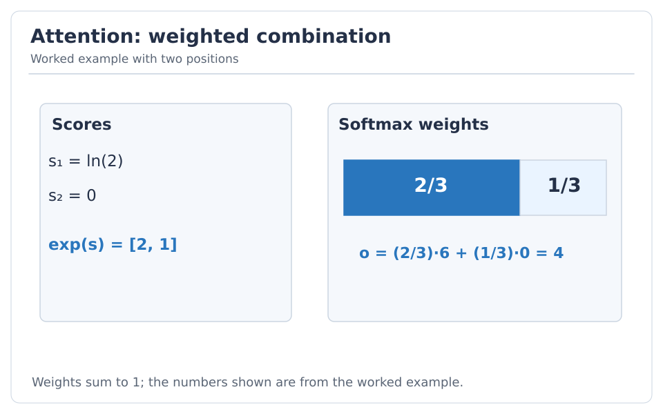

# M4-L1 – Compulsory elective: transformer mathematics, attention and language models {#L1}

**Course area:** M4 – Choice of study: AI, computer science and specialised fields

**Level:** University studies (elective / specialisation)

**Prior knowledge:** [M1-L5](M1-L5.md) (matrices), [M1-L7](M1-L7.md) (probabilities), [M2-L10](M2-L10.md) (information theory), [M2-L11](M2-L11.md) (neural networks), and, where appropriate, [M3-L6](M3-L6.md) (optimisation)

**Context:** Advanced study or compulsory elective, from advanced Bachelor's to Master's level.

## What is it about? {#S1}

A language model does not process strings of characters directly as sentences. Instead, it uses discrete units called tokens and converts them into numerical vectors. A transformer can relate different positions in a sequence to one another. Its central mechanism is a weighted combination of information: **attention**. The mathematical foundations are matrix multiplication, the dot product, normalisation and differentiable optimisation. This lesson explains what is actually computed – and why neither automatic truth nor human understanding of language follows from this process.

## Basic idea and intuition {#S2}

In the sentence ‘The bank is by the river’, the word ‘river’ helps determine which meaning of ‘bank’ is plausible during processing. Technically, this is not decided by a built-in dictionary. A model constructs vectors and learns which positions receive greater weight in relation to other positions. Attention is a **computational mechanism for weighting information**, not a guarantee of grammatical correctness or factual reliability.

## New symbols – read before the formulae {#S3}

| Symbol | Read aloud | Meaning here | Distinction |
| --- | --- | --- | --- |
| $x_{i}$ | ‘x sub i’ | Vector representation of the token at position i | Not the original word |
| $q_{i}$ | ‘q sub i’ | Query vector for a position: what information is sought? | Not a browser search query |
| $k_{j}$ | ‘k sub j’ | Key vector for a position: how can it be identified? | Not an encryption key |
| $v_{j}$ | ‘v sub j’ | Value vector: information to be combined | Not a truth value |
| `·` | ‘dot product’ | Measures a bilinear similarity in this calculation | Not necessarily cosine similarity |
| $d_{k}$ | ‘d sub k’ | Number of components in a key or query vector | Not the length of the token sequence |
| $s_{ij}$ | ‘s sub i j’ | Normalised comparison score between query i and key j | Not yet a probability |
| $\exp$ | ‘exponential function’ | Converts real-valued comparison scores into positive values | Not percentage arithmetic |
| $\alpha _{ij}$ | ‘alpha sub i j’ | Attention weight between positions i and j | Not a causal influence |
| `Σ` | ‘sum’ | Adds the contributions from all permitted positions | Not an integral over continuous time |
| $\operatorname{softmax}$ | ‘softmax’ | Converts finitely many numbers into positive weights that sum to one | Not general statistical calibration |
| $Q,K,V$ | ‘Q, K, V’ | Matrices of all queries, keys and values | Q/K/V have a different meaning in M3-L12 |
| `⊤` | ‘transpose’ | Interchanges rows and columns | Not the matrix inverse |
| $n$ | ‘n’ | Number of token positions under consideration | Not the number of training examples |

## From tokens to vectors {#S4}

A tokeniser divides text into units. A token is not always a word, nor is it always a single character. Each token index is first assigned a learned numerical vector, the **embedding**. The model also needs information about order and position, because without such information attention alone does not interpret the positions as an ordered sentence.

For an input with n positions, we obtain a matrix X: each row contains an embedding. Three new representations are generated from X using learned matrices:

$$
Q=XW_Q,\qquad K=XW_K,\qquad V=XW_V\text{.}
$$

Read aloud: ‘The query matrix is the input matrix multiplied by a trained query weight matrix; the key and value matrices are obtained in the same way.’ The matrices $W_Q$, $W_K$ and $W_V$ are parameters that the model changes during training. Their numbers of columns are an architectural choice.

## Scaled dot-product attention {#S5}

For position i and the position j under consideration, the transformer first computes:

$$
s_{ij}=\frac{q_i\cdot k_j}{\sqrt{d_k}}\text{.}
$$

Read aloud: ‘Compare query i and key j using the dot product and divide by the square root of the key dimension.’ The scaling factor helps control the magnitude of the comparison scores when there are many vector components. It is not a universal guarantee against numerical problems.

The scores for a query are converted into weights using softmax:

$$
\alpha_{ij}=\frac{\exp(s_{ij})}{\sum_m\exp(s_{im})}\text{.}
$$

Read aloud: ‘Exponentiate the score for j and divide by the sum of the exponentiated scores for all positions m that this query is allowed to attend to.’ For **unmasked, permitted positions with finite scores**, it follows that $\alpha _{ij} > 0$; over all permitted positions, $\sum_j\alpha_{ij}=1$. With **causal masking** in autoregressive language models, positions may attend only to permitted context positions that are already available at the current generation step. Softmax is therefore normalised over permitted positions only; forbidden positions have **zero weight**, rather than a strictly positive weight. At least one position must be permitted.

The output vector is obtained by weighting the values:

$$
o_i=\sum_j\alpha_{ij}v_j\text{.}
$$

Read aloud: ‘Add the value vectors, multiplying each by its attention weight.’ The result is a **weighted mixture of vectors**, not simply the selected token with the highest score.

## Fully worked example with two positions {#S6}

We deliberately use just **one component** per query and key: $d_{k} = 1$; hence $\sqrt{d_k}=1$. The query is $q = \ln (2)$ (the natural logarithm of two). The two keys are $k_{1} = 1$ and $k_{2} = 0$. Their values are $v_{1} = 6$ and $v_{2} = 0$.

{alt="Two attention scores, ln two and zero, yield softmax weights of two thirds and one third and an output of four."}

Normalised attention: $\frac23\cdot6+\frac13\cdot0=4$.

$$
\begin{aligned}
s_1&=\frac{q\cdot k_1}{1}=\ln(2),\\
s_2&=\frac{q\cdot k_2}{1}=0\text{.}\\
\exp(s_1)&=2,\quad\exp(s_2)=1,\\
\alpha_1&=\frac2{2+1}=\frac23,\\
\alpha_2&=\frac1{2+1}=\frac13\text{.}\\
o&=\frac23\cdot6+\frac13\cdot0=4\text{.}
\end{aligned}
$$

Read aloud: ‘The first position receives two thirds of the weight, the second one third. The weighted sum of the transmitted values is four.’ Here the values are one-dimensional; in real models, they are usually vectors with many components. The numbers have been chosen for teaching purposes and are not taken from a real language model.

In matrix notation, the same mechanism for many positions is expressed as follows:

$$
\operatorname{Attention}(Q,K,V)=\operatorname{softmax}\left(\frac{QK^{\mathrm{T}}}{\sqrt{d_k}}\right)V\text{.}
$$

Softmax acts **row by row** on the comparison scores; any masks are applied before softmax. The dimensions must be compatible: Q and K use the same comparison dimension, and K and V have the same number of rows.

### Countercheck: a causal mask changes the normalised mixture {#abschnitt-7}

Suppose a single query has **three** keys with comparison scores $s=(\ln (2), 0, \ln (3))$ and one-dimensional values $v=(6,0,100)$. Without a mask, the exponential values are $(2,1,3)$; their sum is 6. The output vector would therefore be:

$$
\begin{aligned}
\alpha_{\mathrm{unmasked}}&=\left(\frac26,\frac16,\frac36\right),\\
o_{\mathrm{unmasked}}&=\frac26\cdot6+\frac16\cdot0+\frac36\cdot100=52\text{.}
\end{aligned}
$$

If the third position lies **in the future** relative to the query under consideration, it must not be taken into account in autoregressive causal self-attention. This means that the third score is excluded before softmax, formally, for example, by masking it with $-\infty$. The remaining weights are **renormalised**:

$$
\begin{aligned}
\alpha_{\mathrm{masked}}&=\left(\frac2{2+1},\frac1{2+1},0\right)
=\left(\frac23,\frac13,0\right),\\
o_{\mathrm{masked}}&=\frac23\cdot6+\frac13\cdot0+0\cdot100=4\text{.}
\end{aligned}
$$

Read aloud: ‘The future position receives not merely a smaller weight, but exactly zero; the permitted positions redistribute the entire weight among themselves.’ A mask value of $-\infty$ is idealised mathematical notation; actual implementations need a correct masking procedure and at least one permitted position per query.

### Numerical countercheck: computing softmax without overflow {#abschnitt-8}

Softmax is unchanged if **the same value is subtracted from all permitted scores**. For the maximum value $m=\max (s_j)$, we have:

$$
\alpha_j=\frac{\exp(s_j-m)}{\sum_{\ell}\exp(s_{\ell}-m)}\text{.}
$$

This avoids unnecessarily large exponential values. Consider an example with scores $s=(1000,999)$:

$$
\begin{aligned}
m&=1000,\\
\exp(s-m)&=(\exp(0),\exp(-1))=\left(1,\frac1e\right),\\
\alpha&=\left(\frac e{e+1},\frac1{e+1}\right)\approx(0.731059;0.268941)\text{.}
\end{aligned}
$$

Read aloud: ‘Instead of generating enormous exponential values, we calculate the same distribution using zero and minus one.’ This is an essential practical measure for numerically stable attention, but it does not provide a complete guarantee against rounding, masking or training problems.

## Multi-head attention, residual connections and training {#S7}

Instead of computing a single attention mapping, a transformer often computes several **heads**, each with its own trained projections. The results are combined and transformed linearly once more. Different heads *can* learn different relationships; each individual head is not guaranteed to have a fixed linguistic meaning. Other components include feedforward layers, normalisation and **residual connections** (adding the input information to a representation that has undergone further processing).

During training, a loss function is optimised, for example, the negative log-probability of the next token in language modelling. Parameter updates are determined from the derivatives of the loss function. The model produces a distribution over possible next tokens, but it does not automatically produce a verified statement about the world. Even a statistically plausible answer can be factually incorrect.

## Computational costs, long contexts and limits of applicability {#S8}

With dense attention, the comparison matrix for n positions contains approximately $n^{2}$ entries. Doubling n quadruples this number in the simple model. This describes **classical dense attention**, not all modern variants: sparse or blockwise attention, memory-optimised implementations and other architectures change actual memory requirements and running time.

Attention weights **cannot reliably be interpreted as causes of a model decision**. Tokenisation, context length, training data, numerical precision and the training objective also limit what can be inferred. The number of model parameters alone predicts neither truth nor reliability.

## What is it useful for? {#S9}

The formulae explain why text generation, image and text processing, vector search and some multimodal AI systems require large matrix multiplications. They also help place concepts such as prompt context, causal masking, model quantisation and the computational costs of long inputs in context. Implementation involves additional topics: secure execution, tokeniser conventions, training, memory layout and evaluation methodology.

## Connection to the next specialist lesson {#S10}

M4-L1 describes learned statistical relationships. **M4-L2 explicitly asks when cause and effect can actually be inferred from such relationships.** M2-L11 remains the foundation for neural networks; M4-L1 does not replace it.

## Sources (external) {#S11}

No external sources listed.
