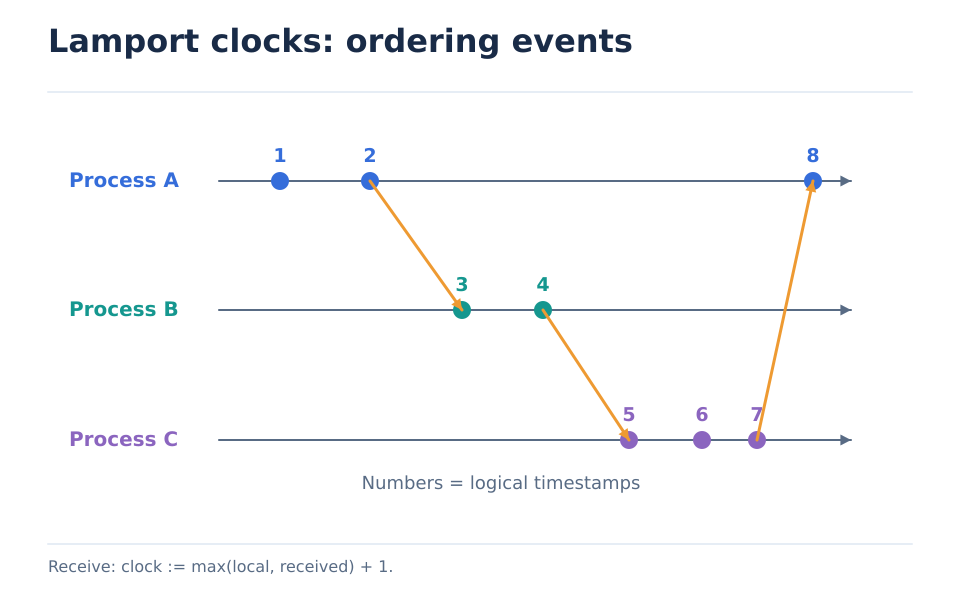

# M4-L10 – Compulsory elective: Distributed systems, logical clocks and consensus {#L10}

**Course area:** M4 – Choice of study: AI, computer science and specialised fields

**Level:** University studies (elective / specialisation)

**Prior knowledge:** [M2-L1](M2-L1.md) · [M2-L13](M2-L13.md) · [M1-L7](M1-L7.md) · [M4-L4](M4-L4.md)

**Context:** Elective module in systems computing, advanced Bachelor's to Master's level. Prior knowledge: M2-L1 (graphs), M2-L13 (algorithms and logic), M1-L7 (probability fundamentals), M4-L4 (specifications and invariants)

## What is this about? {#S1}

When a service runs on several computers, there is no single central clock, and messages arrive with varying delays. One computer may fail while the others continue working. Nevertheless, database entries, machine states or task lists should appear understandable and as reliable as possible. The mathematics involved describes **event ordering, majorities, consistency rules and conflict resolution**. Unlike purely parallel programming, we must explicitly take into account that other computers or the network may be unreachable.

## Basic idea: a timestamp does not tell the whole story {#S2}

Imagine two computers, A and B. A reserves a robotic arm; B reads its availability shortly afterwards, but the message has not yet arrived. From B's perspective, the arm may appear to be free. The local computer clock is therefore insufficient for making the correct decision: we need a rule specifying **which events depend on one another** and **when a jointly accepted state becomes binding**.

Three different goals must remain distinct:

- **Safety (safety of a protocol property):** Two contradictory outcomes are never established as valid, provided that the model assumptions hold.
- **Liveness (progress):** Under suitable additional assumptions, the system eventually reaches a decision again.
- **Availability:** A valid client request receives a successful response within the definition being used. High availability is not the same as a state that is linearizable at all times.

## New symbols and terms – a reading guide first {#S3}

| Symbol / term | Read aloud | Meaning in this lesson | Do not confuse with |
| --- | --- | --- | --- |
| $A$, $B$, $P$, $Q$ | “computer A”, “process P” | separate processes or servers | numerical variables from algebra |
| $a \to  b$ | “event a causally precedes b” | *happened-before* relation | ordinary comparison of physical clock times |
| $a \Vert  b$ | “a and b are concurrent” | no causal direction is known | events that necessarily occur simultaneously |
| $C(a)$ | “logical timestamp of event a” | Lamport counter at the event | time in seconds |
| $\max (x,y)$ | “the greater of x and y” | selection of the greater counter value | sum |
| $N$ | “en” | number of voting servers | sample size in statistics |
| $f$ | “ef” | assumed number of failed servers | function $f(x)$ |
| $\lfloor x\rfloor$ | “floor of x” | greatest integer not greater than x | rounding to the nearest number |
| $q$ | “cue” | required majority of votes | query vector in M4-L1 |
| `term` | “term” | Raft election period with an increasing number | algebraic term |
| `log` | “sequence of log entries” | ordered collection of replicated commands | natural logarithm |
| $s=(s_{1},\ldots ,s_{n})$ | “state vector s” | components of the replicated counter state | position in three-dimensional space |
| $\max (s,t)$ | “componentwise maximum” | merging two counter states | adding the counter values |
| `Σ` | “sigma, sum” | addition of all state components | symbol for an arbitrary process |
| $V(a)$ | “vector clock at event a” | counter value for each observed process | a physically synchronised clock |

The notation $a \to  b$ denotes *causal event ordering* in M4-L10, not necessarily a network connection. $a \Vert  b$ means **no known ordering**; the two events may have occurred at different times in the physical world.

## Causal ordering and Lamport clocks {#S4}

The relation “a happens before b” is constructed using three rules:

{alt="Three processes with messages and consistent Lamport timestamps"}

1.  Two events in the same process follow that process's own execution order.
2.  The **sending** of a message causally precedes its **receipt**.
3.  If a precedes b and b precedes c, then a also precedes c; this is called *transitivity*.

A **logical Lamport clock** is a monotonically increasing integer counter. For the following example, we define this specific convention: before each local event or send event, the counter is increased by one. On receiving a message with timestamp m, the new local counter is set to $\max(C_{\mathrm{local}},m)+1$.

$$
C_{\mathrm{new}}=\max(C_{\mathrm{old}},m)+1
$$

**Read aloud:** “The new logical timestamp is one greater than the greater of the old local counter and the received counter.” This is an ordering rule, not a measurement of physical time.

### Fully worked example: a message from P to Q {#abschnitt-5}

Both counters start at zero.

1.  A local event takes place on computer P. P sets its counter to $1$.
2.  P sends a message. Before sending it, P increments its counter to $2$; the message carries the value $m=2$.
3.  Computer Q has meanwhile performed a local event of its own and is at $1$.
4.  Q receives the message. It calculates $\max (1,2)+1=3$. The receive event therefore has timestamp $3$.
5.  Q then continues processing the message internally. The next event receives $4$.

The send causally precedes the receipt, and the counters confirm $2 < 3$. The converse does **not** hold: $C(a) < C(b)$ alone does **not** imply that a caused or influenced b. Two independent computers may happen to carry the values 2 and 5 and still be causally unrelated. **Vector clocks**, for example, can be used to identify concurrency; their multiple components additionally record the observed history.

### Check example: identifying concurrency with vector clocks {#abschnitt-6}

With exactly two processes P and Q, let each vector clock have two components $(\mathrm{counter}_P,\mathrm{counter}_Q)$. Each process increments its own component before an event of its own. On receiving a message, Q first takes the **componentwise maximum** with the transmitted vector and then increments its own component.

Formula, sketch or calculation scheme · Original notation

    P after a local event and a send event a: V(a) = (2,0)
    Q after an independent event: V(b) = (0,1)
    Comparison: (2,0) ≰ (0,1) and (0,1) ≰ (2,0)
    Therefore a and b are concurrent according to the observed order.

    Send event a transmits the state (2,0) to Q.
    Q receives it after event b:
    max[(0,1),(2,0)] = (2,1)
    Receive event at Q: (2,2)

The two original vectors are **not comparable componentwise**; the receive vector $(2,2)$, by contrast, includes both histories. Unlike a single Lamport counter, the vector clock can distinguish concurrency in this model. This statement assumes that each relevant process component is correctly maintained and transmitted; dynamic membership requires additional rules.

## Majorities: how many votes are needed? {#S5}

A simple majority threshold for $N$ voting servers is:

$$
q=\left\lfloor\frac N2\right\rfloor+1
$$

**Read aloud:** “Divide the number of servers by two, round down and add one.” For $N=5$, the calculation is $\left\lfloor\frac52\right\rfloor+1=2+1=3$. Every set of three servers overlaps every other such majority of three in **at least one** server: two disjoint groups of three would require at least six distinct servers. This overlap is an important building block of consensus protocols, but **not yet a complete proof of safety**. More generally, for two subsets $Q_{1},Q_{2}$, each containing at least $q$ members from $N$ servers, we have: $|Q_{1}\cap Q_{2}| \ge  2q-N$ (provided that the right-hand side is positive). For $N=5$, $q=3$, there is at least $1$ shared server; for $N=4$, $q=3$, there are at least $2$ shared servers. Nor does this alone guarantee the Raft-specific election, log and commit properties.

With at most $f$ **crash failures**, a group of $2f+1$ voting servers suffices for a majority decision in the sense that $f+1$ reachable servers remain under favourable network conditions. For $f=2$, we obtain $N=5$, and the majority is $3$. This statement does **not apply unchanged** to maliciously manipulating (*Byzantine*) participants, arbitrarily disrupted networks or arbitrary consistency requirements.

### Worked example of a network partition {#abschnitt-8}

Five Raft replicas are divided into two groups: A and B on the left, C, D and E on the right. A disruption prevents the groups from communicating with one another. The left side has **2 out of 5 votes**, the right side **3 out of 5**. A new leader may emerge only through a proper Raft election with a majority; the group of three may in principle have enough votes, whereas the group of two does not. A former leader on the left may **not simply commit new entries** just because it was elected previously.

This calculation explains the majority barrier. Whether an election succeeds and which log entries are retained or discarded also depends on **election terms, how up to date the logs are, message delays and the complete Raft rules**.

## Replicated state machines and Raft {#S6}

A replicated state machine executes the same ordered stream of commands on several servers. Assuming **deterministic transitions** and identical initial states, the same committed inputs lead to the same state. A banking or booking system must therefore not only copy data, but above all ensure **the order of the changes**.

Raft separates three groups of problems:

- **Leader election:** A server becomes the leader for an election period (*term*) when it receives the required votes under the protocol conditions.
- **Log replication:** The leader distributes entries in an ordered sequence. Entries become committed according to the commit rules, not simply because they arrive at some server.
- **Safety rules:** Previously committed entries must not be silently overwritten in a contradictory manner by subsequent leader elections. These rules include, for example, checking that logs are sufficiently up to date and the Raft-specific commit rule for entries from the current term.

Consensus is **not a proof that every request will be fulfilled**: if a majority is unavailable, the safe response may be to withhold acknowledgement of a write operation for the time being.

## Consistency models: what may a client observe? {#S7}

**Linearizability:** A completed operation should appear to have taken place at a single point in time between request and response; the temporal order of non-overlapping operations is preserved. This is stronger than all replicas simply agreeing “at some later point”. **Important for Raft reads:** Even a server that still considers itself the leader may be out of date after a network partition. A linearizable read response therefore requires a suitable check of current leadership and the applied commit position, for example through a quorum-based Read Index procedure or a properly safeguarded lease model. Being the “leader” alone does not guarantee an up-to-date read.

**Eventual consistency:** If no further updates occur and sufficient communication becomes possible again, replicas may eventually reach the same state. Without further conflict resolution rules, the resulting state may be unexpected when updates compete.

**Reading the CAP statement correctly:** When a network partition prevents two sides from exchanging messages reliably, a system cannot both handle all requests successfully **and** guarantee a linearizable view for every request. It does not mean that every system simply “gets” exactly two out of three freely selectable properties. Latency, the failure model and the consistency definition used are decisive.

## Alternative without central consensus: monotonically increasing CRDT counters {#S8}

For some data types, separate changes can be **merged without conflicts**, with no need to agree on each individual change in advance. A *Grow-only Counter (G-Counter)* consists of one component per replica. Each replica may increase **only its own** component. The displayed total is the sum of the components. When merging, we take **the greater value for each component**, not the sum of both totals.

$$
\begin{aligned}
\operatorname{merge}(s,t)_i&=\max(s_i,t_i)\\
\operatorname{value}(s)&=\sum_i s_i
\end{aligned}
$$

**Read aloud:** “The i-th component of the merged state is the maximum of the i-th components of both copies; the counter value is the sum of all the components.”

### Worked example {#abschnitt-12}

Replicas A, B and C each have their own counter component. One network node knows the state $s=(4,1,0)$; another knows $t=(3,1,2)$. The second copy has therefore seen A only up to three, but C up to two.

$$
\begin{aligned}
s&=(4,1,0)\\
t&=(3,1,2)\\
\operatorname{merge}(s,t)&=(\max(4,3),\max(1,1),\max(0,2))\\
&=(4,1,2)\\
\text{Total value}&=4+1+2=7
\end{aligned}
$$

Merging the same state again does not change the seven. This works because $\max$ is **commutative, associative and idempotent** for each component: order and duplicate transmission do not affect the merged counter state. However, a G-Counter **cannot directly subtract** and does not replace general booking transactions with global invariants such as “allocate a ticket only once”.

## Retries, failures and limits of safety {#S9}

A client may submit a task, the server executes it, but the response is lost. Sending the request again risks executing it twice. Systems therefore need *idempotent* operations or stable request identifiers with suitable duplicate detection. Network delivery with “at least once” semantics is not the same as an **end-to-end exactly-once business effect**.

With message loss and unbounded delays, a computer cannot reliably tell from a local stopwatch whether the other party has crashed or is merely slow. Real consensus protocols therefore base their progress properties on **additional timing, reachability and failure assumptions**. Safety and progress must be justified separately.

## What is this useful for? {#S10}

Distributed databases and AI services distribute requests across computers; replicated configuration data requires consistent decisions. Sensor networks and fleets of robots must know even when radio coverage fails whether a decision is provisionally local or has been confirmed by the whole group. CRDTs, by contrast, can reconcile distributed, monotonic measurement counters once connectivity returns.

## Assumptions and limitations {#S11}

- The majority example considers **crash failures** and a fixed group, not arbitrary hostile servers or erroneous administrative decisions.
- The Lamport clock rules do not permit exact measurement of physical time; additional methods are required for clock synchronisation.
- The G-Counter example requires an identifiable writer for each component and monotonic local increments. It does not guarantee arbitrary transactional consistency.
- Raft is a **specific** consensus protocol, not a synonym for every kind of distributed coordination; all implementation rules must be considered when evaluating safety and availability in an individual case.
- A network partition may delay or prevent safe operations. A mathematical majority does not replace operational monitoring, safety limits or data backups.

## Connections and further study {#S12}

**M2-L1** provides the language of graphs, **M2-L13** covers algorithms and computability, and **M4-L4** covers program proofs. **M4-L7** describes privacy in distributed learning – such privacy does not follow from Raft or replication. **M4-L11** deals with delayed sensor data from multiple sources; the distinction between event time and message order is particularly important there. **M4-L12** uses replicable search indexes that raise their own consistency and update questions.

## Sources {#S13}

- [Leslie Lamport (1978): *Time, Clocks, and the Ordering of Events in a Distributed System*.](https://www.microsoft.com/en-us/research/publication/time-clocks-ordering-events-distributed-system/) · Thematic relevance to lesson: S4: Causal ordering and Lamport clocks (overview/metadata page) · Last accessed: 2026-11-22
- [Diego Ongaro and John Ousterhout (2014): *In Search of an Understandable Consensus Algorithm* (Extended Version).](https://raft.github.io/raft.pdf) · Thematic relevance to lesson: S6: Replicated state machines and Raft (PDF, title page inspected) · Last accessed: 2026-11-22

The numbers and states used above are **independently constructed learning examples**, not results from the publications listed. No external sources are loaded when reading this lesson.
