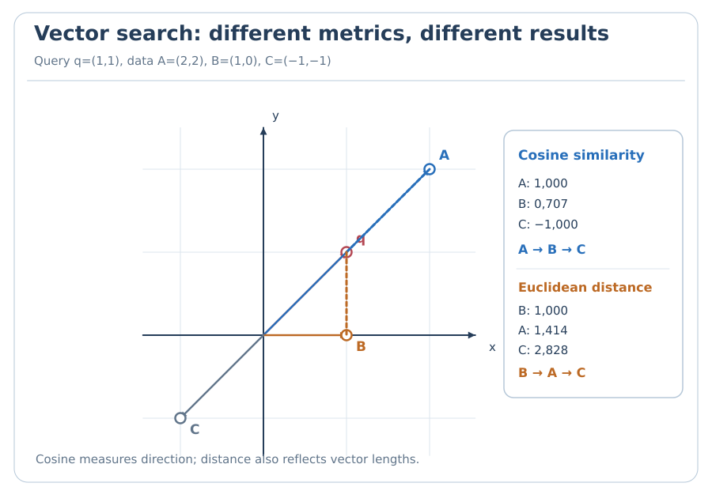

# M4-L12 – Compulsory elective: Vector search, database indexes and approximate nearest neighbours {#L12}

**Course area:** M4 – Choice of study: AI, computer science and specialised fields

**Level:** University studies (elective / specialisation)

**Prior knowledge:** [M2-L11 – School Mathematics (in German)](https://monowlith-com.github.io/learning-courses/index.html?course=school_mathematics&module=M2&lesson=L11&syslang=de&doclang=de&theme=light) (dot product, angles), [M1-L5](M1-L5.md)–[M1-L8](M1-L8.md) (vectors, matrices and numerical methods), [M2-L1](M2-L1.md) (graphs), [M2-L11](M2-L11.md) (embeddings), [M4-L1](M4-L1.md) (language models) and [M4-L3](M4-L3.md) (graph models)

**Context:** Compulsory elective module in AI infrastructure, advanced Bachelor's to Master's level.

## What is this about? {#S1}

An AI system needs to find the most suitable entries among a very large collection of text passages, images or measurement series. A modern approach converts such data into **numerical vectors**. It then searches for the stored vectors that are closest to the query according to a chosen **similarity measure**. With millions of entries, comparing the query directly with every vector can become expensive. Specialised **database indexes** can therefore find suitable candidates much faster, but sometimes miss a vector that is actually closer. Mathematics helps us understand this trade-off between **retrieval quality, running time and memory requirements**.

## Basic idea: Similarity is a decision made by the model {#S2}

A language model or a separate encoder generates a vector from a passage of text. This is called an *embedding*. With a suitable model, two similar texts may be assigned vectors that point in similar directions. This is a **learned, measurable representation**, not a guarantee that both texts mean the same thing, are true or make the same legal statement.

A search therefore involves two distinct steps:

1.  **Represent:** Map the text, image or data object to a vector.
2.  **Compare and retrieve:** A distance or similarity value ranks stored vectors relative to the query.

If the representation is poorly chosen, even the most mathematically accurate nearest-neighbour algorithm cannot conjure up good results in terms of content.

## New symbols – before the formulae {#S3}

| Symbol / term | Read aloud | Meaning here | Do not confuse with |
| --- | --- | --- | --- |
| $q$ | “cue, query vector” | Vector of the search query | Q-value from M4-L6 or attention Q from M4-L1 |
| $x_{i}$ | “x sub i” | Stored vector i | Spatial position or state in M4-L11 |
| $d$ | “dee” | Number of components of a vector | Distance symbol when written as $d(x,y)$ |
| $i$, $j$ | “index i and index j” | i numbers stored vectors; j numbers their individual components | Time variable |
| $N$ | “en” | Number of stored vectors | Number of servers in M4-L10 |
| $k$ | “kay” | Number of neighbours requested | Kalman gain K in M4-L11 |
| $\Vert x\Vert _{2}$ | “two-norm of x” | Euclidean length of x | Absolute value of a scalar |
| $x\cdot y$ | “x dot y” | Sum of component-wise products | Logical AND |
| $\operatorname{sim}_{\cos}(q,x)$ | “cosine similarity of q and x” | Alignment of directions after normalisation | Probability calibration |
| $\operatorname{dist}_2(q,x)$ | “Euclidean distance from q to x” | Length of the difference vector | Same direction with different lengths |
| $\operatorname*{arg\,min}$ | “argument of the minimum” | Index of an entry with minimum distance | Numerical value of the minimum itself |
| `top-k` | “the top kay results” | k highest-ranked search results | All relevant entries |
| `ANN` | “Approximate Nearest Neighbours” | Approximate nearest neighbours | Exact k-NN search |
| `HNSW` | “Hierarchical Navigable Small World” | Navigable multi-level neighbourhood graph | Guaranteed exact search |
| `IVF` | “Inverted File Index” | Group-based vector index | Inverted word index in ordinary full-text search |
| `PQ` | “Product Quantization” | Compressed representation of subvectors | Probability measure |
| `Recall@k` | “recall at kay” | Proportion of exact top-k neighbours found by approximate search | Semantic correctness of all answers |
| `p95` | “95th percentile” | Value below which 95% of observed response times lie | Guaranteed maximum duration |
| `GiB` | “gibibyte” | $2^{30}\,\text{bytes}$ | Decimal gigabyte: $10^9\,\text{bytes}$ |

**Terminological pitfall:** In some technical texts, the number of vectors is denoted by $n$ rather than $N$, or $d$ denotes a distance function. The definitions in the table apply throughout this lesson. Cosine similarity is **not a probability**.

## Three different similarity measures {#S4}

For two non-zero real vectors q and x, the **cosine similarity** is:

$$
\operatorname{sim\_cos}(q,x)=\frac{q\cdot x}{\lVert q\rVert_2\cdot\lVert x\rVert_2}
$$

**In words:** Divide the dot product of the two vectors by the product of their lengths. A value of one means the same direction, minus one means opposite directions, and zero means a right angle for non-zero vectors. The sign and range of values described here apply to **real** vectors with a Euclidean inner product.

The **Euclidean distance**, by contrast, is:

$$
\operatorname{dist}_2(q,x)=\lVert q-x\rVert_2=\sqrt{\sum_j{(q_j-x_j)}^2}
$$

**In words:** Subtract each component of x from the corresponding component of the query, square the differences, add them and take the square root. Unlike cosine similarity, this distance also takes the **length** of a vector into account.

The **dot product** itself can also serve as a ranking score, for example if a model has been trained specifically for this purpose. However, for similar directions, it often favours vectors with a larger norm. The training objective of the particular embedding model is therefore relevant when choosing the metric.

### Fully worked example: Cosine similarity and distance rank differently {#abschnitt-5}

The query is $q=(1,1)$. Three stored vectors are $A=(2,2)$, $B=(1,0)$ and $C=(-1,-1)$.

{alt="Query q=(1,1) and data points A=(2,2), B=(1,0), C=(-1,-1). Cosine similarity ranks A before B before C; Euclidean distance ranks B before A before C."}

The same vector example produces different rankings: cosine similarity A–B–C, Euclidean distance B–A–C.

**Step 1: Lengths and dot products.**

$$
\begin{aligned}
\lVert q\rVert_2&=\sqrt{1^2+1^2}=\sqrt2\\
\lVert A\rVert_2&=\sqrt{2^2+2^2}=\sqrt8=2\sqrt2\\
\lVert B\rVert_2&=1\\
\lVert C\rVert_2&=\sqrt2\\
q\cdot A&=1\cdot2+1\cdot2=4\\
q\cdot B&=1\cdot1+1\cdot0=1\\
q\cdot C&=1\cdot(-1)+1\cdot(-1)=-2
\end{aligned}
$$

**Step 2: Cosine similarities.**

$$
\begin{aligned}
\operatorname{sim}_{\cos}(q,A)&=\frac4{\sqrt2\cdot2\sqrt2}=\frac44=1\\
\operatorname{sim}_{\cos}(q,B)&=\frac1{\sqrt2\cdot1}=\frac1{\sqrt2}\approx0{,}7071\\
\operatorname{sim}_{\cos}(q,C)&=\frac{-2}{\sqrt2\cdot\sqrt2}=-1
\end{aligned}
$$

The **cosine similarity ranking** is therefore `A before B before C`.

**Step 3: Euclidean distances.**

$$
\begin{aligned}
\operatorname{dist}_2(q,A)&=\sqrt{{(1-2)}^2+{(1-2)}^2}=\sqrt2\approx1{,}4142\\
\operatorname{dist}_2(q,B)&=\sqrt{{(1-1)}^2+{(1-0)}^2}=1\\
\operatorname{dist}_2(q,C)&=\sqrt{{(1+1)}^2+{(1+1)}^2}=\sqrt8\approx2{,}8284
\end{aligned}
$$

The **distance ranking**, by contrast, is `B before A before C`. Both rankings are mathematically correct – they answer **different questions**. For **normalised** vectors of length one, the following useful relationship holds:

$$
\lVert q-x\rVert_2^2=2-2\cdot\operatorname{sim\_cos}(q,x),\quad\text{if }\lVert q\rVert_2=\lVert x\rVert_2=1\text{.}
$$

**Read aloud:** “For unit vectors, the squared Euclidean distance equals two minus twice the cosine similarity.” The two measures therefore give the same ranking **only under this normalisation assumption**.

## Exact k-nearest-neighbour search {#S5}

For each query, we can calculate the distance to **all $N$ vectors**, then sort them and take the best $k$. For d-dimensional vectors, a naive pass requires approximately $N\cdot d$ arithmetic operations on the components to calculate the distances, excluding the cost of selection. This linear full scan is simple, easy to verify and may be appropriate for small data collections or highly efficient hardware.

**Exact search** means that the actual best $k$ entries according to the **specified mathematical measure** are found, provided the implemented numerical comparisons and filters are correct. With an **access or metadata filter**, the reference set is explicitly restricted to **permitted** entries; the result must provide the best k entries **within this set**. A correct search ranking must not first retrieve prohibited results and then filter them out in a way that causes authorised top-k results to be missed. Exact metric search does **not** mean that the vectors found are the most relevant in the ordinary linguistic sense.

### Counterexample: Why access filters matter before top-k selection {#abschnitt-7}

Consider a one-dimensional query $q=0$ and three data points; the measure is Euclidean distance $|q-x|$. We want **one** result ($k=1$), which must come only from authorised entries:

| Entry | Position x | Distance to q | Authorised? |
| --- | --- | --- | --- |
| A | 0 | 0 | no |
| B | 1 | 1 | yes |
| C | 2 | 2 | yes |

Formula, sketch or calculation scheme · Original notation

    Unfiltered top-1: A  → after access filter: no results
    Correct filtered top-1 over {B,C}: B with distance 1

The example does not prove that a particular index filter always works incorrectly. It shows that a query which **first forms an overly small, unauthorised candidate set** and then removes prohibited entries may return an empty result even though authorised results exist. A correct system must enforce access rights **and** evaluate the ranking against the permitted reference set. Depending on the implementation, ANN filters may require a different search or post-filtering method to achieve this.

## Approximate Nearest Neighbours (ANN): Speed versus guaranteed completeness {#S6}

ANN indexes examine only part of the search space thoroughly. This often saves work, but may miss a mathematically closer vector. Two important families are:

- **HNSW:** Connects vectors in neighbourhood graphs at several levels. The search starts with a coarse overview at an upper level and navigates down to lower levels. A suitable search parameter can improve recall, but usually at the cost of more work. The method offers no universal guarantee that it will **always** return the exact k neighbours.
- **IVF and product quantisation:** Clustering divides the space into search groups. Only selected groups are examined; quantisation can represent vectors using short codes. This saves memory and distance calculations, but introduces approximation errors. Whether IVF, PQ or their combination is suitable depends on the data structure and search requirements.

An index is **not a magical mathematical substitute** for the meaning of a vector. When embeddings change, the database must be adapted to the new representation or re-indexed. Metadata filters, deletions, updates and data access rights also affect practical search quality.

## Recall@k: How many true neighbours were found? {#S7}

For evaluation, we often begin by constructing an **exact reference search** for a test set. The comparison is not made against a subjective answer rating, but against the k mathematically nearest data points under the same definition of distance.

$$
\operatorname{Recall@k}=\frac{\lvert\mathrm{ANN\_top\_k}\cap\mathrm{exakt\_top\_k}\rvert}{k}
$$

**Read aloud:** “Count how many entries occur in both top-k sets and divide by k.” This measure assumes unique entries and a defined way of handling distance ties.

### Fully worked example: One result is missing {#abschnitt-10}

For the query in the previous example, the exact top-2 entries by **cosine similarity ranking** are $A$ and $B$. Suppose an approximate index incorrectly returns $B$ and $C$.

$$
\begin{aligned}
\mathrm{exakt\_top\_2}&=\{A,B\}\\
\mathrm{ANN\_top\_2}&=\{B,C\}\\
\text{Intersection}&=\{B\}\\
\text{Recall@2}&=\frac12=0{,}5=50\,\%
\end{aligned}
$$

In this single test, the ANN search found **only half** of the two exact best vectors. This tells us neither whether $B$ provides the correct answer to a real question nor how fast the search was. A robust benchmark tests many queries, data distributions, filters and index configurations. Important measures include, for example, the mean, **p95 latency**, memory, throughput and update costs.

### With equal distances, the reference is not automatically unique {#abschnitt-11}

The quotient $\frac{|\mathrm{ANN}_{\mathrm{top}\,k}\cap\mathrm{exakt}_{\mathrm{top}\,k}|}{k}$ needs a clearly defined exact reference. If data points have **identical distances**, several correct top-k sets may exist. Example: $q=0$, $A=-1$, $B=1$, $k=1$; both points have distance $1$.

If the reference arbitrarily chooses $A$ but the ANN index returns $B$, simple set-based recall appears to be $0$, **even though B is just as close**. A benchmark must therefore resolve ties deterministically, for example using a fixed ordering of IDs, or use a suitable tie-aware quality measure. The convention must be documented identically for the exact search and ANN comparison.

## How much memory does a vector database require? {#S8}

Consider one million vectors, each with 768 dimensions. If each component is stored as a 32-bit floating-point number, it requires $4\,\text{bytes}$. The space occupied by the numerical data alone is:

$$
\begin{aligned}
N&=1\,000\,000\quad\text{vectors}\\
d&=768\quad\text{values per vector}\\
\text{Memory}&=N\cdot d\cdot4\,\text{bytes}\\
&=1\,000\,000\cdot768\cdot4\,\text{bytes}\\
&=3\,072\,000\,000\,\text{bytes}\\
&=3{,}072\,\mathrm{GB}\quad\text{(decimal gigabytes)}\\
&\approx2{,}861\,\mathrm{GiB}\quad\text{(gibibytes)}
\end{aligned}
$$

The **actual database** also needs IDs, documents or references, metadata, index graphs, mappings and administrative data. An ideal encoding with exactly **one byte per component** would require $768\,000\,000\,\text{bytes}$ for the vector codes alone, but would involve quantisation errors and further overhead. Product quantisation can encode vectors in very different ways; the one-byte calculation is only a **simple model for comparing storage requirements**, not an automatically valid PQ result.

## The complete AI retrieval process {#S9}

An AI system using document-supported generation (*Retrieval-Augmented Generation*, RAG) can work as follows:

1.  **Prepare documents:** Divide texts into meaningful, uniquely identified sections. Rights and source information remain attributable to the corresponding material.
2.  **Calculate embeddings:** A suitable encoder converts each section into a vector.
3.  **Build the index:** Vectors and metadata are assigned a search index (possibly ANN).
4.  **Map the query:** Embed the search text using a compatible encoder.
5.  **Search for and filter candidates:** The database returns suitable documents that the user is **authorised** to access. Access rights must not be bypassed through simplifications in ANN search or filtering.
6.  **Reorder if necessary:** A more powerful model evaluates the candidates in relation to the original query. This stage is called *reranking*.
7.  **Generate and substantiate the answer:** The language model may cite sources only for claims that they actually support. High vector similarity alone is **not evidence of truth**.

Retrieval quality and answer quality should be measured **separately**. Perfect recall in the index says nothing about whether the answer is summarised correctly. Conversely, a language model can produce convincing text even though the search has failed to supply crucial counterevidence.

## High-dimensional spaces and practical pitfalls {#S10}

In high dimensions, differences between distances become less informative for certain data distributions; this is **not a universal claim** that vector search in high dimensions is fundamentally impossible. Actual quality depends on training, distribution, normalisation, the measure, the intrinsic properties of the data and the structure of the index.

- **Normalisation:** In cosine search, zero vectors must not be divided by their norm. Unit normalisation affects the dot product and Euclidean distance.
- **Filters:** When filtering by customer affiliation or recency, an unsuitable filtering or indexing method can miss relevant results or increase running times.
- **Access rights:** Tenant isolation and deletion requirements are security requirements. A stored vector may itself still allow sensitive information to be inferred.
- **Changes:** A new encoder can alter the geometric space; values from different model versions cannot be compared without verification.
- **Benchmarks:** An index may be fast on average and still have problematic extreme cases. In particular, p95/p99 and recall after filtering should be evaluated.
- **Comparison measure:** Recall@k measures agreement with **exact metric search**, not semantic relevance as judged by humans.

## What is it useful for? {#S11}

Vector search supports local knowledge libraries, image and audio search, code research, recommendation methods, searches for similar sensor patterns and language model retrieval. For **M4-L11**, similarity indexes can speed up the search for candidate visual landmarks; **geometric and probabilistic verification** of the matches remains necessary. For **M4-L1** and **M2-L11**, the lesson bridges the gap between a trained embedding model and its reliable use in a database system.

## Assumptions and limitations {#S12}

- An embedding models similarity only according to the data, training and chosen distance measure. It is not general proof of truth, security or identity.
- ANN methods can miss mathematically better candidates. Index names such as HNSW or IVF alone offer **no guaranteed latency or recall rate**.
- All memory figures refer to explicitly stated data types and do **not** include the complete storage requirements of a database.
- The equivalence of cosine and Euclidean rankings in the form used above holds **only for unit-normalised vectors**.
- A RAG system additionally needs critical evaluation of sources, access control, up-to-date data and end-to-end tests. A correct search result does not prevent hallucinations.

## Connections and conclusion of the F series {#S13}

**School Mathematics M2-L11** explains the dot product; **M1-L5** linear algebra; **M1-L8** numerical limitations; **M2-L11** embeddings; **M4-L1** language processing; **M4-L3** graph models. **M4-L10** shows how distributed nodes can keep data and indexes consistent; **M4-L11** explains how to verify geometric candidates. M4-L12 concludes the first series of elective lessons on AI and computer science topics. The additional specialist applications M4-L13 (architecture and construction) and M4-L14 (aerospace) can be read independently as elective topics. They are not official compulsory university modules.

## Sources {#S14}

- [Malkov / Yashunin – Efficient and robust approximate nearest neighbor search using Hierarchical Navigable Small World graphs (arXiv v4, 2018)](https://arxiv.org/abs/1603.09320) · Abstract: hierarchical graph structure and approximate neighbor search; journal edition: IEEE TPAMI 42(4), 2020, DOI 10.1109/TPAMI.2018.2889473 · Last accessed: 2026-11-25
- [Jeff Johnson, Matthijs Douze and Hervé Jégou: *Billion-scale similarity search with GPUs* (2017).](https://arxiv.org/abs/1702.08734) · Thematic relevance to lesson: S6: Approximate Nearest Neighbours (ANN): Speed versus guaranteed completeness (overview/metadata page) · Last accessed: 2026-11-22

The calculations are **independent teaching examples**, not measurements taken from the publications. The websites are not loaded during offline use.
