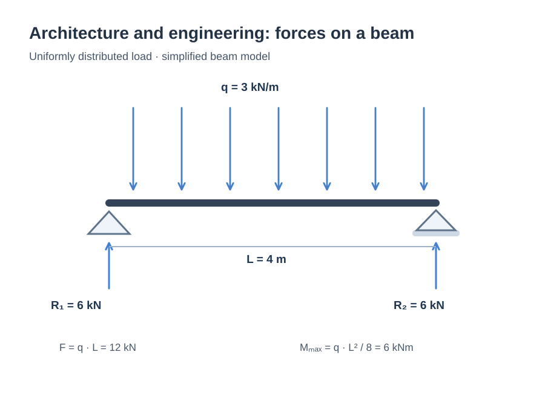

# M4-L13 – Mathematics for architecture, building construction and engineering {#L13}

**Course area:** M4 – Choice of study: AI, computer science and specialised fields

**Level:** Not specified

**Prior knowledge:** No fixed prerequisites specified.

**Context:** An elective and applied field for prospective architecture and civil engineering students; not a complete course in structural mechanics or building physics, nor a basis for calculations suitable for building control purposes.

**Guiding question:** How does a drawing become a spatial idea, a structural component become a mechanical model, and a design become a justified estimate of quantities?

Architecture combines spatial design with technical constraints. A floor plan must translate into actual dimensions in a building. A floor slab must transfer forces to load-bearing elements. A window affects not only daylight but also the thermal balance. For all of this, students do not need entirely new mathematics, but several familiar mathematical tools in a common context.

TU Dresden's university modules **Descriptive Geometry and CAD**, **Fundamentals of Structural Design** and **Building Climatology** show why these applications already occur in architecture degree programmes. The examples below, however, are **original didactic model cases**, not material taken from module descriptions or templates for structural design calculations.

## Drawing means establishing a scale {#S1}

A plan at a scale of **1:100** reduces a real length by a factor of 100. A four-metre-long wall corresponds to four centimetres on the plan. In other words, the number on paper is not the actual size; the corresponding unit and scale are part of the information.

| Actual length | Representation at 1:100 | Representation at 1:50 |
| --- | ---: | ---: |
| 4.00 m | 4.0 cm | 8.0 cm |
| 0.80 m | 8.0 mm | 16.0 mm |
| 0.25 m | 2.5 mm | 5.0 mm |

The simple formula is **plan length = actual length / scale denominator**, provided that both lengths are first converted to the same unit. Anyone working in millimetres in a CAD file must still check which unit the result actually uses when exporting and printing.

**Important:** Lengths reduced to scale change linearly; areas change by the square of the factor, and volumes by its cube. A square with a side length of one metre has a side length of one centimetre on a 1:100 plan, and therefore a plan area of only one square centimetre. Areas must not be converted back using the length factor alone.

## From floor area to a spatial model {#S2}

A rectangular room measuring **$4\,\mathrm m\times6\,\mathrm m$** has a floor area of **$24\,\mathrm m^2$**. With a clear height of **2.8 m**, the idealised cuboid has a volume of **$67{,}2\,\mathrm m^3$**. The model is useful, for example, for an initial understanding of room sizes and volumetric flow rates, but it accounts for neither wall thicknesses nor sloping ceilings.

For more complicated floor plans, areas are subdivided: an L-shaped room can be calculated as the sum of two non-overlapping rectangles or as one large rectangle minus a cut-out. Descriptive geometry adds another consideration: a three-dimensional object provides different information in plan, elevation and side view. A single viewing angle is not always sufficient to determine the spatial construction unambiguously.

## Forces are vectors, not just numbers {#S3}

Consider a horizontal beam bridge supported at both ends. A uniformly distributed load is described by the **line load q** in kilonewtons per metre. Its total resultant force is the product of the load intensity and the length.

**Original worked example:** An idealised beam is **4 m** long; a downward load of **3 kN/m** acts along its entire length. The resultant force is:

$F=q\cdot L=3\,\mathrm{kN/m}\cdot4\,\mathrm m=12\,\mathrm{kN}$.

With symmetrical loading and two idealised supports, each carries **6 kN**. This follows from the condition that the sum of all vertical forces must be zero in a system at rest. For asymmetrical loading, equilibrium of moments would also be required.

*Independently constructed teaching sketch; not a real structural design calculation.*

## The bending moment makes internal loading visible {#S4}

The support reaction is not the whole story. Within a structural component, too, the forces acting on it must remain in equilibrium. For a simply supported beam with a constant line load, this leads to a maximum bending moment at the centre:

$M_{\max}=\frac{q\cdot L^2}{8}$.

Using the example values gives **$M_{\max}=\frac{3\cdot4^2}{8}=6\,\mathrm{kN\,m}$**. Because the length enters the equation quadratically, a slightly greater span can cause a considerably greater bending moment. If only L is doubled while q remains unchanged, M_max increases by a factor of four.

The stress in an idealised elastic cross-section also depends on its section modulus. For a rectangular cross-section bending about its strong axis, the simplified model gives:

$W=\frac{b\cdot h^2}{6}$, $\sigma_{\max}=\frac{M_{\max}}{W}$.

If, solely for practice, we take **$b=0{,}20\,\mathrm m$** and **$h=0{,}40\,\mathrm m$**, then **$W\approx0{,}00533\,\mathrm m^3$** and **$\sigma_{\max}\approx1{,}13\,\mathrm{MPa}$**. This is only a mathematical illustrative example for a homogeneous beam under the modelling assumptions of elementary bending theory. It makes **no** statement about the load-bearing capacity of reinforced concrete, timber or an actual structure. Material behaviour, safety factors, shear, deflection, connections, stability and standards are not included here.

## Why the depth of a beam can be so important {#S5}

In the example, the section modulus increases in proportion to the square of the cross-sectional depth. The second moment of area of a rectangle, for the corresponding choice of axis, is $I=\frac{b\cdot h^3}{12}$ and depends on the third power of the depth. This reveals an important design principle: the spatial distribution of material changes the mechanical effect. Saying that a component contains ‘more material’ is not a sufficient description – **where** the material is located is also decisive.

In real buildings, load cases, cross-sectional shape, self-weight, deformation, connecting elements and regulations also determine the assessment. A quick mathematical comparison can explain a structural idea, but can never replace professional structural design.

## Mathematics for architecture also includes building physics {#S6}

For an initial model of steady-state heat transfer, the heat flow rate through a homogeneous building surface can be estimated using the **U-value**, the area and the temperature difference:

$P=U\cdot A\cdot\Delta T$.

Suppose an idealised surface has **$A=80\,\mathrm m^2$**, its U-value is **$0{,}30\,\mathrm W/(\mathrm m^2\cdot\mathrm K)$**, and the temperature difference between indoors and outdoors is **20 K**. The calculation then gives **$P=480\,\mathrm W$**. This means an instantaneous rate of heat loss in the simple model, **not** automatically a daily or annual energy consumption. Determining energy demand also requires the evolution over time, ventilation, thermal bridges, solar gains, internal heat sources and further conditions.

Here in particular, the interaction between mathematics and architecture becomes apparent: geometry provides areas, physics provides models, and analysis describes how quantities can change over time.

## From the beam model to simulation {#S7}

For complex building structures, a single formula is often insufficient. The structure can be divided into many smaller sections, and approximate solutions calculated for them. An important approach is the **finite element method (FEM)**, introduced in Mathematics M3-L3. In civil engineering it combines geometry, material models and boundary conditions.

The quality of FEM output depends on more than its computational precision. A beam with incorrectly modelled supports can produce a misleading solution even with a very fine mesh. Therefore, **modelling assumptions, units and plausibility checks** must come before any potential design decision.

## What else belongs in an actual architecture or civil engineering degree programme? {#S8}

This chapter provides an initial orientation, not a substitute for the courses themselves. Depending on the degree programme, further subjects include building materials, construction, building climatology, surveying, construction informatics, fire protection, cost planning and design studios. Architects also need design and communication skills that cannot be reduced to a formula. Structural design, in turn, requires specific engineering knowledge and application of the relevant rules.

**Further learning path:** School Mathematics (German) [M1-L11](https://monowlith-com.github.io/learning-courses/index.html?course=school_mathematics&module=M1&lesson=L11&syslang=de&doclang=de&theme=light) (similarity/scale), School Mathematics (German) [M1-L21](https://monowlith-com.github.io/learning-courses/index.html?course=school_mathematics&module=M1&lesson=L21&syslang=de&doclang=de&theme=light) (vectors), School Mathematics (German) [M2-L11](https://monowlith-com.github.io/learning-courses/index.html?course=school_mathematics&module=M2&lesson=L11&syslang=de&doclang=de&theme=light) (dot product), School Mathematics (German) [M2-L12](https://monowlith-com.github.io/learning-courses/index.html?course=school_mathematics&module=M2&lesson=L12&syslang=de&doclang=de&theme=light) (planes), [M1-L4](M1-L4.md) (gradient) and [M3-L3](M3-L3.md) (finite elements). The new section can be read as an **optional specialist application** after these fundamentals.

## Comprehension questions for self-assessment {#S9}

1.  How large does a 2.50 m wide opening appear on a plan at 1:50? **Result:** 5.0 cm.
2.  With the same q, the span increases from 4 to 6 m. By what factor does the simplified M_max change? **Result:** ${\left(\frac64\right)}^2=2{,}25$.
3.  What quantity is missing if we want to convert 480 W into energy consumption in kWh? **Answer:** at least a duration; in real buildings, additional dynamic influences as well.

## Assumptions and limitations {#S10}

The beam formulas apply to a **statically determinate, straight, simply supported beam with a constant line load** under the relevant assumptions of elementary beam theory. The building physics formula applies as a steady-state approximation. Design in accordance with standards, safety verification and building energy planning are separate specialist tasks and require qualified professionals.

## Sources {#S11}

**Documented source status:** 10 November 2026

- [TU Dresden – Module handbooks for architecture and landscape architecture](https://tu-dresden.de/bu/architektur-landschaft/studium/module): Academic context for descriptive geometry, structural design, building climatology and construction.
- [Technical University of Munich – Teaching examples from the Chair of Structural Mechanics](https://www.cee.ed.tum.de/bm/lehre/interactive-apps/): Examples of beam bending and fundamental mechanical models.

*The sources provide subject-specific orientation. The structure, numerical values and explanations were newly developed for this learning course; no illustration was reproduced from the sources.*
