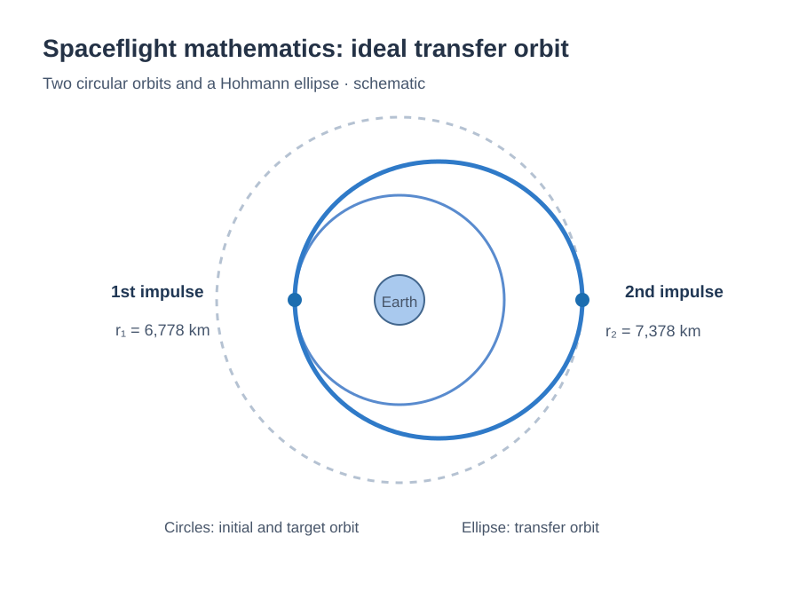

# M4-L14 – Mathematics for aviation, spaceflight and navigation {#L14}

**Course area:** M4 – Choice of study: AI, computer science and specialised fields

**Level:** Not specified

**Prior knowledge:** No fixed prerequisites specified.

**Context:** An elective and applied field at the intersection of applied mathematics, physics and aerospace engineering. This text introduces mathematical models; it is not a guide to actual flight operations, navigation or mission planning.

**Guiding question:** Why does an aircraft need lift, why does a satellite not simply fall to Earth, and why does a spacecraft need a carefully planned change in velocity to transfer to another orbit?

Aerospace engineering problems bring together several mathematical languages: vectors describe position and velocity, differential equations describe motion, trigonometry describes angles, probability describes measurement uncertainty, and optimisation deals with scarce resources such as fuel.

## Velocity is a vector {#S1}

An aircraft may travel north while the wind blows eastwards. Its velocity relative to the ground is the **vector sum** of its velocity relative to the air and the wind velocity. For a teaching model, we assume:

- Airspeed: **200 km/h northwards**.
- Wind: **30 km/h eastwards**.

In a two-dimensional coordinate system, the ground velocity vector is $v=(30,200)\,\mathrm{km/h}$. Its magnitude is $\sqrt{30^2+200^2}\approx202{,}2\,\mathrm{km/h}$. The direction of travel relative to the ground deviates eastwards by $\arctan\left(\frac{30}{200}\right)\approx8{,}5^\circ$.

This result already shows that a speed without a specified direction can be insufficient in navigation problems. The example uses constant vectors and neglects actual flight control, time-varying winds and geodetic effects.

## Lift as a model of physical quantities {#S2}

A commonly used idealised lift equation is:

$L=0{,}5\cdot\rho\cdot v^2\cdot S\cdot C_L$.

Here, $\rho$ denotes air density, $v$ the speed relative to the air, $S$ a reference area and $C_L$ a dimensionless lift coefficient. For **$\rho=1{,}2\,\mathrm{kg/m}^3$**, **$v=50\,\mathrm{m/s}$**, **$S=10\,\mathrm m^2$** and **$C_L=0{,}8$**, we obtain **12,000 N**.

This is a worked example, not a statement about a particular aircraft. The lift coefficient is not constant; it depends on factors such as geometry, angle of attack and flow conditions. The presence of $v^{2}$ in the equation therefore does not mean that lift in reality always increases by exactly a factor of four when the speed doubles.

## Gravity has not disappeared in orbit {#S3}

A satellite in low Earth orbit keeps moving while Earth's gravitational attraction curves its trajectory. In the idealised two-body model for a circular orbit, gravity provides exactly the required centripetal acceleration. It follows that:

$v_{\mathrm{kreis}}=\sqrt{\frac\mu r}$.

$r$ is the distance from the **centre of Earth**, not the altitude above Earth's surface. $\mu$ represents the gravitational effect of the central body.

**Original worked example:** We choose the rounded value $\mu_{\mathrm{erde}}=398\,600\,\mathrm{km}^3/\mathrm{s}^2$ and an orbital radius of $r=6\,778\,\mathrm{km}$ (approximately 400 km above the Earth model used here). The idealised circular orbital speed is then approximately **7.67 km/s**. Such a large value illustrates why spaceflight operates on different scales of speed and energy from ordinary travel on the ground.

The orbital period in the circular model can be estimated using $T=2\pi\cdot\sqrt{\frac{r^3}{\mu}}$. For the example orbit, this gives approximately **92.6 minutes**.

*Independently constructed schematic illustration. Radii are schematic; not a real mission plan.*

## The vis-viva equation relates position and orbital speed {#S4}

A body does not travel at the same speed everywhere along an elliptical orbit. Under the assumptions of the two-body model, this can be described using the **vis-viva equation**:

$v^2=\mu\cdot\left(\frac2r-\frac1a\right)$.

Here, $a$ is the semi-major axis of the ellipse. When a spacecraft is closer to the central body, its orbital speed on the same bound ellipse is greater than at a more distant point. This is not a coincidence; it is related to the conservation of mechanical energy.

For a circular orbit, $a = r$; the equation reduces to the expression used earlier, $v^2=\frac\mu r$.

## An orbital transfer requires Δv {#S5}

In the simplified case, a **Hohmann transfer** is an elliptical transfer orbit between two circular, coplanar orbits. In the idealised model, the spacecraft briefly changes its velocity at two points. The first change takes it from the inner circular orbit onto the ellipse; the second adjusts its velocity to match the outer circular orbit.

For the radii $r_1$ and $r_2$, the semi-major axis of the transfer ellipse is:

$a_t=\frac{r_1+r_2}{2}$.

The orbital speeds in the initial and target circular orbits are obtained using $\sqrt{\frac\mu{r_1}}$ and $\sqrt{\frac\mu{r_2}}$. The speeds on the ellipse are calculated at the two points of tangency using the vis-viva equation. The differences are the two **Δv manoeuvres**. In our teaching example, with $r_1=6\,778\,\mathrm{km}$ and $r_2=7\,378\,\mathrm{km}$, both steps can be calculated. The total ideal change in velocity in this model is approximately **0.32 km/s**.

**Caution:** This is a highly simplified transfer between two circular orbits in the same plane, not a generally optimal flight trajectory. Perturbations, orbital inclination, engine characteristics, trajectory tracking and actual propulsion phases alter the real requirements.

## Why the choice of departure time matters {#S6}

When a spacecraft arrives, two planets or satellites are no longer where they were at departure. **Travel time and relative positions** are therefore key quantities. In its introduction to spaceflight, NASA explains that transfer orbits and encounter geometry must be planned together. In practical mission analysis, trajectories are therefore predicted and suitable time windows identified.

Mathematically, this takes us from simple Keplerian orbits to the numerical integration of differential equations. In a more complex gravitational field or under continuous thrust, the flight can no longer be fully described by a single elementary formula.

## Measurement errors and navigation {#S7}

A position measurement is not an absolute truth. It may contain systematic deviations and random noise. Imagine two sensors estimating the same distance:

- Sensor A reports **100.0 m**, with an assumed standard deviation of **2 m**.
- Sensor B reports **104.0 m**, with an assumed standard deviation of **4 m**.

Under the explicitly simplified assumption of **independent, unbiased, normally distributed measurement errors**, an inverse-variance-weighted mean is appropriate:

$\hat x=\frac{\frac{x_A}{\sigma_A^2}+\frac{x_B}{\sigma_B^2}}{\frac1{\sigma_A^2}+\frac1{\sigma_B^2}}$.

For the example values, this gives $\hat x=100{,}8\,\mathrm m$. The more precise sensor receives a greater weight because its variance is smaller. In actual navigation, it is also necessary to check whether measurement errors are correlated, whether the distribution is appropriate and whether both sensors are measuring the same physical quantity at all.

## What mathematical models can and cannot do {#S8}

A model can explain an order of magnitude, a possible cause or a design alternative. However, its conclusions cannot go beyond what its assumptions allow. A numerically precise value for a satellite orbit is not an actual flight plan; a simplified lift value says nothing about aerodynamic stall, manoeuvring limits or structural margins.

Practical specialist fields include flight mechanics, fluid mechanics, navigation, control engineering, multibody dynamics, numerical optimisation and mission analysis. The presentation here deliberately connects only a few central ideas.

## Learning path and brief self-assessment {#S9}

**Prerequisites:** School mathematics M1-L20–School M1-L21 (trigonometry and vectors), School M2-L11–School M2-L14 (vector products and spatial geometry), M1-L9 (differential equations), M2-L12 (mathematics for robotics) and, depending on your interests, M2-L9 (Fourier analysis).

1.  Why must the distance to the **centre** be used in the satellite equation? Because the central gravitational model refers to the distance between the centres of mass involved.
2.  Why does an orbital manoeuvre change the subsequent orbit rather than simply the current position? Because velocity and position together determine the future state of motion.
3.  What happens in the inverse-variance-weighted mean if one sensor becomes very uncertain? Its weight decreases.

## Sources {#S10}

**Documented source status:** 10 November 2026

- [NASA – Basics of Space Flight, Chapter 3: Gravity & Mechanics](https://science.nasa.gov/learn/basics-of-space-flight/chapter3-3/): Keplerian orbits as a fundamental physical model.
- [NASA – Basics of Space Flight, Chapter 4: Trajectories](https://science.nasa.gov/learn/basics-of-space-flight/chapter4-1/): An accessible introduction to transfer orbits.
- [DLR – Fundamentals of orbital mechanics, bibliographic entry](https://elib.dlr.de/143300/): Overview of spaceflight mechanics and mission applications; the actual publisher's text was not reproduced.
- [DLR – Mission analysis](https://www.dlr.de/de/irs/ueber-uns/abteilungen/systemanalyse-raumsegment/abteilungsaktivitaeten): Context for mission design, transfer orbits and further constraints.

*The sources provide orientation on specialist fields and equations. The structure and worked examples were developed independently.*
