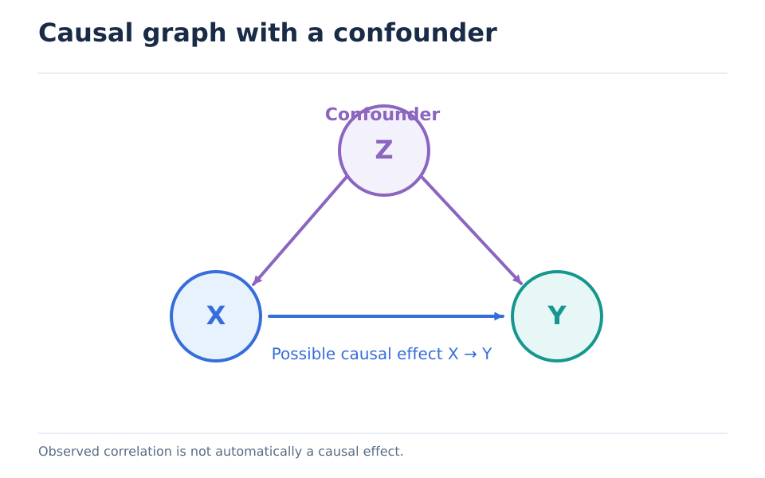

# M4-L2 – Compulsory elective: Causal inference and probabilistic models {#L2}

**Course area:** M4 – Choice of study: AI, computer science and specialised fields

**Level:** University studies (elective / specialisation)

**Prior knowledge:** [M2-L15 – School mathematics (in German)](https://monowlith-com.github.io/learning-courses/index.html?course=school_mathematics&module=M2&lesson=L15&syslang=de&doclang=de&theme=light), [M1-L7](M1-L7.md), [M3-L4](M3-L4.md), [M3-L5](M3-L5.md); [M4-L1](M4-L1.md) for the connection to AI

**Context:** Elective/specialist course, advanced Bachelor’s to Master’s level.

## What is this about? {#S1}

Statistical data show which events occur together. Anyone seeking to change a system deliberately also needs to know **what would happen under an intervention**. A correlation is not always sufficient for this purpose. Causal inference combines probability, graphical models and testable assumptions to investigate the consequences of possible interventions. This perspective is important in medicine, economics, product development and the control of autonomous systems.

## Basic idea and intuition {#S2}

Suppose a robot works faster on dry days and also reports fewer sensor errors on those days. A mere association between faster operation and fewer errors does not prove that higher speed prevents errors. The weather may influence both quantities. A measure that changes the speed does not then automatically have the same effect as the difference between naturally fast and slow days.

To describe such situations, we use **directed acyclic graphs** (DAGs). In the causal model under consideration, an arrow represents an assumed direction of direct influence; its presence must be justified on subject-specific grounds. The graph is a modelling assumption, not a causal relationship that follows from the data alone.

## New symbols – read these first {#S3}

| Symbol | Read aloud | Meaning in this lesson | Distinction |
| --- | --- | --- | --- |
| $Z$ | “zed” | Observed background factor, such as the operating environment | Ordinary random value |
| $X$ | “ex” | Quantity that can be manipulated, for example an intervention or treatment | Input vector from M4-L1 |
| $Y$ | “why” | Outcome variable, such as performance | Not automatically a cause of X |
| $Z \to  X$ | “Z influences X” | Directed edge in the postulated causal model | Mere chronological order |
| $P(X=1)$ | “Probability that X equals one” | Probability of an event in the observational model | Intervention probability |
| $P(Y\vert X,Z)$ | “Y given X and Z” | Conditional distribution from observational data | Intervention on X |
| $E[Y]$ | “Expected value of Y” | Probability-weighted mean | Sample mean without a model |
| $\operatorname{do}(X=1)$ | “do: X is set to one” | Intervention that fixes X in the model | Selection of cases with $X=1$ |
| $E[Y\vert\operatorname{do}(X=1)]$ | “Expected value of Y after an intervention setting X to one” | Expected outcome of an intervention | $E[Y\vert X=1]$ |
| $\sum_z$ | “Sum over all values of Z” | Averaging over background groups | Integral for continuous Z |
| `⊥` | “Independent of” | Statistical independence | Perpendicularity in geometry |

## Observation and intervention are two different questions {#S4}

The conditional expectation

{alt="Causal graph with a common cause and a possible direct effect"}

$$
E[Y\mid X=1]
$$

is read as: “What mean value of Y do we observe among the cases in which X equals one?” This is a purely observational question.

A different question is:

$$
E[Y\mid\operatorname{do}(X=1)]\text{.}
$$

Read aloud: “What mean value of Y do we expect if we actively set X to one?” In the causal model, the $\operatorname{do}$ operator denotes the intervention in which the original causes of X are disconnected when its value is set. This distinction is the starting point of **intervention calculus**.

A simple causal diagram illustrates possible **confounding**:

Formula, sketch or calculation scheme · original notation

    Z → X → Y
     \      ↑
      └──────┘

Read aloud: “Z influences X and Y; X also influences Y.” This means that a comparison of X and Y may capture both the effect of X and the influence of Z. We need additional assumptions or a suitable study design to distinguish the effects.

## Fully worked example: apparent effect and actual intervention {#S5}

We consider an explicitly constructed model with three quantities:

- $Z$ is either 0 or 1. Both values are equally frequent: $P(Z=1)=P(Z=0)=0{,}5$.
- The probability of a measure $X=1$ depends on Z: $P(X=1|Z=1)=0{,}8$ and $P(X=1|Z=0)=0{,}2$.
- Let the outcome be deterministic: $Y = X + 2Z$. Thus, actively setting X to one increases the outcome by exactly 1 for a fixed Z.

First, we consider only the data. Bayes’ theorem and the law of total probability give:

$$
\begin{aligned}
P(X=1)&=0{,}8\cdot0{,}5+0{,}2\cdot0{,}5=0{,}5\text{.}\\
P(Z=1\mid X=1)&=\frac{0{,}8\cdot0{,}5}{0{,}5}=0{,}8\text{.}\\
P(Z=1\mid X=0)&=\frac{0{,}2\cdot0{,}5}{0{,}5}=0{,}2\text{.}
\end{aligned}
$$

Read aloud: “Among cases with X equal to one, 80 per cent are in the group Z equal to one. Among cases with X equal to zero, only 20 per cent are.” These groups therefore differ **not only in X**, but also in their background factor Z.

For the observed mean, we obtain:

$$
\begin{aligned}
E[Y\mid X=1]&=1+2\cdot0{,}8=2{,}6\text{.}\\
E[Y\mid X=0]&=0+2\cdot0{,}2=0{,}4\text{.}\\
\text{Observed difference}&=2{,}6-0{,}4=2{,}2\text{.}
\end{aligned}
$$

Read aloud: “Simply comparing the observed groups gives a difference of 2.2 units.” This value **overestimates** the causal effect of X in our constructed model.

Under the intervention, however, the original probabilities of the background groups remain unchanged. Because $Y=X+2Z$, we have:

$$
\begin{aligned}
E[Y\mid\operatorname{do}(X=1)]&=1+2\cdot0{,}5=2\text{.}\\
E[Y\mid\operatorname{do}(X=0)]&=0+2\cdot0{,}5=1\text{.}\\
\text{Average causal effect}&=2-1=1\text{.}
\end{aligned}
$$

Read aloud: “Actively changing X from zero to one increases the mean outcome by one, not by 2.2.” The example shows how the same data situation can produce a different observed difference from the causal difference.

## The adjustment formula {#S6}

If the background factor Z is **sufficient to control all relevant back-door paths**, is present before the measure in the appropriate causal model, and treatment is possible under all the conditions considered, the interventional distribution can be obtained from observational data:

$$
P(Y=y\mid\operatorname{do}(X=x))=\sum_z P(Y=y\mid X=x,Z=z)\cdot P(Z=z)\text{.}
$$

Read aloud: “For each background group z, we consider the observed proportion with the outcome at a fixed X and average these proportions using the share of that background group in the entire original population.” For continuous Z, the sum is replaced by an integral.

In particular, this requires **exchangeability without unobserved confounding** conditional on Z, **positivity** (each treatment being compared must be observable for the relevant Z groups) and a meaningful **consistency assumption**: the observed treatment corresponds to the intervention described. The formula does **not apply merely because** Z appears in the data. In more complex diagrams, choosing suitable control variables is itself part of the problem.

## Why not every control variable is helpful {#S7}

A **collider** is a variable into which two arrows point:

Formula, sketch or calculation scheme · original notation

    A → C ← B.

Even when A and B are initially independent, this may change after selection or conditioning on C. “Controlling for all variables just in case” is therefore not a valid general rule. Likewise, a variable affected by the measure itself must not be treated as an ordinary background factor without a precise research question. Dynamic causal models are required for multiple points in time.

### Countercheck: A collider can create an association in the first place {#abschnitt-8}

Consider two **independent** coin tosses $A$ and $B$, each taking the values 0 and 1 with a probability of $0{,}5$ for each value. The selection variable $C$ is 1 precisely when **at least one** of the two tosses produces 1. This is the collider $A \to  C \leftarrow  B$: A and B influence the selection without influencing each other.

$$
\begin{aligned}
(A,B)&=(0,0),(0,1),(1,0),(1,1),\quad\text{each with }P=\frac14\text{.}\\
C=1&\text{ holds for }(0,1),(1,0),(1,1),\quad\text{each conditionally with }P=\frac13\text{.}\\
P(B=1\mid A=1,C=1)&=\frac{1/3}{2/3}=\frac12\text{.}\\
P(B=1\mid A=0,C=1)&=\frac{1/3}{1/3}=1\text{.}
\end{aligned}
$$

Read aloud: “Among the selected cases with $C=1$, B is **always one when $A=0$**, but only in half the cases when $A=1$.” Before selection, the independence of the tosses gives $P(B=1|A=0)=P(B=1|A=1)=0{,}5$. Only the selection $C=1$ creates the statistical dependence. It is **not evidence of a causal effect** of A on B. The example assumes that the coin tosses are independent and uniformly distributed and that $C$ is determined as described.

## Counterfactual questions and probabilistic models {#S8}

A **counterfactual** question might be: “What would the outcome for the same machine have been if, instead of $X=1$, we had chosen the measure $X=0$?” This is a stronger question than asking for a mean across different machines. Modelling such questions requires additional assumptions about shared hidden influences and structural equations, rather than merely the observed joint distribution.

A Bayesian network describes a factorised probability distribution using directed edges. For the simple graph Z→X, Z→Y and X→Y, we have:

$$
P(Z,X,Y)=P(Z)\cdot P(X\mid Z)\cdot P(Y\mid X,Z)\text{.}
$$

Read aloud: “The joint distribution is decomposed into the distribution of the background, the treatment conditional on that background, and the outcome conditional on both quantities.” A Bayesian network can also be understood in a **purely probabilistic** sense. Interpreting the arrows as actual causes requires additional structural assumptions.

### Countercheck: Identical observational data, different intervention outcomes {#abschnitt-10}

An even more fundamental problem is that the same observed distribution can arise from different causal mechanisms. We assume an unobserved, fair binary random variable $U$ and consider two explicitly **alternative** structural models:

$$
\begin{aligned}
\text{Model 1:}\quad&X:=U,\quad Y:=X\text{.}\\
\text{Model 2:}\quad&X:=U,\quad Y:=U\text{.}
\end{aligned}
$$

In both models, $X=Y$ always holds in the observational data: only $(0,0)$ and $(1,1)$ occur, each with probability $\frac12$. An intervention, however, replaces the equation for X, not the equation for Y:

$$
\begin{aligned}
\text{Model 1:}\quad E[Y\mid\operatorname{do}(X=1)]&=1\text{.}\\
\text{Model 2:}\quad E[Y\mid\operatorname{do}(X=1)]&=E[U]=\frac12\text{.}
\end{aligned}
$$

Read aloud: “Although we see exactly the same joint observational distribution, the models yield different expected outcomes under intervention.” Without additional causal assumptions or intervention data, the observational distribution cannot resolve this difference. In this constructed example, there is also no overlap of the two X values within $U$; naive adjustment for U is therefore not valid.

## What is it useful for? {#S9}

Causal models help to assess A/B tests, diagnostic algorithms, recommendations, medical studies and technical interventions. In robotics and AI, it is important to know whether a prediction remains valid after a change in the environment or strategy. Observational data alone cannot in general prove this.

## Assumptions and limitations {#S10}

The example is artificial; its distributions and causal structure are fully specified. In practice, unmeasured factors, selection bias, measurement errors, unclear definitions of interventions and feedback over time can prevent identification. A mathematically computable number is not necessarily a reliable causal estimate. Interventions involving humans or safety-critical equipment require separate professional and ethical assessment.

## Connection to the next specialist lesson {#S11}

**M4-L3** considers dependencies within networks and uses graph structures for machine learning. However, a graph in M4-L3 does not automatically represent a causal graph; the meanings of the edges differ.

## Sources (external) {#S12}

No external sources listed.
