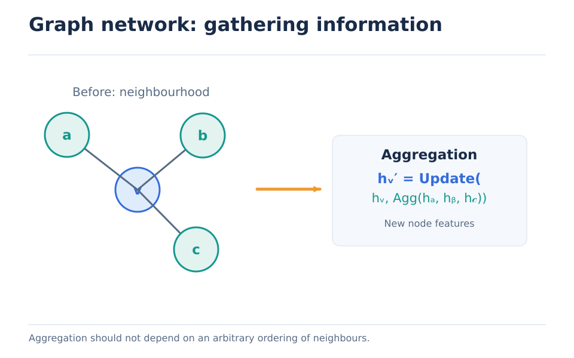

# M4-L3 – Compulsory elective: Graph neural networks and spectral learning {#L3}

**Course area:** M4 – Choice of study: AI, computer science and specialised fields

**Level:** University studies (elective / specialisation)

**Prior knowledge:** [M2-L1](M2-L1.md) (graph theory), [M1-L5](M1-L5.md)/[M1-L6](M1-L6.md) (matrices and eigenvalues), [M2-L11](M2-L11.md) (neural networks), [M3-L7](M3-L7.md) (numerical methods)

**Context:** Specialisation between advanced Bachelor’s and Master’s level.

## What is this about? {#S1}

Many types of data consist not of a single long list of numbers, but of objects with relationships: social networks, roads, molecules, power grids, software dependencies or sensor networks. Such structures are called **graphs**. A graph neural network (GNN) computes a representation for each node that incorporates information from connected nodes. The mathematics combines graph theory, matrix calculations, weighted sums, symmetry and spectral methods.

## Basic idea and intuition {#S2}

In a computer network, each server has its own properties, such as workload and error rate. Its behaviour also depends on neighbouring servers. Rather than classifying each server in isolation, a method can take the properties of its neighbours into account. It must make no difference whether the servers happen to be called 'A', 'B' and 'C' or '3', '9' and '12'. **The relationships should matter, not the arbitrary order of the names.**

## New symbols – read these first {#S3}

| Symbol | Name / pronunciation | Meaning here | Other uses |
| --- | --- | --- | --- |
| $G=(V,E)$ | 'Graph G of vertices V and edges E' | Network model | G as a function in other lessons |
| $i,j$ | 'Indices i, j' | Node numbers | Arbitrary physical coordinates |
| $N(i)$ | 'Neighbourhood of i' | Nodes directly connected to node i | Entire connected component |
| $x_{i}$ | 'Feature vector of node i' | Original node features | A spatial coordinate |
| $h_{i}$ | 'h i' | Learned or computed node representation | Measurement without transformation |
| $A$ | 'Adjacency matrix' | $A_{ij}=1$ if connected, otherwise 0 | Matrix A in control theory, M3-L12 |
| $D$ | 'Degree matrix' | Diagonal matrix of node degrees | Differentiation operator |
| $L=D-A$ | 'Laplacian matrix' | Graph Laplacian of an undirected graph | Continuous Laplace operator from M2-L8 |
| `Σ` | 'Sum' | Aggregated neighbour information | Product |
| $\operatorname{mean}$ | 'Mean' | Average neighbour information | Weighted sum without normalisation |
| $\sigma$ | 'Sigma' | Activation function, such as ReLU | Standard deviation $\sigma$ in statistics |
| $W$ | 'Weight matrix' | Trained linear mapping of features | Set of a probability distribution |
| `⊤` | 'Transposed' | Interchange columns and rows of a matrix | Inverse |
| $\lambda$ | 'Lambda' | Eigenvalue of the graph Laplacian | Regularisation parameter in M3-L11 |

## Graphs as matrices {#S4}

For an undirected graph with three nodes A, B, C and edges A–B and B–C, the adjacency matrix is:

$$
\begin{aligned}
A&=\begin{bmatrix}0&1&0\\1&0&1\\0&1&0\end{bmatrix},\quad\text{Column order: A, B, C}
\end{aligned}
$$

In words: 'A is connected to B, B to A and C, and C to B.' The number of neighbours of a node is called its **degree**. The degree matrix has entries only on its diagonal: $D=\operatorname{diag}(1,2,1)$.

To describe a distribution of node properties mathematically, we use the **graph Laplacian**:

$$
\begin{aligned}
L&=D-A\\
&=\begin{bmatrix}1&-1&0\\-1&2&-1\\0&-1&1\end{bmatrix}\text{.}
\end{aligned}
$$

In words: 'The Laplacian matrix is the degree matrix minus the adjacency matrix.' For undirected graphs with non-negative edge weights, L is symmetric and positive semidefinite. The constant vector consisting entirely of ones satisfies $L\cdot 1=0$ and has eigenvalue zero. The number of connected components equals the dimension of its null space. For directed graphs, these statements do not automatically hold in this form.

## A complete mini-example of neighbourhood aggregation {#S5}

We assign exactly **one** feature value to each node:

$$
x_A=1,\qquad x_B=2,\qquad x_C=4\text{.}
$$

Our simple learning model calculates the mean of a node's own value and the values of its immediate neighbours. It is a pedagogically simplified message-passing model **without trained weights** and without non-linear activation.

$$
\begin{aligned}
h_A&=\frac{x_A+x_B}{2}=\frac{1+2}{2}=1.5\text{.}\\
h_B&=\frac{x_A+x_B+x_C}{3}=\frac{1+2+4}{3}=\frac73\approx2.333\text{.}\\
h_C&=\frac{x_B+x_C}{2}=\frac{2+4}{2}=3\text{.}
\end{aligned}
$$

In words: 'Node A combines its value with B and obtains 1.5. Node B combines all three nodes and obtains seven thirds. Node C combines B and C and obtains three.' After **one** step, each node knows only its immediate neighbourhood. Only several successive steps allow information from more distant nodes to contribute.

A common abstract notation is:

$$
h_i(\mathrm{new})=\sigma\left(W\cdot\operatorname{mean}\left(\{h_j(\mathrm{old}):j\in N(i)\cup\{i\}\}\right)\right)\text{.}
$$

In words: 'Compute the mean of the old representations of all neighbours, including the node itself, multiply by a weight matrix and apply an activation function.' This is **one possible** GNN architecture, not the only valid one. Depending on the method, neighbours are summed, weighted, distinguished by edge type or combined using attention.

## Graph convolution, normalisation and eigenvectors {#S6}

A widespread form of graph convolution on an undirected graph with added self-loops uses:

$$
\begin{aligned}
\tilde A&=A+I,\\
\tilde D_{ii}&=\sum_j\tilde A_{ij},\\
H_{\mathrm{new}}&=\sigma\!\left(\tilde D^{-1/2}\tilde A\tilde D^{-1/2}H_{\mathrm{old}}W\right)\text{.}
\end{aligned}
$$

In words: 'We add a self-loop to each node, form the new degree matrix, normalise the adjacency matrix on both sides using the inverse square roots of the node degrees, multiply by the feature and weight matrices and apply an activation function.' The formula assumes positive node degrees after adding the self-loops. This symmetric normalisation is different from the simple arithmetic mean in our example.

The eigenvectors of the Laplacian describe different patterns of variation on the graph. For the feature values in our example $x={(1,2,4)}^\top$, we have:

$$
\begin{aligned}
x^\top Lx&={(x_A-x_B)}^2+{(x_B-x_C)}^2\\
&={(1-2)}^2+{(2-4)}^2\\
&=1+4=5\text{.}
\end{aligned}
$$

In words: 'The quadratic form involving the Laplacian matrix is the sum of the squared differences along both edges in this case.' Small values mean that neighbouring nodes have similar features. The identity holds in this form for the **undirected graph with unit edge weights**; for weighted edges, the edge weights are included.

### Cross-check: Eigenvectors and their meaning in the example graph {#abschnitt-7}

The eigenvalues of the Laplacian matrix of the path graph A–B–C given above can be calculated directly. Alongside the constant vector, there are two distinct patterns of variation:

$$
\begin{aligned}
v_0&={(1,1,1)}^\top,\quad Lv_0=0\cdot v_0\text{.}\\
v_1&={(1,0,-1)}^\top,\quad Lv_1=1\cdot v_1\text{.}\\
v_3&={(1,-2,1)}^\top,\quad Lv_3=3\cdot v_3\text{.}\\
\text{Eigenvalues of }L&:\quad 0,1,3\text{.}
\end{aligned}
$$

In words: 'The constant vector does not change along any edge. The second vector distinguishes the endpoints; the third varies particularly strongly between the middle node and the end nodes.' All three vectors are mutually orthogonal and form a basis of $\mathbb{R}^3$. The eigenvalues are not merely assertions: each of the three matrix-vector multiplications can be checked row by row. For a different graph, the spectrum changes; for weighted edges, the appropriate weighted Laplacian matrix must be used.

### Cross-check: Symmetric normalisation is not an ordinary mean {#abschnitt-8}

For the same example graph, adding self-loops gives the degrees $2,3,2$. For the graph convolution, we take $W=1$, the identity activation and the features $x={(1,2,4)}^\top$. For the first node, the symmetrically normalised variant yields:

$$
\begin{aligned}
h_A(\mathrm{GCN})&=\frac12\cdot1+\frac1{\sqrt{2\cdot3}}\cdot2\\
&=\frac12+\frac2{\sqrt6}\approx1.3165\text{.}\\
h_A(\text{mean})&=\frac{1+2}{2}=1.5\text{.}
\end{aligned}
$$

In words: 'Symmetric normalisation accounts for the node degrees at both ends of an edge. Therefore, even with an identical graph and the same features, it is **not the same operation** as the simple neighbourhood mean.' This statement applies to the layer defined here, not to all GNN architectures.

## Why node numbering must not determine the result {#S7}

If a graph is merely relabelled, the outputs should undergo the same relabelling. This property is called **permutation equivariance**. In node classification, the result for the same node should not depend on its position in a database table. When classifying an entire graph as a single object, **permutation invariance** is often required: the overall result should not change at all under relabelling.

Mathematically, a permutation matrix P is involved. If node numbering changes, both the adjacency matrix and all node features must be reordered accordingly:

$$
A_{\mathrm{new}}=PAP^{\mathrm{T}},\qquad X_{\mathrm{new}}=PX\text{.}
$$

In words: 'We interchange rows and columns of the connectivity information consistently and reorder the feature rows in the same way.' A suitable GNN layer produces correspondingly renumbered node representations. This property is an important architectural requirement, not an automatic advantage of arbitrary neural networks.

### Cross-check: Renumbering the three-node graph {#abschnitt-10}

We interchange only the names of the end nodes A and C. The order of the values $x={(1,2,4)}^\top$ becomes $x_{\mathrm{new}}={(4,2,1)}^\top$, and the rows **and** columns of the adjacency matrix are permuted accordingly. The simple mean from Section 2 now yields:

$$
\begin{aligned}
h_{\mathrm{old}}&=\left(\frac32,\frac73,3\right)^\top\text{.}\\
h_{\mathrm{new}}&=\left(3,\frac73,\frac32\right)^\top=Ph_{\mathrm{old}}\text{.}
\end{aligned}
$$

In words: 'Renumbering interchanges exactly the positions of the results for the two end nodes. The computed node results remain associated with their original objects.' The demonstration assumes a consistent permutation of the edges as well; merely interchanging input rows without adjusting A would produce a different data structure. A global, symmetric sum of the node outputs would additionally be permutation **invariant**.

## Multiple layers and practical limitations {#S8}

Many aggregation steps can make node representations increasingly similar: this is called **oversmoothing**. Another problem is **oversquashing**: a great deal of information from large regions of the network must be transmitted through a small bottleneck. Some networks are **heterophilous**, meaning that neighbouring nodes have dissimilar properties; indiscriminate smoothing can then be harmful.

With real data, there are also risks from erroneous edges, outdated networks and **data leakage**: if information from the subsequent test task becomes available during model training through the graph structure, the measurement of model quality can be misleading. The graph and its edges should therefore be examined as critically as the target values.

## What is it useful for? {#S9}

Graph neural networks can model relationships between atoms in molecules, software components, documents, supply chains or sensors. Spectral graph methods help with clustering, smoothing and the analysis of network structures. In robotics, for example, relationships between objects or joints can be modelled. Computational scaling depends heavily on graph size, the number of edges, batching methods and model architecture.

## Assumptions and limitations {#S10}

The example graph is small, undirected and has equally weighted edges. In practice, a graph can be directed, dynamic, heterogeneous or probabilistic. **An edge initially describes an observed or defined relationship, not a proven cause.** For questions about causal interventions, see M4-L2; for attention mechanisms, see M4-L1. Moving from a mathematically plausible GNN to a reliably tested system requires separate validation.

## Connection to the other compulsory elective modules {#S11}

M4-L4 introduces formal proof techniques for programs, M4-L6 discusses learning-based decisions and M4-L11 deals with probabilistic sensor networks. These topics can be combined with graph models, but have different mathematical objectives.

## Sources {#S12}

No individual sources are listed separately for this lesson.
