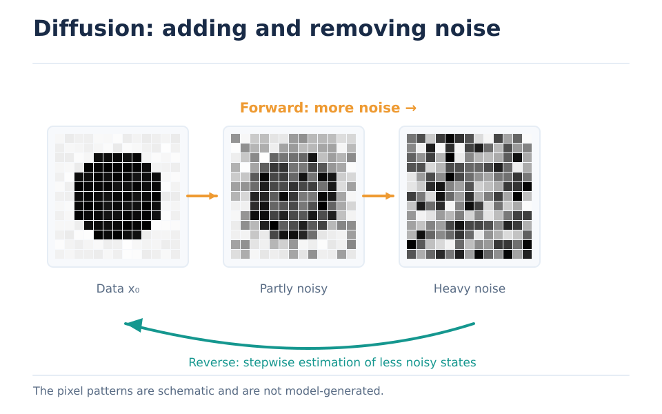

# M4-L8 – Compulsory elective: Generative models, diffusion and optimal transport {#L8}

**Course area:** M4 – Choice of study: AI, computer science and specialised fields

**Level:** University studies (elective / specialisation)

**Prior knowledge:** [M1-L7](M1-L7.md) (random variables), [M2-L7](M2-L7.md) (densities and integration), [M2-L9](M2-L9.md)/[M3-L10](M3-L10.md) (Fourier analysis and function spaces as an outlook), [M3-L6](M3-L6.md) (optimisation), [M2-L11](M2-L11.md)/[M4-L1](M4-L1.md) (neural models)

**Context:** Master’s-oriented advanced study in AI and data science.

## What is this about? {#S1}

A classifier assigns an existing input to a category. A **generative model**, by contrast, is intended to produce new examples with characteristics of a learned distribution: images, sounds or geometric shapes. One modern approach begins with easily generated **random noise** and works towards structured data step by step. Such **diffusion models** use probability distributions, stochastic processes and neural networks. **Optimal transport** addresses a related but different question: how can probability mass be moved from one distribution to another at the lowest possible cost? Both fields connect statistics, analysis and optimisation.

## Basic idea: noise is a starting point here, not a privacy guarantee {#S2}

A photograph contains many interrelated pixels. If controlled noise is repeatedly added, details become less distinct and the state eventually resembles a simple noise distribution. A model can be trained to learn an appropriate **reverse process** towards plausible data. This reversal is not simply the algebraic undoing of changes to a particular image: after substantial noise has been added, information has been destroyed and several reconstructions are possible.

In optimal transport, imagine two piles of probability mass, such as measurements from an old and a new type of sensor. Every transport route has a cost. We seek a **coupling** that respects all the source and target masses and has the lowest possible total cost. The two approaches are mathematically related, but must not be treated as identical algorithms.

## New symbols – before the first formula {#S3}

| Symbol | Read aloud | Meaning here | Do not confuse with |
|---|---|---|---|
| $x_{0}$ | “x zero” | original data vector, for example pixel values | fixed geographical coordinate system |
| $x_{t}$ | “x at step t” | randomly noised state at time step t | deterministic position of a particle |
| $t$ | “t” | index of a noise or reversal step | necessarily physical time |
| $\beta _{t}$ | “beta at step t” | planned additional noise variance in the discrete forward process, usually between zero and one | beta distribution in statistics |
| $\alpha _{t}$ | “alpha at step t” | remaining signal fraction $1 - \beta _{t}$ | step size in optimisation |
| $\bar{a}_{t}$ | “alpha bar at step t” | product of all alpha values up to this step | average of many measurements |
| $\varepsilon$ | “epsilon” | here, **standard normally distributed noise**, not the privacy epsilon from M4-L7 | privacy budget |
| $N(\mu ,\sigma ^{2})$ | “normal distribution with mu and variance sigma squared” | Gaussian distribution with mean $\mu$ and variance $\sigma^2$ | the natural number N of data points |
| $p_{t}(x)$ | “density p at time t at x” | probability *per unit interval of values* at location x | probability of an individual real value |
| $q(x_{t} | x_{0})$ | “q of x t given x zero” | conditional forward distribution of a noised point | trained reverse direction |
| $\varepsilon_\theta(x_t,t)$ | “epsilon hat with parameters theta” | noise estimated by the neural network | actual sampled noise ε |
| $E[\cdot ]$ | “expected value” | average over random training and noise events | individual observation |
| ${\Vert v\Vert}^2$ | “length of v squared” | sum of the squared vector components | matrix determinant |
| $\nabla_x \log  p(x)$ | “gradient with respect to x of the logarithm of density p” | *score*: direction of increasing log-density | score assigned by a classifier |
| $a_{i}, b_{j}$ | “a sub i and b sub j” | probability masses at source and target points, respectively | free optimisation variables |
| $\pi _{ij}$ | “pi sub i j” | mass transported from source i to target j | mathematical constant pi |
| $c_{ij}$ | “c sub i j” | cost of this transport | normalisation factor |
| `Σ` | “sum” | addition over all possible transport routes | integral of a continuous density |

## The forward process: adding controlled noise to data {#S4}

In the standard discrete model, a further amount of noise is introduced at each step. With $\alpha _{t} = 1 - \beta _{t}$ and the product $\bar a_t=\alpha_1\cdot\alpha_2\cdot\ldots\cdot\alpha_t$, a noised state can be generated **directly** from the original vector:

{alt="Forward and reverse processes of a diffusion model"}

$$
\begin{aligned}
x_t&=\sqrt{\bar a_t}\cdot x_0+\sqrt{1-\bar a_t}\cdot\varepsilon\\
\varepsilon&\sim\mathcal N(0,I)
\end{aligned}
$$

Read aloud: The input at step t is the original data vector, attenuated by the square root of the remaining overall signal fraction, plus an independent standard normal noise vector weighted by the square root of the remaining variance fraction. The symbol $I$ denotes the identity matrix; in the simple model, each component of ε has variance one. The formula describes the **conditional distribution given $x_0$**, not automatically the distribution of all data points.

The corresponding statement is:

$$
q(x_t\mid x_0)=\mathcal{N}\left(\sqrt{\bar{\alpha}_t}\cdot x_0,\,(1-\bar{\alpha}_t)\cdot I\right)
$$

Read aloud: Given the original, the state at step t is normally distributed, with a mean equal to the square root of alpha bar times the original and a covariance matrix equal to the remaining noise weight times the identity matrix. For simplicity, we assume isotropic, independent Gaussian noise.

### Complete numerical example of forward diffusion {#abschnitt-5}

We consider just **one** numerical component. Let the original value be $x_{0} = 2$. Let the overall signal fraction at a particular step be $\bar{a}_{t} = 0{,}36$. A particular random draw gives $\varepsilon  = -1$. Then:

$$
\begin{aligned}
\sqrt{\bar a_t}&=\sqrt{0{,}36}=0{,}6\\
\sqrt{1-\bar a_t}&=\sqrt{0{,}64}=0{,}8\\
x_t&=0{,}6\cdot2+0{,}8\cdot(-1)\\
&=1{,}2-0{,}8\\
&=0{,}4
\end{aligned}
$$

**In words:** The original two is retained with a weight of zero point six and contributes one point two. The sampled noise, minus one, is weighted by zero point eight and subtracts zero point eight. Zero point four remains. A different random outcome would have produced a different noised value. This sample draw is not a deterministic prediction.

## How the model learns to estimate noise {#S5}

During training, a neural network is shown a noised state and its step. Since the actual random value drawn during the artificially generated noise step is known, the network's estimate can be compared with it:

$$
L(\theta)=E\left[\lVert\varepsilon-\varepsilon_{\theta}(x_t,t)\rVert^2\right]
$$

The formula reads as follows: The training loss L for the network parameters theta is the expected squared length of the difference between the actual noise and the noise predicted by the network. A small loss improves noise estimation in the training model used. It does **not** guarantee that every generated object is semantically correct, unaltered or free of problematic training patterns.

Generation typically starts with random noise and repeatedly applies a learned reverse sampler. The specific reverse formula depends on the model family, time discretisation, choice of variance and sampler. This is more than simply “subtract the estimated noise value once”. Deterministic or stochastic samplers can be used.

## What is a score? {#S6}

For a **positive, differentiable density** $p(x)$, the score is the gradient of its logarithm:

$$
\operatorname{Score}(x)=\nabla_x\log p(x)
$$

Read aloud: Take the natural logarithm of the probability density and consider the direction in which it increases most rapidly. For a one-dimensional standard normal distribution:

$$
\begin{aligned}
p(x)&=\frac1{\sqrt{2\pi}}\cdot\exp\!\left(-\frac{x^2}{2}\right)\\
\log p(x)&=\text{constant}-\frac{x^2}{2}\\
\operatorname{Score}(x)&=-x
\end{aligned}
$$

This follows because the derivative of minus x squared divided by two is minus x. At $x = 2$, the score is $-2$ and points towards the high-density centre at zero. At $x = -1$, it is $+1$ and likewise points towards zero. A direction of increasing density is **not** a guarantee that a unique original training image lies there.

Score-based models use relationships between density scales, added noise and reverse dynamics. The noise vector estimated by the training objective and the score are related by scale-dependent factors; the two quantities therefore cannot be equated without normalisation.

### Cross-check: conditional score and estimated noise {#abschnitt-8}

For the **conditional** Gaussian model $q(x_{t} | x_{0})$ above, with $0 < \bar{a}_{t} < 1$, differentiating the log-density with respect to the noised state gives:

$$
\begin{aligned}
\nabla_{x_t}\log q(x_t\mid x_0)
&=-\frac{x_t-\sqrt{\bar a_t}\cdot x_0}{1-\bar a_t}\\
&=-\frac{\varepsilon}{\sqrt{1-\bar a_t}}
\end{aligned}
$$

For the sample draw $\bar{a}_{t}=0{,}36$, $x_{0}=2$, $x_{t}=0{,}4$, we obtain $-\frac{0{,}4-0{,}6\cdot2}{0{,}64}=+1{,}25$; similarly, $\varepsilon =-1$ gives the value $-\frac{-1}{0{,}8}=+1{,}25$. The calculation refers **to the known $x_0$**. The score of the **marginal** distribution $p_{t}(x_{t})$, in which we average over unknown original data, is generally not simply the same expression with an arbitrary $x_0$. A learned noise prediction is therefore not automatically the exact marginal score.

## Optimal transport: moving probability mass at the lowest possible cost {#S7}

We turn to a **different mathematical problem**. There are discrete source points $i$ with masses $a_{i}$ and target points $j$ with masses $b_{j}$. An admissible **transport coupling** $\pi _{ij}$ specifies how much mass is moved from source point i to target point j. All transported parts must be non-negative; each source and target total must be matched exactly.

$$
\begin{aligned}
\text{minimise}\quad&\sum_i\sum_j\pi_{ij}\cdot c_{ij}\\
\text{subject to:}\quad&\pi_{ij}\ge0;\\
&\sum_j\pi_{ij}=a_i\quad\text{for each source }i;\\
&\sum_i\pi_{ij}=b_j\quad\text{for each target }j\text{.}
\end{aligned}
$$

Read aloud: Among all non-negative allocations of mass, find the one that minimises the sum of transported mass times route cost, while each source and target retains the prescribed total amount. Such a coupling describes an **optimisation problem**, not yet a generative reverse diffusion process.

### Complete example with two points {#abschnitt-10}

The source distribution has mass $0{,}5$ at $0$ and mass $0{,}5$ at $2$. The target distribution has mass $0{,}5$ at $1$ and mass $0{,}5$ at $3$. We choose squared distance as the cost:

$$
\begin{aligned}
\text{Cost}\quad c(0,1)&={(0-1)}^2=1\\
c(0,3)&={(0-3)}^2=9\\
c(2,1)&={(2-1)}^2=1\\
c(2,3)&={(2-3)}^2=1
\end{aligned}
$$

**Plan A:** The first half of the mass moves from 0 to 1, the second from 2 to 3. The average transport cost is $0{,}5\cdot 1 + 0{,}5\cdot 1 = 1$.

**Plan B:** The first half moves from 0 to 3, the second from 2 to 1. This costs $0{,}5\cdot 9 + 0{,}5\cdot 1 = 5$. Both plans satisfy all mass constraints, but Plan A is considerably cheaper. In one dimension with quadratic distance costs, the **order-preserving matching of sorted points is optimal**: the transport cost $1$ is the minimum here. For the so-called quadratic Wasserstein distance, we therefore have $W_{2}^{2} = 1$ and $W_{2} = 1$.

A single cost comparison describes only these two specified distributions. For continuous distributions, unequal masses and high-dimensional spaces, the optimisation is more complicated; existence, uniqueness and computational cost depend on the assumptions.

## Entropically regularised transport and the Sinkhorn idea {#S8}

To handle large discrete transport problems more efficiently, an **entropy term** that favours a distributed coupling is sometimes added to the linear transport cost. A typical regularised expression is:

$$
\begin{aligned}
\text{minimise}\quad&\sum_{i,j}\pi_{ij}c_{ij}+
 \tau\sum_{i,j}\pi_{ij}(\log\pi_{ij}-1)
\end{aligned}
$$

Here, $\tau$ (“tau”) is a positive regularisation strength; for $\pi _{ij} = 0$, the limiting value of the term is taken to be zero. A larger tau favours more distributed transport plans; a small tau approximates the unregularised problem under suitable conditions. **Sinkhorn iterations** repeatedly scale rows and columns of a positive matrix formed from the costs to match the desired marginal totals. This is an algorithmic connection to M3-L6 and M3-L7; its numerical stability also depends on scaling and implementation.

### Verification example: why regularisation changes the coupling {#abschnitt-12}

In the two-point problem above, **every** admissible coupling can be described by a single number $u$ with $0 \le  u \le  0{,}5$:

$$
\begin{aligned}
\begin{array}{c|cc}
 &\text{Target 1}&\text{Target 3}\\
\hline
\text{Source 0}&u&0{,}5-u\\
\text{Source 2}&0{,}5-u&u
\end{array}\\
\text{Transport cost}&=5-8u
\end{aligned}
$$

Without regularisation, the minimum is at $u=0{,}5$ with transport cost $1$ (Plan A). The midpoint $u=0{,}25$ distributes all four masses evenly and costs $3$. Substituting the coupling into the entropically regularised expression gives the derivative in the interior $0<u<0{,}5$:

$$
\begin{aligned}
J'(u)&=-8+2\tau\cdot\ln\!\left[\frac{u}{0{,}5-u}\right]\\
J''(u)&=2\tau\cdot\left[\frac1u+\frac1{0{,}5-u}\right]>0
\end{aligned}
$$

For the deliberately chosen strength $\tau=\frac4{\ln3}$, it follows from $J'(u)=0$ that $\frac{u}{0{,}5-u}=3$. Thus we have **uniquely** $u=\frac38=0{,}375$ and $0{,}5-u=\frac18=0{,}125$. The pure transport cost of this regularised optimum is $5-8\cdot 0{,}375=2$, which is higher than the unregularised minimum $1$. However, the quantity being minimised was **transport cost plus the entropy term**, not transport cost alone. This is not a calculation error but the purpose of the modified objective function. The derivation assumes positive masses, the specified costs and $\tau >0$.

## Connection to generative AI – and an essential distinction {#S9}

- **Diffusion** constructs stochastic modelling and generation dynamics from noise to a data distribution.
- **Optimal transport** compares distributions in terms of the minimum cost of a coupling. It can serve as a training tool or as a geometric perspective on generative models.
- **Flow-based methods** learn continuous transformations of distributions. Some combine ideas from differential equations, transport and generative models; however, not every flow model can be equated with unique optimal transport.

## What is it useful for? {#S10}

**Image and audio generation** uses data-dependent distributions and neural reverse processes. **Simulation and materials design** can generate possible structures or compare distributions between scenarios. **Optimal transport** is useful for distribution matching, image processing, sensor adaptation and distance measures between data sets. In **robotic motion models**, the mathematics helps compare spatial probability distributions, but it does not replace collision checking or safe trajectory planning.

## Assumptions and limitations {#S11}

1.  The forward process uses an explicitly defined noise distribution. The noise model is not automatically a realistic model of all recording or sensor errors.
2.  The trained reverse process is a statistical approximation. A plausible appearance does not guarantee factual, causal or legal correctness.
3.  Data set biases, copyright issues, reconstruction of sensitive patterns and misuse must be addressed independently of mathematical quality.
4.  The Wasserstein distance requires a cost or metric structure and appropriate finite moments; exact computation can be very expensive for larger or continuous problems.
5.  Entropic regularisation changes the optimisation problem. The regularised solution generally has **different** costs from the unregularised optimum.
6.  A short scalar calculation conveys the idea, but does not prove a convergence guarantee for a trained diffusion or flow model.

## Connection to the next lesson {#S12}

**M4-L9** asks when an AI result can be trusted. For generative models in particular, it is important to distinguish between an attractive representation, modelled probability, actual uncertainty and a robustly verified property. In addition, the noise used here is not a differential privacy guarantee of the kind discussed in M4-L7.

## Sources {#S13}

- [Ho / Jain / Abbeel, *Denoising Diffusion Probabilistic Models*, NeurIPS 2020](https://papers.neurips.cc/paper/2020/hash/4c5bcfec8584af0d967f1ab10179ca4b-Abstract.html) · Thematic relevance to lesson: S5: How the model learns to estimate noise (overview/metadata page) · Last accessed: 2026-11-22
- [Peyré / Cuturi, *Computational Optimal Transport*, Foundations and Trends in Machine Learning, 2019](https://research.google/pubs/computational-optimal-transport/) · Thematic relevance to lesson: S7: Optimal transport: moving probability mass at the lowest possible cost (overview/metadata page) · Last accessed: 2026-11-22
