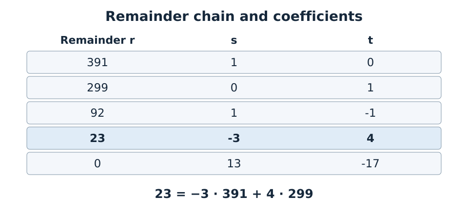

# M5-L1 – Divisibility, Euclidean algorithm and Bézout {#L1}

**Course area:** M5 – Algebra and number theory

**Level:** Bachelor · elective bridge

**Prerequisites:** [M1-L1](M1-L1.md); [M2-L3](M2-L3.md)

**Classification:** University-level extension of elementary number theory

## Learning objectives {#S1}

You will prove correctness and termination of the Euclidean algorithm using an invariant, derive Bézout's identity constructively and interpret the gcd as the positive generator of an ideal in $\mathbb Z$. You will solve linear Diophantine equations completely and analyse the number of remainder divisions. This lesson assumes residue arithmetic from M2-L3 and develops its algebraic foundations.

## Notation and divisibility {#S2}

Let $a,b\in\mathbb Z$, not both zero. We write $c\mid a$ if $a=ck$ for some $k\in\mathbb Z$. Let $d=\gcd(a,b)$ denote the positive greatest common divisor. Write $a\mathbb Z+b\mathbb Z=\{sa+tb:s,t\in\mathbb Z\}$ for the set of all integer linear combinations. This is an ideal: sums, additive inverses and integer multiples remain in the set. For $b>0$, division with remainder uniquely gives $a=qb+r$ with $0\le r<b$.

The common divisors are unchanged by $(a,b)\mapsto(b,a-qb)$. More strongly, $a\mathbb Z+b\mathbb Z=b\mathbb Z+(a-qb)\mathbb Z$: both new generators are combinations of the old ones, and $a=(a-qb)+qb$ proves the reverse inclusion. This is the central invariant.

## Algorithm, termination and example {#S3}

Start with the absolute values of the inputs. While the second value is positive, replace the pair by that value and the nonnegative remainder. The remainder is strictly smaller than the preceding second value. A strictly decreasing sequence of nonnegative integers must terminate; at the final pair $(d,0)$ the generated ideal is $d\mathbb Z$. By the invariant, $d$ is the gcd of the inputs.

$$391=1\cdot299+92,\quad299=3\cdot92+23,\quad92=4\cdot23.$$

Thus $d=23$. The diagram shows the remainders and their coefficients relative to the original inputs.

{alt="Remainders 391, 299, 92, 23, 0 with coefficients; last positive remainder 23."}

## Extended algorithm and Bézout {#S4}

Write the remainders as $r_i=s_i|a|+t_i|b|$. Begin with $(s_0,t_0)=(1,0)$ and $(s_1,t_1)=(0,1)$. From $r_{i+1}=r_{i-1}-q_i r_i$ we obtain the same recurrence for both coefficients. Inductively the representation of every remainder is preserved. Correcting the signs yields coefficients for $a,b$ themselves. This proves Bézout's identity: $d=sa+tb$. In the example $23=299-3(391-299)=-3\cdot391+4\cdot299$.

The equality $a\mathbb Z+b\mathbb Z=d\mathbb Z$ also explains the universal property: every common divisor divides $d$, and $d$ divides both inputs. Alternatively, prove that $d$ is the smallest positive element of the ideal: dividing an element by this minimum produces a remainder still in the ideal; a positive remainder would be a contradiction.

The implementation below maintains two successive remainders and their coefficients. The input $(0,0)$ is excluded by our convention.

```python
def egcd(a, b):
    if a == b == 0:
        raise ValueError("undefined gcd for this convention")
    r, q = abs(a), abs(b)
    s, u, t, v = 1, 0, 0, 1
    while q:
        k = r // q
        r, q = q, r - k*q
        s, u = u, s - k*u
        t, v = v, t - k*v
    return r, s*(-1 if a < 0 else 1), t*(-1 if b < 0 else 1)

assert egcd(391, 299) == (23, -3, 4)
```

## Diophantine equations and inverses {#S5}

The equation $ax+by=c$ in integer unknowns has a solution exactly when $d\mid c$. Necessity follows because $d$ divides both summands; sufficiency follows by multiplying the Bézout identity by $c/d$. For $a,b\ne0$ and one particular solution $(x_0,y_0)$, all solutions are

$$x=x_0+(b/d)k,\qquad y=y_0-(a/d)k,\qquad k\in\mathbb Z.$$

Proof: subtract two solutions, divide by $d$ and use coprimality of $a/d$ and $b/d$. From $(a/d)(x-x_0)=-(b/d)(y-y_0)$ it follows that $b/d\mid(x-x_0)$ (Bézout applied to the reduced coefficients proves this cancellation rule). Substitution yields the formula. If one coefficient is zero, divisibility by the other decides solvability; the unconstrained variable is free.

For $391x+299y=46$, $(-6,8)$ is a solution, and the parametric form is $x=-6+13k$, $y=8-17k$. An inverse of $a$ modulo $m\ge2$ exists if and only if $\gcd(a,m)=1$: the equation $ax+my=1$ is then solvable. For example, $17\cdot(-7)+120=1$, so $113$ is the inverse of $17$ modulo $120$.

## Complexity and limitations {#S6}

For positive remainders $u>v$, within at most two remainder divisions the new positive remainder is less than $u/2$. If $v\le u/2$, the next remainder is smaller than $v$; otherwise the quotient is one and $u-v<u/2$. This gives a logarithmic bound $O(\log(\max(|a|,|b|)+1))$ on the number of divisions (an initial swap may cost one step). This does not imply constant bit cost for division of large integers. Consecutive Fibonacci numbers require especially many steps because their remainders are again Fibonacci numbers. When one input is zero, the algorithm stops immediately or after one division. The proof uses division with remainder in $\mathbb Z$; it cannot be transferred to arbitrary rings without further justification.

## Self-check {#S7}

### Exercises

1. Compute the gcd of 414 and 162 and give Bézout coefficients.
2. Prove that every common divisor of $a,b$ divides every integer linear combination.
3. Solve $21x+15y=6$ completely.
4. Decide whether $21x+15y=5$ is solvable.
5. Find and check the inverse of 23 modulo 60.

::: {.lc-solutions data-lc-section="S7"}
1. $414=2\cdot162+90$, $162=90+72$, $90=72+18$, $72=4\cdot18$. Back-substitution gives $18=90-72=2\cdot90-162=2\cdot414-5\cdot162$.
2. If $c\mid a,b$, there are $u,v$ with $a=cu,b=cv$. Then $sa+tb=c(su+tv)$ is divisible by $c$.
3. $6=21-15$. All solutions: $x=1+5k$, $y=-1-7k$, $k\in\mathbb Z$.
4. No: $\gcd(21,15)=3$ does not divide 5.
5. $60=2\cdot23+14$, $23=14+9$, $14=9+5$, $9=5+4$, $5=4+1$. Back-substitution gives $1=5-4=2\cdot5-9=2\cdot14-3\cdot9=5\cdot14-3\cdot23=5\cdot60-13\cdot23$. The inverse is 47; $23\cdot47=1081=18\cdot60+1$.
:::

## Sources {#S8}

- [Bruce Ikenaga – The Extended Euclidean Algorithm (Millersville University)](https://sites.millersville.edu/bikenaga/number-theory/extended-euclidean-algorithm/extended-euclidean-algorithm.html) · algorithm and theorem, lines 2–48 · Last accessed: 2026-11-24 · Content verified: 2026-11-24
