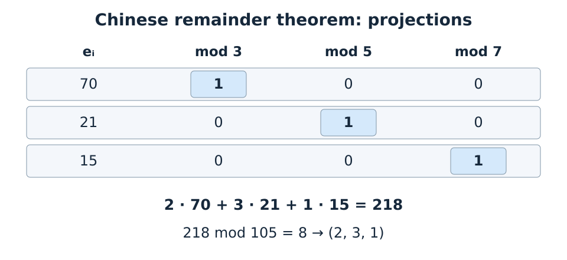

# M5-L2 – Congruences and Chinese remainder theorem {#L2}

**Course area:** M5 – Algebra and number theory

**Level:** Bachelor · elective bridge

**Prerequisites:** [M5-L1](M5-L1.md)

**Classification:** University-level extension of elementary number theory

## Learning objectives {#S1}

You will interpret congruences as equality of residue classes, prove the solvability criterion for linear congruences and construct the Chinese remainder theorem isomorphism for pairwise coprime moduli. You will also handle two non-coprime moduli and identify inconsistent systems.

## Residue classes and ring operations {#S2}

For $m\ge2$, write $[a]_m=a+m\mathbb Z$. The congruence $a\equiv b\pmod m$ means $m\mid(a-b)$, or $[a]_m=[b]_m$. The set of classes is denoted by $\mathbb Z/m\mathbb Z$. Addition and multiplication are defined by $[a]_m+[b]_m=[a+b]_m$ and $[a]_m[b]_m=[ab]_m$. They are well-defined: replacing $a$ by $a+km$ and $b$ by $b+lm$ changes the sum and product only by multiples of $m$. The ring has exactly $m$ elements. A class is a unit (multiplicatively invertible) precisely when its representative is coprime to $m$, as shown in M5-L1.

For example, $[3]_8$ is its own inverse because $9\equiv1\pmod8$. By contrast, $[2]_8$ is not invertible; its product with any class remains even.

## Linear congruences {#S3}

Set $d=\gcd(a,m)$. The congruence $ax\equiv b\pmod m$ is equivalent to $ax+my=b$ for some integer $y$. By Bézout it has a solution exactly when $d\mid b$. In this case, one particular solution $x_0$ generates all solutions $x=x_0+(m/d)k$. Modulo $m$ these yield exactly $d$ distinct classes, because two parameters give the same class precisely when their difference is divisible by $d$. The special case $a=0$ means all classes if $m\mid b$, and none otherwise.

For example, $18x\equiv12\pmod{30}$ reduces to $3x\equiv2\pmod5$. Since $3^{-1}\equiv2$, we obtain $x\equiv4\pmod5$. The six solutions modulo 30 are $4,9,14,19,24,29$. In contrast, $18x\equiv13\pmod{30}$ has no solution.

## Chinese remainder theorem: construction and proof {#S4}

Let $m_1,\ldots,m_k\ge2$ be pairwise coprime, $M=\prod_i m_i$ and $N_i=M/m_i$. Since $\gcd(N_i,m_i)=1$, there exists $u_i$ with $N_i u_i\equiv1\pmod{m_i}$. For $j\ne i$, $N_i u_i\equiv0\pmod{m_j}$. Set $e_i=[N_i u_i]_M$. For arbitrary target residues $a_i$,

$$x=\sum_{i=1}^k a_iN_i u_i\pmod M$$

satisfies all required congruences simultaneously. If $x'$ is another solution, each $m_i$ divides $x-x'$. Pairwise coprimality implies (by repeatedly applying the Bézout cancellation rule) that $M$ divides the difference. Hence the solution is unique modulo $M$.

For $(m_1,m_2,m_3)=(3,5,7)$ and $(a_1,a_2,a_3)=(2,3,1)$, we have $M=105$, $(N_1,N_2,N_3)=(35,21,15)$ and $(u_1,u_2,u_3)=(2,1,1)$. The sum is $2\cdot70+3\cdot21+15=218\equiv8\pmod{105}$. Check: $8$ has the required remainders.

{alt="70, 21 and 15 map to the three unit vectors; their weighted sum gives 8 modulo 105."}

## Ring isomorphism and implementation {#S5}

The map $\phi:\mathbb Z/M\mathbb Z\to\prod_i\mathbb Z/m_i\mathbb Z$, $[x]_M\mapsto([x]_{m_i})_i$, is well-defined because each $m_i$ divides $M$. It preserves addition, multiplication and the identity. The proof above establishes surjectivity (construction) and injectivity (uniqueness). It is therefore a ring isomorphism. Each element $e_i$ maps to a tuple with a single one; consequently $e_i^2=e_i$, $e_i e_j=0$ for $i\ne j$ and $\sum_i e_i=1$. Operations can thus be performed componentwise and their result reconstructed.

The following Python program (Python 3.8 or newer) computes a nonnegative representative. It assumes integer inputs and deliberately rejects moduli that are not pairwise coprime. The built-in `pow` with exponent −1 provides the modular inverse.

```python
from math import gcd, prod

def crt(residues, moduli):
    if not moduli or len(residues) != len(moduli):
        raise ValueError("nonempty matching lists required")
    if any(m < 2 for m in moduli):
        raise ValueError("moduli must be >= 2")
    if any(gcd(m,n) != 1 for i,m in enumerate(moduli) for n in moduli[i+1:]):
        raise ValueError("pairwise coprime moduli required")
    M = prod(moduli)
    return sum(a*(M//m)*pow(M//m,-1,m)
               for a,m in zip(residues,moduli)) % M

assert crt([2, 3, 1], [3, 5, 7]) == 8
```

## Non-coprime moduli and limitations {#S6}

For two moduli $m,n\ge2$ and target residues $a,b$, the system $x\equiv a\pmod m$, $x\equiv b\pmod n$ is solvable precisely when $a\equiv b\pmod d$, where $d=\gcd(m,n)$. Indeed, $x=a+mt$ leads to $mt\equiv b-a\pmod n$. The criterion follows from S3. If solvable, the solution is unique modulo $\operatorname{lcm}(m,n)=mn/d$, not necessarily modulo $mn$: two solutions differ by a common multiple of the moduli, and every multiple of the lcm preserves both congruences.

For example, $x\equiv2\pmod6$, $x\equiv5\pmod9$ is compatible. From $6t\equiv3\pmod9$ we obtain $2t\equiv1\pmod3$, hence $t\equiv2\pmod3$ and $x\equiv14\pmod{18}$. In contrast, $x\equiv2\pmod6$, $x\equiv4\pmod9$ is incompatible. The product-ring isomorphism from S5 does not hold in this case. Larger systems can be solved by merging two compatible congruences at a time; each intermediate solution retains its lcm as modulus.

## Self-check {#S7}

### Exercises

1. Solve $14x≡16$ modulo 20.
2. Construct a solution to $x≡2$ modulo 5 and $x≡4$ modulo 7.
3. Find the two CRT elements $e_1,e_2$ modulo 35 and check their idempotence.
4. Solve $x≡3$ modulo 8 and $x≡7$ modulo 12.
5. Explain why the common gcd 1 of moduli 6, 10, 15 does not imply pairwise coprimality.

::: {.lc-solutions data-lc-section="S7"}
1. $d=2$, so $7x\equiv8\pmod{10}$; $7^{-1}=3$ modulo 10, hence $x\equiv4\pmod{10}$. Classes 4 and 14 modulo 20.
2. $M=35$. $N_1=7,u_1=3$; $N_2=5,u_2=3$. Thus $2\cdot21+4\cdot15=102\equiv32\pmod{35}$.
3. $e_1=[21]_{35}$, $e_2=[15]_{35}$. $441\equiv21$, $225\equiv15$, $315\equiv0$; $36\equiv1\pmod{35}$.
4. $d=4$, compatible. $x=3+8t$, $8t\equiv4\pmod{12}$, so $2t\equiv1\pmod3$, $t\equiv2\pmod3$. $x\equiv19\pmod{24}$.
5. $\gcd(6,10)=2$, $\gcd(6,15)=3$, $\gcd(10,15)=5$. A common gcd of 1 is insufficient: for example, residues 0 modulo 6 and 1 modulo 10 are incompatible.
:::

## Sources {#S8}

- [Bruce Ikenaga – Linear Congruences (Millersville University)](https://sites.millersville.edu/bikenaga/number-theory/linear-congruences/linear-congruences.html) · theorem and proof, lines 2–46 · Last accessed: 2026-11-24 · Content verified: 2026-11-24
- [Bruce Ikenaga – The Chinese Remainder Theorem (Millersville University)](https://sites.millersville.edu/bikenaga/number-theory/chinese-remainder-theorem/chinese-remainder-theorem.html) · construction and compatibility theorem, lines 58–105, 164–172 · Last accessed: 2026-11-24 · Content verified: 2026-11-24
