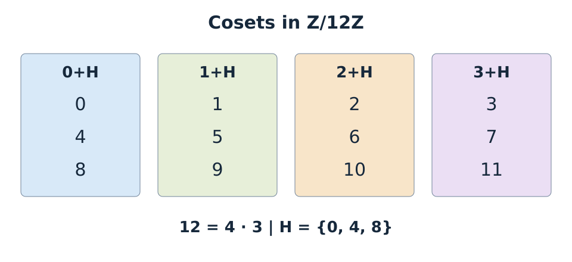

# M5-L3 – Subgroups, cosets and Lagrange's theorem {#L3}

**Course area:** M5 – Algebra and number theory

**Level:** Bachelor’s studies · Elective

**Prerequisites:** [M2-L3](M2-L3.md)

**Classification:** University-level algebra extension

## Learning objectives {#S1}

You will test subgroups with a single criterion, partition a group into cosets and prove Lagrange's theorem. You will determine element orders and distinguish necessary from sufficient conditions for subgroup existence.

## Subgroups and generators {#S2}

Let $G$ be a group with identity $e$. A nonempty subset $H\subseteq G$ is a subgroup exactly when $ab^{-1}\in H$ for all $a,b\in H$. Proof: setting $a=b$ gives $e\in H$; setting $a=e$ gives $b^{-1}\in H$. Using $b^{-1}$ as the second argument then gives $ab\in H$. Associativity is inherited from $G$. Conversely, subgroup closure implies the criterion.

The cyclic subgroup $\langle g\rangle$ generated by $g$ consists of all integer powers of $g$. In additive notation, $\langle g\rangle=\{kg:k\in\mathbb Z\}$. In $\mathbb Z/12\mathbb Z$, 4 generates $H=\{0,4,8\}$. The set $\{0,2,4\}$ is not a subgroup because $0-2\equiv10\pmod{12}$ is absent. An intersection of any family of subgroups is a subgroup because the criterion holds in every member; unions need not be closed.

## Cosets as a partition {#S3}

For $a\in G$, $aH=\{ah:h\in H\}$ is a left coset and $Ha$ is a right coset. Define $a\sim b$ by $a^{-1}b\in H$. This is reflexive, symmetric and transitive by identity, inversion and multiplication in $H$. The equivalence class of $a$ is precisely $aH$. Hence two left cosets are either equal or disjoint; every element belongs to exactly one. The map $h\mapsto ah$ is a bijection from $H$ to $aH$, with inverse $x\mapsto a^{-1}x$.

In the additive example modulo 12, there are four cosets: $H,1+H,2+H,3+H$. The number 5 represents the same coset as 1. The diagram groups all twelve elements by their residue modulo 4. A coset is not generally a subgroup; only $H$ itself contains 0.

{alt="Four cosets of three elements each modulo 12."}

## Lagrange's theorem and consequences {#S4}

For finite $G$, write $[G:H]$ for the number of left cosets. The partition and bijections of S3 give

$$|G|=[G:H]\,|H|.$$

Thus $|H|$ divides the group order. The order of an element $g$ is the least positive $d$ such that $g^d=e$, if it exists. In a finite group it exists because two of $e,g,\ldots,g^{|G|}$ must coincide. The powers $e,g,\ldots,g^{d-1}$ are distinct and form the cyclic subgroup. Therefore $d\mid |G|$ and $g^{|G|}=e$. If $G$ has prime order $p$, every $g\ne e$ generates the whole group because $d>1$ and $d\mid p$.

## Cyclic groups: computation {#S5}

In $\mathbb Z/n\mathbb Z$, the order of $a$ is $n/\gcd(n,a)$. Indeed, $ka=0$ modulo $n$ means $n\mid ka$; dividing by the gcd leaves coprime factors. The least positive choice is therefore $k=n/\gcd(n,a)$. For $n=12,a=8$ the result is 3. Every subgroup of a cyclic group arises from a divisor $d$ of $n$: its preimage in $\mathbb Z$ is an additive subgroup containing $n\mathbb Z$. Each such subgroup is $d\mathbb Z$ (divide with remainder by its least positive element), so $d\mid n$. The generated subgroup has $n/d$ elements.

## Limits of the theorem {#S6}

The converse of Lagrange's theorem fails in general. The alternating group $A_4$ of even permutations of four objects has twelve elements: the identity, three double transpositions and eight 3-cycles. A subgroup of order 6 would have index 2. Its left and right cosets would be the subgroup and its complement, making it normal. The quotient of order 2 (see M5-L4) cannot contain a nontrivial image of an element of order 3: the image order divides both 3 and 2. All eight 3-cycles would have to belong to the subgroup, a contradiction. Although 6 divides 12, no subgroup of that order exists here. For cyclic groups the converse does hold by S5.

## Self-assessment {#S7}

### Exercises

1. Test whether $\{0,6,12,18\}$ is a subgroup of $\mathbb Z/24\mathbb Z$ and find its index.
2. List the cosets of $\langle 6\rangle$ in $\mathbb Z/15\mathbb Z$.
3. Determine the order of 18 modulo 42.
4. Prove that a group of order 17 is cyclic.
5. Show that the union of the subgroups generated by 2 and 3 modulo 6 is not a subgroup.

::: {.lc-solutions data-lc-section="S7"}
1. These are the multiples of 6 modulo 24; differences stay in the set. Order 4, index 6.
2. $H=\{0,3,6,9,12\}$; $1+H=\{1,4,7,10,13\}$; $2+H=\{2,5,8,11,14\}$.
3. $42/\gcd(42,18)=42/6=7$.
4. Every nonidentity element has order greater than 1 dividing 17, so it generates 17 elements.
5. The union is $\{0,2,3,4\}$; $2+3=5$ is missing.
:::

## Sources {#S8}

- [Bruce Ikenaga – Subgroups (Millersville University)](https://sites.millersville.edu/bikenaga/abstract-algebra-1/subgroups/subgroups.html) · subgroup criterion · Last accessed: 2026-11-24 · Content verified: 2026-11-24
- [Bruce Ikenaga – Cosets (Millersville University)](https://sites.millersville.edu/bikenaga/abstract-algebra-1/cosets/cosets.html) · lines 94–141: partition, index, Lagrange · Last accessed: 2026-11-24 · Content verified: 2026-11-24
