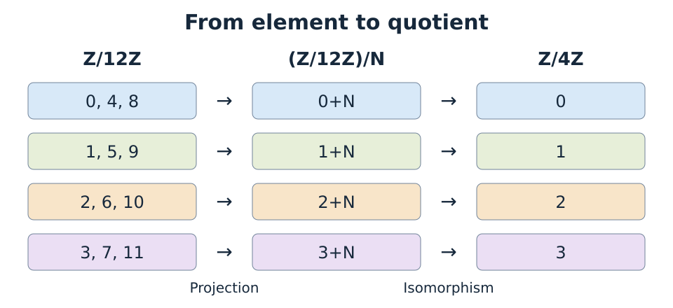

# M5-L4 – Normal subgroups and quotient groups {#L4}

**Course area:** M5 – Algebra and number theory

**Level:** Bachelor’s studies · Elective

**Prerequisites:** [M5-L3](M5-L3.md)

**Classification:** University-level algebra extension

## Learning objectives {#S1}

You will recognize normal subgroups, prove that a quotient operation is well defined and apply the first isomorphism theorem. You will distinguish a coset set from a quotient group and diagnose why multiplication fails for nonnormal subgroups.

## Normality and conjugation {#S2}

A subgroup $N\le G$ is normal, written $N\triangleleft G$, if $gNg^{-1}=N$ for every $g\in G$. Conjugation is an automorphism of $G$; it suffices to show $gNg^{-1}\subseteq N$ for all $g$, since applying this to $g^{-1}$ gives the reverse inclusion. Right multiplication by $g$ gives the equivalent condition $gN=Ng$. Every subgroup of an abelian group is normal. Every subgroup of index 2 is also normal: left and right cosets of an element outside the subgroup are both its entire complement.

In $S_3$, the permutation group on three symbols, $N=\{e,(123),(132)\}$ is normal (index 2). In contrast, $H=\{e,(12)\}$ is not normal: $(123)(12)(123)^{-1}=(23)\notin H$. Permutations are applied from right to left here. The subgroup $H$ has three left cosets, but their existence alone does not supply a group structure.

## Quotient operation: proof {#S3}

For a normal subgroup define $(aN)(bN)=abN$. Choose alternative representatives $a'=an_1$, $b'=bn_2$ with $n_1,n_2\in N$. Then

$$a'b'=ab(b^{-1}n_1b)n_2\in abN.$$

Normality ensures $b^{-1}n_1b\in N$, so $a'b'N=abN$. The product is independent of the representatives. Associativity follows from $G$; $N$ is the identity and $a^{-1}N$ the inverse of $aN$. Conversely, well-definedness forces normality: since $nN=N$, for every $g,n$ with $n\in N$ the product $(gN)(nN)(g^{-1}N)$ would have to give $N$. Hence $gng^{-1}$ belongs to $N$.

For $H=\{e,(12)\}$ from S2, the representatives $e,(12)$ of one coset reveal the conflict: with $b=(123)$, the cosets $bH$ and $(12)bH$ differ because $b^{-1}(12)b=(13)\notin H$. The quotient operation cannot be defined this way.

## Kernel, image and isomorphism theorem {#S4}

Let $f:G\to K$ be a homomorphism. Its kernel $N=\{g:f(g)=e_K\}$ is a subgroup by the subgroup criterion. For $n\in N$, $f(gng^{-1})=f(g)e_K f(g)^{-1}=e_K$; thus $N$ is normal. The image $f(G)$ is also a subgroup since $f(a)f(b)^{-1}=f(ab^{-1})$.

Define $\bar f:G/N\to f(G)$ by $\bar f(gN)=f(g)$. Equality of cosets means $g^{-1}h\in N$, which is equivalent to $f(g)=f(h)$. This proves both well-definedness and injectivity. Surjectivity follows from the definition of the image; $\bar f$ preserves multiplication. Thus $G/\ker f\cong f(G)$. The canonical projection $\pi:g\mapsto gN$ is surjective with kernel $N$. Every normal subgroup therefore occurs as a kernel.

## Worked example and factorization {#S5}

The map $f:\mathbb Z/12\mathbb Z\to\mathbb Z/4\mathbb Z$, $[a]_{12}\mapsto[a]_4$, is well defined because 4 divides 12. It is additive and surjective. Its kernel is $\{0,4,8\}$. The four cosets from M5-L3 thus form a group whose addition is precisely addition modulo 4. In particular, $(3+N)+(2+N)=1+N$. The projection groups three elements into each coset, while $\bar f$ matches each coset bijectively to one residue.

{alt="Projection and isomorphism onto four residues modulo 4."}

More generally, every homomorphism $h:G\to K$ with $N\subseteq\ker h$ factors uniquely through $G/N$: the required choice is $\tilde h(gN)=h(g)$; it is well defined by $N\subseteq\ker h$ and preserves products. Surjectivity of $\pi$ forces uniqueness. Without this kernel condition such a factorization is impossible.

## Quotients and symmetries {#S6}

The sign map $\operatorname{sgn}:S_3\to\{1,-1\}$ distinguishes even and odd permutations. Its multiplicativity follows, for example, from determinants of permutation matrices. Its kernel is $A_3$, and its image is the entire two-element group; therefore $S_3/A_3\cong\{1,-1\}$. The quotient retains parity, not the individual permutation. It is not a substitute for a subgroup: the image may be abelian even when $G$ is not. For finite groups Lagrange's theorem gives the quotient order $|G|/|N|$, but not automatically its isomorphism class.

## Self-assessment {#S7}

### Exercises

1. Prove that every subgroup of an abelian group is normal.
2. Find kernel and image of $[a]_{18}\mapsto[a]_6$.
3. In the quotient of exercise 2, add the cosets of 14 and 17.
4. Explain why $[a]_6\mapsto[a]_4$ is not well defined.
5. For the residue map $h:\mathbb Z\to\mathbb Z/8\mathbb Z$, does $h$ factor through $\mathbb Z/12\mathbb Z$ or $\mathbb Z/24\mathbb Z$?

::: {.lc-solutions data-lc-section="S7"}
1. Commutativity gives $gng^{-1}=n$ for all $n$.
2. Kernel $\{0,6,12\}$, image all six residues. The quotient is isomorphic to $\mathbb Z/6\mathbb Z$.
3. $14+17=31\equiv1\pmod6$; the coset is $1+N=\{1,7,13\}$.
4. 0 and 6 represent the same class modulo 6 but 0 and 2 modulo 4 differ.
5. Kernel $8\mathbb Z$. $12\mathbb Z$ is not contained in the kernel, but $24\mathbb Z$ is. Only through the second quotient.
:::

## Sources {#S8}

- [Bruce Ikenaga – Normal Subgroups and Quotient Groups (Millersville University)](https://sites.millersville.edu/bikenaga/abstract-algebra-1/normal-subgroups/normal-subgroups.html) · lines 139–166: well-defined product · Last accessed: 2026-11-24 · Content verified: 2026-11-24
- [Bruce Ikenaga – The First Isomorphism Theorem (Millersville University)](https://sites.millersville.edu/bikenaga/abstract-algebra-1/first-isomorphism-theorem/first-isomorphism-theorem.html) · kernel and quotient examples · Last accessed: 2026-11-24 · Content verified: 2026-11-24
