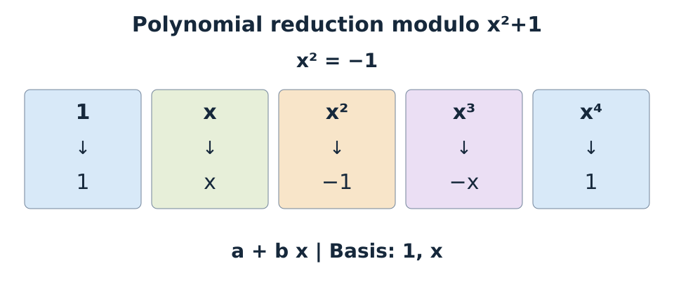

# M5-L5 – Ideals, polynomial rings and field extensions {#L5}

**Course area:** M5 – Algebra and number theory

**Level:** Bachelor’s studies · Elective / master’s bridge

**Prerequisites:** [M5-L4](M5-L4.md); [M1-L5](M1-L5.md)

**Classification:** University-level algebra extension

## Learning objectives {#S1}

You will construct quotient rings from ideals, justify the field criterion for irreducible polynomials and represent finite simple field extensions using a basis. You will distinguish the role of the base field from the form of a polynomial.

## Ideals and quotient rings {#S2}

Throughout this lesson rings are commutative with identity. An ideal $I\subseteq R$ is an additive subgroup satisfying $ri\in I$ for all $r\in R,i\in I$. The class $a+I$ consists of elements differing from $a$ by an element of $I$. Define addition and multiplication by adding and multiplying representatives. Addition is already well defined by M5-L4. For $a'=a+i,b'=b+j$, we have $a'b'-ab=aj+bi+ij\in I$. Multiplication is therefore well defined too. The resulting ring $R/I$ has identity $1+I$ (zero in the zero ring). A proper ideal cannot contain 1, since otherwise every $r=r\cdot1$ would belong to $I$.

Example: $n\mathbb Z$ is an ideal of $\mathbb Z$ and its quotient is the familiar residue ring. By contrast, $\mathbb Z\subset\mathbb Q$ is a subring but not an ideal: $1/2\cdot1\notin\mathbb Z$.

## Polynomial division and normal form {#S3}

Let $F$ be a field and $p\in F[x]$ a polynomial of positive degree $d$. For every $f\in F[x]$ there are unique $q,r$ with $f=qp+r$ and $r=0$ or $\deg r<d$. For existence, repeatedly subtract a suitable monomial multiple of $p$ to cancel the leading term and decrease the degree. The leading coefficient of $p$ is invertible. For uniqueness, two representations would imply $(q-q')p=r'-r$; a nonzero product on the left would have degree at least $d$, while the right has smaller degree. Thus the representations coincide.

The principal ideal $(p)=\{qp:q\in F[x]\}$ therefore gives a unique normal form for every class in $F[x]/(p)$: $a_0+a_1x+\dots+a_{d-1}x^{d-1}$. The classes $1,x,\dots,x^{d-1}$ form a basis over $F$, since a nonzero polynomial of smaller degree cannot be a multiple of $p$. Constants embed $F$ injectively.

## Irreducibility and the field criterion {#S4}

A polynomial of positive degree is irreducible over $F$ when it cannot be written as the product of two positive-degree polynomials in $F[x]$. If $p$ is irreducible, every $f\notin(p)$ has monic gcd 1 with $p$. Polynomial division enables the same Euclidean algorithm as for integers; back substitution yields $uf+vp=1$. Modulo $(p)$ this gives $[u][f]=[1]$. Hence every nonzero class is invertible. Conversely, if $p=ab$ with both factors of positive degree, $[a]$ and $[b]$ are nonzero (their degrees are smaller than $d$), but $[a][b]=0$. Fields have no such zero divisors. Thus $F[x]/(p)$ is a field exactly when $p$ is irreducible.

## A concrete extension of Q {#S5}

Over $\mathbb Q$, $p=x^2+1$ is irreducible because a quadratic polynomial factors exactly when it has a root, and rational squares are nonnegative. Set $\alpha=[x]$. Then $\alpha^2=-1$. Every element has a unique form $a+b\alpha$ with rational $a,b$. For two elements,

$$(a+b\alpha)(c+d\alpha)=(ac-bd)+(ad+bc)\alpha.$$

Example: $(2+3\alpha)(1-\alpha)=5+\alpha$. For $(a,b)\ne(0,0)$ the inverse is $(a-b\alpha)/(a^2+b^2)$. The extension has degree 2 and basis $1,\alpha$. It is isomorphic to $\mathbb Q(i)$, not the whole field $\mathbb C$: only rational coefficients are allowed.

{alt="Reduction of powers modulo x²+1 to the basis 1 and x."}

## Base fields and finite extensions {#S6}

Over $\mathbb C$ the same polynomial is reducible, since $x^2+1=(x-i)(x+i)$. The quotient has zero divisors. Over $\mathbb F_2$, $x^2+1=(x+1)^2$ is also reducible, but $x^2+x+1$ has neither 0 nor 1 as a root and is irreducible. Its quotient has four elements $0,1,\beta,1+\beta$, with $\beta^2=\beta+1$ and $\beta(1+\beta)=1$. In general a quotient over a finite field of $q$ elements by a degree-$d$ polynomial has exactly $q^d$ classes. If the polynomial is irreducible it is a field. The degree of a field extension is its vector-space dimension over the base field, not its number of elements. For degrees 4 and above, testing for roots alone cannot establish irreducibility: a product of two irreducible quadratics has no roots in the base field.

## Self-assessment {#S7}

### Exercises

1. Prove that the even integers form an ideal of $\mathbb Z$.
2. Reduce $x^4+2x^3+3$ modulo $x^2+1$ over $\mathbb Q$.
3. Find the inverse of $3+4\alpha$ from S5.
4. Determine $(1+\beta)^2$ in the field from S6.
5. Give nonzero zero divisors in $\mathbb Q[x]/(x^2-1)$ and explain why the quotient is not a field.

::: {.lc-solutions data-lc-section="S7"}
1. Differences of even integers are even; for any integer $r$, $r(2k)=2(rk)$ is even.
2. $x^2\equiv-1$, $x^3\equiv-x$, $x^4\equiv1$; remainder $4-2x$.
3. $(3-4\alpha)/25$; the product is $25/25=1$.
4. $1+2\beta+\beta^2=1+0+\beta+1=\beta$.
5. $[x-1]$ and $[x+1]$ are nonzero because degree 1 is less than 2. Their product is $[x^2-1]=0$, so neither has a multiplicative inverse.
:::

## Sources {#S8}

- [Bruce Ikenaga – Quotient Rings of Polynomial Rings (Millersville University)](https://sites.millersville.edu/bikenaga/abstract-algebra-1/quotient-rings-of-polynomial-rings/quotient-rings-of-polynomial-rings.html) · lines 70–97: field criterion and proof · Last accessed: 2026-11-24 · Content verified: 2026-11-24
