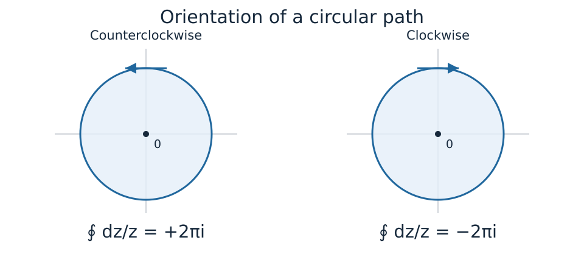

# M6-L1 – Contour integrals and Cauchy's integral formula {#L1}

**Course area:** M6 – Complex analysis

**Level:** Bachelor’s studies · Elective

**Prerequisites:** [M2-L5](M2-L5.md); [M1-L3](M1-L3.md)

**Classification:** University-level complex analysis extension

## Learning objectives {#S1}

You will parametrize complex paths, compute contour integrals directly and apply Cauchy's integral theorem and formula with verified hypotheses. You will explain how boundary values determine derivatives of holomorphic functions.

## Parametrization and orientation {#S2}

A piecewise continuously differentiable path $\gamma:[a,b]\to\mathbb C$ defines the integral of a continuous function $f$ on its trace by

$$\int_\gamma f(z)\,dz=\int_a^b f(\gamma(t))\gamma'(t)\,dt.$$

The integral on the right is evaluated componentwise over a real parameter. The directed tangent is part of the integrand; arc length alone is insufficient. Reversing orientation negates the integral, and concatenating paths adds their integrals. A regular orientation-preserving reparametrization leaves the value unchanged by substitution.

Example: Along $\gamma(t)=t(1+i)$, $0\le t\le1$, we have $\int_\gamma z\,dz=(1+i)^2/2=i$. For $f(z)=\bar z$, the same path gives $\int_0^1 2t\,dt=1$. Along the polygonal path $0\to1\to1+i$, the integral of $\bar z$ first gives $1/2$ and then $\int_0^1(1-it)i\,dt=1/2+i$. The sum $1+i$ differs from the straight-path value.

## Bounds and primitives {#S3}

If $|f(z)|\le M$ along the trace and $L=\int_a^b|\gamma'(t)|dt$ is the path length, the triangle inequality gives

$$\left|\int_\gamma f(z)\,dz\right|\le ML.$$

If a holomorphic primitive $F$ with $F'=f$ exists in an open neighborhood of the path, the chain rule gives $\int_\gamma f(z)dz=F(\gamma(b))-F(\gamma(a))$. Closed paths then yield zero. For instance, $z^2$ has the global primitive $z^3/3$. In contrast, $1/z$ has no global primitive on $\mathbb C\setminus\{0\}$: along $\gamma(t)=Re^{it}$ for $0\le t\le2\pi$, we have $\gamma'/\gamma=i$, giving $2\pi i$. Clockwise traversal yields $-2\pi i$.

{alt="Positively and negatively oriented circular paths around 0."}

## Integral theorem and domain hypotheses {#S4}

One form of Cauchy's integral theorem states that if $f$ is holomorphic on a simply connected domain $D$, its integral along every closed piecewise smooth path in $D$ vanishes. For a simple closed contour, holomorphy on an open neighborhood of the contour and its enclosed region suffices. This theorem is a deeper analytic result than the chain rule alone; we use it as an established theorem here. On a domain with a hole, holomorphy along the path alone is insufficient, as $1/z$ in S3 shows. On a circle of radius 1 centered at 0, however, the integral of $1/(z-2)$ is zero because its singularity lies outside.

## Cauchy's integral formula {#S5}

Let $\gamma$ be a simple, positively (counterclockwise) oriented, closed piecewise smooth contour and $f$ holomorphic on an open neighborhood of its closed enclosed region. For an interior point $c$,

$$f(c)=\frac1{2\pi i}\int_\gamma\frac{f(z)}{z-c}\,dz.$$

Justification: remove a small disk around $c$ from the interior. The integrand is holomorphic on the remaining region; the integral theorem for its boundary (outer positive, inner negative orientation, obtainable by subdivision) equates the outer integral with the positively oriented small-circle integral. Substituting $z=c+\rho e^{it}$ turns it into $i\int_0^{2\pi}f(c+\rho e^{it})dt$. Continuity at $c$ permits the limit $\rho\to0$, giving $2\pi i f(c)$. The interior point must not lie on the contour. If it is outside, the integrand is holomorphic on the closed enclosed region and the integral vanishes. Reversing orientation changes the sign.

Example: On counterclockwise $|z|=2$, $\int_\gamma (z^2+1)/(z-i)\,dz=2\pi i(i^2+1)=0$. The zero comes from a removable singularity, not an exterior point.

## Derivative formula and Cauchy estimate {#S6}

Differentiation with respect to $c$ under the integral is locally valid: in a small neighborhood of $c$, the distance to the compact trace stays positive, ensuring uniform convergence of the relevant difference quotients. Repetition gives, for $n\ge0$,

$$f^{(n)}(c)=\frac{n!}{2\pi i}\int_\gamma\frac{f(z)}{(z-c)^{n+1}}\,dz.$$

For a circle centered at $c$ with radius $R$ and $|f|\le M$ on that circle, S3 yields $|f^{(n)}(c)|\le n!M/R^n$. If $f$ is holomorphic throughout $\mathbb C$ and globally bounded, taking $n=1$ and $R\to\infty$ gives $f'=0$ everywhere, so $f$ is constant (Liouville's theorem). Example: On $|z|=3$, the counterclockwise integral of $e^z/(z-1)^3$ is $2\pi i e/2!=\pi i e$.

## Self-assessment {#S7}

### Exercises

1. Integrate $z^2$ along the straight segment from 0 to $1+i$.
2. Integrate $1/z$ along $z(t)=2e^{-it}$, $0\le t\le2\pi$.
3. Compute $\int_{|z|=2}(z+1)/(z-1)\,dz$ counterclockwise.
4. Compute $\int_{|z|=2}z^4/(z-1)^3\,dz$ counterclockwise.
5. Suppose $|f|\le9$ on $|z-c|=3$ and $f$ is holomorphic on a neighborhood of the closed disk. Bound $|f''(c)|$.

::: {.lc-solutions data-lc-section="S7"}
1. Primitive $z^3/3$; result $(-2+2i)/3$.
2. $\gamma'/\gamma=-i$; result $-2\pi i$.
3. $2\pi i(1+1)=4\pi i$.
4. The second derivative of $z^4$ at 1 is 12; integral $2\pi i\cdot12/2!=12\pi i$.
5. $2!\cdot9/3^2=2$.
:::

## Sources {#S8}

- [Alan Reynolds – The Cauchy formula and power series](https://alan-reynolds.quarto.pub/introduction-to-complex-analysis/power.html) · §7.1–7.2 · Last accessed: 2026-11-24 · Content verified: 2026-11-24
