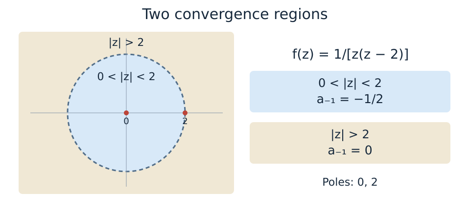

# M6-L2 – Laurent series, poles and residue theorem {#L2}

**Course area:** M6 – Complex analysis

**Level:** Bachelor’s studies · Elective

**Prerequisites:** [M6-L1](M6-L1.md); [M1-L2](M1-L2.md)

**Classification:** University-level complex analysis extension

## Learning objectives {#S1}

You will expand Laurent series on appropriate annuli, classify isolated singularities, calculate residues including at higher-order poles and evaluate closed integrals using the residue theorem. You will distinguish local singularities from global convergence boundaries.

## Laurent expansion and convergence region {#S2}

If $f$ is holomorphic on $r<|z-c|<R$, $0\le r<R\le\infty$, it has a unique Laurent expansion there:

$$f(z)=\sum_{n=-\infty}^{\infty}a_n(z-c)^n,\qquad a_n=\frac1{2\pi i}\int_{|\zeta-c|=\rho}\frac{f(\zeta)}{(\zeta-c)^{n+1}}\,d\zeta$$

for any $r<\rho<R$, with positive circle orientation. The series is interpreted as the sum of two series (nonnegative and negative powers). It converges absolutely and locally uniformly on the annulus. Laurent's theorem follows from Cauchy's formula on an annular region with two boundary circles and geometric expansions of the Cauchy kernel: the inner circle $|\zeta-c|<|z-c|$ produces negative powers, the outer circle $|\zeta-c|>|z-c|$ nonnegative powers. The geometric series converge uniformly on the respective integration circles. Uniqueness follows by termwise integration on an intermediate circle, since only the appropriate power contributes a nonzero integral.

## Two series of the same function {#S3}

Consider $f(z)=1/[z(z-2)]$ centered at $c=0$. For $0<|z|<2$,

$$f(z)=-\frac1{2z}\frac1{1-z/2}=-\sum_{k=0}^\infty\frac{z^{k-1}}{2^{k+1}}.$$

For $|z|>2$, instead,

$$f(z)=\frac1{z^2}\frac1{1-2/z}=\sum_{k=0}^\infty 2^k z^{-k-2}.$$

The first expansion has coefficient $a_{-1}=-1/2$, the outer one $a_{-1}=0$. This does not contradict uniqueness because the annuli differ. The outer coefficient is not the local residue at 0; it captures the integral around both poles. On $|z|=2$ the stated geometric expansions do not hold. The singularity at $z=2$ prevents a single Laurent series centered at 0 from spanning both annular regions.

{alt="Convergence regions and Laurent coefficient of power minus one."}

## Isolated singularities {#S4}

Suppose $f$ is holomorphic on $0<|z-c|<R$. The principal part of its local Laurent series contains the negative powers. If it vanishes, the singularity is removable and the extension takes value $a_0$ (example: $(e^z-1)/z$ at 0). If it ends at $a_{-m}\ne0$, $m\ge1$, there is a pole of order $m$ (example: $\cos z/z^2$ at 0). If infinitely many principal-part coefficients are nonzero, the singularity is essential (example: $e^{1/z}$ at 0). A zero residue does not rule out a pole, as $1/z^2$ shows. An accumulation of singularities, such as the poles of $1/\sin(1/z)$ near 0, does not define an isolated singularity at 0 and is outside this classification.

## Calculating residues {#S5}

The residue at an isolated singularity is coefficient $a_{-1}$ of the local Laurent series. At a simple pole, $\operatorname{Res}(f,c)=\lim_{z\to c}(z-c)f(z)$. If $f=g/h$ with holomorphic $g,h$, $h(c)=0$, $h'(c)\ne0$ and $g(c)\ne0$, then $h(z)=(z-c)(h'(c)+O(z-c))$ gives the formula $g(c)/h'(c)$. At a pole of order $m$, $G(z)=(z-c)^mf(z)$ extends holomorphically and the residue is $G^{(m-1)}(c)/(m-1)!$. This follows by expanding $G$ in its Taylor series and dividing by $(z-c)^m$.

Example: For $e^z/z^3$, $G=e^z$ and $m=3$, so the residue is $1/2$. For $1/[z(z-2)]$, the residues at 0 and 2 are $-1/2$ and $1/2$ respectively.

## Residue theorem and applications {#S6}

Let $\gamma$ be a simple positively oriented closed piecewise smooth contour. Suppose $f$ is holomorphic in an open neighborhood of its closed enclosed region except for finitely many isolated singularities $c_j$ in the interior; none lies on the trace. Then

$$\int_\gamma f(z)\,dz=2\pi i\sum_j\operatorname{Res}(f,c_j).$$

Justification: remove disjoint small disks around the singularities. The integral theorem on the remaining region equates the outer integral with the sum of positively oriented small-circle integrals. On each circle, uniform convergence permits termwise integration of the Laurent series; the integral of $(z-c_j)^n$ is zero for integer $n\ne-1$ and $2\pi i$ for $n=-1$. For more general suitable closed paths, residues are weighted by the corresponding winding numbers; here we restrict attention to simple contours. A pole on the contour calls for a different treatment, not direct substitution into the theorem.

Example: The counterclockwise integral of $1/[z(z-2)]$ on $|z|=1$ is $-\pi i$, while on $|z|=3$ it is zero. A further application: for $f(z)=1/(1+z^2)$ on the upper semicircle of radius $R>1$ and diameter from $-R$ to $R$, only the pole $i$ is enclosed, with residue $1/(2i)$. The arc has length $\pi R$ and $|f|\le1/(R^2-1)$. Its integral vanishes as $R\to\infty$; hence $\int_{-\infty}^\infty dx/(1+x^2)=\pi$.

## Self-assessment {#S7}

### Exercises

1. Expand $1/[z(z-3)]$ for $0<|z|<3$ and for $|z|>3$.
2. Classify $\sin z/z$, $1/z^4$ and $\sin(1/z)$ at 0.
3. Calculate the residue of $e^{2z}/z^3$ at 0.
4. Integrate $1/(z^2-1)$ on $|z-1|=1/2$ and on $|z|=2$, both counterclockwise.
5. Explain why the residue theorem cannot be applied directly to $1/(z-1)$ on $|z|=1$.

::: {.lc-solutions data-lc-section="S7"}
1. Inner annulus: $-\sum_{k\ge0} z^{k-1}/3^{k+1}$; outer annulus: $\sum_{k\ge0}3^k z^{-k-2}$.
2. Removable with extension value 1; fourth-order pole; essential because infinitely many negative odd powers occur.
3. $G''(0)/2!=4/2=2$.
4. Residue at 1: $1/2$, at $-1$: $-1/2$. First integral $\pi i$, second zero.
5. The pole at $z=1$ lies on the trace; the ordinary integrand is undefined there. A principal value would be a separately defined quantity.
:::

## Sources {#S8}

- [NIST DLMF – Functions of a Complex Variable](https://dlmf.nist.gov/1.10) · §1.10(iii)–(iv) · Last accessed: 2026-11-24 · Content verified: 2026-11-24
- [Alan Reynolds – Singularities and the Residue Theorem](https://alan-reynolds.quarto.pub/introduction-to-complex-analysis/singularities.html) · §8.1–8.3 · Last accessed: 2026-11-24 · Content verified: 2026-11-24
