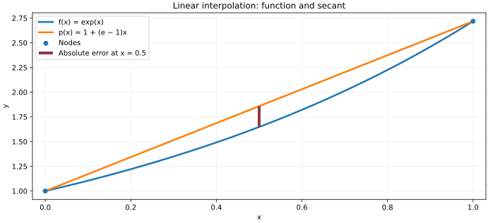

# M7-L1 – Interpolation and approximation {#L1}

**Course area:** M7 – Numerical analysis and optimisation

**Level:** Bachelor’s studies · Elective

**Prerequisites:** [M1-L2](M1-L2.md); [M1-L3](M1-L3.md); [M1-L6](M1-L6.md)

**Classification:** Numerical extension of the common bachelor core

## Learning objectives {#S1}

You construct an interpolating polynomial, derive an error bound, and distinguish approximation error, data error and roundoff. You decide when a fitting model is preferable to exact interpolation.

## Existence, uniqueness and the Lagrange basis {#S2}

Let $x_0,\dots,x_n$ be distinct real nodes with values $y_i$. We seek $p\in\mathcal P_n$, a polynomial of degree at most $n$, satisfying $p(x_i)=y_i$. Define

$$L_i(x)=\prod_{j\ne i}\frac{x-x_j}{x_i-x_j},\qquad p(x)=\sum_{i=0}^n y_iL_i(x).$$

Since $L_i(x_j)=\delta_{ij}$, $p$ meets all conditions. The difference of two solutions would have degree at most $n$ and $n+1$ distinct roots, so it must vanish identically. This proves existence and uniqueness.

Example: The points $(-1,1),(0,0),(2,4)$ are values of $x^2$. The unique solution is therefore $p=x^2$, even without expanding the products. For $(0,1),(1,2),(2,5)$ the answer is $p=1+x^2$. For repeated evaluation a barycentric representation is usually preferable to the direct product form; the implementation below is intended for small examples.

```python
from math import prod

def lagrange(xs, ys, x):
    if not xs or len(xs) != len(ys) or len(set(xs)) != len(xs):
        raise ValueError("distinct nodes and matching data required")
    return sum(yi * prod((x-xj)/(xi-xj)
                        for j, xj in enumerate(xs) if j != i)
               for i, (xi, yi) in enumerate(zip(xs, ys)))

assert abs(lagrange([0, 1, 2], [1, 2, 5], 1.5)-3.25) < 1e-12
```

## Error formula and proof {#S3}

If $f\in C^{n+1}([a,b])$ and all nodes and $x$ are in the interval, then for some intermediate point $\xi\in(a,b)$ (on the common convex hull of the nodes and $x$ if $x$ is outside the nodes),

$$f(x)-p(x)=\frac{f^{(n+1)}(\xi)}{(n+1)!}\prod_{i=0}^n(x-x_i).$$

At nodes the error is immediately zero. Otherwise define $\omega(t)=\prod_i(t-x_i)$ and $c=(f(x)-p(x))/\omega(x)$. The function $g=f-p-c\omega$ has $n+2$ distinct zeros. Repeated application of Rolle's theorem yields $g^{(n+1)}(\xi)=0$. Since $p^{(n+1)}=0$ and $\omega^{(n+1)}=(n+1)!$, the formula follows. With $M=\max_{[a,b]}|f^{(n+1)}|$, an upper bound is $M|\omega(x)|/(n+1)!$.

For $f(x)=x^3$ with nodes $-1,0,1$, $p=x$, and the formula gives exactly $x^3-x=x(x-1)(x+1)$. For linear interpolation of $e^x$ between 0 and 1, the bound at $x=1/2$ is $e/8$. The actual absolute error $(1+e)/2-\sqrt e\approx0.2104$ is smaller.

{alt="Exponential function and linear interpolant with midpoint error."}

## Conditioning, nodes and extrapolation {#S4}

Increasing the polynomial degree with equally spaced nodes does not guarantee uniform convergence. The Runge function $1/(1+25x^2)$ on $[-1,1]$ exhibits oscillations near the endpoints. The roots of the Chebyshev polynomial $T_{n+1}$, namely $x_i=\cos((2i+1)\pi/(2n+2))$, cluster near the endpoints and reduce the maximum magnitude of the monic node polynomial. This improves error control when the derivative bound is suitable. Alternatively, subdivide the interval and use low-degree piecewise polynomials.

If data are perturbed by $|\Delta y_i|\le\varepsilon$, then $|\Delta p(x)|\le\varepsilon\sum_i|L_i(x)|$. This amplification describes conditioning with respect to the data, independently of implementation. Roundoff is an additional computational error. Outside the data interval both the node product and amplification can grow: extrapolation needs a justified modelling assumption, not merely a formula.

## Fitting rather than interpolation {#S5}

For noisy measurements it may be undesirable to pass through every data point. Least squares fits the line $a+bx$ by minimising $\sum_i(a+bx_i-y_i)^2$. Derivatives with respect to $a,b$ give $ma+b\sum x_i=\sum y_i$ and $a\sum x_i+b\sum x_i^2=\sum x_iy_i$ for $m$ measurements. When the $x_i$ are not all equal the solution is unique. For $(0,1),(1,3),(2,2)$, $b=1/2$, $a=3/2$. The residuals (model minus data) are $1/2,-1,1/2$; their squared sum is $3/2$. A quadratic interpolant would have zero residuals, but this does not imply better predictions. For larger problems QR factorisation or SVD is often numerically preferable to explicitly forming normal equations.

## Self-assessment {#S6}

### Exercises

1. Find the interpolating polynomial for $(0,2),(1,3),(2,6)$.
2. Prove uniqueness for four distinct nodes.
3. Interpolate $x^3$ at $0,1,2$ and find the error at $x=1/2$.
4. Bound the midpoint error for linear interpolation of $\sin x$ on $[0,\pi/2]$.
5. Find the least-squares line for $(0,0),(1,2),(2,1)$ and explain why it does not interpolate.

::: {.lc-solutions data-lc-section="S6"}
1. $p(x)=2+x^2$.
2. The difference has degree at most 3 and four distinct roots, so it vanishes.
3. $p=3x^2-2x$, error $x(x-1)(x-2)=3/8$ at $1/2$.
4. $|f''|\le1$, hence $\pi^2/32$.
5. $a=1/2,b=1/2$; predictions $1/2,1,3/2$ do not match every data point.
:::

## Sources {#S7}

- [Driscoll/Braun – Fundamentals of Numerical Computation](https://tobydriscoll.net/fnc-julia/globalapprox/polynomial.html) · §9.1 · Last accessed: 2026-11-24 · Content verified: 2026-11-24
