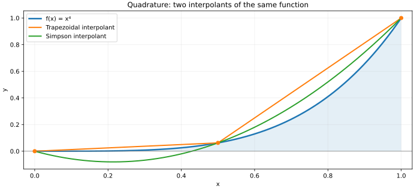

# M7-L2 – Numerical quadrature and error estimation {#L2}

**Course area:** M7 – Numerical analysis and optimisation

**Level:** Bachelor’s studies · Elective

**Prerequisites:** [M1-L3](M1-L3.md); [M7-L1](M7-L1.md)

**Classification:** Numerical extension of the common bachelor core

## Learning objectives {#S1}

You derive quadrature rules from polynomial interpolation, apply composite trapezoidal and Simpson rules, determine error bounds and construct the two-node Gaussian rule. You distinguish polynomial exactness, order of accuracy and actual computational error.

## Quadrature from interpolation {#S2}

Quadrature approximates $I=\int_a^b f(x)\,dx$ by weighted function values $Q=\sum_i w_if(x_i)$. Integrating the Lagrange interpolant yields weights $w_i=\int_a^b L_i(x)\,dx$. With two endpoints the interpolant is linear; integration gives $T=(b-a)(f(a)+f(b))/2$. For three equally spaced nodes $a,m=(a+b)/2,b$, integration of the quadratic basis produces Simpson's rule $S=(b-a)(f(a)+4f(m)+f(b))/6$.

Simpson's rule is even exact for cubic polynomials: after shifting to the symmetric interval $[-h,h]$, the odd monomials $x$ and $x^3$ integrate to zero both exactly and by the symmetric rule. Monomials 1 and $x^2$ are exact by construction. This no longer holds for $x^4$.

{alt="Trapezoidal and Simpson interpolants for x to the fourth power on the unit interval."}

## Composite rules and error bounds {#S3}

For $n\ge1$, $h=(b-a)/n$ and $x_i=a+ih$, the composite trapezoidal rule is

$$T_n=h\left(\frac{f(x_0)+f(x_n)}2+\sum_{i=1}^{n-1}f(x_i)\right).$$

For even $n\ge2$ the composite Simpson rule is

$$S_n=\frac h3\left(f(x_0)+f(x_n)+4\sum_{i\ \mathrm{odd}}f(x_i)+2\sum_{\substack{0<i<n\\i\ \mathrm{even}}}f(x_i)\right),$$

where the odd sum includes only interior nodes. Assuming $f\in C^2([a,b])$ and $f\in C^4([a,b])$, respectively, the bounds are

$$|I-T_n|\le\frac{b-a}{12}h^2\max|f''|,\qquad |I-S_n|\le\frac{b-a}{180}h^4\max|f^{(4)}|.$$

The first bound follows by integrating the linear interpolation remainder on each subinterval: $\int_0^h t(h-t)\,dt=h^3/6$. For Simpson one may apply the error operator $E=I-S$ on $[-h,h]$ to Taylor's formula with fourth-order integral remainder. It annihilates polynomials through degree 3; its Peano kernel is $K(t)=E[(x-t)_+^3/6]$. For $0\le t\le h$ one obtains $K(t)=-(h-t)^3(h+3t)/72$, and for negative $t$, $K(-t)=K(t)$ by symmetry and polynomial exactness. The kernel is nonpositive and $\int K=-h^5/90$. Thus the error on a pair of subintervals is at most $h^5\max|f^{(4)}|/90$. Summing over $n/2$ pairs yields the stated bound.

## Gauss–Legendre quadrature {#S4}

Gauss–Legendre quadrature optimises the nodes as well. On $[-1,1]$ seek a symmetric rule with nodes $\pm c$ and equal weight $w$. Exactness for 1 requires $2w=2$, so $w=1$. For $x^2$ we get $2c^2=2/3$, hence $c=1/\sqrt3$. Odd monomials through degree 3 are integrated exactly by symmetry. Therefore

$$\int_{-1}^1 f(x)\,dx\approx f(-1/\sqrt3)+f(1/\sqrt3).$$

On a general $[a,b]$ set $m=(a+b)/2$, $d=(b-a)/2$; the approximation is $d[f(m-d/\sqrt3)+f(m+d/\sqrt3)]$. The general $k$-node Gauss–Legendre rule uses the roots of the Legendre polynomial $P_k$ and is exact for polynomials of degree at most $2k-1$. For $x^4$ on $[-1,1]$, the two-node rule gives $2/9$ instead of $2/5$. Exactness for low degrees thus does not imply zero error for arbitrary functions.

## Convergence experiment and limitations {#S5}

For $f=x^4$ on $[0,1]$, $I=1/5$. With $n=2$ we obtain $T_2=9/32$, $S_2=5/24$, and with $n=4$, $S_4=77/384$. The Simpson errors have ratio exactly $16:1$. The following code permits further experiments.

```python
def quadrature(f, a, b, n, simpson=False):
    if n < 1 or (simpson and n % 2):
        raise ValueError("positive n, even for Simpson")
    h = (b-a)/n
    y = [f(a+i*h) for i in range(n+1)]
    if simpson:
        return h/3*(y[0]+y[-1]+sum((4 if i%2 else 2)*y[i]
                                    for i in range(1,n)))
    return h*((y[0]+y[-1])/2+sum(y[1:-1]))

for n in (2, 4, 8, 16):
    print(n, abs(quadrature(lambda x: x**4, 0, 1, n, True)-0.2))
```

With sufficient smoothness and in the asymptotic regime, halving $h$ typically reduces errors by factors 4 and 16, respectively. This need not occur if the leading error term vanishes or roundoff dominates. When the true value is unknown and the expansion $I-Q_h=Ch^p+o(h^p)$ holds, the difference $|Q_{h/2}-Q_h|/(2^p-1)$ estimates the finer error. Such an estimator is not a guaranteed bound without further assumptions. Singularities and jumps require adapted methods; simply doubling the number of nodes is not proof of reliable accuracy.

## Self-assessment {#S6}

### Exercises

1. Compute $T_2$ and $S_2$ for $x^2$ on $[0,1]$.
2. Find a Simpson error bound for $e^x$ on $[0,1]$ with $n=4$.
3. Apply two-node Gaussian quadrature to $x^3+2x^2+1$ on $[-1,1]$.
4. Show that two-node Gaussian quadrature integrates $x^2$ on $[0,2]$ exactly.
5. A Simpson computation gives $Q_h=1.0024$ and $Q_{h/2}=1.00015$. Estimate the finer error assuming fourth order.

::: {.lc-solutions data-lc-section="S6"}
1. $T_2=3/8$, $S_2=1/3$.
2. $e/(180\cdot4^4)=e/46080$.
3. $2+4/3=10/3$; the odd term vanishes.
4. $m=d=1$; $(1-1/\sqrt3)^2+(1+1/\sqrt3)^2=8/3$.
5. $0.00225/15=0.00015$; this is an estimate under the stated assumption.
:::

## Sources {#S7}

- [Driscoll/Braun – Fundamentals of Numerical Computation](https://tobydriscoll.net/fnc-julia/localapprox/integration.html) · §5.6 · Last accessed: 2026-11-24 · Content verified: 2026-11-24
- [NIST DLMF – Quadrature](https://dlmf.nist.gov/3.5) · §3.5(v) · Last accessed: 2026-11-24 · Content verified: 2026-11-24
