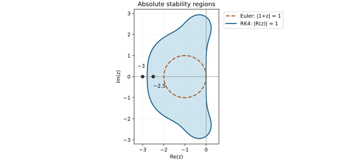

# M7-L3 – Runge–Kutta methods and numerical stability {#L3}

**Course area:** M7 – Numerical analysis and optimisation

**Level:** Bachelor’s studies · Elective

**Prerequisites:** [M1-L9](M1-L9.md); [M1-L8](M1-L8.md)

**Classification:** Numerical extension of the common bachelor core

## Learning objectives {#S1}

You compute a classical Runge–Kutta step, distinguish local and global error orders, derive the stability function on a linear test equation and explain why stiff problems may require specialised integrators.

## One-step methods and RK4 {#S2}

Consider $y'=f(t,y)$, $y(t_0)=y_0$, with a sufficiently smooth right-hand side. For a step of length $h>0$, Euler approximates $y_{n+1}=y_n+hf(t_n,y_n)$. Explicit Runge–Kutta methods use several slopes within the same step. The classical four-stage method is

$$\begin{aligned}k_1&=f(t_n,y_n),\\ k_2&=f(t_n+h/2,y_n+hk_1/2),\\ k_3&=f(t_n+h/2,y_n+hk_2/2),\\ k_4&=f(t_n+h,y_n+hk_3),\\ y_{n+1}&=y_n+h(k_1+2k_2+2k_3+k_4)/6.\end{aligned}$$

The $k_i$ are slopes, not increments already multiplied by $h$. The middle stages use different state estimates. The method is explicit: each stage depends only on previous stages. Example: $y'=y$, $y_0=1$, $h=1/2$. The slopes are $1,5/4,21/16,53/32$. The new value is $211/128=1.6484375$, whereas $e^{1/2}\approx1.6487213$.

## Local defect and global order {#S3}

For a method of order $p$, the unscaled local defect starting from the exact value is $O(h^{p+1})$. The global error on a fixed time interval is $O(h^p)$ under suitable smoothness and Lipschitz assumptions. RK4 has $p=4$ and Euler has $p=1$. To justify propagation, write the step as $\Phi_h(t,y)$. If $|\Phi_h(t,u)-\Phi_h(t,v)|\le(1+Lh)|u-v|$ and the local defect is bounded by $Ch^{p+1}$, the error $e_n=|y(t_n)-y_n|$ satisfies $e_{n+1}\le(1+Lh)e_n+Ch^{p+1}$. Iterating with $e_0=0$ gives the bound $Ch^p(e^{L(t_n-t_0)}-1)/L$ for $L>0$; for $L=0$ it gives $C(t_n-t_0)h^p$. Fourth order for general smooth $f$ follows by matching Taylor expansions of the stages through degree four (not fully derived here). For $y'=\lambda y$ it can be seen directly from the stability polynomial. A linear test alone does not prove general order.

## Absolute stability and stiffness {#S4}

For $y'=\lambda y$, $z=h\lambda$, the exact amplification is $e^z$. Substitution into the four stages gives $y_{n+1}=R(z)y_n$, where

$$R(z)=1+z+z^2/2+z^3/6+z^4/24.$$

Thus $y_n=R(z)^ny_0$. Values remain bounded when $|R(z)|\le1$ and decay when $|R(z)|<1$. Euler has $R_E(z)=1+z$ and the stability disk $|z+1|\le1$. Along the negative real axis RK4 extends from approximately $-2.7853$ to 0, while Euler extends only from $-2$ to 0. At the boundary, boundedness is not decay. The RK4 boundary follows from $R(-r)=1$, hence $r^3-4r^2+12r-24=0$ for $r>0$; this polynomial is strictly increasing. Indeed $24R(-r)=(r^2-2r)^2+8(r-3/2)^2+6>0$.

{alt="Stability regions of Euler and RK4 with test points −3 and −2.5."}

For $\lambda=-100$, $h=0.03$, we have $z=-3$; RK4 amplifies by $11/8>1$ although the exact solution decays. At $h=0.025$, $z=-2.5$ lies inside the RK4 region but outside Euler's. Stability does not guarantee accuracy. A stiff system such as $u'=-u$, $v'=-1000v$ has widely separated time scales. Even after the fast component has become small, it can restrict explicit step sizes. Backward Euler has $R_B(z)=1/(1-z)$ and is absolutely stable for $\operatorname{Re}z\le0$ (A-stable); for very negative real $z$, $R_B$ tends to zero. The cost is generally an implicit system of equations to solve.

## Experiment and method selection {#S5}

```python
from math import exp

def rk4(f, t, y, h):
    k1 = f(t, y)
    k2 = f(t+h/2, y+h*k1/2)
    k3 = f(t+h/2, y+h*k2/2)
    k4 = f(t+h, y+h*k3)
    return y+h*(k1+2*k2+2*k3+k4)/6

def solve(f, a, b, y, n):
    if n < 1 or b <= a:
        raise ValueError("positive step count and interval required")
    h = (b-a)/n
    for i in range(n):
        y = rk4(f, a+i*h, y, h)
    return y

for n in (10, 20, 40, 80):
    print(n, abs(solve(lambda t,y: y, 0, 1, 1, n)-exp(1)))
```

On $[0,1]$ with $y'=y$, the ratio of endpoint errors approaches 16 as the step is halved. For very small steps, roundoff may dominate. A local error estimator compares one step of length $h$ with two half steps. For a smooth solution and a leading defect term of order $h^5$, the magnitude of their difference divided by 15 estimates the local error of the two half steps. This is not a global error guarantee. Practical applications often use embedded RK methods with adaptive step control; stiff problems favour suitable implicit solvers. In addition to tolerances, check model error, events, singularities and conserved quantities.

## Self-assessment {#S6}

### Exercises

1. Compute one RK4 step for $y'=2$, $y_0=3$, $h=1/4$.
2. Derive $R(z)$ from the four stages for $y'=\lambda y$.
3. Check Euler and RK4 for decay at $z=-5/2$.
4. For $\lambda=-1000$, estimate the maximum RK4 step for boundedness.
5. Explain global order four from a local defect $O(h^5)$ and a Lipschitz bound for the step.

::: {.lc-solutions data-lc-section="S6"}
1. All slopes equal 2; $y_1=7/2$.
2. $hk_1=zy$, $hk_2=z(1+z/2)y$, $hk_3=z(1+z/2+z^2/4)y$, $hk_4=z(1+z+z^2/2+z^3/4)y$. Their weighted sum gives the polynomial.
3. Euler: $|-3/2|>1$. RK4: $R(-5/2)=83/128<1$ and positive; only RK4 decays.
4. $h\le 2.7853/1000\approx0.0027853$; strictly below for decay, with $h>0$.
5. The error recursion sums $O(1/h)$ local defects with amplification factors bounded on the fixed time interval. Hence $O(h^4)$.
:::

## Sources {#S7}

- [Driscoll/Braun – Fundamentals of Numerical Computation](https://tobydriscoll.net/fnc-julia/ivp/rk.html) · §6.4 · Last accessed: 2026-11-24 · Content verified: 2026-11-24
- [Driscoll/Braun – Fundamentals of Numerical Computation](https://tobydriscoll.net/fnc-julia/diffusion/absstab-diffusion.html) · §11.3 · Last accessed: 2026-11-24 · Content verified: 2026-11-24
