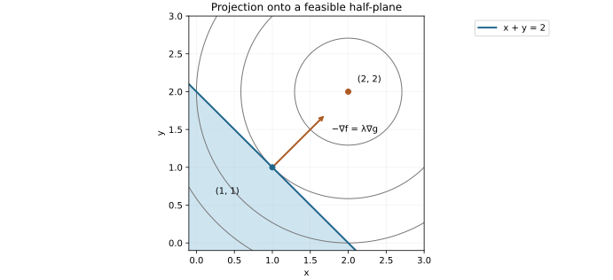

# M7-L4 – KKT conditions and active constraints {#L4}

**Course area:** M7 – Numerical analysis and optimisation

**Level:** Master’s orientation · Advanced specialisation

**Prerequisites:** [M1-L4](M1-L4.md); [M3-L6](M3-L6.md)

**Classification:** Master-level specialisation

## Learning objectives {#S1}

You formulate the Karush–Kuhn–Tucker (KKT) conditions for smooth optimisation problems, determine active constraints and multipliers, prove global optimality in the convex case and recognise when KKT neither certifies optimality nor provides a necessary condition.

## Lagrangian and KKT system {#S2}

Consider minimising a differentiable function $f:\mathbb R^n\to\mathbb R$ subject to differentiable constraints $g_i(x)\le0$ ($i=1,\dots,m$) and $a_j(x)=0$ ($j=1,\dots,q$). The sign convention determines the Lagrangian

$$\mathcal L(x,\lambda,\nu)=f(x)+\sum_i\lambda_i g_i(x)+\sum_j\nu_j a_j(x).$$

The four KKT conditions are:

- Primal feasibility: $g_i(x)\le0$, $a_j(x)=0$.
- Dual feasibility: $\lambda_i\ge0$; the $\nu_j$ are unrestricted.
- Stationarity: $\nabla f(x)+\sum_i\lambda_i\nabla g_i(x)+\sum_j\nu_j\nabla a_j(x)=0$.
- Complementary slackness: $\lambda_i g_i(x)=0$ for each $i$.

An inequality is active when $g_i(x)=0$. A strictly inactive constraint necessarily has $\lambda_i=0$. Conversely, an active constraint may have a zero multiplier. Geometrically, at a regular minimum the negative objective gradient lies in the cone of active inequality gradients plus the linear span of equality gradients.

## Active sets and worked example {#S3}

Minimise $f(x,y)=((x-2)^2+(y-2)^2)/2$ subject to $g=x+y-2\le0$. The unconstrained minimiser $(2,2)$ is infeasible. If the constraint is active, $x+y=2$. Stationarity gives $x-2+\lambda=0$, $y-2+\lambda=0$; hence $x=y=1$ and $\lambda=1$. All four conditions hold. The objective value is 1. The Hessian of $f$ is the identity matrix; the problem is strictly convex with an affine constraint, so this is the unique global minimum.

{alt="Level curves, feasible half-plane and negative objective gradient at the optimum."}

More generally, for $f=((x-a)^2+(y-b)^2)/2$ and $x+y\le c$, case analysis gives $\lambda=\max(0,(a+b-c)/2)$, $x=a-\lambda$, $y=b-\lambda$. When $a+b=c$, the constraint is active but $\lambda=0$. This illustrates an active-set strategy: assume an active set, solve the equations and discard candidates with negative dual variables or violated primal constraints. Naive enumeration is expensive when many constraints are present.

## Necessity and sufficiency {#S4}

At a local minimum, KKT conditions are necessary under a suitable constraint qualification. One sufficient qualification is LICQ: the gradients of equalities and all active inequalities are linearly independent. Without regularity, existence of multipliers is not assured.

For convex differentiable $f,g_i$ and affine $a_j$, however, satisfaction of KKT is sufficient for global optimality without an additional constraint qualification. For fixed feasible multipliers, $\mathcal L$ is convex in $x$. Stationarity makes $x^*$ a global minimiser of $\mathcal L$. For every primal feasible point $z$, because $\lambda_i\ge0$ and $g_i(z)\le0$,

$$f(z)\ge\mathcal L(z,\lambda,\nu)\ge\mathcal L(x^*,\lambda,\nu)=f(x^*).$$

The final equality follows from complementary slackness and the equality constraints. For convex problems on $\mathbb R^n$ with a finite attained optimum, a strictly feasible point ($g_i<0$, all equalities satisfied; Slater's condition) ensures existence of suitable multipliers. In this case KKT is necessary and sufficient. Strict convexity of $f$ ensures uniqueness of an existing minimiser, but not necessarily uniqueness of multipliers.

## Counterexamples and numerical checks {#S5}

Nonconvex example: minimise $-x^2$ subject to $x^2-1\le0$. The point $x=0$, $\lambda=0$ satisfies KKT but is a strict local maximum; the global minima lie at $x=\pm1$. Failed regularity: minimise $f=x$ subject to $x^2\le0$. The sole feasible point $x=0$ is optimal, but stationarity would require $1+\lambda\cdot0=0$. No multiplier exists. Slater and LICQ fail.

```python
def project_halfplane(a, b, c):
    # x+y <= c
    lam = max(0, (a+b-c)/2)
    return a-lam, b-lam, lam

x, y, lam = project_halfplane(2, 2, 2)
assert (x, y, lam) == (1, 1, 1)
assert x+y <= 2 and lam >= 0 and lam*(x+y-2) == 0
```

In numerical optimisation, measure residuals separately: maximum inequality violation $\max_i\max(0,g_i)$, equality norm, maximum negative dual component, stationarity norm and maximum absolute complementarity product. Empty sets contribute zero. Small residuals depend on tolerances and scaling, and are not a global optimality certificate for nonconvex problems. In the convex case, a rigorous dual bound can additionally bound the objective gap. For the projection example with variable bound $c$, the optimal value is $v(c)=(\max(0,a+b-c))^2/4$; its derivative is $-\lambda$. Here this sensitivity result follows immediately from the explicit formula and should not be generalised without assumptions.

## Self-assessment {#S6}

### Exercises

1. Minimise $(x-3)^2/2$ subject to $x\le1$ and find the multiplier.
2. Solve the projection for $a=1,b=0,c=3$; is the constraint active?
3. Solve it for $a=1,b=2,c=3$; what does the multiplier show?
4. Show that $x=0$ is not a KKT point when minimising $x$ subject to $x^2\le0$.
5. Prove that any KKT point of a convex problem is globally optimal and state the assumptions.

::: {.lc-solutions data-lc-section="S6"}
1. $x=1$, $\lambda=2$; $x-3+\lambda=0$ and complementary slackness.
2. $(x,y)=(1,0)$, $\lambda=0$; $g=-2$, inactive.
3. $(1,2)$, $\lambda=0$; an active constraint with zero multiplier.
4. The constraint gradient vanishes; $1+2\lambda x=1$ cannot vanish at $x=0$.
5. Convex differentiable objective and inequalities, affine equalities, primal and dual feasibility, stationarity and complementarity. The convex Lagrangian attains a minimum at $x^*$ and is no larger than $f(z)$ for all feasible $z$; at $x^*$ it equals $f(x^*)$.
:::

## Sources {#S7}

- [Stanford EE364A – Stephen Boyd, Convex Optimization I](https://see.stanford.edu/materials/lsocoee364a/transcripts/ConvexOptimizationI-Lecture09.html) · Lecture 9, KKT and Slater · Last accessed: 2026-11-24 · Content verified: 2026-11-24
