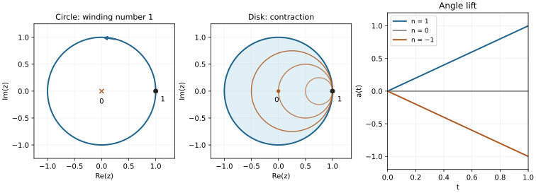

# M8-L1 – Homotopy and fundamental group {#L1}

**Course area:** M8 – Algebraic topology

**Level:** Bachelor’s studies · Elective

**Prerequisites:** [M2-L4](M2-L4.md); [M5-L3](M5-L3.md)

**Classification:** Bachelor specialisation and bridge to master-level studies

## Learning objectives {#S1}

You define homotopies of paths with fixed endpoints, construct the fundamental group and explain its group structure. You prove that the disk has trivial fundamental group while the circle has fundamental group isomorphic to the integers. You calculate winding numbers of polygonal loops and distinguish topological proof from numerical sampling.

## Paths and homotopy relative to endpoints {#S2}

Let $X$ be a topological space and $I=[0,1]$. A path is a continuous map $\alpha:I\to X$. Paths $\alpha,\beta$ with identical endpoints $a,b$ are homotopic relative to their endpoints if there is a continuous map $H:I\times I\to X$ such that

$$H(t,0)=\alpha(t),\quad H(t,1)=\beta(t),\quad H(0,s)=a,\quad H(1,s)=b.$$

Joint continuity in both variables is essential; an arbitrary family of continuous paths is insufficient. A loop at basepoint $x_0$ satisfies $a=b=x_0$. The constant loop is $c(t)=x_0$. A loop is nullhomotopic if it is homotopic to $c$ relative to the basepoint. The relation is reflexive via $H(t,s)=\alpha(t)$, symmetric by reversing $s$, and transitive by joining two homotopies at $s=1/2$. The pasting lemma for continuous maps on finitely many closed subsets ensures continuity at the join.

In a convex subspace of $\mathbb R^n$, $H(t,s)=(1-s)\alpha(t)+s\beta(t)$ is always valid. In a nonconvex space the entire homotopy must stay within the space; straight-line interpolation can leave it.

## Fundamental group and functoriality {#S3}

The fundamental group $\pi_1(X,x_0)$ consists of homotopy classes of based loops. For loops $\alpha,\beta$ define

$$ (\alpha*\beta)(t)=\begin{cases}\alpha(2t)&0\le t\le1/2,\\\beta(2t-1)&1/2\le t\le1.\end{cases}$$

The multiplication $[\alpha][\beta]=[\alpha*\beta]$ is well defined: paste two homotopies in the path variable in the same manner. Associativity holds for classes, not necessarily for parametrised paths. The two bracketings traverse the same three paths with different time allocations; continuous linear interpolation between their monotone piecewise linear reparametrisations gives a homotopy. An inserted constant path segment can likewise be removed by reparametrisation. Thus $[c]$ is the identity. For $\bar\alpha(t)=\alpha(1-t)$, the formula $H(t,s)=\alpha((1-s)\min(2t,2-2t))$ contracts $\alpha*\bar\alpha$; similarly $\bar\alpha*\alpha$ contracts. Hence $[\bar\alpha]$ is inverse to $[\alpha]$.

A continuous based map $f:(X,x_0)\to(Y,y_0)$ induces the homomorphism $f_*([\alpha])=[f\circ\alpha]$, since composition with $f$ preserves homotopies and concatenations. For composed maps, $(g\circ f)_*=g_*\circ f_*$. In particular a homeomorphism induces an isomorphism. Fundamental groups need not be abelian and are not complete invariants.

## Circle, disk and winding number {#S4}

Identify the plane with $\mathbb C$. Set $S^1=\{z:|z|=1\}$, $D^2=\{z:|z|\le1\}$ and $x_0=1$. In $D^2$, $H(t,s)=(1-s)\alpha(t)+s$ contracts every based loop, so $\pi_1(D^2,1)=\{e\}$. For the loop traversing the circle once, the same construction does not stay in $S^1$.

{alt="Once-around circle loop, based contraction in the disk and lifts with endpoints −1, 0, 1."}

For $S^1$ consider $p(u)=e^{2\pi i u}$ for $u\in\mathbb R$. Every continuous loop $\alpha$ with $\alpha(0)=1$ has a unique continuous lift $a:I\to\mathbb R$ satisfying $a(0)=0$ and $p(a(t))=\alpha(t)$. To justify this, use uniform continuity to subdivide $I$ finely enough that $|\alpha(t)-\alpha(t_j)|<1$ on each subinterval. The quotient $\alpha(t)/\alpha(t_j)$ then has a continuous principal angle $\theta(t)\in(-\pi,\pi)$ which is zero at $t_j$. Put $a(t)=a(t_j)+\theta(t)/(2\pi)$ there; successive pasting constructs the lift. Two lifts differ continuously by integers and agree initially, hence everywhere.

Since $p(a(1))=1$, the value $n=a(1)\in\mathbb Z$ is the winding number. For a based homotopy $H$, uniform continuity on the square supplies one fine subdivision in $t$ for all $s$. The same angle construction with quotients $H(t,s)/H(t_j,s)$ yields a lift $A$ continuous in $(t,s)$ with $A(0,s)=0$. Its endpoint $A(1,s)$ is integer-valued and continuous, hence constant. Thus $n$ is homotopy invariant.

Conversely, any lift ending at $n$ is homotopic relative to endpoints in $\mathbb R$ to the linear path via $(1-s)a(t)+snt$. Applying $p$ shows that every loop of winding number $n$ is homotopic to the standard loop $e^{2\pi i nt}$. Every integer occurs; concatenation adds endpoints because the lift of the second path starts at the endpoint of the first. Consequently

$$\pi_1(S^1,1)\cong(\mathbb Z,+).$$

The circle and disk therefore are not homeomorphic. Nor can a retraction $r:D^2\to S^1$ with $r|_{S^1}=\operatorname{id}$ exist: composing a contraction of the once-around loop in the disk with $r$ would contract a winding-one loop within the circle. For the punctured plane $\mathbb C\setminus\{0\}$, the map $F(z,s)=((1-s)+s/|z|)z$ is a deformation retraction onto $S^1$. Hence its fundamental group at basepoint 1 is also isomorphic to $\mathbb Z$. For $S^1\times S^1$, the two coordinate winding numbers classify the loops, so $\pi_1(S^1\times S^1,(1,1))\cong\mathbb Z^2$. Homotopies in both components can be performed together; concatenation adds componentwise.

## Polygonal winding number and sampling limitations {#S5}

For a closed polygonal loop with vertices $z_0,\ldots,z_N=z_0$ in the punctured plane, suppose every segment avoids the origin. The angle change along a straight edge is then the principal angle of $(z_{j+1}/|z_{j+1}|)\overline{(z_j/|z_j|)}$ in $(-\pi,\pi)$. Indeed a segment avoiding the origin lies in an open half-plane bounded by a line through the origin (take the normal from the origin to the closest point of the segment, for example). The total winding number is the sum of these angles divided by $2\pi$. With exactly opposite directions the segment passes through zero and the method is undefined.

```python
import cmath
from math import pi, fsum

def polygon_winding(vertices, tol=1e-10):
    # Explicitly closed polygon; all vertices and edges avoid 0.
    if len(vertices) < 2 or vertices[0] != vertices[-1]:
        raise ValueError("closed polygon required")
    if any(abs(z) <= tol for z in vertices):
        raise ValueError("vertex too close to zero")
    angles = []
    for a, b in zip(vertices, vertices[1:]):
        q = (b/abs(b)) * (a/abs(a)).conjugate()
        theta = cmath.phase(q)
        if pi-abs(theta) <= tol:
            raise ValueError("edge through or nearly opposite zero")
        angles.append(theta)
    turns = fsum(angles)/(2*pi)
    n = round(turns)
    if abs(turns-n) > tol:
        raise ArithmeticError("numerically uncertain result")
    return n

assert polygon_winding([1, 1j, -1, -1j, 1]) == 1
assert polygon_winding([1, -1j, -1, 1j, 1]) == -1
```

The code computes the winding number of the polygon, not necessarily that of an unknown smooth path between samples. For instance, sampling $e^{2\pi i 8t}$ at $t=j/8$ theoretically always yields 1; the interpolated polygon is constant but the true path winds eight times. For a known circle loop whose lifted angle change between sample endpoints is strictly less than $\pi$ in magnitude on every interval, the unwrapped increments agree. Floating-point tolerances are additional practical checks, not rigorous interval arithmetic; for very small or nearly opposite points, rescale or check at higher precision.

## Self-assessment {#S6}

### Exercises

1. Give a based homotopy of $e^{2\pi it}$ to the constant loop in $D^2$. What happens at $t=s=1/2$?
2. Find the winding number of $e^{2\pi i(3t+\sin(2\pi t))}$ and of the reversed path.
3. Find the class of the concatenation of standard loops of winding numbers 4 and −7. Why is it not nullhomotopic?
4. Prove that two based circle loops with equal lifted endpoints are homotopic, without differentiating the curves.
5. Compute the winding number of the polygon $1,i,-1,-i,1$ and explain why the edge from 1 to −1 is invalid in the punctured plane.

::: {.lc-solutions data-lc-section="S6"}
1. $H(t,s)=(1-s)e^{2\pi it}+s$; at $t=s=1/2$ it equals 0, outside $S^1$ but inside $D^2$.
2. The lift $a(t)=3t+\sin(2\pi t)$ starts at 0 and ends at 3; the reversed path has winding number −3 (lift $a(1-t)-3$).
3. The class corresponds to $4-7=-3\ne0$ in $\mathbb Z$. A based homotopy cannot change the integer endpoint.
4. If $a,b$ are lifts with initial value 0 and common endpoint $n$, then $H(t,s)=p((1-s)a(t)+sb(t))$ is a continuous based homotopy. Differentiability is not required.
5. Each of the four edges contributes $\pi/2$, giving $2\pi$ and winding number 1. The segment from 1 to −1 contains the origin.
:::

## Sources {#S7}

- [Allen Hatcher – Algebraic Topology](https://math.uchicago.edu/~farb/algtop2023/Hatcher.pdf) · §1.1, Theorem 1.7; path homotopy and product groups · Last accessed: 2026-11-24 · Content verified: 2026-11-24
- [Laurentiu Maxim – Math 751, Lecture Notes Week 3](https://people.math.wisc.edu/~lmaxim/751f14w3.pdf) · §1, Theorem 1 and Lemmas 1.1–1.3 · Last accessed: 2026-11-24 · Content verified: 2026-11-24
