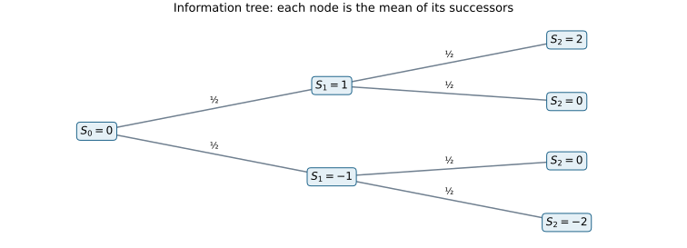

# M9-L1 – Conditional expectation and martingales {#L1}

**Course area:** M9 – Stochastics, financial and actuarial mathematics

**Level:** Bachelor’s studies · Elective

**Prerequisites:** [M3-L1](M3-L1.md); [M3-L4](M3-L4.md)

**Classification:** Bachelor specialisation and bridge to master-level studies

## Learning objectives {#S1}

You calculate conditional expectations on finite probability spaces, formulate their measure-theoretic characterisation and use the tower property. You verify the martingale property of a symmetric random walk and prove preservation of expectation at bounded stopping times. You recognise why almost sure finiteness of a stopping time is insufficient by itself.

## Conditional expectation as an information projection {#S2}

Let $(\Omega,\mathcal F,P)$ be a probability space and let $X$ be integrable, meaning $E|X|<\infty$. A sub-$\sigma$-algebra $\mathcal G\subseteq\mathcal F$ describes observable events. The conditional expectation $Y=E[X\mid\mathcal G]$ is an integrable, $\mathcal G$-measurable random variable satisfying

$$\int_A Y\,dP=\int_A X\,dP\qquad(A\in\mathcal G).$$

Existence follows from the Radon–Nikodym theorem applied to the signed measure $A\mapsto\int_A X\,dP$ on $\mathcal G$. Uniqueness holds up to null sets: for two candidates $Y,Z$, choosing $A=\{Y>Z\}$ makes the integral of a positive difference zero; similarly for $Z>Y$. On cells $A_j$ of a finite partition with positive probability,

$$Y|_{A_j}=\frac{\sum_{\omega\in A_j}X(\omega)P(\{\omega\})}{P(A_j)}$$

when $\Omega$ is finite. Null cells do not affect the result. Example: four equally likely outcomes carry values $2,4,0,10$. Information distinguishes only the first two from the last two. The conditional values are 3 and 5, while the unconditional mean is 4.

The integral characterisation implies linearity. If $\mathcal H\subseteq\mathcal G$, the tower property is $E[E[X\mid\mathcal G]\mid\mathcal H]=E[X\mid\mathcal H]$, since both sides have the same integral on every $A\in\mathcal H$. In particular $E[Y]=E[X]$. For bounded $\mathcal G$-measurable $H$, $E[HX\mid\mathcal G]=H E[X\mid\mathcal G]$ (first for indicators, then simple functions, finally by bounded approximation). If $X$ is independent of $\mathcal G$, then $Y=E[X]$ is constant. For $X\in L^2$, conditional Jensen first gives $E[Y^2]\le E[X^2]$. Then $E[(X-Y)Z]=0$ for each $\mathcal G$-measurable $Z\in L^2$, by approximation from the integral characterisation. Thus $Y$ minimises mean squared prediction error among such $Z$: $E[(X-Z)^2]=E[(X-Y)^2]+E[(Y-Z)^2]$.

## Filtrations and martingales {#S3}

A filtration $(\mathcal F_n)_{n\ge0}$ is an increasing sequence of $\sigma$-algebras. A process $(M_n)$ is adapted when $M_n$ is determined by information $\mathcal F_n$. It is a martingale when every $M_n$ is integrable and adapted and

$$E[M_{n+1}\mid\mathcal F_n]=M_n\quad\text{almost surely}.$$

Iterating the tower property gives $E[M_m\mid\mathcal F_n]=M_n$ for $m\ge n$. Constant expectation alone is insufficient: the condition must hold given the particular past. Submartingales use $\ge$, supermartingales $\le$ instead of equality.

Let $X_i$ be independent steps with $P(X_i=1)=P(X_i=-1)=1/2$, $S_n=\sum_{i=1}^n X_i$ and $\mathcal F_n=\sigma(X_1,\ldots,X_n)$. Independence of $X_{n+1}$ from $\mathcal F_n$ gives $E[S_{n+1}\mid\mathcal F_n]=S_n$. Also $S_n^2-n$ is a martingale because $E[(S_n+X_{n+1})^2\mid\mathcal F_n]=S_n^2+1$. For an integrable terminal variable $Z$, $M_n=E[Z\mid\mathcal F_n]$ is a martingale by the tower property.

{alt="Two-step random walk with conditional probabilities 1/2 and node values."}

## Bounded stopping times {#S4}

An integer-valued random time $\tau\in\{0,1,\ldots\}\cup\{\infty\}$ is a stopping time if $\{\tau\le n\}\in\mathcal F_n$ for each $n$. At time $n$ it is therefore possible to determine whether stopping has occurred. First entry into an observable set is a stopping time; the last positive step before a fixed end time generally is not.

Suppose $\tau\le N$ almost surely. For a martingale,

$$M_\tau=M_0+\sum_{k=1}^N\mathbf 1_{\{\tau\ge k\}}(M_k-M_{k-1}).$$

The indicator is $\mathcal F_{k-1}$-measurable since $\{\tau\ge k\}=\{\tau\le k-1\}^c$. Each summand has zero expectation: condition on $\mathcal F_{k-1}$ and apply the martingale property. Hence $E[M_\tau]=E[M_0]$. Similarly $M_{n\wedge\tau}$ is a martingale even for unbounded $\tau$, because its increment is the corresponding indicator-weighted increment of $M$. Finiteness of $N$ avoids an unjustified interchange of limit and expectation.

Example: stop the symmetric walk after at most two steps or on first reaching 1. The value 1 occurs with probability $1/2$, and 0 and −2 each with probability $1/4$. The expected value is $1/2-2/4=0$. The terminal distribution is not symmetric even though the mean is preserved.

## Exact enumeration and limitations {#S5}

The following exact enumeration uses equally probable complete paths. Even if a path stops early, its continuations still count as distinct outcomes; this yields the correct probabilities without double weighting.

```python
from itertools import product
from fractions import Fraction

def stopped_walk(steps, level):
    s = 0
    for k, x in enumerate(steps, 1):
        s += x
        if s >= level:
            return k, s
    return len(steps), s

def exact_stopped_mean(n, level):
    paths = product((-1, 1), repeat=n)
    return Fraction(sum(stopped_walk(p, level)[1]
                        for p in paths), 2**n)

assert exact_stopped_mean(8, 2) == 0
```

Runtime grows exponentially with $n$; the calculation suits small horizons. A state distribution with absorbing states provides an alternative verification. Boundedness matters: for a symmetric walk $\tau=\inf\{n:S_n=1\}$ is almost surely finite but $S_\tau=1$. To prove almost sure finiteness, consider first entry into $\{-a,1\}$ for integers $a\ge1$. Entry is almost surely finite: in blocks of $a+1$ steps, a sequence of only positive steps guarantees exit if stopping has not occurred. Stopped values lie between −a and 1. Apply the bounded theorem to $\tau_a\wedge N$ and let $N\to\infty$ using dominated convergence. From $0=p\cdot1+(1-p)(-a)$ we obtain $p=a/(a+1)$. The probability of ever reaching 1 is at least $p$ for every $a$, hence 1. Yet $E[S_\tau]=1\ne0$. The stopped values here are not controlled by a common integrable bound; passage to the limit from bounded times is unjustified.

## Self-assessment {#S6}

### Exercises

1. On four equally probable outcomes let $X$ have values −2, 6, 4, 8. Compute the conditional expectation for the partition into the first two and last two outcomes and its mean.
2. Show that $S_n^2-n$ is a martingale for the random walk defined above.
3. Is the first time $n$ with $S_n\ge2$ a stopping time? Is the last time with $S_n\ge2$ before the fixed horizon 10 (defaulting to 0 if none exists) a stopping time?
4. Stop the walk on first reaching 1 or after three steps at the latest. Determine the terminal distribution and mean.
5. Why cannot the bounded stopping theorem be extended to arbitrary stopping times solely on the basis of almost sure finiteness?

::: {.lc-solutions data-lc-section="S6"}
1. Cell means are 2 and 6; the conditional random variable has mean 4.
2. Conditioning on $\mathcal F_n$: $E[X_{n+1}]=0$, $E[X_{n+1}^2]=1$, so $E[S_{n+1}^2-(n+1)\mid\mathcal F_n]=S_n^2-n$; adaptedness and integrability follow from $|S_n|\le n$.
3. Yes: $\{\tau\le n\}=\bigcup_{j\le n}\{S_j\ge2\}$. No: after two positive steps, later steps can cause another visit or stay below 2 throughout; whether the last visit occurred at time 2 is not decidable then.
4. Paths either start with +1 (value 1, probability 1/2), or with −1. Of these, −++ reaches 1 (1/8), −+− and −−+ reach −1 (1/8 each), −−− reaches −3 (1/8). Thus $P(1)=5/8$, $P(-1)=1/4$, $P(-3)=1/8$; mean 0.
5. Almost sure convergence does not automatically imply convergence of expectations. The first hitting time of 1 supplies the counterexample; additional conditions such as suitable dominating bounds are needed.
:::

## Sources {#S7}

- [Ellen G. Powell, Stochastic Processes, Durham University](https://www.maths.dur.ac.uk/users/ellen.g.powell/SPnotes.html) · §4.1–4.4 · Last accessed: 2026-11-24 · Content verified: 2026-11-24
