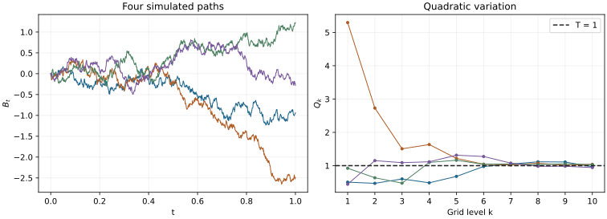

# M9-L2 – Brownian motion and quadratic variation {#L2}

**Course area:** M9 – Stochastics, financial and actuarial mathematics

**Level:** Bachelor’s studies · Elective

**Prerequisites:** [M9-L1](M9-L1.md)

**Classification:** Bachelor specialisation and bridge to master-level studies

## Learning objectives {#S1}

You characterise standard Brownian motion by its increments and continuity, derive its covariance and scaling and prove quadratic variation along deterministic partitions in $L^2$. You distinguish path properties from distributional statements and investigate convergence numerically.

## Definition and scaling {#S2}

Standard Brownian motion $(B_t)_{t\ge0}$ starts at $B_0=0$ almost surely, has continuous paths almost surely and independent increments on disjoint time intervals. For $0\le s<t$, $B_t-B_s\sim N(0,t-s)$, where the second parameter denotes variance. The increment is independent of the natural past $\mathcal F_s=\sigma(B_u:0\le u\le s)$. In particular $B_t\sim N(0,t)$; the values $B_s,B_t$ themselves are generally dependent. For $s\le t$,

$$E[B_sB_t]=E[B_s^2]+E[B_s(B_t-B_s)]=s,$$

so $\operatorname{Cov}(B_s,B_t)=\min(s,t)$. The joint law of finitely many values is multivariate normal, since each value is a linear combination of independent normal increments. For $c>0$, $\widetilde B_t=c^{-1/2}B_{ct}$ again has the defining properties: its increment variance is $c^{-1}c(t-s)=t-s$, and independence and continuity are preserved. This is equality in law, not equality of paths.

Natural time discretisation with step size $h$ generates increments $\sqrt h Z_k$ with independent $Z_k\sim N(0,1)$. Unlike a symmetric random walk with steps $\pm\sqrt h$, this gives exactly the finite-dimensional distributions of Brownian motion on the grid. Linear interpolation between grid points, however, is not Brownian motion.

## Quadratic variation and convergence {#S3}

For a deterministic partition $\pi=(0=t_0<\cdots<t_n=T)$ put $h_j=t_j-t_{j-1}$, $|\pi|=\max_j h_j$, and

$$Q_\pi=\sum_{j=1}^n(B_{t_j}-B_{t_{j-1}})^2.$$

A normal increment of variance $h_j$ has second moment $h_j$ and fourth moment $3h_j^2$, so its square has variance $2h_j^2$. The fourth standard normal moment follows, for example, by integration by parts using the normal density $\phi'(z)=-z\phi(z)$: $E[Z^4]=3E[Z^2]=3$. Independence of increments implies that the variances of their squares add. Thus

$$E[Q_\pi]=T,\qquad E[(Q_\pi-T)^2]=2\sum_jh_j^2\le2T|\pi|.$$

For every sequence of deterministic partitions with mesh tending to zero, $Q_\pi$ converges to $T$ in $L^2$ and therefore in probability. On uniform grids of $n$ intervals, exactly $\operatorname{Var}(Q)=2T^2/n$; also $nQ/T\sim\chi_n^2$. For dyadic partitions $n=2^k$, Chebyshev's inequality gives for each $\epsilon>0$

$$\sum_{k\ge0}P(|Q_k-T|>\epsilon)\le \frac{2T^2}{\epsilon^2}\sum_{k\ge0}2^{-k}<\infty.$$

The first Borel–Cantelli lemma (not requiring independence of events) shows that only finitely many such deviations occur. Using the countable choices $\epsilon=1/m$ proves almost sure convergence along these grids for fixed $T$. This is stronger than convergence in probability, but not a statement about every arbitrary path-dependent choice of partitions.

{alt="Four simulated Brownian paths and their variation sums on dyadic grids; reference value 1."}

## Path regularity and martingales {#S4}

For a continuously differentiable function $f$ on $[0,T]$, with $C=\max|f'|$, the estimate $\sum(\Delta f)^2\le C^2T|\pi|\to0$ holds. More generally, for a continuous path of finite total variation $V$, uniform continuity gives $\sum(\Delta f)^2\le V\max_j|\Delta f_j|\to0$. Since Brownian motion has positive quadratic variation almost surely along dyadic grids on every fixed interval of positive length (the same proof with a shifted start), it has infinite total variation there almost surely. Considering all rational subintervals yields this simultaneously on every nontrivial interval. In particular no subinterval has a continuously differentiable path. The stronger statement that Brownian paths are almost surely nowhere differentiable requires an additional proof; infinite total variation alone does not imply it.

With respect to the natural filtration, $B_t$ and $B_t^2-t$ are martingales: $E[B_t\mid\mathcal F_s]=B_s$ and $E[B_t^2\mid\mathcal F_s]=B_s^2+t-s$. The deterministic term $t$ thus exactly compensates for the expected squared increments. This prepares Itô's formula. The notation $(dB_t)^2=dt$ is symbolic shorthand, not an equality of ordinary differentials or individual finite increments.

## Reproducible simulation {#S5}

The following code first simulates fine paths. Coarser grids are obtained by subsampling the same paths. This matters for observing pathwise convergence: generating new independent paths at each level would give the correct marginal distributions but would not show approximation along a common path.

```python
import numpy as np

def brownian_grid(T, m, paths=1, seed=42):
    if T <= 0 or m < 0 or paths < 1:
        raise ValueError("positive T and paths, nonnegative m")
    rng = np.random.default_rng(seed)
    n = 2**m
    increments = rng.normal(0, np.sqrt(T/n), (paths, n))
    return np.column_stack((np.zeros(paths),
                            np.cumsum(increments, axis=1)))

def qv_at_level(grid, k):
    n = grid.shape[1] - 1
    if n < 1 or n & (n-1) or not 0 <= k <= n.bit_length()-1:
        raise ValueError("invalid dyadic grid or level")
    step = n // 2**k
    return np.sum(np.diff(grid[:, ::step], axis=1)**2, axis=1)

grid = brownian_grid(1, 10, paths=2000)
for k in (2, 5, 8, 10):
    q = qv_at_level(grid, k)
    print(k, q.mean(), q.var(), 2/2**k)
```

The four outputs contain grid level, empirical mean, empirical variance (dividing by the number of paths) and theoretical variance. With $T=1$ and $k=5$, theoretical variance is $1/16$ and standard deviation $1/4$; with $k=10$, variance is $1/512$. An individual $Q_k$ need not converge monotonically to 1. Random numbers are pseudorandom, and rounding and finite sample size limit accuracy. Simulation cannot prove an almost sure statement. Memory requirements grow with the number of paths times grid size; for large experiments generate paths in batches.

## Self-assessment {#S6}

### Exercises

1. Calculate the distribution of $B_5-B_2$ and the covariance of $B_2$ and $B_5$.
2. Show that $\tfrac12 B_{4t}$ is standard Brownian motion.
3. For $T=2$ and 128 uniform intervals, calculate the mean and variance of the quadratic variation sum.
4. Prove that $f(t)=t^2$ on $[0,1]$ has zero quadratic variation.
5. Use conditional expectation to show that $B_t^2-t$ is a martingale and explain why $B_t^2$ is not.

::: {.lc-solutions data-lc-section="S6"}
1. $N(0,3)$ with variance 3; covariance $\min(2,5)=2$.
2. The increment variance is $\tfrac14\cdot4(t-s)=t-s$; initial value, independence, normality and continuity are preserved.
3. $E[Q]=2$, $\operatorname{Var}(Q)=2\cdot4/128=1/16$.
4. $|f'|\le2$, hence $\sum(\Delta f)^2\le4|\pi|\to0$.
5. Independent increments give $E[B_t^2-t\mid\mathcal F_s]=B_s^2+(t-s)-t=B_s^2-s$. $B_t^2$ has time-dependent mean $t$ and therefore is not a martingale.
:::

## Sources {#S7}

- [Lorenzo Naranjo, Stochastic Foundations for Finance: Brownian Motion](https://lorenzonaranjo.com/class-materials/stochastic-processes/notes/brownian-motion.html) · Brownian Motion; Quadratic Variation of Brownian Motion · Last accessed: 2026-11-24 · Content verified: 2026-11-24
