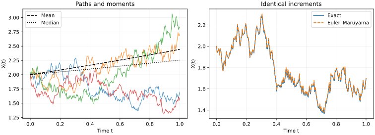

# M9-L3 – Itô's formula and stochastic differential equations {#L3}

**Course area:** M9 – Stochastics, financial and actuarial mathematics

**Level:** Master’s studies · Elective

**Prerequisites:** [M9-L2](M9-L2.md); [M1-L4](M1-L4.md)

**Classification:** Master’s specialisation

## Learning objectives {#S1}

Derive the Itô correction for squared Brownian motion from finite sums, state the general Itô rule under suitable assumptions, construct the geometric Brownian motion solution, and distinguish drift, diffusion and discretisation error.

## From grids to the Itô integral {#S2}

Let $B$ be standard Brownian motion with its natural filtration. For an adapted step process $H_s=H_j$ on $[t_j,t_{j+1})$, with square-integrable $H_j$ measurable at time $t_j$, define

$$I(H)=\sum_j H_j(B_{t_{j+1}}-B_{t_j}).$$

Conditional on the past, increments have mean zero and variance $h_j=t_{j+1}-t_j$. For $i<j$, conditioning on $\mathcal F_{t_j}$ eliminates the cross expectation. Thus $E[I(H)]=0$ and the Itô isometry is $E[I(H)^2]=\sum_j h_j E[H_j^2]$. Continuous extension in the norm $\|H\|^2=E\int_0^T H_s^2ds$ defines the integral for square-integrable predictable processes. Completeness and approximation details of this construction are assumed here.

For $H_s=B_s$, left grid values approximate the integrand in that norm because $\sum_j\int_{t_j}^{t_{j+1}}E[(B_s-B_{t_j})^2]ds=\tfrac12\sum_j h_j^2\to0$. The algebraic identity

$$B_T^2=2\sum_j B_{t_j}\Delta B_j+\sum_j(\Delta B_j)^2$$

and quadratic variation from [M9-L2](M9-L2.md) imply in $L^2$ that $B_T^2=2\int_0^T B_s\,dB_s+T$. Unlike for smooth paths, the sum of squared increments cannot be discarded. Using right rather than left endpoints changes the sum here by $\sum_j(\Delta B_j)^2$; the choice of evaluation points matters.

## Itô formula and stochastic differential equations {#S3}

An Itô process $X_t=X_0+\int_0^t a_s ds+\int_0^t b_s dB_s$ requires adapted coefficients suitable for integration (in particular locally integrable drift and locally square-integrable predictable diffusion). For $f\in C^{1,2}$, continuously differentiable once in time and twice in space, Itô's formula holds locally:

$$df(t,X_t)=\left(f_t+a_tf_x+\tfrac12 b_t^2f_{xx}\right)dt+b_tf_xdB_t.$$

Derivatives are evaluated at $(t,X_t)$. This is shorthand for an integral equation, not an equation of classical derivatives. Formally $(dB)^2=dt$, $dt\,dB=(dt)^2=0$. For general $f$ this is a mnemonic only; the full theorem requires limiting arguments and potentially localisation. The special case $f(x)=x^2$, $X=B$ was proved above.

In an SDE $dX_t=\mu(t,X_t)dt+\sigma(t,X_t)dB_t$, $\mu$ describes local drift and $\sigma^2$ local variance rate. Arbitrary coefficients do not guarantee existence and uniqueness. Global Lipschitz continuity in space and linear growth, with suitable time measurability and a square-integrable initial condition, are classical sufficient conditions. The following linear example satisfies them.

## Geometric Brownian motion {#S4}

Consider $dX_t=\mu X_tdt+\sigma X_tdB_t$ with real constant $\mu$, $\sigma\ge0$ and $X_0=x_0>0$. Instead of presupposing positivity, construct

$$Y_t=x_0\exp((\mu-\sigma^2/2)t+\sigma B_t).$$

Apply Itô to $f(t,b)=x_0\exp((\mu-\sigma^2/2)t+\sigma b)$. Since $f_t=(\mu-\sigma^2/2)f$, $f_b=\sigma f$, and $f_{bb}=\sigma^2f$, we get $dY_t=\mu Y_tdt+\sigma Y_tdB_t$. Uniqueness gives $X=Y$, so $X$ is positive. Using the normal moment-generating function gives $E[X_t]=x_0e^{\mu t}$ and

$$\operatorname{Var}(X_t)=x_0^2e^{2\mu t}(e^{\sigma^2t}-1).$$

The log distribution has mean $\log x_0+(\mu-\sigma^2/2)t$ and variance $\sigma^2t$; the process median is $x_0e^{(\mu-\sigma^2/2)t}$. For $x_0=2,\mu=0.2,\sigma=0.4$ the log drift is $0.12$. Mean and median differ even though process drift is positive. When $\mu=0$, $X$ is a martingale because the exponential factor of the independent increment has conditional mean one.

{alt="Geometric Brownian motion: four simulated paths, theoretical mean and median; exact and Euler paths with identical increments."}

## Simulation and Euler–Maruyama {#S5}

On a uniform grid with step $h$, Euler–Maruyama gives $X_{j+1}^{EM}=X_j^{EM}(1+\mu h+\sigma\Delta B_j)$. The exact grid solution multiplies by $\exp((\mu-\sigma^2/2)h+\sigma\Delta B_j)$. Using identical increments in the two methods enables pathwise comparison; $\Delta B_j\sim N(0,h)$. Euler can generate negative values, unlike the exact solution. For $\sigma>0$, every $h>0$ gives a positive probability of a negative Euler factor. For this SDE Euler–Maruyama converges in root mean square with strong order $1/2$ (general convergence theorem, not proved here). A single simulation does not establish that order. The code takes already scaled increments; it is an educational model, not a forecast of actual market prices.

```python
import numpy as np

def gbm_paths(x0, mu, sigma, h, increments):
    increments = np.asarray(increments, dtype=float)
    if x0 <= 0 or h <= 0 or sigma < 0 or increments.ndim != 1:
        raise ValueError("invalid parameters")
    t = h * np.arange(len(increments)+1)
    b = np.r_[0., np.cumsum(increments)]
    exact = x0 * np.exp((mu-sigma**2/2)*t + sigma*b)
    euler = x0 * np.r_[1., np.cumprod(1+mu*h+sigma*increments)]
    return t, exact, euler

rng = np.random.default_rng(41)
h = 1/256
db = rng.normal(0, np.sqrt(h), 256)
t, exact, euler = gbm_paths(2, .2, .4, h, db)
print(exact[-1], euler[-1])
```

## Self-assessment {#S6}

### Exercises

1. Derive the Itô isometry for two independent Brownian increments with predictable integrands.
2. Find $\int_0^T B_s\,dB_s$ and its expectation.
3. Apply Itô's formula to $B_t^3$.
4. Calculate log drift and median for $x_0=1,\mu=0,\sigma=1,T=2$.
5. With $h=1,\mu=0,\sigma=1,\Delta B=-2$, demonstrate failure of positivity for Euler.

::: {.lc-solutions data-lc-section="S6"}
1. Cross terms vanish by conditioning at the second start time. Diagonal terms equal $h_jE[H_j^2]$.
2. $(B_T^2-T)/2$; expectation zero.
3. $d(B_t^3)=3B_t^2dB_t+3B_tdt$.
4. Log drift $-1/2$, median $e^{-1}$.
5. Euler factor $-1$, exact factor $e^{-5/2}>0$.
:::

## Sources {#S7}

- [MIT OpenCourseWare, 18.642: Stochastic Calculus](https://ocw.mit.edu/courses/18-642-topics-in-mathematics-with-applications-in-finance-fall-2024/mit18_642_f24_lec19_1.pdf) · pp. 21–23 (PDF text) (Review scope: Text) · Last accessed: 2026-11-24 · Content verified: 2026-11-24
