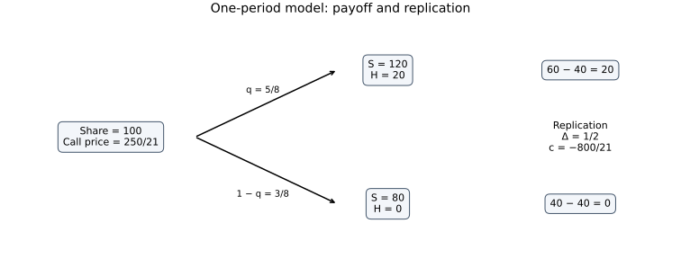

# M9-L4 – Arbitrage-free pricing in the binomial model {#L4}

**Course area:** M9 – Stochastics, financial and actuarial mathematics

**Level:** Master’s studies · Elective

**Prerequisites:** [M1-L7](M1-L7.md); [M9-L1](M9-L1.md)

**Classification:** Master’s specialisation

## Learning objectives {#S1}

Test absence of arbitrage in a one-period model, derive the unique replicating portfolio and risk-neutral valuation, apply them to an original option example, and distinguish model probabilities, valuation and actual risk.

## Market model and arbitrage {#S2}

At time 0 a share costs $s>0$; at time 1 it is worth either $su$ or $sd$, with $u>d>0$. Both states have positive actual probability. A cash account grows by the factor $R>0$ per period: an initial amount $c$ becomes $Rc$. The period may have any length; $R$ is not a continuous interest rate. Arbitrary real share holdings $\Delta$ and cash positions $c$ are permitted, including short selling and borrowing, without fees or default. There are no dividends or intermediate trading times.

A portfolio has initial value $V_0=s\Delta+c$ and terminal values $V_u=su\Delta+Rc$, $V_d=sd\Delta+Rc$. Arbitrage means $V_0=0$, both terminal values nonnegative and at least one strictly positive. For $V_0=0$ we have $c=-s\Delta$, hence $V_u=s\Delta(u-R)$ and $V_d=s\Delta(d-R)$. If $d<R<u$, these values have opposite signs for $\Delta\ne0$. If instead $R\le d$, $\Delta=1$ gives arbitrage; if $R\ge u$, $\Delta=-1$ does. Since $u>d$, at least one terminal value is positive even in equality cases. Thus $d<R<u$ is exactly the no-arbitrage condition.

## Replication and unique price {#S3}

A claim with terminal payments $H_u,H_d$ is replicated by solving

$$su\Delta+Rc=H_u,\qquad sd\Delta+Rc=H_d.$$

Subtracting gives

$$\Delta=\frac{H_u-H_d}{s(u-d)},\qquad c=\frac{uH_d-dH_u}{R(u-d)}.$$

The determinant is $sR(u-d)>0$, so every payoff in this two-state market has a unique replication (completeness). Its price must be $H_0=s\Delta+c$: if the claim is more expensive, sell it and buy the replication; if cheaper, reverse the positions. Invest the positive initial surplus in the cash account; future claim payments cancel exactly. This proves uniqueness if the claim is freely tradable too. Conversely the price $s\Delta+c$ introduces no new arbitrage because every claim position can be replaced by its replicating portfolio.

## Risk-neutral measure {#S4}

Set $q=(R-d)/(u-d)$. Under strict no-arbitrage, $0<q<1$ and $qu+(1-q)d=R$. Thus the discounted share price is a martingale under the probability measure $Q=(q,1-q)$. The measure is unique since $u>d$ and equivalent to the actual measure because both states have positive probability. Substitution of portfolio values yields

$$H_0=\frac{qH_u+(1-q)H_d}{R}.$$

This is a valuation identity, not an estimate of actual up probability $p$. It follows from replication. A nonnegative payoff has a nonnegative price, lying between $\min(H_u,H_d)/R$ and $\max(H_u,H_d)/R$. Ordered payoff vectors have ordered prices, strictly if at least one state inequality is strict. These facts follow from the positive weights.

{alt="One-period tree with share values, claims, replicating portfolio and risk-neutral weights."}

## Worked example and limitations {#S5}

Take $s=100$, $u=6/5$, $d=4/5$, $R=21/20$. A European call with strike 100 pays $(20,0)$. Then $\Delta=1/2$, $c=-800/21$, $q=5/8$, and $H_0=250/21\approx11.90$. In the up state the share holding is worth 60 and debt is 40; in the down state they are 40 and 40. Net payments are exactly 20 and 0. A put with the same strike has $H=(0,20)$ and price $50/7$. Put-call parity follows from the statewise identity $C_1-P_1=S_1-K$: $C_0-P_0=s-K/R=100/21$. This is a consistency check.

```python
from fractions import Fraction as F

def replicate(s, u, d, R, hu, hd):
    s, u, d, R, hu, hd = map(F, (s,u,d,R,hu,hd))
    if not (s > 0 and 0 < d < R < u):
        raise ValueError("strict no-arbitrage condition required")
    delta = (hu-hd)/(s*(u-d))
    cash = (u*hd-d*hu)/(R*(u-d))
    q = (R-d)/(u-d)
    price = s*delta+cash
    assert price == (q*hu+(1-q)*hd)/R
    return delta, cash, q, price

print(replicate(100, F(6,5), F(4,5), F(21,20), 20, 0))
```

Fractions avoid rounding errors; supply decimal parameters as strings or exact fractions, not binary floating-point values. Without the idealised assumptions (for example, with fees, trading constraints or more states than independent traded assets), replication may fail; a unique price may not exist. In the multi-period model, analogous assumptions permit backward replication at every node; the dynamic strategy must be self-financing. This example is not investment advice.

## Self-assessment {#S6}

### Exercises

1. Test no-arbitrage for $s=50,d=0.9,u=1.1,R=1.1$. Give a zero-cost position.
2. Compute $q$ for $d=0.7,u=1.3,R=1$.
3. Replicate a constant payoff 9 when $R=1.125$.
4. Compute the example's put price using the risk-neutral measure and check parity.
5. Actual up probability is 0.9. Does this change the example's call price? Explain.

::: {.lc-solutions data-lc-section="S6"}
1. No, $R=u$. $\Delta=-1,c=50$ pays 0 up and 10 down.
2. $(1-0.7)/(1.3-0.7)=1/2$.
3. $\Delta=0,c=9/1.125=8$.
4. $20(3/8)/(21/20)=50/7$; $250/21-50/7=100/21$.
5. No. As long as both states have positive actual probability, replication is unchanged; $q=5/8$ is determined by prices.
:::

## Sources {#S7}

- [Clare Wallace, Durham University: Mathematical Finance, Chapter 2](https://www.maths.dur.ac.uk/users/clare.wallace/MF/Chapter2.html) · §2.2–2.5 · Last accessed: 2026-11-24 · Content verified: 2026-11-24
