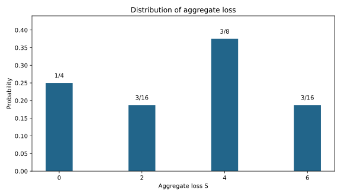

# M9-L5 – Insurance risk and collective risk models {#L5}

**Course area:** M9 – Stochastics, financial and actuarial mathematics

**Level:** Master’s studies · Elective

**Prerequisites:** [M1-L7](M1-L7.md); [M3-L4](M3-L4.md); [M9-L1](M9-L1.md)

**Classification:** Master’s specialisation

## Learning objectives {#S1}

Model a random aggregate loss, derive its mean and variance by conditioning, and compute a finite loss distribution by convolution. Distinguish average loss, variability and model risk.

## Claim frequency and severity {#S2}

Let $N$ be the nonnegative integer number of claims in a fixed period. Let $(X_i)_{i\ge1}$ be a sequence of independent, identically distributed nonnegative claim amounts, independent of $N$. Aggregate loss is

$$S=\sum_{i=1}^{N}X_i,$$

with the empty sum equal to zero when $N=0$. The model describes a portfolio, not necessarily individual policies. All amounts use the same monetary unit and valuation date. Assume $E[N^2]<\infty$ and $E[X_1^2]<\infty$. Write $\mu=E[X_1]$, $\sigma^2=\operatorname{Var}(X_1)$. Frequency and severity are modelled separately; even a small number of claims may include a very large loss.

## Moments by conditioning {#S3}

Given $N=n$, $S$ is distributed as the sum of exactly $n$ independent copies of $X_1$. Linearity of expectation and zero covariances give $E[S\mid N]=N\mu$ and $\operatorname{Var}(S\mid N)=N\sigma^2$. The tower property (see [M9-L1](M9-L1.md)) and the total variance decomposition yield

$$E[S]=E[N]\mu,\qquad \operatorname{Var}(S)=E[N]\sigma^2+\operatorname{Var}(N)\mu^2.$$

For the second identity, write $S-E[S]=(S-E[S\mid N])+(E[S\mid N]-E[S])$. The cross term in the square has expectation zero because the first summand has conditional mean zero given $N$, while the second depends on $N$. The remaining squares produce the formula. For $N\sim\operatorname{Poisson}(\lambda)$ we get $E[S]=\lambda\mu$ and $\operatorname{Var}(S)=\lambda E[X_1^2]$. The second raw moment is not the variance: even constant severities give variable losses when the count is random.

## Distribution and a complete example {#S4}

For integer severities with generating function $G_X(z)=E[z^X]$, the identity $G_S(z)=G_N(G_X(z))$ holds for $0\le z\le1$, because conditional on $N=n$ the expectation of the product factors into $G_X(z)^n$. For Poisson frequency this is $\exp(\lambda(G_X(z)-1))$. For finite distributions all coefficients can be computed exactly by repeated convolution.

Example: $P(N=0)=1/4$, $P(N=2)=3/4$; independently $X=1$ or $3$, each with probability $1/2$. Then $E[N]=3/2$, $\operatorname{Var}(N)=3/4$, $\mu=2$, $\sigma^2=1$. Thus $E[S]=3$ and $\operatorname{Var}(S)=9/2$. The distribution is $P(S=0)=1/4$, $P(S=2)=3/16$, $P(S=4)=3/8$, $P(S=6)=3/16$. The probability of $S>4$ is $3/16$. The probabilities sum to one and the moments computed from the four atoms agree with the general formula.

{alt="Four aggregate losses with their probabilities"}

## Computation and model limitations {#S5}

The following function convolves the severity distribution step by step, weighting the results by the count distribution. It is intended for small finite models with exact rational probabilities, not unbounded Poisson distributions.

```python
from fractions import Fraction as F

def aggregate(count, severity):
    # Finite probability mass functions: nonnegative integer keys.
    for pmf in (count, severity):
        if (not pmf or any(type(k) is not int or k < 0 or v < 0
                          for k, v in pmf.items())
                or sum(pmf.values()) != 1):
            raise ValueError("invalid probability mass function")
    result, current = {}, {0: F(1)}
    for n in range(max(count)+1):
        for s, weight in current.items():
            result[s] = result.get(s, F(0)) + count.get(n, 0)*weight
        if n < max(count):
            new = {}
            for s, a in current.items():
                for x, b in severity.items():
                    new[s+x] = new.get(s+x, F(0)) + a*b
            current = new
    return {s: w for s, w in sorted(result.items()) if w}

print(aggregate({0:F(1,4), 2:F(3,4)}, {1:F(1,2), 3:F(1,2)}))
```

The pure risk premium $E[S]$ accounts for neither administrative expenses nor capital requirements. A stop-loss contract with retention $a$ pays $(S-a)_+$; in the example the expected payment for $a=4$ is exactly $3/8$. Dependence may change the formulas: let $N$ be equally likely to be 0 or 2 and all $X_i=N$; then $E[S]=2$ although $E[N]E[X_1]=1$. Common catastrophe factors and heavy distribution tails require separate models. Finite moments do not guarantee a small exceedance probability. These numbers are teaching models, not pricing or solvency recommendations.

## Self-assessment {#S6}

### Exercises

1. Find the mean and variance for constant severity 5 and Poisson count with parameter 4.
2. Compute the variance in the example directly from the distribution.
3. Find the probability of $S\ge4$ in the example.
4. Find its expected stop-loss payment for $a=2$.
5. Let $N=2$ surely and $X_1=X_2=Y$, where $Y$ is equally likely to be 0 or 2. Compare the actual variance with the formula for independent severities.

::: {.lc-solutions data-lc-section="S6"}
1. $20$ and $100$.
2. $E[S^2]=4(3/16)+16(3/8)+36(3/16)=27/2$; subtracting $9$ gives $9/2$.
3. $3/8+3/16=9/16$.
4. $2(3/8)+4(3/16)=3/2$.
5. $S=2Y$ has variance 4 rather than 2 under independence. The covariance term explains the difference.
:::

## Sources {#S7}

- [Loss Data Analytics, 2nd ed., Chapter 7](https://openacttexts.github.io/LDAVer2/ChapAggLossModels.html) · §7.3 · Last accessed: 2026-11-24 · Content verified: 2026-11-24
